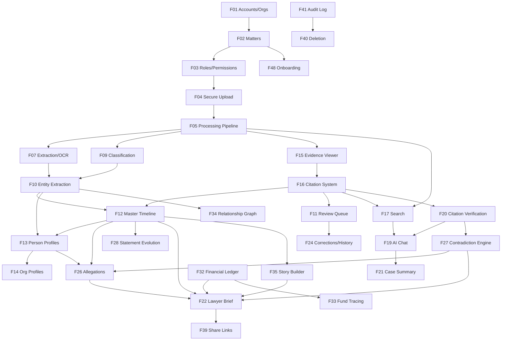

# 04 — Feature Specification

Every feature carries a stable ID (`F-nn`). Other documents reference these IDs. Each feature
states its purpose, the problem it solves, its dependencies, and **testable acceptance
criteria**. "Phase" refers to `19-roadmap.md`.

**Global acceptance criteria apply to every feature** and are stated once in §0.

---

## 0. Global acceptance criteria (apply to every feature)

| ID | Criterion |
|---|---|
| G-01 | Every statement shown to a user is either (a) traceable to a source span in one click, or (b) explicitly labelled with its assertion class and marked unverified. There is no third state. |
| G-02 | Every AI-generated item displays its assertion class badge (`SOURCE EXCERPT`, `EXTRACTED FACT`, `ALLEGATION`, `PARTY POSITION`, `YOUR ACCOUNT`, `AI INFERENCE`, `LEGAL QUESTION`). |
| G-03 | No feature asserts or implies truth, guilt, innocence, credibility, or dishonesty about any person. Copy lint enforces this. |
| G-04 | No feature provides legal advice, legal opinion, or outcome prediction. |
| G-05 | All data access is tenant- and matter-scoped server-side. Client-side filtering is never a security control. |
| G-06 | All destructive actions are reversible except permanent deletion, which requires typed confirmation. |
| G-07 | All user edits autosave within 2s and record an audit entry. |
| G-08 | All AI outputs are versioned with model ID, prompt version, and timestamp, retrievable by a professional user. |
| G-09 | Every screen is usable at WCAG 2.2 AA and at 375px width. |
| G-10 | No feature degrades to a dead end. Every error state names a next action. |
| G-11 | Every feature has an explicit empty state, loading state, error state, and partial-data state. |
| G-12 | Every feature is instrumented: usage, latency, error rate, and (where AI is involved) citation-integrity rate. |

---

## 1. Feature index

| ID | Feature | Module | MVP | Phase | Priority |
|---|---|---|---|---|---|
| F01 | Accounts, sessions, and Organizations | Identity | ✅ | 1 | P0 |
| F02 | Matter (case) creation and settings | Matters | ✅ | 1 | P0 |
| F03 | Roles and permissions | Security | ✅ (basic) | 1 | P0 |
| F04 | Secure document upload | Ingest | ✅ | 2 | P0 |
| F05 | Document processing pipeline | Ingest | ✅ | 2 | P0 |
| F06 | Document library | Documents | ✅ | 2 | P0 |
| F07 | Text extraction and OCR | Ingest | ✅ | 2 | P0 |
| F08 | Duplicate detection and dedup review | Ingest | ✅ | 2 | P1 |
| F09 | Auto-classification of documents | Documents | ✅ | 2 | P1 |
| F10 | Entity extraction (people/organizations) | Entities | ✅ | 4 | P0 |
| F11 | Extraction review queue | Quality | ✅ | 4 | P0 |
| F12 | Master timeline | Timeline | ✅ | 4 | P0 |
| F13 | Person profiles | Entities | ✅ | 4 | P0 |
| F14 | Organization profiles | Entities | ✅ | 4 | P1 |
| F15 | Evidence viewer | Evidence | ✅ | 2 | P0 |
| F16 | Citation system | Evidence | ✅ | 4 | P0 |
| F17 | Search (keyword + semantic + filters) | Search | ✅ | 3 | P0 |
| F18 | Saved views | Search | ✅ | 3 | P2 |
| F19 | Evidence-cited AI chat | AI | ✅ | 5 | P0 |
| F20 | Citation verification agent | AI/Quality | ✅ | 5 | P0 |
| F21 | Case summary generation | AI | ✅ | 5 | P0 |
| F22 | Lawyer Brief generation and export | Reports | ✅ | 8 | P0 |
| F23 | Processing status and transparency panel | Ingest | ✅ | 2 | P0 |
| F24 | User corrections and version history | Quality | ✅ | 4 | P0 |
| F25 | Notes and annotations | Collaboration | ✅ | 2 | P1 |
| F26 | Allegation matrix | Allegations | ❌ | 6 | P0 |
| F27 | Contradiction engine ("Conflicts") | Analysis | ❌ | 6 | P0 |
| F28 | Statement evolution view | Analysis | ❌ | 6 | P0 |
| F29 | Missing-evidence / gap analysis | Analysis | ❌ | 6 | P1 |
| F30 | Communication threading | Communications | ❌ | 6 | P1 |
| F31 | Witness profiles | Entities | ❌ | 6 | P1 |
| F32 | Financial transaction ledger | Finance | ❌ | 6 | P1 |
| F33 | Fund tracing view | Finance | ❌ | 7 | P2 |
| F34 | Entity relationship graph | Graph | ❌ | 7 | P2 |
| F35 | Story builder | Narrative | ❌ | 7 | P0 |
| F36 | Deadlines and important dates | Matters | ❌ | 6 | P1 |
| F37 | Calendared export (.ics) | Reports | ❌ | 6 | P2 |
| F38 | Comments and threads | Collaboration | ❌ | 8 | P2 |
| F39 | Share links for counsel/expert | Collaboration | ✅ (basic) | 8 | P0 |
| F40 | Matter archival and permanent deletion | Lifecycle | ✅ | 1 | P0 |
| F41 | Audit log and audit viewer | Security | ✅ | 1 | P0 |
| F42 | Data export (full matter export) | Lifecycle | ❌ | 9 | P1 |
| F43 | Bundle / disclosure production set | Reports | ❌ | 10 | P3 |
| F44 | Audio and video transcription | Media | ❌ | Later | P3 |
| F45 | Multilingual UI and documents | i18n | ❌ | 9 | P2 |
| F46 | Administration console | Admin | ✅ (basic) | 9 | P1 |
| F47 | Billing and usage metering | Commerce | ❌ | 9 | P1 |
| F48 | Onboarding wizard | Onboarding | ✅ | 1 | P0 |
| F49 | Notifications | Platform | ❌ | 5 | P2 |
| F50 | Matter-level AI provider policy | Security | ✅ | 5 | P1 |

---

## 2. Identity and matters

### F01 — Accounts, sessions, and Organizations

**Purpose.** Authenticate users and group them into Organizations that own Matters.

**Problem.** Legal work is organised by client/matter, and professionals need firm-level
grouping. Consumers need a single simple account that can hold multiple matters.

**Requirements**
- Email + password with strong password policy, or OAuth (Google, Microsoft).
- **MFA**: TOTP from MVP; passkeys/WebAuthn as the preferred method in Phase 9.
- Session: httpOnly, `Secure`, `SameSite=Lax` cookies; short-lived access token + rotating
  refresh token; server-side session revocation.
- An Organization is created implicitly for a consumer on signup; professionals may create
  named organizations and invite members.
- Self-hosted auth backed by our own Postgres. No third-party auth vendor receives case content
  or user email addresses unless explicitly adopted with a reviewed data-processing agreement
  (see `24-architecture-decisions.md` ADR-013).
- Account deletion purges all personal data subject to the retention rules in `13-privacy-and-legal-risks.md`.

**Dependencies.** None.

**Acceptance criteria**
1. Password reset flow does not reveal whether an email is registered.
2. MFA can be enabled, disabled (with re-auth), and has documented recovery codes.
3. Sessions are revocable per device; revoking takes effect within 30 seconds.
4. Repeated failed logins trigger progressive rate limiting and lockout, with the thresholds configurable.
5. OAuth account linking to an existing email requires verification.
6. Auth events are logged to the audit log without recording credentials or tokens.

---

### F02 — Matter (case) creation and settings

**Purpose.** Create and configure a case/matter container.

**Problem.** Users need a container that holds documents, extracted knowledge, and configuration,
and that a lawyer would recognise as "the file."

**Requirements**

Core fields (all optional except title): title, case type, jurisdiction, court, court file
number, current stage, parties, lawyers, important dates, retention policy, confidentiality
posture, AI provider policy.

Case types (consumer-facing plain-English labels in brackets): `criminal` (Criminal matter),
`civil` (Civil claim), `family` (Family matter), `employment` (Employment dispute),
`regulatory` (Regulatory matter), `administrative` (Tribunal / board matter),
`immigration` (Immigration matter), `insurance` (Insurance dispute), `other` (Something else).

- Duplicate-title detection with a warning.
- A matter is never deleted by accident: archiving is the default, deletion is explicit.
- Matter settings include: `retention_policy`, `allow_third_party_ai`, `require_review_before_export`.

**Dependencies.** F01.

**Acceptance criteria**
1. A matter can be created in under 30 seconds with only a title.
2. Case type selection changes default terminology and available modules (e.g. Money is hidden for most family matters unless enabled).
3. All settings changes are audit-logged with previous and new values.
4. A matter's `allow_third_party_ai = false` is enforced server-side; an automated test confirms no AI provider call is made for such a matter.
5. Matter list shows document count, processing status, and last activity.

---

### F03 — Roles and permissions

**Purpose.** Enforce who can see and do what.

**Requirements.** Roles: `owner`, `admin`, `member`, `reviewer`, `viewer`, `external`. Plus
document-level sensitivity: `normal`, `confidential`, `privileged`.

Full matrix in `12-security-architecture.md` §5.

**Dependencies.** F01, F02.

**Acceptance criteria**
1. Permission checks are enforced in the data-access layer, not in route handlers alone.
2. A cross-matter access attempt returns 404 (not 403) for resources in other matters, to avoid existence disclosure.
3. Postgres row-level security is enabled on all tenant-scoped tables, with a test that a raw query without tenant context returns zero rows.
4. Permission changes are audit-logged.
5. `privileged` documents require an explicit role capability to view; access attempts by unauthorised users are logged as security events.

---

### F48 — Onboarding wizard

**Purpose.** Get a non-technical user from signup to first value.

**Problem.** The 10-step workflow in the brief is too long to show at once and will lose users.
We compress it into a linear wizard that defers everything non-essential.

**Requirements.** Five visible steps, with later capability discovered in-product:

1. **What is this case about?** → title + case type (plain English cards).
2. **Who are you in this case?** → self / supporting someone / professional. Sets terminology and defaults.
3. **Add your documents** → upload, or "I'll do this later".
4. **We're reading your documents** → honest live progress, value teaser, optional email notification.
5. **Here's what we found** → top 3 timeline events + people, each with a citation, and a single
   primary action: *Check the timeline*.

Deferred to in-product discovery (never in the wizard): allegations, story builder, brief
generation, witnesses, money, graph.

**Dependencies.** F02, F04, F12.

**Acceptance criteria**
1. Median completion time from signup to step 5 < 4 minutes, excluding document processing wait.
2. Steps 1–2 can be completed on a phone in under 60 seconds.
3. Skipping upload does not block case creation and leaves a persistent, non-nagging entry point.
4. The wizard is resumable after abandonment.
5. Step 5 shows at least one real extracted event with a working citation for any readable dated document; otherwise it shows the honest zero-result state from J1.
6. All copy passes the "no legal jargon" lint against the terminology map in `14-ux-specification.md` §6.

---

### F40 — Matter archival and permanent deletion

**Purpose.** Honor user control over their data.

**Requirements.** As per Journey J13. Two modes: recoverable removal (30 days) and permanent
deletion. Deletion purges objects, text, embeddings, graph edges, caches, chat history, and
share links.

**Dependencies.** F02, F04, F41.

**Acceptance criteria**
1. See J13 acceptance criteria 1–6.
2. A partial deletion job resumes to completion; the receipt reflects final state only.
3. Deletion is blocked while an export or share link is active, with a clear explanation and a one-click revoke.

---

### F41 — Audit log and audit viewer

**Purpose.** Record who did what, when, and provide a defensible trail.

**Requirements.** Append-only, hash-chained (`prev_hash` → `entry_hash`), with a periodic
checkpoint. Records actor, action, target type, target ID, matter, IP, user agent, timestamp,
and a JSON diff where applicable. **Never records document content, extracted text, or query
text containing case content** — records reference IDs only.

Actions logged: auth events, permission changes, document upload/download/view, extraction
review, correction, deletion, export, share-link creation/access/revocation, AI queries
(metadata only), and privacy-sensitive views of privileged documents.

**Dependencies.** F01.

**Acceptance criteria**
1. Any modification or removal of an audit entry breaks the chain and is detectable by a verification job.
2. A verification endpoint reports chain integrity with the first divergent entry ID.
3. Audit entries are written in the same transaction as the action they record, or via a transactional outbox.
4. Owner-role users can review and filter the log; export produces a signed CSV.
5. Audit records contain no case content — asserted by a test with a content-detection scan.
6. Retention of audit metadata is disclosed in the privacy policy and is distinct from matter content retention.

---

## 3. Ingestion and documents

### F04 — Secure document upload

**Purpose.** Get files in safely, from any device, without losing them.

**Requirements**
- Three routes: file picker, folder picker (`webkitdirectory`), ZIP upload.
- **Direct-to-object-storage presigned upload** — files never transit the application server
  (see `12-security-architecture.md` §7).
- Chunked, resumable upload with content-addressed chunk hashes.
- Client computes SHA-256 streaming; server independently computes SHA-256 and compares.
  Mismatch ⇒ reject with a clear error.
- Pre-flight validation: extension allowlist, MIME sniffing, size limits, per-matter quota
  check, filename sanitisation (no path traversal, no control characters, length caps).
- ZIP handling: recursive extraction with **zip-bomb defence** (max depth, max entries, max
  uncompressed size, compression-ratio ceiling), path traversal rejection, and per-entry
  processing.
- Supported at MVP: PDF, DOCX, DOC, TXT, MD, RTF, CSV, XLSX, XLS, PNG, JPG/JPEG, TIFF, HEIC,
  EML, MBOX, MSG, ZIP. Phase 3: PST, WhatsApp export (`.txt` and `.zip`), Telegram JSON.
- Unsupported types are accepted into storage (so nothing is lost) but flagged as unreadable.

**Dependencies.** F02, F03.

**Acceptance criteria**
1. A 500 MB ZIP containing 400 files uploads, extracts, and queues without server memory growth beyond a bounded buffer.
2. A malicious ZIP with `../` entries is rejected and logged; no file is written outside the matter prefix.
3. A ZIP bomb (10 KB expanding to 10 GB) is rejected at the configured ceiling with a clear message.
4. SHA-256 mismatch causes rejection, an audit entry, and a user-visible explanation.
5. Upload resumes correctly after network interruption, verified by an automated interruption test.
6. Files with names containing `..`, `/`, `\`, NUL, or >255 chars are stored safely with the original name preserved as metadata.
7. Duplicate content (same SHA-256 within a matter) is detected and surfaced for dedup review (F08).
8. Upload never modifies file bytes — asserted by comparing hashes before and after the full pipeline.

---

### F05 — Document processing pipeline

**Purpose.** Turn an uploaded file into structured, citable knowledge.

Full specification in `08-document-ingestion.md`.

**Requirements.** A durable, resumable, idempotent, multi-stage job pipeline with explicit
states: `UPLOAD_RECEIVED` → `SCANNING` → `EXTRACTING_TEXT` → `OCR` → `CLASSIFYING` →
`EXTRACTING_ENTITIES` → `EXTRACTING_EVENTS` → `EXTRACTING_FACTS` → `INDEXING` →
`BUILDING_RELATIONSHIPS` → `QUALITY_CHECK` → `READY`, plus `FAILED_*` and `SKIPPED_*` states.

- Every stage is idempotent and re-runnable in isolation.
- Every stage records model ID, prompt version, input hash, and output hash.
- Stages that spend money on inference are guarded against duplicate spend by an
  idempotency key derived from input hash + stage + prompt version.

**Dependencies.** F04.

**Acceptance criteria**
1. A stage retried after a transient failure produces identical output (idempotency test).
2. Killing the worker mid-stage leaves the job in a resumable state; on restart the job completes without duplicate LLM spend (asserted by counting provider calls).
3. Every job has a correlation ID traceable through all logs.
4. A stage that exceeds its timeout is marked `FAILED_TIMEOUT` and is manually retryable.
5. Pipeline completion emits a per-document summary: pages, characters, OCR pages, extracted counts, and confidence distribution.
6. Re-running the whole pipeline for a document produces byte-identical extracted text.

---

### F06 — Document library

**Requirements.** List and grid views; folders (user-created, plus system views); tags;
filtering by type, date range, author, sender, recipient, involved people, involved
organizations, OCR status, processing status, sensitivity, relevance, source, and file size;
sorting; bulk actions; per-document detail panel including metadata, extracted entities, linked
events, and processing history.

**Dependencies.** F05, F16.

**Acceptance criteria**
1. A 2,000-document library renders first page in < 1.5s at p95 (server-side pagination).
2. Every filter is combinable and reflected in the URL (shareable/reloadable view).
3. Document detail shows the true original filename, upload timestamp, uploader, SHA-256, page count, and OCR status.
4. Bulk actions operate on selections across pages and report partial failures per item.
5. Deleted/superseded documents are visible in an archive view, not silently gone.

---

### F07 — Text extraction and OCR

**Requirements.** Per-format extractors; born-digital vs scanned detection; OCR fallback;
per-page confidence; table extraction for financial documents; explicit "unreadable page"
records rather than silent gaps.

Full specification in `08-document-ingestion.md` §4-5.

**Acceptance criteria**
1. Born-digital PDFs never invoke OCR (cost control) — asserted by a test on a text-layer PDF.
2. Every page record stores whether it was OCR'd, the OCR engine and version, and a confidence value.
3. Pages below the confidence threshold are individually flagged in the UI.
4. **Any number-like token sourced from OCR carries an `ocr_derived` flag** and is rendered with an
   "verify this figure" affordance everywhere it appears.
5. Extracted text preserves a stable mapping to page and character offsets, verified by a round-trip test that re-locates a known string.
6. Table extraction output preserves row and column structure, with a per-table confidence.

---

### F08 — Duplicate detection and dedup review

**Requirements.** Exact duplicates by SHA-256. Near-duplicates by MinHash/SimHash similarity
with a threshold. Duplicates are grouped, the canonical item chosen (earliest upload wins by
default, user-overridable), and non-canonical items kept as linked variants — **never deleted**.

**Acceptance criteria**
1. A document repeated 6 times in disclosure appears once in default lists with "5 other copies".
2. Dedup grouping is reversible; splits are audit-logged.
3. Near-duplicate detection does not merge documents whose text differs materially; evaluated against a labelled set.
4. Merging preserves all per-copy metadata (which production batch it came from).

---

### F09 — Auto-classification of documents

**Requirements.** Classify into a controlled taxonomy: `pleading`, `affidavit`, `witness_statement`,
`police_record`, `court_order`, `endorsement`, `correspondence`, `email`, `chat_export`,
`bank_statement`, `invoice`, `receipt`, `contract`, `expert_report`, `medical_record`,
`financial_statement`, `corporate_record`, `regulatory_record`, `photograph`, `other`,
`unclassified`.

Single-label primary type plus multi-label secondary tags. Confidence per label. Low-confidence
items go to the review queue.

**Acceptance criteria**
1. Classification accuracy ≥ 85% on the labelled evaluation set in `sample-case/` and the extended eval set (see `17-ai-evaluation-framework.md`).
2. Every classification shows confidence and is user-correctable.
3. Classification drives downstream prompts (a bank statement and an affidavit get different extraction schemas).
4. `unclassified` documents are visibly grouped for user attention, not hidden.

---

### F23 — Processing status and transparency panel

**Requirements.** Live per-file and per-stage status; aggregate progress; honest ETA as a range;
per-file error detail with the reason; a "what we couldn't do" panel; manual retry per file and
per stage; a downloadable processing report.

**Acceptance criteria**
1. Status updates arrive within 5 seconds of a server-side state change (SSE or polling fallback).
2. The ETA range is computed from observed throughput and never narrows falsely; if throughput is unknown, the ETA is omitted rather than guessed.
3. Failures are individually listed with reason codes and a retry action.
4. A completed matter's processing report is exportable and lists every file with its final state.
5. Processing state survives page reload and is visible from the matter dashboard.

---

## 4. Entities and evidence

### F10 — Entity extraction (people and organizations)

**Purpose.** Identify who and what is in the record.

**Requirements.** Extract persons (with aliases), organizations (companies, agencies, banks,
processors, law firms, regulators, employers), roles, and structured identifiers where present
(addresses, account numbers, registration numbers). Every mention carries a source span and a
document.

- **Entity resolution** proposes merges; it must be conservative.
- All merges require confirmation, except exact-string matches within the same document.
- Every entity has: canonical name, aliases, role(s), first/last mention date, mention count,
  and a per-matter stable ID.

**Dependencies.** F05, F07, F09.

**Acceptance criteria**
1. Every extracted mention links to a resolvable source span.
2. Merges are never automatic across documents without user confirmation — asserted by a test that two people with the same name in different documents remain separate until confirmed.
3. Splitting a merged entity restores all original mentions to the correct entity with no loss of links.
4. Role extraction (e.g. "director", "consultant") is stored as a separate, correctable, evidenced assertion — not as a property of the person.
5. The People list shows detected counts and an explicit "possible duplicates" review group.
6. **Distinct-people precision** on the evaluation set ≥ 0.95 (false merges are much worse than false splits).

---

### F11 — Extraction review queue

**Requirements.** As per Journey J3. Grouped queue, keyboard-driven review, four dispositions
(`looks_right`, `corrected`, `removed`, `cant_tell`), batch actions with explicit counts, impact
sorting, resume position, and `review_state` recording (`unreviewed` | `reviewed_adopted` |
`reviewed_corrected` | `reviewed_removed` | `deferred`).

**Dependencies.** F10, F12, F24.

**Acceptance criteria**
1. 100 items reviewable in under 15 minutes by a keyboard-fluent user (measured).
2. Resume position is restored across sessions and devices.
3. `reviewed_adopted` records reviewer identity and timestamp and is immutable without a new audit entry.
4. Batch actions require confirmation showing the exact count and a preview of the first 5 items.
5. Reviewing an item never mutates its source document or extracted text.

---

### F12 — Master timeline

**Purpose.** The product's centrepiece.

**Requirements.** Automatically constructed chronology from all evidence, plus manual events.

Each event: `id`, matter, `date` or `date_range`, `date_precision`
(`exact` | `approximate` | `inferred_range` | `unknown`), title, description, `assertion_class`,
people[], organizations[], documents[], evidence items[], `related_allegations`,
`conflicting_evidence`, confidence, `review_state`, `source_citations[]`, `created_by`
(`ai` | `user`), `derived_from` (which extraction run).

User capabilities: add event · edit event (with date-precision control) · correct AI event ·
merge duplicate events · dispute event · add note · attach supporting evidence · filter by
person / organization / allegation / issue / document / date range / review state.

Two views: **visual timeline** (horizontal, zoomable, grouped by year→month; degradable for
large counts) and **table view** (sortable, filterable, exportable, virtualised).

Automatic de-duplication: near-identical events on the same date from the same document are
merged with a link to all constituent sources rather than duplicated.

**Dependencies.** F05, F10, F16, F24.

**Acceptance criteria**
1. Every AI-generated event has ≥ 1 source citation or is displayed as an unsupported draft that cannot be promoted to an established fact — enforced by a test.
2. Approximate dates are visually distinct from exact dates in both views, and export states the precision explicitly.
3. Merging events preserves all source citations from every merged event.
4. Manual events are marked `created_by = user` and render distinctly; exports preserve that distinction.
5. Filtering by person returns every event in which that person is a detected participant.
6. Table view supports 5,000+ events with virtualised scrolling at ≥ 50fps.
7. Every edit creates a new version; prior versions are retrievable.
8. Timeline export to CSV/ICS carries citation columns.
9. Disputed events remain visible but are styled and counted separately; they are excluded from the Lawyer Brief by default.

---

### F13 — Person profiles

**Requirements.** For each person: name, aliases, roles (as evidenced assertions), relationship
to the case, organizations, allegations involving them, statements made by them (with sources),
documents in which they appear, timeline events, communications, financial transactions,
flagged conflicts, related people, and a coverage/uncertainty summary.

**Dependencies.** F10, F12, F16.

**Acceptance criteria**
1. "Statements made by them" lists only statements where the person is the speaker or author, each with a citation.
2. Role claims display as separate evidenced assertions with their own sources and confidence.
3. The profile distinguishes clearly between things the person is *alleged* to have done and things the record establishes.
4. Related-people links show the relationship type, the supporting evidence, and a citation.
5. A person profile for a person mentioned only once still renders correctly (no empty-state crash).

---

### F14 — Organization profiles

Same structure as F13, plus: corporate identifiers, registration numbers, addresses,
associated accounts, and directors/officers where evidenced.

**Acceptance criteria** as F13, plus: organization-to-person role links are evidenced assertions
(`director of`, `consultant to`, `employee of`) with sources, never inferred from co-occurrence
alone.

---

### F15 — Evidence viewer

**Purpose.** Answer "show me the actual document" in one click, from anywhere.

**Requirements.** A split-pane viewer opened from any citation, with:
- Left: source preview (PDF page render / image / text) with the cited span highlighted.
- Right: citation metadata — document name, type, date, author/sender/recipient, page, paragraph,
  extraction run, model and prompt version (professional users), confidence, OCR flag, hash.
- Actions: open full document · copy citation · add note · flag as misattributed · download original.
- Keyboard: `Esc` closes and returns focus to the triggering element.
- Deep-linkable: a citation has a stable URL.

**Dependencies.** F16, F07.

**Acceptance criteria**
1. Opening a citation takes < 1.5s at p95 and highlights the correct span.
2. The highlighted span matches the stored quote; if it does not match the current extracted text, the viewer shows a "source text changed or does not match" warning rather than silently highlighting the wrong area.
3. Rendering is available for PDF, images, and plain text at MVP; Office formats show extracted text with a "open original" download.
4. Every viewer action is audit-logged where it involves a privileged document.
5. Works at 375px width with a stacked layout.

---

### F16 — Citation system

**Purpose.** The mechanical guarantee behind the product's core promise.

**Requirements.** A `Citation` record binds an assertion to a precise source location:
`document_id`, `page_number`, `char_start`, `char_end`, `paragraph_ref`, `quoted_text`,
`quote_hash`, `verification_status` (`verified` | `quote_mismatch` | `unsupported` |
`unverifiable`), `verified_at`, `verifier_version`.

Rules:
- **An assertion with no citation is never rendered as established content.** The renderer
  enforces this structurally: a "fact component" requires a citation prop, and the component
  refuses to render claim text without one.
- Citations are verified by exact/normalised quote matching against stored extracted text.
- A `quote_mismatch` citation is never shown as a citation; the assertion is downgraded to
  unsupported and hidden behind a disclosure.
- Citations survive export as anchors.

**Acceptance criteria**
1. A unit test asserts that the claim-rendering component throws if given a claim with no citation.
2. Quote matching tolerates whitespace, smart quotes, hyphenation, and line-break differences, but not wording differences. Normalisation rules are enumerated in `09-evidence-provenance.md` §6.
3. Deleting a document marks dependent citations `unresolvable` and shows "source deleted" rather than a broken link, and the dependent assertions are visually downgraded.
4. Every citation resolves to a stable deep link.
5. Citation verification runs on every generated assertion before display, and the verification result is stored.

---

### F24 — User corrections and version history

**Requirements.** Every AI extraction is correctable. Corrections are additive: the original is
preserved in an immutable `ai_extractions` record; the correction lives in a separate
`user_corrections` record with actor, timestamp, optional reason, and evidence links. Effective
values are computed. All versions retrievable.

Applies to: events, entities, roles, classifications, amounts, allegations, relationships,
summaries, and narrative text.

**Dependencies.** F41.

**Acceptance criteria**
1. Writing a correction never mutates the original AI row — asserted at the database level.
2. `Original value` is always visible in the UI next to the current value for corrected items.
3. Reverting restores the previous effective value and creates a new audit entry.
4. Version history is exportable.
5. Corrections propagate to dependent views (timeline, profiles, brief) within 5 seconds.

---

### F25 — Notes and annotations

**Requirements.** Notes on matters, documents, pages, events, entities, allegations, and
transactions. Notes support markdown, mentions of case entities, and attachments (internal
only). Notes carry an author and timestamp. Notes can be private or matter-visible.

**Acceptance criteria**
1. A note attached to a page range re-anchors or degrades gracefully if the document's text is reprocessed.
2. Notes are included in the full matter export (F42) and optionally in the Lawyer Brief.
3. Private notes never appear in exports or share links.
4. Notes are searchable (F17).

---

## 5. Search

### F17 — Search

**Requirements.** Hybrid retrieval: PostgreSQL full-text (`tsvector`, with a legal-aware
dictionary for common abbreviations) + vector similarity (`pgvector`) + structured filters,
fused with Reciprocal Rank Fusion, then reranked.

Filter dimensions: date range, document type, person, organization, author/sender/recipient,
amount range, account, allegation, witness, assertion class, sensitivity, OCR status, review
state, and file metadata.

Results show: document, page, highlighted snippet, match reason, and a citation chip. Result
groups: documents, events, people, transactions, statements, notes.

Query syntax: quoted phrases, `AND`/`OR`/`NOT`, field prefixes (`person:`, `org:`, `date:`,
`amount:`, `type:`), and natural-language queries routed to the AI assistant (F19) when the
intent is a question rather than a lookup.

**Dependencies.** F05, F07, F10.

**Acceptance criteria**
1. Keyword search over 2,000 documents returns first results in < 800ms at p95.
2. Semantic search returns results for a paraphrased query that shares no keywords with the source.
3. Hybrid search outperforms either pure mode on the retrieval evaluation set (`17-ai-evaluation-framework.md` §5) — measured, not assumed.
4. Every result shows a highlighted snippet with the matched text and a clickable citation.
5. Filters compose and are reflected in the URL.
6. Search respects permissions: a user never sees a snippet from a document they cannot view, and the result count does not leak its existence.
7. Search over an empty matter returns a helpful empty state, not an error.

---

### F18 — Saved views

**Requirements.** Save any filter/search combination with a name; re-openable; pinnable to the
matter dashboard; shareable within the matter.

**Acceptance criteria.** Re-opening restores the exact query and filters; a saved view with a
deleted document filter still loads; saved views are included in matter export.

---

## 6. AI

### F19 — Evidence-cited AI chat

**Requirements.** As per Journey J4. The chat is a *case-scoped research assistant*, not a
general chatbot.

Full pipeline in `07-ai-architecture.md`.

Hard requirements:
- Retrieval precedes generation; no parametric answering.
- The model may cite only from the provided evidence bundle, by citation index.
- Every factual assertion carries ≥ 1 citation or is suppressed.
- Legal-advice requests are refused with a specific template.
- Answers are structured by intent (list, timeline, amount, comparison, explanation, abstain).
- Every answer is saved in history with its citations intact.
- Users can save an answer to notes, add to the brief, or flag it as wrong.

**Dependencies.** F17, F16, F20, F50.

**Acceptance criteria**
1. Zero assertions displayed without a verified citation (unsupported-assertion escape rate = 0) — continuous test.
2. Abstention is returned when no retrieved span supports the query; measured on an abstention eval set with a target of ≥ 90% correct abstentions.
3. Adversarial legal-advice prompt set (≥ 30 prompts) produces 100% refusal-with-redirect.
4. Citation integrity rate ≥ 99.5% on the evaluation set.
5. Every answer's citations remain resolvable; deleted-source answers show a downgraded state.
6. First token < 3s p50; completion < 20s p95.
7. Cost per answer is metered and bounded per matter by a configured ceiling.

---

### F20 — Citation verification agent

**Purpose.** Independently check that each cited span actually supports the assertion it is
attached to. This is the product's integrity backstop.

**Requirements.** Runs on every generated assertion in chat, summaries, contradictions,
allegations, and the Lawyer Brief. Two-tier:
- **Tier 1 (deterministic):** exact/normalised quote match against stored extracted text. Cheap, always runs, catches fabrication and misattribution.
- **Tier 2 (model-based):** an entailment judgement of the claim against the retrieved span, run on a **different model from the generator where available**. Catches the subtler failure where the quote is real but does not support the claim.

Outcomes: `supported`, `partially_supported`, `not_supported`, `contradicts`. `not_supported`
and `contradicts` suppress the assertion from established content.

**Dependencies.** F16.

**Acceptance criteria**
1. Tier 1 runs synchronously and adds < 200ms p95.
2. Tier 2 runs before an assertion is rendered as established; measured latency budget stated in `07-ai-architecture.md` §7.
3. A deliberately fabricated citation is caught by Tier 1 in 100% of a 100-case test set.
4. A real quote that does not support its claim is caught by Tier 2 in ≥ 95% of the labelled adversarial set.
5. Verification results are stored with verifier model and version.
6. Disagreement between generator and verifier is logged for evaluation; a sampled set is human-reviewed weekly.

---

### F21 — Case summary generation

**Requirements.** Generate a short case summary (6–10 sentences) and a longer case narrative,
each sentence individually citable, with assertion classes preserved.

**Acceptance criteria**
1. Every sentence renders with a citation or an explicit `ALLEGATION` / `YOUR ACCOUNT` badge.
2. Summaries regenerate on demand and on significant new evidence; regeneration is versioned, and the previous version remains retrievable.
3. The summary never states a contested proposition as established; a test set of contested propositions produces "disputed" framing.
4. Summary length is bounded and configurable; the system refuses to pad.
5. Professional users can see which source documents contributed to each sentence.

---

### F50 — Matter-level AI provider policy

**Requirements.** Per matter, control: whether third-party AI providers may process content at
all; which providers; whether strict no-retention mode is required; and whether a
locally-hosted/self-hosted model is preferred for a given sensitivity level.

**Acceptance criteria**
1. The policy is enforced server-side at the provider-client layer with a test asserting no call is made when disallowed.
2. Documents marked `privileged` follow a separate, stricter policy than `normal` documents.
3. Policy changes are audit-logged and take effect immediately for new jobs, without affecting in-flight jobs (which are pinned to the policy at start).
4. The UI states plainly which provider processed a given document (professional users).

---

## 7. Analysis modules

### F26 — Allegation matrix

**Requirements.** As per Journey J6. Fields: allegation text (with source), alleged_by,
date_first_alleged, supporting_evidence[], contradicting_evidence[], undisputed_facts[],
missing_evidence[], related_witnesses[], related_events[], status, notes, review state, and
`added_to_brief` flag.

Statuses: `alleged` · `partially_supported` · `disputed` · `unsupported_in_uploaded_evidence` ·
`unresolved`.

Status computation is deterministic, rule-based, and documented — see `09-evidence-provenance.md` §8.

**Dependencies.** F12, F13, F16, F27.

**Acceptance criteria**
1. Copy lint forbids truth/credibility assertions throughout the module.
2. Status derivation is a pure function covered by unit tests with a truth table.
3. Every evidence item links to a source span and displays its assertion class.
4. Allegations are always attributable: an allegation with no identified author is labelled `source not identified`, never presented unattributed.
5. A user can add an allegation manually; it is marked `created_by = user` and renders distinctly.
6. No module output uses the words *proved, established that he, guilty, innocent, credible, lied*.

---

### F27 — Contradiction engine ("Conflicts")

**Requirements.** Detect *potential* inconsistencies between statements. Two detection modes:
- **Pairwise statement comparison** within a person's statements (and cross-person where relevant).
- **Statement-versus-record comparison** (a claim contradicted by an independent document).

Each finding: statement A (source, date, quote, speaker), statement B, a neutral description of
the apparent inconsistency, candidate explanations (explicitly non-exhaustive), confidence,
subject area (timing, amount, presence, knowledge, ownership, sequence), and evidence links.

User dispositions: `important` · `explained` · `not_actually_contradictory` ·
`requires_investigation` · `send_to_lawyer`.

Copy rules: only "these statements appear inconsistent", "the accounts differ as to X".
**Never** credibility language.

**Dependencies.** F10, F12, F16, F20.

**Acceptance criteria**
1. Copy lint over the module's entire string table fails the build on credibility vocabulary.
2. Every finding shows both quotes with resolvable citations, or is suppressed.
3. Precision ≥ 0.70 on the labelled evaluation set; recall reported but not optimised at the cost of precision.
4. Every finding lists at least two plausible non-culpable explanations where such explanations exist in the record; if none are identified, the UI says so explicitly rather than implying bad faith.
5. Dispositions are recorded, reversible, and included in the audit log.
6. A finding where one source has been deleted is marked unresolvable and removed from active counts.
7. Findings are never auto-added to the Lawyer Brief; user action is required.

---

### F28 — Statement evolution view

**Requirements.** For a given person, a chronological vertical view of every statement
attributed to them, with source, date, forum (interview, affidavit, examination, email, text),
and the statement text. Material differences between consecutive statements are highlighted
with a neutral label. A "what changed" summary is generated but is explicitly labelled
`AI INFERENCE`.

**Acceptance criteria**
1. Statements are strictly ordered by date with the source date shown, not the extraction date.
2. A statement with an unknown date is grouped separately rather than guessed into place.
3. Material-difference highlighting is conservative; cosmetic differences are not highlighted (evaluated on the labelled set).
4. Undated statements and statements whose speaker attribution is uncertain are flagged as such.
5. Links from a highlight jump to the exact span in both statements.

---

### F29 — Missing-evidence / gap analysis

**Requirements.** For an allegation or event, identify categories of evidence that would be
expected and are absent from the uploaded record (e.g. no bank statement covering a period, no
witness for a disputed meeting, no document referenced but not produced). All suggestions are
labelled `AI INFERENCE` and framed as questions, never assertions about what a party failed to do.

**Acceptance criteria**
1. Suggestions are phrased as questions for investigation, never as conclusions.
2. Referenced-but-not-present documents are detected from explicit cross-references in the record (e.g. "as per the email of 3 June") and listed.
3. Every gap is user-editable, dismissible, and markable as resolved.
4. No gap statement implies that a party withheld evidence — asserted by copy lint.

---

### F30 — Communication threading

**Requirements.** Parse email (EML, MBOX, MSG) and chat exports (WhatsApp `.txt`/`.zip`,
Telegram JSON) into conversation threads with participants, timestamps, and messages.
Detect: participants, topics, referenced people, referenced documents, referenced amounts, and
referenced dates. Render threads chronologically with attachments linked to their parent message.

**Acceptance criteria**
1. Thread reconstruction groups replies correctly for quoted-reply email; evaluated on a labelled thread set.
2. Quoted text in replies is de-duplicated from the message body so the same sentence is not treated as two statements.
3. Participant identity is resolved to case entities with confirmation before merge.
4. Attachments are linked to their message and inherit its date and participants.
5. Undated or partially-corrupt exports are imported with explicit per-message warnings.
6. WhatsApp media references that are not present are listed as missing rather than silently dropped.

---

### F31 — Witness profiles

**Requirements.** Extends F13 for people classified as witnesses: all statements with forum and
date, interview records, affidavits, examination transcripts, emails, texts, a personal
timeline, allegations they are associated with, conflicts involving them, change-in-story view
(F28), documents corroborating their account, documents conflicting with their account, and
their relationship to parties.

**Acceptance criteria**
1. Corroborating and conflicting document lists are evidence-linked and never assert that the witness is or is not telling the truth.
2. The "changes in their story" surface is F28 and inherits its copy constraints.
3. A witness with a single statement renders an honest sparse profile.
4. Witness classification is user-overridable.

---

### F32 — Financial transaction ledger

**Requirements.** Extract transactions from bank statements, exports, spreadsheets, invoices,
and payment records into a ledger: `date`, `value_date`, `sender`, `recipient`, `amount` (decimal),
`currency`, `account_ref`, `transaction_type`, `description`, `source_citation`, `linked_people[]`,
`linked_organizations[]`, `linked_allegations[]`, `ocr_derived`, `confidence`, `review_state`.

Supporting requirements:
- **Decimal arithmetic only.** Amounts stored as `numeric(20,4)` with an explicit currency code. No floating point anywhere in the pipeline or the UI.
- Duplicate transaction detection across overlapping statements (the same transaction appearing in two statements or in a rolled-up total).
- Balance verification: where a statement includes a running balance, the system validates extracted rows against the balance arithmetic and flags rows that break it. **This is the strongest available signal that OCR misread a figure.**
- Aggregations always show their constituent rows and count.

**Acceptance criteria**
1. `numeric` type asserted by a schema test; no `float`/`double` column exists for money.
2. Duplicate-transaction detection prevents double-counting in totals, verified on statements with overlapping periods.
3. A deliberately OCR-corrupted amount ("1,500.00" misread as "7,500.00") is caught by balance-arithmetic checking and flagged with high visibility on the labelled test set.
4. Every row has a source citation or lives in a separate "unverified extraction" list.
5. Totals display the row count and are recomputable; a displayed total never includes rows the user cannot see.
6. Currency mixing is prevented in aggregates, or shown explicitly as unconverted with a warning. **No implicit FX conversion.**
7. No row is ever labelled fraudulent, suspicious, or legitimate.

---

### F33 — Fund tracing view

**Requirements.** Build a directed flow graph from transactions: nodes are accounts/people/orgs,
edges are transactions with amount and date. Users select a starting transaction and trace
forward and/or backward. Each hop displays its supporting transaction and citation. Traces are
saveable, reproducible, and exportable with full provenance.

**Acceptance criteria**
1. A trace renders every hop with a citation linking to the source line.
2. Saved traces re-render identically from stored links after reprocessing.
3. Amounts along a path are summed **without** implying they are the same money; the UI states explicitly that sequential transfers do not establish that funds are identical.
4. Loops, splits, and merges are handled and displayed without infinite recursion (depth and node caps with a "showing partial graph" notice).
5. Rendering remains usable at 500 nodes / 1,000 edges; beyond that, aggregation is applied.

---

### F34 — Entity relationship graph

**Requirements.** Interactive node-link graph. Node types: person, organization, account,
transaction cluster, document, event, court case, regulator, law firm. Edge types: `owns`,
`transferred_funds_to`, `communicated_with`, `works_for`, `director_of`, `represented_by`,
`accused_by`, `mentioned_in`, `signed`, `received_from`, `controls`, `related_to`.

**Every edge has evidence.** Clicking an edge reveals supporting sources with citations and
assertion class. Edges with no evidence are not rendered as edges; they appear as
`suggested relationships` requiring confirmation.

**Acceptance criteria**
1. Clicking any edge shows ≥ 1 supporting source with a resolvable citation, and the assertion class of the relationship.
2. Unsupported inferred relationships are visually distinct and marked `AI INFERENCE — not established`.
3. Graph is explorable: expand/collapse by node, filter by edge type and date range, focus mode.
4. Performance: 300 nodes / 800 edges at ≥ 40fps; beyond the configured cap, the graph aggregates and offers a table view.
5. Every node links to its profile.
6. The graph has an accessible fallback: a keyboard-navigable list/table representation of the same data (WCAG 2.2 AA requirement, not optional).
7. Node positions are deterministic for a given data set so a shared screenshot is reproducible.

---

## 8. Narrative, reports, and collaboration

### F35 — Story builder

**Requirements.** As per Journey J9. A guided interview that converts plain-language answers
into a structured, editable, evidence-linked narrative, in the user's own words.

Question set is adaptive but bounded (9 core questions plus follow-ups). Every answer is stored
as `USER_STATEMENT`. Narrative generation may use only user answers plus cited evidence.
Insertions from evidence are visually distinct and cited. Full version history; a locked final
version.

**Dependencies.** F12, F16, F24.

**Acceptance criteria**
1. Every narrative sentence is attributable to a user answer or a citation — enforced by a test over generated narratives.
2. The "light touch" default preserves the user's wording; a diff test asserts that ≤ 10% of the user's distinctive tokens are altered in light-touch mode.
3. The system never inserts a fact the user did not state unless it is cited and visually marked.
4. Contradictions between answers are surfaced neutrally ("Earlier you said X — is this different?"), never auto-corrected.
5. The locked version is immutable; forking creates a new draft with a link to the parent.
6. Narrative sections map to Lawyer Brief sections.

---

### F22 — Lawyer Brief generation and export

**Requirements.** The 14-section brief defined in Journey J5 (`03-user-journeys.md`) and
`14-ux-specification.md` §W16:

1. Case Summary · 2. Parties · 3. Procedural History · 4. Key Allegations ·
5. Client's Position · 6. Master Timeline · 7. Important Evidence ·
8. Contradictory Evidence · 9. Witness Issues · 10. Financial Evidence ·
11. Missing Evidence · 12. Questions Requiring Investigation ·
13. Upcoming Deadlines · 14. Document Index

Plus: a legend explaining assertion classes; per-page footer ("Prepared by [user] with AI
assistance for discussion with counsel. Not legal advice. Not for filing."); cross-reference
numbering; a verification gate; export to PDF, DOCX, and print-optimised HTML; a
read-only expiring share link.

**Dependencies.** F12, F13, F16, F26, F27, F32, F39.

**Acceptance criteria**
1. Every statement in the brief carries a citation or an explicit assertion class.
2. Unreviewed AI statements are marked `UNVERIFIED — AI SUGGESTED` and counted in a
   verification summary on the cover page.
3. Privileged/sensitive documents are excluded by default and the exclusion is stated in the brief.
4. PDF and DOCX both render correctly with a table of contents, page numbers, citation anchors, and the legend; verified by a rendering snapshot test.
5. Generation completes in < 60s for a 2,000-document matter; if it exceeds the limit, it runs as a background job with notification.
6. The brief never contains the words *guilty, innocent, lied, proved* about any person — copy lint.
7. Every page carries the disclaimer footer.
8. The share link is scoped to one brief version, expiring (max 30 days), revocable, and access-logged.
9. Concise and full modes produce measurably different lengths with the same citation density.

---

### F39 — Share links for counsel and experts

**Requirements.** Create a scoped, expiring, revocable, optionally passcode-protected read-only
link to a brief, a document set, or a filtered view. Access is logged. Links can be restricted
to specific documents, so a link cannot be used to enumerate the matter.

**Acceptance criteria**
1. A link grants access only to its scoped content; enumeration attempts return 404.
2. Expiry and revocation take effect immediately (server-side check on every request).
3. Access is logged with IP and user agent.
4. Links are excluded from matter export for security, but their existence and metadata are listed.
5. Revoking a link invalidates any cached or in-flight download via short-lived signed URLs (≤ 5 minutes).

---

### F38 — Comments and threads

**Requirements.** Comment on events, allegations, people, documents, pages, transactions, and
brief sections. Threaded replies, mentions, resolve/unresolve, and private vs matter-visible
scoping.

**Acceptance criteria.** Comments are permission-scoped; private comments never leak into exports
or share links; resolving preserves history; mentions notify appropriately (F49).

---

## 9. Lifecycle, admin, and commerce

### F36 — Deadlines and important dates

**Requirements.** Record court dates, filing deadlines, limitation dates, and other important
dates, with source (document citation or manual entry), reminder configuration, and an
"upcoming" panel on the dashboard. **The system does not compute legal deadlines** — it records
dates found in documents and dates the user enters, and it says so.

**Acceptance criteria**
1. Every deadline shows its source: a citation, or "entered by you".
2. No deadline is ever calculated from a rule; no copy implies the system knows a filing rule.
3. Deadlines detected from documents are presented as `AI EXTRACTED — verify this date`.
4. Reminders are configurable and delivered per notification policy.
5. Missed deadlines are not silently dropped; overdue items remain visible until dismissed.

---

### F37 — Calendared export (.ics)

**Acceptance criteria.** ICS export validates against RFC 5545; timezone handling is explicit;
exported events carry the source citation in the description; a re-export does not duplicate
events in a calendar that supports UID matching.

---

### F42 — Full matter export

**Requirements.** A complete, self-contained export of a matter: documents with their hashes and
metadata, extracted text, entities, events, citations, notes, corrections, audit metadata, and a
manifest. Designed for portability and for a user leaving the platform.

**Acceptance criteria**
1. The export is a documented, versioned format with a manifest and schema.
2. All provenance is preserved: every assertion in the export carries its citation.
3. The export verifies against stored hashes; a verification report is included.
4. Export runs as a background job with progress and produces a signed download link.
5. Export excludes share links and credentials (which cannot be meaningfully transferred).

---

### F43 — Bundle / disclosure-production set

**Requirements.** Create a defined set of documents with sequential numbering, an index, and
optional redaction notes, for sharing a production set. (Not an e-discovery production tool with
Bates stamping across millions of pages.)

**Acceptance criteria.** Sequential numbering is stable and reproducible; the index carries
provenance; a bundle can be regenerated identically from a saved definition.

---

### F46 — Administration console

**Requirements.** Org-level: members and roles, invitation management, matter inventory, usage
and cost dashboard, AI provider policy defaults, retention policy defaults, security settings
(MFA enforcement, session policy), audit log viewer, and support access controls.

**Acceptance criteria.** Only `owner`/`admin` roles access it; all admin actions are
audit-logged; support impersonation (if ever built) requires explicit user consent, is
time-boxed, is visibly indicated to the user, and is logged.

---

### F47 — Billing and usage metering

**Requirements.** Meter: documents processed, pages OCR'd, AI queries, AI tokens by model,
storage GB-months, exports, and seats. Enforce plan limits before work begins, with clear
pre-work warnings. No mid-job hard failures from a quota.

**Acceptance criteria**
1. Every metered event is recorded idempotently; a retry does not double-charge.
2. A user can see their current usage and projected overage before starting a large upload.
3. Quota enforcement is checked at upload start and before each expensive stage.
4. Billing events reconcile against provider invoices with a documented variance tolerance.

---

### F44 — Audio and video transcription

Deferred to "Later / experimental". Specified in outline only: transcription with speaker
diarisation, timestamped segments as citable spans, and the same provenance model applied to
transcript segments. Requires a separate privacy review before build because audio of third
parties raises consent issues distinct from documents.

---

### F45 — Multilingual UI and documents

**Requirements.** UI localisation framework from the start (never hard-coded English strings).
Document language detection, with extraction quality reported per language. Priority languages
following user geography.

**Acceptance criteria.** No user-facing string is hard-coded; a pseudo-localisation build
catches layout breakage; extraction quality is reported per language rather than averaged.

---

### F49 — Notifications

**Requirements.** Processing complete, processing failed, share-link accessed, deadline
approaching, comment mention, and export ready. Channel: in-app, email. Granular per-user
preferences. **Notification bodies never contain case content by default** — a legal matter's
subject line is itself sensitive.

**Acceptance criteria.** Content-free by default; preferences respected; unsubscribe works;
no notification reveals case content in a subject line or push payload.

---

## 10. Feature dependency graph

---

## Related documents

- `05-mvp-scope.md` — which of these ship first
- `09-evidence-provenance.md` — the semantics behind F16, F24, F26
- `14-ux-specification.md` and `wireframes/` — screens implementing these features
- `16-testing-strategy.md` — how acceptance criteria become tests
- `19-roadmap.md` — phasing
- `epics/` — engineering task breakdown
