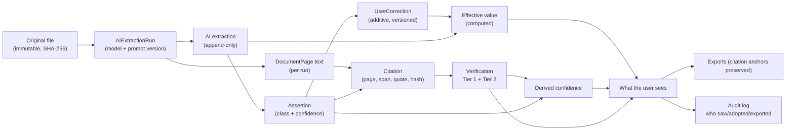
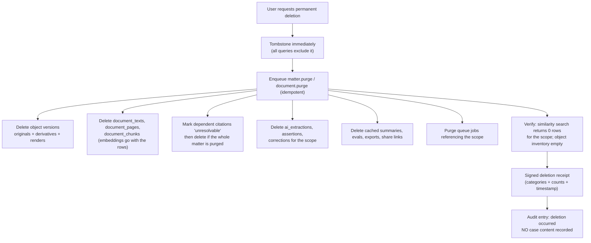

# 09 — Evidence Provenance

This document specifies the mechanism behind Case IQ's central promise:

> **Every significant statement the system shows a user is traceable to the exact place in the
> uploaded evidence that supports it — or it is not shown as a statement of fact at all.**

Everything here is a *requirement*, not a convention. Where a rule can be enforced by the
database or the type system, it must be, because conventions decay and constraints do not.

---

## 1. The seven assertion classes

The canonical enumeration. This is the vocabulary the entire product speaks.

| Class | User-facing label | Definition | Requires citation? | Requires confidence? |
|---|---|---|---|---|
| `SOURCE_EXCERPT` | **From the document** | Verbatim text from a source, unmodified. | **Yes** (itself is the quote) | No (it is the source) |
| `EXTRACTED_FACT` | **Found in your documents** | A normalised factual statement drawn from a source span. | **Yes** | Yes |
| `ALLEGATION` | **Alleged by a party** | A claim made by a party in the proceeding. | **Yes** (the pleading/statement) | Yes |
| `PARTY_POSITION` | **A party's position** | A party's characterisation, denial, or admission. | **Yes** | Yes |
| `USER_STATEMENT` | **Your account** | The account given by our user. Not evidence unless independently supported. | **No** (but must be labelled as the user's own account) | No |
| `AI_INFERENCE` | **AI observation** | A conclusion the system derived from multiple pieces of evidence. | **Yes** (≥ 1 supporting citation; ≥ 2 for a cross-document inference) | Yes |
| `LEGAL_INTERPRETATION` | **A legal question** | Requires professional legal judgement. Never resolved by the system. | **No** | No |

### 1.1 Why these seven, and not more or fewer

- **`SOURCE_EXCERPT` vs `EXTRACTED_FACT`** — the difference between *what the page says* and
  *our reading of it*. Collapsing them is how a paraphrase becomes a quotation.
- **`ALLEGATION` vs `PARTY_POSITION`** — the difference between *what is claimed* and *what a
  party says about a claim*. A denial is not an allegation, and treating them the same produces
  nonsense in the brief.
- **`USER_STATEMENT`** — must be distinguishable from evidence in every export. A user's account
  is not proof, and a lawyer must be able to tell instantly which is which.
- **`AI_INFERENCE`** — our own conclusions, always visibly ours.
- **`LEGAL_INTERPRETATION`** — the boundary of the product. It exists so that the system has a
  place to *put* a legal question instead of answering it.
- **Merged deliberately:** the brief's five conceptual layers ("what the record says / what a
  party alleges / what the user claims / what the AI infers / what remains unknown") map onto
  these seven. Seven is the implementation enumeration; five is the story we tell users
  (`01-product-vision.md` §4).

### 1.2 Prohibited class transitions

| From | To | Permitted? | Note |
|---|---|---|---|
| `ALLEGATION` | `EXTRACTED_FACT` | **NEVER** | The single most damaging error. A pleading is not a finding. |
| `PARTY_POSITION` | `EXTRACTED_FACT` | **NEVER** | |
| `USER_STATEMENT` | `EXTRACTED_FACT` | **NEVER** automatically. Only by explicit user action creating a *new* `EXTRACTED_FACT` assertion that references independent evidence. |
| `SOURCE_EXCERPT` | `EXTRACTED_FACT` | Permitted via an explicit, evidenced derivation | The quote stays; the derived fact is a separate assertion citing it |
| `AI_INFERENCE` | `EXTRACTED_FACT` | **NEVER** | An inference can only be promoted by a human, by creating a new assertion attributed to that human |
| `LEGAL_INTERPRETATION` | anything | **NEVER** | |

**Enforcement:** class is immutable on a row. A "promotion" is always the creation of a new
assertion with its own class, its own authorship, and its own citation set. The original remains.

---

## 2. Confidence

### 2.1 The four levels

An **ordinal** scale. Deliberately not a probability.

| Level | User-facing label | Definition | Typical trigger |
|---|---|---|---|
| `HIGH` | **Stated directly in a document** | The fact appears explicitly in primary evidence, in unambiguous terms, and verification passed. | An explicit dated statement in a document |
| `MEDIUM` | **Supported by the records** | Supported by one or more records, but requires a small interpretive step, or the record is indirect. | A date inferred from context; a role inferred from an email signature |
| `LOW` | **Possible — worth checking** | A plausible reading of the evidence that requires confirmation. Includes OCR-derived content and ambiguous dates. | An entity match on a common name; a figure read from a poor scan |
| `UNKNOWN` | **Not established** | Insufficient evidence, or the system could not determine. **Not a failure.** | No supporting span; contradictory evidence of equal weight |

### 2.2 Deterministic derivation rules

Confidence **must be computed by rule, not self-reported by the model.** A model's stated
confidence is not calibrated and must not be displayed as though it were.

The model may emit a *signal* (`stated_explicitly` | `inferred` | `ambiguous`), which is one
input to the rule. The final level is computed:

```
computeConfidence(assertion):
  # Hard downgrades — any of these cap the level
  if citation.verification_status != 'verified':          return UNKNOWN   # never rendered as fact
  if citation_count == 0:                                  return UNKNOWN
  if assertion_class == 'LEGAL_INTERPRETATION':            return UNKNOWN
  if model_signal == 'ambiguous':                          cap at MEDIUM
  if source.ocr_derived and source.ocr_confidence < 0.85:  cap at LOW
  if source.ocr_derived and token_is_numeric:              cap at LOW
  if date_precision in ('approximate','inferred_range'):   cap at MEDIUM
  if date_precision == 'unknown':                          cap at LOW
  if entity_match_basis == 'name_similarity':              cap at LOW
  if assertion_class == 'AI_INFERENCE':                    cap at MEDIUM
  if contradicts_other_verified_evidence:                  cap at LOW

  # Base level
  base = HIGH   if (model_signal == 'stated_explicitly' and single_source_direct)
         MEDIUM if (model_signal in ('stated_explicitly','inferred') and supported)
         LOW    if model_signal == 'ambiguous'
         UNKNOWN otherwise

  # Elevation: corroboration across independent documents
  if independent_source_count >= 2 and base < HIGH:        raise one level

  return min(base, all_applicable_caps)
```

Rules:
1. **Confidence is derived, versioned, and recomputed when its inputs change** (e.g. when a
   citation is re-verified after re-extraction).
2. **The derivation is deterministic and unit-tested** with a truth table covering every cap.
3. **`UNKNOWN` is never rendered as a fact.** An assertion with `UNKNOWN` confidence is either
   suppressed or shown under an explicit "not established" treatment.
4. **Elevation requires *independent* sources.** Two copies of the same document is one source,
   not two — hence the dedup requirement in F08.
5. **The user-facing label is always the phrase, never the enum.** "Stated directly in a document,"
   not "HIGH." Professional users additionally see the raw inputs (per `02-user-personas.md` C.6).

### 2.3 What confidence is not

- **Not a probability.** We do not display "87% confident." There is no defensible calibration
  method for that number, and manufacturing precision would be dishonest.
- **Not a measure of legal strength.** "Stated directly in a document" describes the *evidential
  provenance*, not whether a claim will succeed.
- **Not a credibility assessment.** Confidence attaches to the extraction, never to a person.
- **Not comparable across assertion classes.** A `HIGH` inference is not stronger than a `HIGH`
  fact; that is why class is always displayed alongside confidence.

---

## 3. The provenance record

### 3.1 Citation — the atomic unit

```
Citation {
  id
  assertable_type / assertable_id       # polymorphic pointer to what this supports
  assertion_class                       # denormalised for query and filtering

  # Location
  document_id
  document_run_id                       # which extraction run's text this refers to
  page_number
  char_start
  char_end
  paragraph_ref                         # nullable; structural location when known
  quoted_text                           # the verbatim supporting text
  quote_hash                            # sha256(normalise(quoted_text))

  # Source context (denormalised for display speed, authoritative copy in documents)
  source_date                           # the source document's own date
  source_author
  source_recipient

  # Verification
  verification_status                   # verified | quote_mismatch | unsupported | unverifiable
  verification_detail                   # human-readable reason, or verifier rationale
  tier1_checked_at
  tier2_verdict                         # supported | partially_supported | not_supported | contradicts | not_run
  tier2_verifier_model
  tier2_checked_at

  # Quality flags
  ocr_derived
  ocr_confidence
  quote_offset_drift                    # nullable; set when text shifted between runs

  created_at
  created_by                            # 'ai:<role>' | 'user:<id>' | 'import'
}
```

### 3.2 Assertion — the renderable unit

Every user-visible claim is an `assertion` row:

```
Assertion {
  id
  matter_id
  assertion_class                       # the seven classes
  text                                  # the claim as displayed
  subject_entity_id                     # nullable
  confidence                            # HIGH | MEDIUM | LOW | UNKNOWN  (derived)
  confidence_inputs                     # JSON: the signals the derivation used (for audit)
  citation_count                        # maintained, ≥1 enforced for classes that require it
  primary_citation_id                   # nullable

  # Lineage
  origin                                # 'ai' | 'user' | 'import'
  extraction_run_id                     # nullable; ties to model + prompt version
  derived_from_assertion_id             # nullable; when created by promotion/derivation

  # Lifecycle
  review_state                          # unreviewed | reviewed_adopted | reviewed_corrected
                                        # | reviewed_removed | deferred
  reviewed_by / reviewed_at
  suppressed                            # true when verification failed
  suppression_reason

  subject_table / subject_id            # what entity this assertion is *about*
                                        # (event, fact, allegation, statement, transaction, …)

  created_at / updated_at
  deleted_at
}
```

### 3.3 Extraction run — the reproducibility unit

```
AIExtractionRun {
  id, matter_id, document_id,
  role_id                               # r01_classifier, r02_entities, …
  prompt_template_id, prompt_version
  provider, model_id, model_version
  input_hash, output_hash
  started_at, completed_at
  token_usage {input, output, cached}
  cost_estimate
  status, error
  idempotency_key
  data_policy                           # standard | no_retention | local_only
}
```

**Every assertion produced by AI points at exactly one extraction run.** This makes the question
"how was this produced?" answerable with a single join, including after the model is upgraded.

### 3.4 Correction — the additive change

```
UserCorrection {
  id
  ai_extraction_id                      # what was corrected (never mutated)
  assertable_type / assertable_id
  field_name
  original_value                        # snapshot, immutable
  corrected_value
  reason                                # nullable, user-supplied
  corrected_by, corrected_at
  superseded_by_correction_id           # nullable; corrections form a chain
  evidence_links[]                      # optional citations supporting the correction
}
```

**Effective value** = the latest non-superseded correction, else the original extraction.

### 3.5 The full chain



**Every arrow in that diagram is a real foreign key.** That is the point.

---

## 4. The rendering contract

### 4.1 The single rule

> **A component that renders claim text requires a citation. If it has none, it renders the
> "not established" treatment instead of the claim.**

This is enforced in three places, in order of strength:

| Layer | Enforcement |
|---|---|
| **Type system** | The renderable type is `VerifiedAssertion`. It can only be constructed by the verification module. Constructing one requires a citation whose `verification_status = 'verified'`. |
| **Render component** | The claim component's props require `citation: Citation` (non-nullable). It cannot be called without one. A separate `<NotEstablished>` component exists for the other case. |
| **Database** | A `CHECK` constraint: for assertion classes requiring a citation, `citation_count >= 1` must hold, and `confidence != 'UNKNOWN'` unless `suppressed = true`. |

A developer who wants to render an uncited claim must therefore either (a) fabricate a
`VerifiedAssertion`, which the type system prevents, or (b) deliberately use
`<NotEstablished>`, which is an honest act. **There is no accidental path.**

### 4.2 Confidence and class in the interface

| Element | Consumer surfaces | Professional surfaces |
|---|---|---|
| Class badge | Sentence-case phrase ("Found in your documents") | Enum + phrase, with tooltip |
| Confidence | The phrase ("Stated directly in a document") | Phrase + derived signal list |
| Citation | A chip: `Affidavit of M.C. · p. 412` | Chip + offsets + quote hash |
| OCR warning | Amber "check this figure" affordance | Same + engine, version, confidence value |
| Extraction detail | Hidden behind "how do we know this?" | Visible: model, prompt version, run timestamp |

### 4.3 Required treatments

| Situation | Required rendering |
|---|---|
| Verified + confidence ≥ MEDIUM | Normal: claim text + class badge + confidence phrase + citation chip |
| Verified + confidence LOW | Normal plus a visible "worth checking" affordance; never used in the Lawyer Brief as an established statement without the label |
| `tier2_verdict = 'partially_supported'` | Rendering includes an explicit hedge drawn from the verifier's rationale — not a generic disclaimer |
| `suppressed = true` | **Claim text is not rendered as content.** Available only inside a collapsed "AI suggested — not verified" disclosure that the user must actively open |
| `citation.verification_status = 'unverifiable'` | Downgraded state, explicit warning, "re-verify" affordance |
| Source document deleted | "Source deleted" chip; assertion downgraded; excluded from exports |
| `ocr_derived` + numeric | Persistent amber badge: "read by computer from a scan — check against the original" + direct link to the page image |
| `UNKNOWN` confidence | `NotEstablished` treatment with the nearest supported facts offered |
| `USER_STATEMENT` | Visually distinct (different border treatment), labelled "your account", never rendered in the same style as extracted facts |
| `LEGAL_INTERPRETATION` | Rendered as a question in a distinct panel: "This needs a lawyer's view" + "add to questions for your lawyer" |

---

## 5. Provenance surfaces

Where citations appear. **Every one of these is a requirement, not a nice-to-have.**

| Surface | Citation requirement |
|---|---|
| Case summary | Every sentence |
| Timeline event | Every event; the citation resolves to the paragraph, not just the page |
| Person/organization profile | Every role claim, every attributed statement, every relationship |
| Statement list | Every statement |
| Contradiction finding | Both statements, verbatim and separately citable |
| Allegation matrix | The allegation itself, and every evidence item in all five panels |
| Transaction row | Every row, to the line on the page |
| Relationship graph edge | Every edge, revealed on click |
| Narrative (story builder) | Every inserted evidence fragment; user's own words are attributed to the user |
| AI chat | Every assertion |
| Deadlines | The deadline date, or "entered by you" |
| Notes | Optional, but supported |
| **Every export** | All of the above survive export as anchors |
| Search results | Snippet + citation chip |
| Review queue | The source panel opens inline |

### 5.1 The one-click rule

> **From any surface, reaching the underlying evidence requires exactly one click and no
> navigation away from context.**

Implementation: every citation is a deep link of the form
`/matters/:matterId/evidence/:citationId`. Opening it renders the evidence viewer as an overlay
(split pane), preserving the user's place. Keyboard: `Esc` returns focus to the triggering element.

**Two clicks to see the source is a defect.** It is measured: the "citation click-through to
source" funnel is instrumented, and any surface requiring more than one click fails its
acceptance test.

---

## 6. Quote verification semantics

### 6.1 Normalisation — the exhaustive, enumerated list

Tier 1 matches `quoted_text` against the stored page text after applying **only** these
normalisations. Wording differences are never normalised away.

| # | Normalisation | Rationale |
|---|---|---|
| N1 | Unicode NFC normalisation | Canonical composition |
| N2 | Collapse runs of whitespace to a single space; trim | Line-wrapping artefacts |
| N3 | Remove soft hyphens (U+00AD) and zero-width characters | PDF extraction artefacts |
| N4 | Fold typographic quotes and dashes to ASCII equivalents | `" " ' ' — –` → `" ' -` |
| N5 | Join words hyphenated across a line break (`trans-\nfer` → `transfer`) | PDF line breaking |
| N6 | Optional case-insensitive comparison | OCR case errors; enabled per source, recorded |
| N7 | Normalise non-breaking spaces to normal spaces | |
| N8 | Strip a leading/trailing ellipsis marker in the quote | `…` used to mark a truncated quote |
| N9 | Normalise ligatures (`fi` → `fi`) | Encoding artefacts |

**Explicitly NOT normalised:** word substitutions, stemming, lemmatisation, synonymy, number
reformatting, punctuation removal beyond the above, or reordering.

### 6.2 Matching algorithm

1. Normalise `quoted_text` per N1–N9.
2. Normalise the stored page text identically.
3. Exact substring search of the normalised quote in the normalised page text.
4. If found → `verified`, and the original (un-normalised) offsets are recovered by mapping back
   through the normalisation, so the highlight lands correctly.
5. If not found → attempt a **fuzzy match** limited to a Levenshtein distance ≤ 2% of the quote
   length, reporting the closest location and similarity.
   - Similarity ≥ 0.98 → `verified` with `match_quality = 'fuzzy'` (recorded; the citation
     displays without a warning but the fuzzy flag is retained for QA).
   - Similarity < 0.98 → `quote_mismatch`.
6. Only when `match_quality = 'fuzzy'` is a numeric token present in the differing region, the
   citation is additionally flagged `numeric_mismatch_suspected` and shown with a warning.
7. If the quote is not present anywhere on the cited page, the search widens to the whole
   document for diagnostics; the citation remains `quote_mismatch` but the diagnostic identifies
   the page where it *was* found (a page-number attribution error) — feeding the correction
   workflow.

### 6.3 Verification outcomes and consequences

| Outcome | Meaning | Consequence |
|---|---|---|
| `verified` | Quote found on the cited page | Normal rendering |
| `verified` (fuzzy) | Near-match within tolerance | Normal rendering; fuzzy flag retained |
| `quote_mismatch` | Quote not found | **Assertion suppressed**; diagnostic recorded; alert if rate rises |
| `unsupported` | No citation supplied, or Tier 2 rejected | **Assertion suppressed** |
| `unverifiable` | Source text unavailable (deleted, failed extraction, drifted) | Assertion downgraded; excluded from exports; user told |

**A `quote_mismatch` is a Sev-2 engineering event**, not a user-facing error. It means either the
generator fabricated or misattributed, or the pipeline has a bug. Both require investigation.

---

## 7. Database-enforced invariants

These are `CHECK` constraints, triggers, or role grants. They are the difference between a promise
and a guarantee.

| # | Invariant | Mechanism |
|---|---|---|
| DB-1 | Assertion classes requiring citations have ≥ 1 citation | `CHECK ((assertion_class IN ('SOURCE_EXCERPT','EXTRACTED_FACT','ALLEGATION','PARTY_POSITION','AI_INFERENCE') AND citation_count >= 1) OR (assertion_class IN ('USER_STATEMENT','LEGAL_INTERPRETATION')))` |
| DB-2 | A non-suppressed assertion cannot have `UNKNOWN` confidence | `CHECK (suppressed OR confidence <> 'UNKNOWN')` |
| DB-3 | `citation.verification_status = 'verified'` requires the quote hash to match a stored quote | Trigger recomputing `quote_hash` on write and rejecting mismatch |
| DB-4 | `assertion_class` is immutable | Trigger rejecting `UPDATE OF assertion_class` |
| DB-5 | `ai_extractions` is append-only | `REVOKE UPDATE, DELETE` from the application role |
| DB-6 | `audit_log` is append-only | `REVOKE UPDATE, DELETE`; hash chain verified by a scheduled job |
| DB-7 | Every matter-scoped row has a `matter_id` and is covered by RLS | CI check that every table matching the matter-scoped naming pattern has `ENABLE` + `FORCE ROW LEVEL SECURITY` and a policy |
| DB-8 | `char_start < char_end` and both within the page text length | `CHECK` + trigger |
| DB-9 | A citation's `document_run_id` matches the run that produced its page text | FK composite constraint |
| DB-10 | Money columns are `numeric(20,4)` with an explicit currency | Column type + `CHECK (currency ~ '^[A-Z]{3}$')` |
| DB-11 | An `AI_INFERENCE` assertion has ≥ 1 citation, and ≥ 2 independent documents if its text asserts a cross-document relationship | `CHECK` on a maintained counter |
| DB-12 | Corrections never modify the original: `user_corrections.original_value` is written from the extraction at insert time and is never updated | `REVOKE UPDATE` on that column |

### 7.1 Why DB-level enforcement

Application-layer validation is where bugs live. A `CHECK` constraint is enforced for every code
path — the API, a migration script, a background job, a future feature written by a coding agent
that did not read this document. **For guarantees this important, the constraint belongs as close
to the data as possible.**

---

## 8. Assertion-class and allegation-status semantics

### 8.1 Allegation status is derived, never chosen

The allegation status enum in `04-feature-specification.md` F26 is computed by a pure function
over the evidence. No model chooses it.

```
deriveAllegationStatus(allegation):
  support    = count of verified evidence items with stance = 'supporting'
  contradict = count of verified evidence items with stance = 'contradicting'
  total      = support + contradict

  if total == 0:                          return 'unsupported_in_uploaded_evidence'
  if support > 0 and contradict > 0:      return 'disputed'
  if support > 0 and contradict == 0:
      if support >= 2 and any HIGH:       return 'partially_supported'
      else:                               return 'alleged'
  if contradict > 0 and support == 0:     return 'unsupported_in_uploaded_evidence'
  return 'unresolved'
```

Notes:
1. **`partially_supported` never means "probably true."** It means "some evidence supports it and
   none contradicts it." The user-facing copy says exactly that.
2. **There is no `proven` or `established` status.** The enum has no verdict value by design.
3. **The function is unit-tested with a full truth table**, and its output is displayed with the
   counts that produced it, so a user can see the derivation and disagree with the evidence
   rather than with a black box.

### 8.2 Evidence "stance" is a judgement that must be visible

Marking evidence as supporting or contradicting is itself an interpretive act. Therefore:
- Stance is an `AI_INFERENCE`-class judgement with its own citation and confidence.
- Every stance is user-overridable.
- Overriding a stance recomputes the allegation status and records the change.
- The UI always shows the counts, never just the label.

---

## 9. Chain of custody and evidence integrity

### 9.1 What we do

| Control | Implementation |
|---|---|
| Original bytes immutable | Written once to a versioned, Object-Locked prefix; no application code path holds write permission to that prefix after promotion |
| SHA-256 of original | Computed client-side, verified server-side on upload, re-verified in the worker, stored, and re-verifiable on download |
| Upload timestamp | Server-side, authoritative, recorded separately from any client-supplied date |
| Original filename | Preserved verbatim as metadata; the storage key is a generated UUID |
| File metadata | Size, MIME (sniffed), magic bytes, page count, EXIF where present, document dates |
| Uploader | User ID, session, IP, user agent |
| Modification history | Derivative files each carry their own hash, generator, version, and timestamp; originals have no modification history because they are never modified |
| Verification on download | Every download shows the stored hash and re-computes it server-side, reporting a match |
| Custody event log | Every access, download, export, share, and deletion is an audit-log entry |
| Deletion proof | A signed deletion receipt listing categories and counts purged |

### 9.2 What we honestly do NOT do

Stated plainly, because overclaiming here would be both dishonest and commercially dangerous:

| Not claimed | Why |
|---|---|
| **We do not guarantee admissibility.** | Admissibility is decided by a court under rules of evidence, authentication requirements, and the circumstances of collection. A hash proves our copy is unchanged *since we received it*. It says nothing about where the file came from, who handled it before, or whether it was lawfully obtained. |
| **We are not a forensic acquisition tool.** | We do not image devices, do not preserve metadata at the level a forensic examiner requires, do not maintain an unbroken physical chain of custody, and do not produce forensic reports. |
| **We do not validate provenance before ingestion.** | We record what we received. We do not verify that a document is authentic, unaltered before upload, or genuinely from its purported author. |
| **We do not certify anything.** | Our hashes and timestamps are records, not certifications. No ISO 27037 conformance is claimed unless and until separately audited. |
| **A hash match is not proof of authenticity.** | It proves integrity *relative to the moment of upload*. |

### 9.3 The honest framing for users

> "We store your original files exactly as you uploaded them and record a digital fingerprint
> (SHA-256) of each one, so you can show that the file hasn't changed since you uploaded it. This
> is useful documentation, but it is not a legal guarantee that a court will accept a document as
> evidence. Ask your lawyer what you need for your matter."

This framing appears in-product, in the help documentation, and in the Lawyer Brief's methodology
note. It is a **product requirement**, enforced by copy review.

### 9.4 Where chain of custody is genuinely valuable

Not as a court-admissibility claim, but as:
1. **Internal defensibility** — proving that the version a lawyer reviewed is the version the
   client uploaded, and that nothing changed after review.
2. **Professional-liability protection** for persona C — an audit trail showing which extractions
   she verified and adopted.
3. **Dispute resolution with a client** — "the file you gave us is unchanged; here is the hash."
4. **Deletion proof** — demonstrable compliance with a retention or destruction obligation.
5. **Expert handoff** — an expert can verify they examined exactly the same bytes.

These are real, valuable, and honest. They are a better story than a false admissibility claim.

---

## 10. Provenance in exports

Citations must survive leaving the system. This is where most tools quietly fail.

| Export | Requirement |
|---|---|
| Lawyer Brief (PDF/DOCX) | Every statement carries a citation rendered as `[Doc N, p. X]` with a matching entry in the Document Index. In the digital formats, citations are internal anchors that jump to the index entry. A verification summary states how many statements were human-reviewed. |
| Timeline CSV | Columns: `date, date_precision, title, description, assertion_class, confidence, review_state, document_name, page, quoted_text, ocr_derived` |
| Transaction CSV/XLSX | Columns: `date, sender, recipient, amount, currency, account, type, description, document_name, page, quoted_text, ocr_derived, balance_check, confidence` |
| Full matter export (F42) | A documented, versioned JSON+files format with a manifest, every assertion with its citation, every extraction run, and a verification report against stored hashes |
| Evidence bundle | Documents plus an index with hashes, so a recipient can verify integrity independently |
| Chat answer saved to notes | Citations retained as resolvable references |
| Social/share preview | **No case content.** Citations resolve only for authenticated users. |

**Export rule:** an assertion whose provenance cannot be resolved at export time is marked
`provenance unresolvable — excluded` and counted in the export's verification summary. **It is
never silently omitted.**

---

## 11. Deletion and provenance

Deletion must not leave orphaned provenance or orphaned embeddings.



**Why embeddings are called out explicitly:** "deleted files remain in embeddings" is a named
red-team risk (`18-red-team-risks.md` RT-09). Embeddings are stored as columns on chunk rows, so
deleting the row deletes the vector. There is no separate vector index to clean up — which is a
direct benefit of the single-database decision in `06-system-architecture.md` §6.1.

**Backups:** disclosed honestly. Backups are retained for the configured period and are purged on
their own schedule; the deletion receipt states the backup purge window. Claiming instant
eradication from backups would be false.

---

## Related documents

- `01-product-vision.md` §4 — the principled origin of this document
- `07-ai-architecture.md` §6 — how verification produces `VerifiedAssertion`
- `08-document-ingestion.md` §7 — what ingestion must record
- `10-database-schema.md` — the tables and constraints specified here
- `04-feature-specification.md` — F16, F20, F24 acceptance criteria
- `18-red-team-risks.md` — the failure modes these invariants mitigate
- `13-privacy-and-legal-risks.md` — deletion, retention, and the honest admissibility framing
