# 10 — Database Schema

PostgreSQL 16+ with `pgvector`, `pg_trgm`, and `uuid-ossp`/`pgcrypto`. One database holds
relational data, full-text search, vectors, and the graph. See `06-system-architecture.md` §6 for
why.

**This is a preliminary but complete logical model.** It is intended to be implementable directly
as Drizzle schema + SQL migrations. Where a rule is load-bearing, the constraint that enforces it
is written down, because a rule that is not enforced by the database is a rule that will be
violated by some future code path.

---

## 1. Conventions

| Convention | Rule |
|---|---|
| Primary keys | `uuid` v7 (time-ordered, index-friendly) generated by `uuid_generate_v7()` or application-side |
| Timestamps | `timestamptz`, always UTC, `created_at`/`updated_at` with a trigger |
| Soft delete | `deleted_at timestamptz NULL` on user-visible entities; all queries filter it |
| Matter scoping | Every matter-scoped table carries `matter_id uuid NOT NULL` with an FK and an index leading with `matter_id` |
| Money | `numeric(20,4)` + `currency char(3)` (ISO 4217). **Never `float`/`double`.** |
| Enums | PostgreSQL native enums for closed sets that change rarely; `text` + `CHECK` for sets likely to grow |
| JSON | `jsonb` for genuinely schemaless payloads (confidence inputs, provider usage). Never for anything queried relationally |
| Text search | `tsvector` generated columns with GIN indexes |
| Vectors | `vector(N)` with HNSW index (`vector_cosine_ops`); `N` fixed per embedding model, recorded in `embedding_models` |
| Naming | `snake_case`, plural table names, `<table>_<column>_<suffix>` for indexes and constraints |
| RLS | `ENABLE` + `FORCE ROW LEVEL SECURITY` on every matter-scoped table (see `12-security-architecture.md` §5) |
| Audit | Not a trigger on every table — an explicit application-layer write with content-free records |

### 1.1 Session context for RLS

```sql
-- Set at the start of every request/job transaction. SET LOCAL, never SET.
SET LOCAL app.user_id     = '<uuid>';
SET LOCAL app.matter_ids  = '<uuid>,<uuid>';     -- matters the actor may access
SET LOCAL app.org_id      = '<uuid>';
SET LOCAL app.role        = 'owner'|'member'|'viewer'|'external'|'service';
```

**`SET LOCAL` is mandatory, not stylistic.** Session-level `SET` leaks tenant context across
pooled connections — a catastrophic isolation bug. See `12-security-architecture.md` §5.4.

---

## 2. Entity relationship diagram (core)

```mermaid
erDiagram
    USERS ||--o{ MEMBERSHIPS : has
    ORGANIZATIONS ||--o{ MEMBERSHIPS : has
    ORGANIZATIONS ||--o{ MATTERS : owns
    USERS ||--o{ SESSIONS : has
    MATTERS ||--o{ MATTER_MEMBERS : has
    USERS ||--o{ MATTER_MEMBERS : in

    MATTERS ||--o{ DOCUMENTS : contains
    DOCUMENTS ||--o{ DOCUMENT_FILES : "original + derivatives"
    DOCUMENTS ||--o{ DOCUMENT_PAGES : has
    DOCUMENTS ||--o{ DOCUMENT_CHUNKS : "chunked into"
    DOCUMENTS ||--o{ DOCUMENT_TAGS : tagged
    DOCUMENTS ||--o{ AI_EXTRACTION_RUNS : "processed by"
    DOCUMENTS ||--o{ DOCUMENT_DUPLICATES : "duplicate of"

    AI_EXTRACTION_RUNS ||--o{ AI_EXTRACTIONS : produces
    AI_EXTRACTIONS ||--o{ ASSERTIONS : "materialises into"
    ASSERTIONS ||--o{ CITATIONS : "supported by"
    CITATIONS }o--|| DOCUMENT_PAGES : "points into"
    ASSERTIONS ||--o{ USER_CORRECTIONS : "corrected by"
    ASSERTIONS ||--o{ REVISIONS : versioned

    MATTERS ||--o{ ENTITIES : "has"
    ENTITIES ||--o{ ENTITY_ALIASES : "known as"
    ENTITIES ||--o{ ENTITY_MENTIONS : "mentioned in"
    ENTITY_MENTIONS }o--|| DOCUMENTS : "appears in"
    ENTITIES ||--o{ ENTITY_RELATIONSHIPS : "source of"
    ENTITIES ||--o{ ENTITY_RELATIONSHIPS : "target of"
    ENTITIES ||--o{ ENTITY_MERGE_CANDIDATES : "candidate merge"

    MATTERS ||--o{ EVENTS : "has"
    EVENTS ||--o{ EVENT_ENTITIES : involves
    EVENTS ||--o{ EVENT_DOCUMENTS : "evidenced by"
    ENTITIES ||--o{ EVENT_ENTITIES : in

    MATTERS ||--o{ STATEMENTS : "has"
    ENTITIES ||--o{ STATEMENTS : "made by"
    STATEMENTS ||--o{ STATEMENT_VERSIONS : evolves
    STATEMENTS ||--o{ CONTRADICTIONS : "conflicts in"
    CONTRADICTIONS ||--o{ CONTRADICTION_DISPOSITIONS : disposition

    MATTERS ||--o{ ALLEGATIONS : "has"
    ALLEGATIONS ||--o{ ALLEGATION_EVIDENCE : "supported/contradicted by"
    ASSERTIONS ||--o{ ALLEGATION_EVIDENCE : "evidence item"

    MATTERS ||--o{ ACCOUNTS : "has"
    ACCOUNTS ||--o{ TRANSACTIONS : "involves"
    TRANSACTIONS ||--o{ TRANSACTION_LINKS : "traced via"

    MATTERS ||--o{ THREADS : "has"
    THREADS ||--o{ MESSAGES : contains
    MESSAGES ||--o{ MESSAGE_PARTICIPANTS : has
    MESSAGES ||--o{ MESSAGE_ATTACHMENTS : has

    MATTERS ||--o{ NARRATIVES : "has"
    NARRATIVES ||--o{ NARRATIVE_SECTIONS : contains
    NARRATIVE_SECTIONS ||--o{ NARRATIVE_SOURCES : "sourced from"

    MATTERS ||--o{ NOTES : has
    MATTERS ||--o{ COMMENTS : has
    MATTERS ||--o{ SHARE_LINKS : "shared via"
    MATTERS ||--o{ REPORTS : "generated"
    REPORTS ||--o{ REPORT_VERSIONS : versioned

    MATTERS ||--o{ CHAT_CONVERSATIONS : has
    CHAT_CONVERSATIONS ||--o{ CHAT_MESSAGES : contains
    CHAT_MESSAGES ||--o{ CHAT_ANSWER_ASSERTIONS : "asserts"
    ASSERTIONS ||--o{ CHAT_ANSWER_ASSERTIONS : referenced

    MATTERS ||--o{ DEADLINES : has
    MATTERS ||--o{ AI_PROVIDER_POLICIES : "configured by"
    MATTERS ||--o{ DELETION_RECEIPTS : "deleted via"

    AUDIT_LOG }o--|| ORGANIZATIONS : scoped
    USAGE_EVENTS }o--|| MATTERS : "cost against"
```



---

## 3. Identity and tenancy

### 3.1 `users`

| Column | Type | Notes |
|---|---|---|
| `id` | uuid PK | |
| `email` | citext UNIQUE NOT NULL | `citext` for case-insensitive uniqueness |
| `email_verified_at` | timestamptz | |
| `password_hash` | text NULL | Nullable for OAuth-only accounts. Argon2id. |
| `display_name` | text NOT NULL | |
| `locale` | text NOT NULL DEFAULT 'en-CA' | |
| `persona_type` | text | `individual` \| `supporting` \| `professional` — drives terminology |
| `mfa_secret_encrypted` | bytea NULL | Envelope-encrypted |
| `mfa_enabled_at` | timestamptz NULL | |
| `mfa_recovery_codes_hashed` | text[] NULL | Hashed, single-use |
| `failed_login_count` | int NOT NULL DEFAULT 0 | |
| `locked_until` | timestamptz NULL | |
| `last_login_at` | timestamptz NULL | |
| `tos_accepted_at` | timestamptz | Required before matter creation |
| `privacy_accepted_at` | timestamptz | |
| `deleted_at` | timestamptz NULL | |

Indexes: `UNIQUE(email)`, `(deleted_at) WHERE deleted_at IS NULL`.

**Privacy note:** no case content is ever stored on `users`. Deleting a user does not require
touching case data, which makes a subject access or erasure request tractable.

### 3.2 `sessions`

| Column | Type | Notes |
|---|---|---|
| `id` | text PK | Opaque, 256-bit random, hashed at rest |
| `user_id` | uuid FK | |
| `created_at`, `last_used_at`, `expires_at` | timestamptz | |
| `revoked_at` | timestamptz NULL | Revocation is an UPDATE |
| `ip_hash` | text | Hashed, not raw — privacy |
| `user_agent` | text | Truncated |
| `mfa_satisfied_at` | timestamptz NULL | |

**Opaque server-side sessions** so revocation is immediate (`06-system-architecture.md` §6.6).

### 3.3 `organizations`

| Column | Type | Notes |
|---|---|---|
| `id` | uuid PK | |
| `name` | text NOT NULL | |
| `kind` | text NOT NULL | `individual` \| `firm` \| `clinic` \| `legal_aid` |
| `region` | text NOT NULL DEFAULT 'ca' | Data residency intent |
| `default_ai_policy_id` | uuid FK NULL | |
| `default_retention_days` | int NULL | |
| `mfa_required` | boolean NOT NULL DEFAULT false | |
| `created_at`, `updated_at`, `deleted_at` | timestamptz | |

### 3.4 `memberships`

| Column | Type | Notes |
|---|---|---|
| `id` | uuid PK | |
| `organization_id` | uuid FK | |
| `user_id` | uuid FK | |
| `role` | text NOT NULL | `owner` \| `admin` \| `member` |
| `created_at` | timestamptz | |

`UNIQUE(organization_id, user_id)`.

### 3.5 `matters`

| Column | Type | Notes |
|---|---|---|
| `id` | uuid PK | |
| `organization_id` | uuid FK NOT NULL | |
| `created_by` | uuid FK users | |
| `title` | text NOT NULL | |
| `case_type` | text NOT NULL | Controlled enum (see F02) |
| `jurisdiction` | text NULL | Free text; country/state codes encouraged |
| `court` | text NULL | |
| `court_file_number` | text NULL | |
| `current_stage` | text NULL | |
| `summary` | text NULL | User-editable; AI-generated version lives in assertions |
| `retention_policy` | text NOT NULL DEFAULT 'standard' | |
| `retention_until` | date NULL | |
| `allow_third_party_ai` | boolean NOT NULL DEFAULT true | **Enforced server-side** |
| `require_review_before_export` | boolean NOT NULL DEFAULT true | |
| `cost_ceiling_cents` | int NULL | Per-matter AI spend ceiling |
| `cost_incurred_cents` | int NOT NULL DEFAULT 0 | Maintained by trigger from `usage_events` |
| `document_quota` | int NULL | |
| `archived_at` | timestamptz NULL | |
| `created_at`, `updated_at`, `deleted_at` | timestamptz | |

Indexes: `(organization_id, deleted_at)`, `(organization_id, updated_at DESC)`.

### 3.6 `matter_members`

| Column | Type | Notes |
|---|---|---|
| `id` | uuid PK | |
| `matter_id` | uuid FK | |
| `user_id` | uuid FK NULL | Null when the grantee is an external link |
| `role` | text NOT NULL | `owner` \| `admin` \| `member` \| `reviewer` \| `viewer` \| `external` |
| `can_view_privileged` | boolean NOT NULL DEFAULT false | **Ethical-wall support** |
| `granted_by`, `granted_at` | | |
| `expires_at` | timestamptz NULL | For external/expert access |

`UNIQUE(matter_id, user_id)`. Index: `(user_id, matter_id)`.

### 3.7 `ai_provider_policies`

| Column | Type | Notes |
|---|---|---|
| `id` | uuid PK | |
| `matter_id` | uuid FK NULL | Null = organization default |
| `organization_id` | uuid FK NOT NULL | |
| `allow_cloud_ai` | boolean NOT NULL DEFAULT true | |
| `allow_cloud_ocr` | boolean NOT NULL DEFAULT false | Separate: OCR sends page images |
| `allowed_providers` | text[] NOT NULL DEFAULT '{}' | Empty = all allowed providers |
| `require_no_retention` | boolean NOT NULL DEFAULT true | |
| `privileged_uses_local_only` | boolean NOT NULL DEFAULT true | |
| `created_at`, `updated_at` | | |

**Enforced in the provider client, not in the UI.** A test asserts that disallowing cloud AI
produces zero outbound calls.

---

## 4. Documents and ingestion

### 4.1 `documents`

| Column | Type | Notes |
|---|---|---|
| `id` | uuid PK | |
| `matter_id` | uuid FK NOT NULL | |
| `upload_id` | uuid FK uploads | Which batch |
| `original_filename` | text NOT NULL | Verbatim, never used as a path |
| `storage_key` | text NOT NULL | Generated UUID path under `originals/` |
| `sha256` | char(64) NOT NULL | Content hash |
| `size_bytes` | bigint NOT NULL | |
| `detected_mime` | text NOT NULL | From magic bytes |
| `declared_mime` | text NULL | From the client |
| `extension` | text NULL | |
| `document_type` | text NULL | Primary classification |
| `document_type_confidence` | numeric(4,3) NULL | |
| `document_type_source` | text NULL | `ai` \| `user` \| `filename` |
| `title` | text NULL | Human title; falls back to filename |
| `document_date` | date NULL | The document's own date |
| `document_date_precision` | text NULL | |
| `author` | text NULL | |
| `sender` | text NULL | |
| `recipients` | text[] NULL | |
| `page_count` | int NULL | |
| `processing_state` | text NOT NULL | The state machine in `08-document-ingestion.md` §2.1 |
| `processing_error_code` | text NULL | |
| `processing_error_detail` | text NULL | |
| `sensitivity` | text NOT NULL DEFAULT 'normal' | `normal` \| `confidential` \| `privileged` |
| `ocr_pages` | int NOT NULL DEFAULT 0 | |
| `low_confidence_pages` | int NOT NULL DEFAULT 0 | |
| `current_run_id` | uuid FK ai_extraction_runs NULL | Which run's text is current |
| `canonical_document_id` | uuid FK documents NULL | Set when this is a duplicate |
| `uploaded_by` | uuid FK users | |
| `created_at`, `updated_at`, `deleted_at` | | |

Indexes: `(matter_id, processing_state)`, `(matter_id, document_type)`, `(matter_id, document_date)`,
`(matter_id, sha256)`, `(matter_id, deleted_at)`, GIN on `(title, original_filename)` with `pg_trgm`.

**Immutability:** `sha256`, `storage_key`, `size_bytes`, and `original_filename` are write-once.
Enforced by a trigger rejecting updates to those columns.

### 4.2 `document_files` (derivatives)

| Column | Type | Notes |
|---|---|---|
| `id` | uuid PK | |
| `document_id` | uuid FK | |
| `kind` | text NOT NULL | `original` \| `page_render` \| `extracted_text` \| `normalized_pdf` \| `thumbnail` \| `ocr_sidecar` \| `converted_docx` |
| `storage_key` | text NOT NULL | |
| `sha256` | char(64) NOT NULL | |
| `size_bytes` | bigint NOT NULL | |
| `page_number` | int NULL | For per-page renders |
| `generator` | text NULL | Tool + version that produced it |
| `created_at` | timestamptz | |

**Rule:** `kind = 'original'` rows are never updated or deleted except by the purge job. Renders
are regenerable and are deleted first under storage pressure.

### 4.3 `uploads`

| Column | Type | Notes |
|---|---|---|
| `id` | uuid PK | |
| `matter_id` | uuid FK | |
| `created_by` | uuid FK | |
| `file_count` | int NOT NULL | |
| `total_bytes` | bigint NOT NULL | |
| `status` | text NOT NULL | `initiated` \| `in_progress` \| `complete` \| `expired` \| `failed` |
| `storage_upload_ids` | jsonb | Multipart upload handles |
| `created_at`, `completed_at`, `expires_at` | | |

Populated for cost and provenance: which batch a document arrived in matters when a client asks
"which of these did I send you on 3 March?"

### 4.4 `document_pages`

| Column | Type | Notes |
|---|---|---|
| `id` | uuid PK | |
| `document_id` | uuid FK NOT NULL | |
| `run_id` | uuid FK ai_extraction_runs NOT NULL | **Citations bind to a run's text** |
| `page_number` | int NOT NULL | 1-based |
| `text` | text NOT NULL DEFAULT '' | |
| `text_tsv` | tsvector GENERATED | `to_tsvector('english', text)` |
| `char_count` | int NOT NULL DEFAULT 0 | |
| `extraction_method` | text NOT NULL | `native` \| `ocr_tesseract` \| `ocr_cloud` \| `manual` |
| `ocr_engine` | text NULL | |
| `ocr_engine_version` | text NULL | |
| `ocr_confidence` | numeric(4,3) NULL | |
| `low_confidence` | boolean NOT NULL DEFAULT false | |
| `has_text_layer` | boolean NOT NULL DEFAULT false | |
| `is_blank` | boolean NOT NULL DEFAULT false | |
| `language` | text NULL | |
| `width_pt`, `height_pt` | numeric | |
| `render_file_id` | uuid FK document_files NULL | Page image for the viewer |
| `created_at` | timestamptz | |

`UNIQUE(document_id, run_id, page_number)`. Index: GIN on `text_tsv`; `(document_id, page_number)`.

### 4.5 `document_chunks`

| Column | Type | Notes |
|---|---|---|
| `id` | uuid PK | |
| `matter_id` | uuid FK NOT NULL | Denormalised for RLS and permission-filtered vector search |
| `document_id` | uuid FK NOT NULL | |
| `run_id` | uuid FK NOT NULL | |
| `page_number` | int NOT NULL | Chunks never cross pages |
| `char_start`, `char_end` | int NOT NULL | Within the page text |
| `block_type` | text NOT NULL | `paragraph` \| `table_row_group` \| `email_message` \| `chat_message` \| `clause` \| `heading` \| `caption` |
| `parent_chunk_id` | uuid FK NULL | Small-to-big |
| `text` | text NOT NULL | |
| `text_tsv` | tsvector GENERATED | |
| `token_count` | int NOT NULL | |
| `embedding` | vector(N) NULL | `N` per the embedding model |
| `embedding_model_id` | text NULL | |
| `sensitivity` | text NOT NULL DEFAULT 'normal' | Mirrors the document; used in SQL filtering |
| `ocr_derived` | boolean NOT NULL DEFAULT false | |
| `injection_flagged` | boolean NOT NULL DEFAULT false | Screening signal (§6.7 of the AI doc) |
| `created_at` | timestamptz | |

Indexes: HNSW on `embedding` (`vector_cosine_ops`), GIN on `text_tsv`,
`(matter_id, document_id, page_number)`, `(matter_id, sensitivity)`.

**Permission and sensitivity metadata live on the chunk** so that filtering is part of the
similarity query rather than a post-filter. Post-filtering leaks existence through result counts
and can return fewer than `k` results for legitimate queries.

### 4.6 `document_tags` and `document_folders`

`document_tags(id, matter_id, document_id, tag, created_by, created_at)` with
`UNIQUE(matter_id, document_id, tag)`.
`document_folders(id, matter_id, name, parent_id, created_by, created_at)`.

### 4.7 `document_duplicates`

| Column | Type | Notes |
|---|---|---|
| `id` | uuid PK | |
| `matter_id` | uuid FK | |
| `canonical_document_id` | uuid FK | |
| `duplicate_document_id` | uuid FK | |
| `match_type` | text NOT NULL | `exact_hash` \| `near_duplicate` |
| `similarity` | numeric(4,3) NULL | |
| `resolved_by` | text NOT NULL | `system` \| `user` |
| `resolved_at` | timestamptz | |

**Duplicates are linked, never deleted.** Each copy retains its own production-batch metadata.

### 4.8 `deletion_receipts`

`id, matter_id, document_id NULL, scope, requested_by, requested_at, completed_at, status,
categories_purged jsonb, verification_result jsonb, receipt_signature text`.

---

## 5. Provenance core

The tables from `09-evidence-provenance.md`, with the constraints that make its promises real.

### 5.1 `ai_extraction_runs`

| Column | Type | Notes |
|---|---|---|
| `id` | uuid PK | |
| `matter_id` | uuid FK NOT NULL | |
| `document_id` | uuid FK NULL | Null for matter-level runs |
| `role_id` | text NOT NULL | `r01_classifier` … `r13_quality_control` |
| `prompt_template_id` | text NOT NULL | |
| `prompt_version` | int NOT NULL | |
| `provider` | text NOT NULL | |
| `model_id` | text NOT NULL | |
| `model_version` | text NULL | |
| `input_hash` | char(64) NOT NULL | |
| `output_hash` | char(64) NULL | |
| `idempotency_key` | text NOT NULL | |
| `data_policy` | text NOT NULL | |
| `status` | text NOT NULL | `running` \| `succeeded` \| `failed` \| `superseded` |
| `error_code`, `error_detail` | text NULL | |
| `token_usage` | jsonb NULL | |
| `cost_estimate_cents` | int NULL | |
| `started_at`, `completed_at` | timestamptz | |

**`UNIQUE(idempotency_key)`** — this single constraint is what makes retries free and prevents
duplicate spend.

### 5.2 `ai_extractions`

**Append-only.** `REVOKE UPDATE, DELETE ON ai_extractions FROM app_role`.

| Column | Type | Notes |
|---|---|---|
| `id` | uuid PK | |
| `matter_id` | uuid FK NOT NULL | |
| `document_id` | uuid FK NULL | |
| `run_id` | uuid FK NOT NULL | |
| `role_id` | text NOT NULL | |
| `extraction_kind` | text NOT NULL | `classification` \| `entity` \| `event` \| `fact` \| `transaction` \| `role_claim` \| `relationship` |
| `payload` | jsonb NOT NULL | The structured output |
| `subject_table` | text NULL | Which entity table this materialised into |
| `subject_id` | uuid NULL | |
| `model_confidence` | numeric(4,3) NULL | **A signal, not the displayed confidence** |
| `model_signal` | text NULL | `stated_explicitly` \| `inferred` \| `ambiguous` |
| `ocr_derived` | boolean NOT NULL DEFAULT false | |
| `created_at` | timestamptz NOT NULL | |

Index: `(matter_id, document_id, extraction_kind)`, `(subject_table, subject_id)`,
`(run_id)`.

### 5.3 `assertions`

The spine. Every user-visible claim.

| Column | Type | Notes |
|---|---|---|
| `id` | uuid PK | |
| `matter_id` | uuid FK NOT NULL | |
| `assertion_class` | text NOT NULL | The seven classes |
| `text` | text NOT NULL | |
| `subject_table` | text NOT NULL | `events` \| `allegations` \| `statements` \| `contradictions` \| `transactions` \| `entity_relationships` \| `summaries` \| `narrative_sections` \| `chat_messages` \| `deadlines` |
| `subject_id` | uuid NOT NULL | |
| `subject_entity_id` | uuid FK entities NULL | Who the assertion is about |
| `confidence` | text NOT NULL | `HIGH` \| `MEDIUM` \| `LOW` \| `UNKNOWN` — **derived** |
| `model_signal` | text NULL | Raw signal, retained for audit |
| `confidence_inputs` | jsonb NOT NULL | The exact signals the derivation used |
| `citation_count` | int NOT NULL DEFAULT 0 | Maintained by trigger |
| `primary_citation_id` | uuid FK citations NULL | |
| `origin` | text NOT NULL | `ai` \| `user` \| `import` |
| `extraction_run_id` | uuid FK ai_extraction_runs NULL | |
| `derived_from_assertion_id` | uuid FK assertions NULL | For promotions/derivations |
| `review_state` | text NOT NULL DEFAULT 'unreviewed' | |
| `reviewed_by`, `reviewed_at` | | |
| `suppressed` | boolean NOT NULL DEFAULT false | |
| `suppression_reason` | text NULL | |
| `created_at`, `updated_at`, `deleted_at` | | |

**Constraints:**

```sql
-- DB-1: classes that require a citation must have one
CHECK (
  (assertion_class IN ('SOURCE_EXCERPT','EXTRACTED_FACT','ALLEGATION','PARTY_POSITION','AI_INFERENCE')
     AND citation_count >= 1)
  OR
  (assertion_class IN ('USER_STATEMENT','LEGAL_INTERPRETATION'))
)

-- DB-2: a non-suppressed assertion cannot be UNKNOWN
CHECK (suppressed OR confidence <> 'UNKNOWN')

-- DB-11: cross-document AI inference needs ≥ 2 citations
CHECK (
  assertion_class <> 'AI_INFERENCE'
  OR suppressed
  OR citation_count >= 1     -- ≥2 enforced in application for cross-document claims,
)                            -- with citation_distinct_documents maintained as a counter
```

Plus a trigger rejecting `UPDATE OF assertion_class` (**DB-4**: class is immutable).

Indexes: `(matter_id, subject_table, subject_id)`, `(matter_id, assertion_class)`,
`(matter_id, confidence)`, `(matter_id, review_state)`, `(subject_entity_id)`,
`(matter_id, deleted_at) WHERE deleted_at IS NULL`.

### 5.4 `citations`

| Column | Type | Notes |
|---|---|---|
| `id` | uuid PK | |
| `matter_id` | uuid FK NOT NULL | |
| `assertion_id` | uuid FK NOT NULL | |
| `assertion_class` | text NOT NULL | Denormalised for filtering |
| `document_id` | uuid FK NOT NULL | |
| `document_run_id` | uuid FK NOT NULL | **Confirms the text version** |
| `page_number` | int NOT NULL | |
| `char_start`, `char_end` | int NOT NULL | |
| `paragraph_ref` | text NULL | |
| `quoted_text` | text NOT NULL | |
| `quote_hash` | char(64) NOT NULL | `sha256(normalise(quoted_text))` |
| `source_date` | date NULL | |
| `source_author` | text NULL | |
| `source_recipient` | text NULL | |
| `verification_status` | text NOT NULL | `verified` \| `quote_mismatch` \| `unsupported` \| `unverifiable` |
| `match_quality` | text NULL | `exact` \| `fuzzy` |
| `similarity` | numeric(4,3) NULL | |
| `verification_detail` | text NULL | |
| `tier1_checked_at` | timestamptz NULL | |
| `tier2_verdict` | text NULL | `supported` \| `partially_supported` \| `not_supported` \| `contradicts` \| `not_run` |
| `tier2_rationale` | text NULL | |
| `tier2_verifier_model` | text NULL | |
| `tier2_checked_at` | timestamptz NULL | |
| `ocr_derived` | boolean NOT NULL DEFAULT false | |
| `ocr_confidence` | numeric(4,3) NULL | |
| `numeric_token` | boolean NOT NULL DEFAULT false | Whether the quote contains a figure |
| `offset_drift` | int NULL | Set when text shifted between runs |
| `created_at` | timestamptz | |

**Constraints:**

```sql
CHECK (char_start >= 0 AND char_end > char_start)
CHECK (verification_status IN ('verified','quote_mismatch','unsupported','unverifiable'))
CHECK (match_quality IS NULL OR match_quality IN ('exact','fuzzy'))
-- Fuzzy matches must record their similarity
CHECK (match_quality <> 'fuzzy' OR similarity IS NOT NULL)
```

Indexes: `(assertion_id)`, `(matter_id, document_id)`, `(matter_id, verification_status)`,
`(document_id, page_number)`, `(matter_id, ocr_derived) WHERE ocr_derived`.

Plus a trigger recomputing `quote_hash` on insert/update and rejecting a mismatch with the
provided value (**DB-3**).

### 5.5 `user_corrections`

| Column | Type | Notes |
|---|---|---|
| `id` | uuid PK | |
| `matter_id` | uuid FK | |
| `ai_extraction_id` | uuid FK NULL | |
| `assertion_id` | uuid FK NULL | |
| `subject_table`, `subject_id` | | |
| `field_name` | text NOT NULL | |
| `original_value` | jsonb NOT NULL | **Write-once** |
| `corrected_value` | jsonb NOT NULL | |
| `reason` | text NULL | |
| `corrected_by` | uuid FK users | |
| `corrected_at` | timestamptz | |
| `superseded_by` | uuid FK user_corrections NULL | Correction chain |
| `evidence_links` | uuid[] NULL | Citation IDs |

**Constraint:** `REVOKE UPDATE ON user_corrections FROM app_role` for `original_value` and
`corrected_value` — a correction may only be superseded, never edited (**DB-12**).

Effective value resolution is a view:

```sql
CREATE VIEW v_effective_values AS
SELECT subject_table, subject_id, field_name,
       COALESCE(
         (SELECT corrected_value FROM user_corrections c
           WHERE c.subject_table = x.subject_table AND c.subject_id = x.subject_id
             AND c.field_name = x.field_name AND c.superseded_by IS NULL
           ORDER BY c.corrected_at DESC LIMIT 1),
         x.original_value
       ) AS effective_value,
       (SELECT count(*) FROM user_corrections c
         WHERE c.subject_table = x.subject_table AND c.subject_id = x.subject_id
           AND c.field_name = x.field_name) AS correction_count
FROM (/* union of extraction-backed and user-created values */) x;
```

### 5.6 `revisions`

Generic version history for narrative and user-editable content.

`id, matter_id, subject_table, subject_id, version int, previous_version_id, new_value jsonb,
previous_value jsonb, changed_by, changed_at, change_source text, reason text`.

`UNIQUE(subject_table, subject_id, version)`.

### 5.7 `verification_samples`

Feeds the QA loop.

`id, matter_id, assertion_id, sample_batch_id, reason text (random|low_confidence|tier2_disagreement|
tier1_failure), assigned_to, verdict text, notes, reviewed_at`.

---

## 6. Entities and relationships

### 6.1 `entities`

| Column | Type | Notes |
|---|---|---|
| `id` | uuid PK | |
| `matter_id` | uuid FK NOT NULL | |
| `kind` | text NOT NULL | `person` \| `organization` \| `account` \| `court` \| `agency` \| `other` |
| `display_name` | text NOT NULL | |
| `sort_name` | text NULL | |
| `person_subtype` | text NULL | `witness` \| `party` \| `lawyer` \| `expert` \| `officer` \| `unknown` |
| `org_subtype` | text NULL | `company` \| `bank` \| `processor` \| `law_firm` \| `regulator` \| `employer` \| `agency` |
| `description` | text NULL | |
| `is_verified_by_user` | boolean NOT NULL DEFAULT false | |
| `resolution_confidence` | text NULL | Ordinal |
| `created_by` | text NOT NULL | `ai` \| `user` |
| `created_at`, `updated_at`, `deleted_at` | | |

Indexes: `(matter_id, kind, deleted_at)`, GIN trigram on `display_name`.

### 6.2 `entity_aliases`

`id, matter_id, entity_id, alias text, alias_type text (name|honorific|abbreviation|email|handle|
account_ref), source_citation_id uuid NULL, created_at`.

`UNIQUE(matter_id, entity_id, alias)`.

### 6.3 `entity_mentions`

| Column | Type | Notes |
|---|---|---|
| `id` | uuid PK | |
| `matter_id` | uuid FK NOT NULL | |
| `entity_id` | uuid FK NOT NULL | |
| `document_id` | uuid FK NOT NULL | |
| `run_id` | uuid FK NOT NULL | |
| `page_number` | int NOT NULL | |
| `char_start`, `char_end` | int NOT NULL | |
| `surface_form` | text NOT NULL | The exact text as it appeared |
| `citation_id` | uuid FK NULL | |
| `resolution_basis` | text NULL | `exact_name` \| `alias` \| `email` \| `name_similarity` \| `user` |
| `resolution_confidence` | text NULL | |
| `ai_extraction_id` | uuid FK NULL | |
| `created_at` | timestamptz | |

Index: `(matter_id, entity_id)`, `(document_id, page_number)`, `(matter_id, resolution_basis)`.

**`resolution_basis` matters:** `name_similarity` merges cap confidence at LOW
(`09-evidence-provenance.md` §2.2) and are always surfaced for confirmation.

### 6.4 `entity_relationships`

| Column | Type | Notes |
|---|---|---|
| `id` | uuid PK | |
| `matter_id` | uuid FK NOT NULL | |
| `source_entity_id` | uuid FK NOT NULL | |
| `target_entity_id` | uuid FK NOT NULL | |
| `relationship_type` | text NOT NULL | `owns` \| `director_of` \| `employee_of` \| `consultant_to` \| `works_for` \| `represented_by` \| `transferred_funds_to` \| `communicated_with` \| `signed` \| `received_from` \| `controls` \| `accused_by` \| `mentioned_in` \| `related_to` |
| `assertion_id` | uuid FK NOT NULL | **Every edge has an assertion, and therefore evidence** |
| `valid_from`, `valid_to` | date NULL | |
| `is_ai_suggested` | boolean NOT NULL DEFAULT false | Unconfirmed suggestions render distinctly |
| `confirmed_by`, `confirmed_at` | | |
| `created_at`, `deleted_at` | | |

**Rule:** `assertion_id` is `NOT NULL`. An edge without evidence cannot exist in this table —
unsupported suggestions live in `ai_extractions` until confirmed (F34 acceptance criterion 1).

`UNIQUE(matter_id, source_entity_id, target_entity_id, relationship_type)`.

### 6.5 `entity_merge_candidates` and `entity_merge_history`

`entity_merge_candidates(id, matter_id, entity_a_id, entity_b_id, similarity numeric, basis text,
evidence jsonb, status text (pending|accepted|rejected), decided_by, decided_at)`.

`entity_merge_history(id, matter_id, merged_entity_id, surviving_entity_id, split_at NULL,
merged_by, merged_at, reversal_data jsonb)` — supports undoing a merge fully.

**Merges are always user-confirmed** except exact-string matches within a single document
(`04-feature-specification.md` F10 AC-2).

---

## 7. Timeline

### 7.1 `events`

| Column | Type | Notes |
|---|---|---|
| `id` | uuid PK | |
| `matter_id` | uuid FK NOT NULL | |
| `assertion_id` | uuid FK NOT NULL | The event's description as an assertion |
| `event_date` | date NULL | Normalised |
| `event_date_end` | date NULL | For ranges |
| `date_precision` | text NOT NULL | `exact` \| `approximate` \| `inferred_range` \| `unknown` |
| `date_source_text` | text NULL | **The phrase the date came from** |
| `date_derivation` | text NULL | `stated` \| `relative` \| `document_date` \| `manual` |
| `date_anchor_event_id` | uuid FK NULL | For relative dates |
| `is_ambiguous` | boolean NOT NULL DEFAULT false | D/M vs M/D |
| `alternative_date` | date NULL | The other reading, when ambiguous |
| `title` | text NOT NULL | |
| `description` | text NULL | |
| `significance` | text NULL | `key` \| `normal` \| `background` |
| `created_by` | text NOT NULL | `ai` \| `user` |
| `review_state` | text NOT NULL DEFAULT 'unreviewed' | |
| `disputed` | boolean NOT NULL DEFAULT false | User marked as disputed |
| `dispute_note` | text NULL | |
| `merged_into_event_id` | uuid FK NULL | Deduplication |
| `created_at`, `updated_at`, `deleted_at` | | |

Indexes: `(matter_id, event_date NULLS LAST)`, `(matter_id, date_precision)`,
`(matter_id, review_state)`, `(matter_id, disputed) WHERE disputed`.

**`date_source_text` is required whenever `date_precision <> 'exact'`.** The user must always be
able to see the phrase the date came from.

### 7.2 `event_entities`

`id, matter_id, event_id, entity_id, role text (participant|subject|author|recipient|witness|
organization), assertion_id uuid NOT NULL`.

### 7.3 `event_documents`

`id, matter_id, event_id, document_id, citation_id NOT NULL, relation text
(primary|corroborating|contradicting|mentioned)`.

### 7.4 `event_merges`

`id, matter_id, surviving_event_id, merged_event_id, merged_by, merged_at, reversal_data jsonb` —
so a merge is always reversible with all citations restored.

---

## 8. Statements, contradictions, allegations

### 8.1 `statements`

| Column | Type | Notes |
|---|---|---|
| `id` | uuid PK | |
| `matter_id` | uuid FK NOT NULL | |
| `assertion_id` | uuid FK NOT NULL | The statement's content |
| `speaker_entity_id` | uuid FK NULL | |
| `statement_date` | date NULL | When the statement was made |
| `statement_date_precision` | text NULL | |
| `forum` | text NOT NULL | `interview` \| `affidavit` \| `examination` \| `pleading` \| `email` \| `text` \| `chat` \| `recorded_call` \| `other` |
| `document_id` | uuid FK NOT NULL | |
| `page_number` | int NULL | |
| `about_entities` | uuid[] NULL | |
| `subject_areas` | text[] NULL | `timing` \| `amount` \| `presence` \| `knowledge` \| `ownership` \| `sequence` |
| `attribution_confidence` | text NULL | Speaker attribution can be uncertain |
| `created_at`, `deleted_at` | | |

Indexes: `(matter_id, speaker_entity_id, statement_date NULLS LAST)`.

### 8.2 `statement_versions`

Not a separate content table — statements are immutable; a "version" is another `statements` row.
This table records the *editorial* relationship used by the Statement Evolution view:

`id, matter_id, statement_id, superseded_by_statement_id, change_summary text, material_change
boolean, material_change_basis text, ai_analysis_assertion_id uuid NULL, created_at`.

### 8.3 `contradictions`

| Column | Type | Notes |
|---|---|---|
| `id` | uuid PK | |
| `matter_id` | uuid FK NOT NULL | |
| `assertion_id` | uuid FK NOT NULL | The finding's neutral description |
| `statement_a_id` | uuid FK NOT NULL | |
| `statement_b_id` | uuid FK NOT NULL | |
| `comparison_type` | text NOT NULL | `statement_vs_statement` \| `statement_vs_record` |
| `subject_area` | text NOT NULL | |
| `neutral_description` | text NOT NULL | **Copy-linted for credibility language** |
| `candidate_explanations` | jsonb NOT NULL | Explicitly non-exhaustive |
| `confidence` | text NOT NULL | Ordinal |
| `detection_run_id` | uuid FK | |
| `status` | text NOT NULL | `active` \| `unresolvable` |
| `created_at`, `updated_at`, `deleted_at` | | |

`CHECK (statement_a_id <> statement_b_id)`.

### 8.4 `contradiction_dispositions`

`id, matter_id, contradiction_id, disposition text (important|explained|not_actually_contradictory|
requires_investigation|send_to_lawyer), reason text, dispositioned_by, dispositioned_at,
superseded_by uuid NULL`.

Dispositions are reversible by superseding, never by updating.

### 8.5 `allegations`

| Column | Type | Notes |
|---|---|---|
| `id` | uuid PK | |
| `matter_id` | uuid FK NOT NULL | |
| `assertion_id` | uuid FK NOT NULL | The allegation text |
| `alleged_by_entity_id` | uuid FK NULL | |
| `alleged_by_text` | text NULL | When the source does not name a person |
| `date_first_alleged` | date NULL | |
| `source_document_id` | uuid FK NULL | The pleading or statement |
| `status` | text NOT NULL | Derived — see `09-evidence-provenance.md` §8.1 |
| `status_computed_at` | timestamptz | |
| `status_inputs` | jsonb NOT NULL | The counts that produced the status |
| `created_by` | text NOT NULL | `ai` \| `user` |
| `added_to_brief` | boolean NOT NULL DEFAULT false | |
| `created_at`, `updated_at`, `deleted_at` | | |

**No `proven`/`established` value exists in the status enum.** That is the point.

### 8.6 `allegation_evidence`

| Column | Type | Notes |
|---|---|---|
| `id` | uuid PK | |
| `matter_id` | uuid FK NOT NULL | |
| `allegation_id` | uuid FK NOT NULL | |
| `assertion_id` | uuid FK NOT NULL | **The evidence item is an assertion, so it has citation and class** |
| `stance` | text NOT NULL | `supporting` \| `contradicting` \| `neutral` |
| `stance_assertion_id` | uuid FK NULL | The AI inference justifying the stance |
| `user_override_stance` | text NULL | |
| `importance` | text NULL | `important` \| `normal` |
| `note` | text NULL | |
| `created_at` | timestamptz | |

`stance` is itself an interpretive judgement with an assertion behind it and a user override path
(`09-evidence-provenance.md` §8.2).

### 8.7 `allegation_undisputed_facts` and `allegation_missing_evidence`

`allegation_undisputed_facts(id, matter_id, allegation_id, assertion_id NOT NULL, created_at)` —
a fact is "undisputed" only when it is supported and nothing contradicts it; this is computed, and
the UI states the basis.

`allegation_missing_evidence(id, matter_id, allegation_id, gap_category text, question text,
rationale text, assertion_id uuid NOT NULL, ai_inference boolean, resolved boolean,
resolved_note text, created_at)` — gaps are `AI_INFERENCE` assertions phrased as questions.

---

## 9. Communications

`threads(id, matter_id, subject text NULL, participant_entity_ids uuid[], message_count int,
first_message_at, last_message_at, source_kind text (email|whatsapp|telegram|sms|other),
created_at)`.

`messages(id, matter_id, thread_id FK NULL, document_id FK NOT NULL, assertion_id FK NULL,
message_index int, sent_at timestamptz NULL, sent_at_precision text, from_entity_id uuid NULL,
from_raw text NULL, body text NOT NULL, quoted_body_stripped boolean DEFAULT false,
is_attachment_only boolean DEFAULT false, source_citation_id uuid NULL, created_at)`.

`UNIQUE(document_id, message_index)` — makes import idempotent.

`message_participants(id, matter_id, message_id, entity_id NULL, raw_identifier text,
role text (from|to|cc|bcc|participant), resolution_confidence text)`.

`message_attachments(id, matter_id, message_id, document_id NULL, filename text, mime text,
size_bytes bigint NULL, sha256 char(64) NULL, is_missing boolean DEFAULT false)`.

**`quoted_body_stripped`** records that reply-quoting was removed, so the same sentence is not
counted as two statements (`04-feature-specification.md` F30 AC-2).

---

## 10. Financial evidence

### 10.1 `accounts`

`id, matter_id, entity_id uuid NULL, kind text (bank|processor|wallet|internal|unknown),
institution text NULL, account_ref_masked text NULL, account_ref_hash text NULL,
currency char(3) NULL, opened_on date NULL, closed_on date NULL, source_citation_id uuid NULL,
created_at`.

**Account numbers are stored masked plus a salted hash** for matching, never in plaintext. A full
account number is sensitive personal information and there is no product requirement to display
one in full.

### 10.2 `transactions`

| Column | Type | Notes |
|---|---|---|
| `id` | uuid PK | |
| `matter_id` | uuid FK NOT NULL | |
| `assertion_id` | uuid FK NOT NULL | |
| `txn_date` | date NULL | |
| `value_date` | date NULL | |
| `amount` | **numeric(20,4) NOT NULL** | Signed by convention: positive = credit |
| `currency` | **char(3) NOT NULL** | ISO 4217 |
| `sender_account_id` | uuid FK NULL | |
| `recipient_account_id` | uuid FK NULL | |
| `sender_text`, `recipient_text` | text NULL | As written, when unresolved |
| `transaction_type` | text NULL | |
| `description` | text NULL | As written |
| `balance_after` | numeric(20,4) NULL | Enables the arithmetic check |
| `balance_check` | text NOT NULL DEFAULT 'not_applicable' | `ok` \| `mismatch` \| `not_applicable` \| `unchecked` |
| `duplicate_of_transaction_id` | uuid FK NULL | Prevents double counting across overlapping statements |
| `ocr_derived` | boolean NOT NULL DEFAULT false | |
| `extraction_confidence` | text NOT NULL | Ordinal |
| `review_state` | text NOT NULL DEFAULT 'unreviewed' | |
| `linked_allegation_ids` | uuid[] NULL | |
| `created_at`, `updated_at`, `deleted_at` | | |

**Constraints:**

```sql
CHECK (currency ~ '^[A-Z]{3}$')
CHECK (balance_check IN ('ok','mismatch','not_applicable','unchecked'))
-- A mismatch must never be silently included in an aggregate
-- (enforced at the aggregate query layer, and surfaced in the UI)
```

Indexes: `(matter_id, txn_date)`, `(matter_id, amount)`, `(matter_id, sender_account_id)`,
`(matter_id, recipient_account_id)`, `(matter_id, balance_check) WHERE balance_check = 'mismatch'`,
`(matter_id, ocr_derived) WHERE ocr_derived`.

**No `float`/`double` column exists anywhere in the money path** (DB-10).

### 10.3 `transaction_links`

For tracing: `id, matter_id, from_transaction_id, to_transaction_id, link_type text
(sequential|same_reference|same_amount_window|user_asserted), confidence text,
evidence_citation_id uuid NULL, created_at`.

### 10.4 `trace_paths`

`id, matter_id, name, definition jsonb (start transaction, direction, depth, filters),
created_by, created_at, last_rendered_at`.

Traces are **definitions, not cached results** — re-rendering recomputes from stored links, which
is what makes them reproducible (F33 AC-2).

### 10.5 `ledger_aggregates`

Materialised view for the ledger's running totals, refreshed on write, so a total always has its
constituent rows and never drifts.

---

## 11. Narrative, notes, collaboration

`narratives(id, matter_id, title, status text (draft|final), current_version int,
created_by, created_at, locked_at, locked_by)`.

`narrative_sections(id, matter_id, narrative_id, ordinal int, question_key text NULL,
heading text NULL, body text NOT NULL, origin text (user_answer|ai_draft|user_edit),
version int, created_at, updated_at)`.

`narrative_sources(id, matter_id, narrative_section_id, source_kind text (user_answer|citation),
answer_id uuid NULL, citation_id uuid NULL, char_start int NULL, char_end int NULL)`.

**`narrative_sources` is what makes F35 AC-1 testable:** every narrative sentence's provenance is
explicit — either the user's own answer, or a citation — with character ranges. There is no third
option, so "the AI invented a fact in my story" is structurally detectable.

`notes(id, matter_id, subject_table, subject_id, body text, visibility text (private|matter),
author_id, created_at, updated_at, deleted_at)`.

`comments(id, matter_id, subject_table, subject_id, parent_comment_id, body text,
visibility text, author_id, resolved_at, resolved_by, created_at, updated_at, deleted_at)`.

`share_links(id, matter_id, token_hash text UNIQUE, scope jsonb NOT NULL, grantee_email text NULL,
passcode_hash text NULL, created_by, created_at, expires_at NOT NULL, revoked_at, last_accessed_at,
access_count int, max_accesses int NULL)`.

**`scope` is server-enforced and immutable after creation.** A link cannot be widened. Access
checks load the scope on every request, and short signed URLs are capped at 5 minutes so
revocation is effectively immediate (F39 AC-5).

---

## 12. AI interaction

`chat_conversations(id, matter_id, user_id, title text NULL, created_at, updated_at, deleted_at)`.

`chat_messages(id, matter_id, conversation_id, role text (user|assistant), body text,
created_at, run_id uuid NULL, retrieval_meta jsonb NULL, abstained boolean DEFAULT false,
refusal_reason text NULL)`.

**`retrieval_meta`** stores what was retrieved (chunk IDs and ranks), so an answer can be
reproduced and audited without re-running the model.

`chat_answer_assertions(id, matter_id, chat_message_id, assertion_id NOT NULL, ordinal int)` —
links each rendered assertion in an answer to its assertion row, so citation chips in a saved
answer survive and remain resolvable.

`usage_events(id, matter_id NULL, organization_id, kind text (llm|ocr|embedding|rerank|storage|
export), provider text NULL, model_id text NULL, units jsonb NOT NULL, cost_estimate_cents int NOT
NULL, idempotency_key text NOT NULL UNIQUE, created_at)`.

**`idempotency_key` is `UNIQUE`** — this is what prevents a retry from double-billing a user or
double-counting cost.

---

## 13. Reports and exports

`reports(id, matter_id, kind text, definition jsonb NOT NULL, status text, current_version int,
created_by, created_at, completed_at, error text NULL)`.

`report_versions(id, matter_id, report_id, version int, storage_key text, sha256 char(64),
size_bytes bigint, statement_count int, cited_statement_count int, unreviewed_count int,
generated_at, generated_by, verification_summary jsonb)`.

**`unreviewed_count` and `cited_statement_count` are stored on the version**, so a brief's
verification state is a property of the artifact, not something computed later from mutable data.
This is what makes the verification gate auditable (F22 AC-2).

`exports(id, matter_id, kind, subject_table, subject_id, format, storage_key, sha256, size_bytes,
created_by, created_at, expires_at, download_count int)`.

`deadlines(id, matter_id, title text, due_date date NOT NULL, kind text
(court_date|filing|limitation|meeting|other), source text (document|user), citation_id uuid NULL,
entered_by uuid NULL, reminder_offsets_days int[], status text, notes text, created_at,
updated_at, deleted_at)`.

**`CHECK ((source = 'document' AND citation_id IS NOT NULL) OR (source = 'user' AND entered_by IS
NOT NULL))`** — every deadline is either sourced or user-entered, never floating.

---

## 14. Operations

### 14.1 `audit_log`

| Column | Type | Notes |
|---|---|---|
| `id` | bigserial PK | |
| `organization_id` | uuid NULL | |
| `matter_id` | uuid NULL | |
| `actor_user_id` | uuid NULL | |
| `actor_kind` | text NOT NULL | `user` \| `system` \| `job` \| `support` |
| `action` | text NOT NULL | Controlled vocabulary |
| `target_table` | text NULL | |
| `target_id` | uuid NULL | |
| `metadata` | jsonb NOT NULL DEFAULT '{}' | **Contains no case content** |
| `ip_hash` | text NULL | |
| `user_agent` | text NULL | Truncated |
| `created_at` | timestamptz NOT NULL DEFAULT now() | |
| `prev_hash` | char(64) NULL | Hash chain |
| `entry_hash` | char(64) NOT NULL | `sha256(prev_hash || canonical(entry))` |

`REVOKE UPDATE, DELETE ON audit_log FROM app_role` (**DB-6**).

Indexes: `(organization_id, created_at DESC)`, `(matter_id, created_at DESC)`,
`(actor_user_id, created_at DESC)`, `(action, created_at DESC)`.

**Content-free by construction:** the `metadata` JSONB is validated against a schema per action
type, and a CI test asserts that no audit write includes a field from a denylist
(`text`, `body`, `quote`, `quoted_text`, `description`, `filename`, `query`).

### 14.2 `jobs` and `job_attempts`

Managed by pg-boss in its own schema; Case IQ reads it through a read-only view for the
processing-status UI (F23).

### 14.3 `feature_flags`

`id, organization_id NULL, key text, enabled boolean, rollout_percent int, created_at, updated_at`.
**Security modules must not read feature flags** (CI-enforced, `06-system-architecture.md` §8.5).

### 14.4 `embedding_models`

`id text PK, provider text, dimensions int, max_input_tokens int, distance_metric text,
introduced_at date, deprecated_at date NULL`.

Records which model produced which vectors, so a re-embedding migration is a defined operation
rather than an incident.

---

## 15. Views and materialised views

| View | Purpose |
|---|---|
| `v_effective_values` | Correction-aware effective field values |
| `v_matter_dashboard` | Counts, processing state, unreviewed counts, deadline proximity |
| `v_person_profile` | Aggregated profile data (documents, events, statements) in one query |
| `v_timeline` | Events with citation and confidence joined, ordered |
| `v_allegation_summary` | Allegation with derived counts and status |
| `v_transaction_ledger` | Transactions with resolved entities and citations |
| `v_unreviewed_queue` | Impact-ordered review queue |
| `v_coverage_gaps` | Documents/pages that failed or are unreadable |
| `mv_ledger_totals` | Materialised: per-matter, per-currency totals with row counts |
| `mv_search_documents` | Materialised document-level search document (chunk text concatenated is too large; this is metadata + first N chars) |

---

## 16. Migration and integrity requirements

1. **Every migration includes its RLS policies.** A CI check verifies that every table with a
   `matter_id` column has `ENABLE ROW LEVEL SECURITY`, `FORCE ROW LEVEL SECURITY`, and at least
   one policy.
2. **Migrations are forward-only in production**, reviewable SQL, each backward-compatible with
   the deployed application version (expand → migrate → contract).
3. **No migration may drop a column that a live citation depends on** without first migrating the
   citation. Enforced by a pre-migration dependency check.
4. **`ai_extractions`, `audit_log`, and the `original_value` column of `user_corrections` are
   immutable at the role level.** Verified by a test that attempts an `UPDATE` as the application
   role and expects a permission error.
5. **A seeded sample matter** from `sample-case/` is created by a migration-independent seed
   script, so every developer and every test environment has the same fixture.
6. **Constraint tests are part of CI.** Every `CHECK` and trigger in §5 has a test that attempts
   the forbidden write and expects rejection. This is what makes §5's guarantees real.

---

## Related documents

- `09-evidence-provenance.md` — the semantics these tables enforce
- `06-system-architecture.md` §5–6 — why one database
- `11-api-specification.md` — how these tables are exposed
- `12-security-architecture.md` §5 — RLS policies in detail
- `sample-case/` — the seed dataset
- `epics/EPIC-003-secure-file-upload.md` and following — implementation tasks
