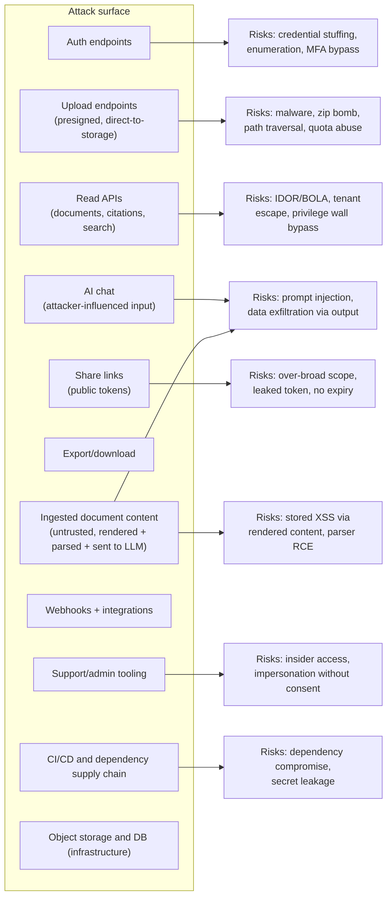

# 12 — Security Architecture

Case IQ holds the most sensitive category of personal information a person can possess: their
legal matter. Opposing parties, employers, ex-partners, and regulators all have a motive to obtain
it. A breach is not a PR problem; it can lose someone their case, their children, or their liberty.

**Design stance:** assume a motivated adversary, assume an insider risk exists, and assume that
at least one control will fail — so layer them.

---

## 1. What we are protecting

| Asset | Why it matters | Worst-case impact |
|---|---|---|
| Original evidence files | Cannot be recreated by the user | Irrecoverable; destroys trust and possibly the case |
| Extracted text and citations | The derived intellectual work product | Exposure of the substance of the matter |
| Statements and allegations | Names third parties, contains accusations | Defamation exposure; harm to non-users |
| Financial records | Account numbers, amounts, patterns | Direct financial crime enablement |
| Communications (email/chat) | Private conversations of multiple people | Mass privacy harm; third parties never consented |
| Identity and contact data | Directly identifying | Phishing, harassment |
| Privileged material | Legally protected | Waiver of privilege; professional liability |
| Audit log | Defensibility and accountability | Loss undermines every integrity claim |
| Model prompts and outputs | May contain case content | Same as extracted text |

**Third-party data is a distinct concern.** A user uploads documents containing information about
witnesses, opposing parties, and family members who are **not users and never consented**. This
raises obligations beyond ordinary SaaS privacy and is discussed in `13-privacy-and-legal-risks.md`.

---

## 2. Threat model

Modelled on STRIDE plus the AI-specific risks from the OWASP Top 10 for LLM Applications.

### 2.1 Adversaries

| # | Adversary | Capability | Motivation | Primary targets |
|---|---|---|---|---|
| A1 | **Opportunistic attacker** | Automated scanning, credential stuffing, known-CVE exploitation | Financial gain | Any account; bulk data |
| A2 | **Opposing party or their agent** | Motivated, may know the user, may have partial access (shared device, shared cloud folder, subpoena) | Win the case | That user's matter |
| A3 | **Malicious insider (our staff or contractor)** | Legitimate access to infrastructure or support tooling | Curiosity, coercion, sale | Any matter |
| A4 | **Compromised user account** | Valid credentials via phishing, reuse, or device compromise | Access the matter | That account's matters |
| A5 | **Malicious uploader** | Can upload arbitrary files | Attack the platform, inject into AI, exfiltrate other tenants' data | The pipeline and the model |
| A6 | **Scraper / abusive client** | Automated API use | Exfiltrate at scale, denial of service | API and cost budget |
| A7 | **Well-intentioned user making a mistake** | Legitimate access | Share too broadly | Their own matter |
| A8 | **Subprocessor compromise** | Access to data we sent them | Various | Whatever they hold |

**A2 and A7 are the most under-appreciated.** A7 in particular: the most likely real-world
disclosure in this product is a user sharing the wrong link, not an attacker breaking in.
Designing for it is as important as designing for A1.

### 2.2 Attack surface



### 2.3 STRIDE analysis

| Threat | Concrete scenario | Controls |
|---|---|---|
| **Spoofing** | Credential stuffing into a user account | Argon2id, MFA, breached-password checks, rate limiting, device/session listing, anomaly alerts |
| | Forged share-link token | 256-bit random tokens, hashed at rest, constant-time comparison, rate-limited redemption |
| | Forged webhook payload | HMAC-SHA256 signature over the raw body with a timestamp, replay window |
| **Tampering** | Altering an uploaded original | Object Lock/WORM, versioning, SHA-256 recorded and re-verified, no application write access to originals |
| | Altering the audit log | Hash chain, `REVOKE UPDATE/DELETE`, periodic checkpoint, verification endpoint |
| | Altering a citation's quoted text | `quote_hash` recomputed on every write and mismatches rejected |
| | Altering a correction's original value | Column-level `REVOKE UPDATE` |
| **Repudiation** | "I never saw that document" | Append-only audit log with actor, IP hash, timestamp, and hash chaining |
| | "The AI said it, not me" | `review_state` records human adoption separately from AI suggestion |
| **Information disclosure** | Cross-tenant read via IDOR | Server-side matter scoping, Postgres RLS with `FORCE`, 404-not-403 |
| | Privilege wall bypass | `can_view_privileged` capability checked in the data layer; access attempts logged as security events |
| | Chunk from a forbidden document in a search snippet | Permission filtering **inside** the SQL query, never post-filter |
| | Data in logs | Structured logging with a denylist; a test asserts no case content in logs |
| | Data in error messages | Error schema excludes internals; response lint in CI |
| | Data to an AI provider that may retain it | Per-matter provider policy, no-retention mode, DPA, residency controls |
| | Data in a shared link that is too broad | Immutable, server-enforced scope; short-lived signed URLs (≤5 min) |
| | Data left in embeddings after deletion | Embeddings are columns on chunk rows; deletion removes them in the same transaction |
| **Denial of service** | Queue flooding via many small uploads | Per-matter concurrency caps, upload rate limits, admission control, backpressure |
| | Expensive AI queries as a cost attack | Per-user and per-matter query rate limits, per-matter cost ceiling, query complexity bounds |
| | ZIP bomb / decompression bomb | Entry count, size, depth, and compression-ratio ceilings |
| | Huge PDF causing OOM | Streaming parse, per-page processing, memory ceiling per worker, page-count cap |
| | AI provider rate limits starving interactive queries | Separate provider semaphores for interactive vs batch; priority lanes |
| **Elevation of privilege** | Member → owner via missing check | Single authorisation module; RLS as a second layer; permission tests per role |
| | Reading a privileged document as a viewer | Capability check; test matrix across all read paths |
| | Parser RCE from a malicious PDF | Sandboxed parsing, no shell invocation, resource limits, patched dependencies, no dynamic evaluation |
| | Prompt injection causing the model to act | The model has **no tools and no write authority**; it cannot act at all |

---

## 3. Authentication

### 3.1 Design

| Aspect | Decision |
|---|---|
| Approach | **Self-hosted**, credentials in our Postgres. No auth vendor processes user identifiers by default (ADR-013). |
| Password hashing | **Argon2id** with tuned parameters (memory ≥ 64 MB, iterations ≥ 3, parallelism 4); parameters stored per hash so they can be upgraded on next login |
| Password policy | Minimum 12 characters, checked against a breached-password corpus (k-anonymity range query, never sending the password), no composition rules, no forced rotation, no security questions |
| MFA | **TOTP required for professional accounts**; available and encouraged for all; **passkeys/WebAuthn preferred** and shipped in Phase 9 |
| Recovery codes | 10 single-use codes, hashed at rest, shown once |
| OAuth | Google and Microsoft, for convenience. Linking to an existing email requires verification of that email first. |
| Sessions | Opaque 256-bit IDs, stored **hashed** at rest, httpOnly + `Secure` + `SameSite=Lax` cookies, idle timeout 12h, absolute timeout 30 days, rotation on privilege change, immediate server-side revocation |
| Step-up auth | Required for: changing email or password, disabling MFA, creating share links, exporting privileged material, deleting a matter, changing permissions |
| Account lockout | Progressive delay then lockout after repeated failures, keyed by account **and** IP to avoid a lockout-based DoS on a known user |
| Enumeration resistance | Registration, login, and password reset responses are indistinguishable by account existence |

### 3.2 Why opaque sessions, not JWT

A JWT cannot be revoked before expiry. In this product, revocation latency matters: a departing
firm member, a revoked external expert, or a user who suspects their device is compromised must
lose access **immediately**. Opaque session IDs in Postgres make revocation a single `UPDATE`
that takes effect on the next request.

### 3.3 Explicitly deferred

SSO/SAML, SCIM provisioning, and IP allowlisting are Phase 4 — required for firm sales, not for
the MVP, and each adds a configuration surface that can itself be misconfigured.

---

## 4. Authorisation

### 4.1 Two layers, deliberately

```
Request
  → Layer 1: Application authorisation module (capability check)
  → Layer 2: Postgres RLS with session context (row filtering)
  → Layer 3: Column/field-level checks (privileged documents, account numbers)
```

**Why two layers:** application-layer checks are where bugs live. RLS means a bug in the handler
does not become a data breach — the database returns zero rows. This is defence in depth for the
single most consequential failure mode (cross-tenant disclosure).

### 4.2 Capability model

Capabilities rather than role checks scattered through the code. Roles map to capability sets.

| Capability | owner | admin | member | reviewer | viewer | external |
|---|---|---|---|---|---|---|
| `matter:read` | ✅ | ✅ | ✅ | ✅ | ✅ | ✅ |
| `matter:update` | ✅ | ✅ | ✅ | — | — | — |
| `matter:delete` | ✅ | — | — | — | — | — |
| `matter:manage_members` | ✅ | ✅ | — | — | — | — |
| `document:upload` | ✅ | ✅ | ✅ | — | — | — |
| `document:read` | ✅ | ✅ | ✅ | ✅ | ✅ | ✅ |
| `document:read_privileged` | ✅ | ✅ | configurable | configurable | ❌ | ❌ |
| `document:delete` | ✅ | ✅ | ✅ | — | — | — |
| `document:set_sensitivity` | ✅ | ✅ | ✅ | — | — | — |
| `extraction:review` | ✅ | ✅ | ✅ | ✅ | — | — |
| `extraction:adopt` | ✅ | ✅ | ✅ | ✅ | — | — |
| `assertion:correct` | ✅ | ✅ | ✅ | ✅ | — | — |
| `assertion:create` (manual) | ✅ | ✅ | ✅ | ✅ | — | — |
| `allegation:edit` | ✅ | ✅ | ✅ | ✅ | — | — |
| `conflict:disposition` | ✅ | ✅ | ✅ | ✅ | — | — |
| `chat:query` | ✅ | ✅ | ✅ | ✅ | ✅ | ✅ |
| `report:create` | ✅ | ✅ | ✅ | ✅ | — | — |
| `report:export` | ✅ | ✅ | ✅ | ✅ | — | — |
| `share_link:create` | ✅ | ✅ | ✅ | — | — | — |
| `audit:read` | ✅ | ✅ | — | — | — | — |
| `matter:purge` | ✅ | — | — | — | — | — |

**`document:read_privileged` is configuration, not a role.** In a firm, a paralegal may need it on
one matter and not another. It is a per-membership flag, which is how ethical screens actually
work in practice.

### 4.3 Ethical walls and privilege

Legal practice requires screening: a firm acting for two adverse parties in unrelated matters, or
a lawyer who has moved firms, must be walled off.

| Requirement | Implementation |
|---|---|
| Wall between matters | Membership is per matter. There is no "firm-wide matter access" capability. |
| Wall within a matter | Document-level `sensitivity = privileged` plus the per-membership `can_view_privileged` flag |
| Wall on specific documents | A `document_acl` overlay for individual grants/denials, evaluated **after** role and sensitivity |
| Access attempts to walled material | Logged as `security.walled_access_attempt` with actor, document, and timestamp — this log is the firm's evidence that the wall held |
| Aggregate leakage | Counts, search results, graph nodes, and timelines exclude walled documents **in the query**, so a walled document's existence is not inferable |
| Export leakage | Exports apply the same filters; a brief can never contain walled content |
| Non-bypassability | RLS policies reference the same ACL, so application bugs cannot bypass the wall |

**Test requirement:** an automated test attempts every read path (document list, detail, search,
citation, graph, timeline, export, brief, chat retrieval) as a walled user and expects zero
exposure — including through inferred counts.

### 4.4 Why 404 not 403 for cross-tenant access

Returning 403 for a resource in another tenant confirms its existence. For legal matters, even
the existence of a file number or a party name can be sensitive. Returning 404 for both "absent"
and "not yours" removes the oracle. Within a tenant, 403 is used where the user's access to the
container is known, because it is more helpful and leaks nothing new.

### 4.5 Row-level security

```sql
-- Pattern applied to every matter-scoped table.
ALTER TABLE documents ENABLE ROW LEVEL SECURITY;
ALTER TABLE documents FORCE ROW LEVEL SECURITY;   -- applies to the table owner too

CREATE POLICY documents_tenant_isolation ON documents
  USING (
    matter_id = ANY (string_to_array(current_setting('app.matter_ids', true), ',')::uuid[])
    AND deleted_at IS NULL
  );

CREATE POLICY documents_privileged ON documents
  AS RESTRICTIVE
  USING (
    sensitivity <> 'privileged'
    OR current_setting('app.can_view_privileged', true) = 'true'
    OR EXISTS (
      SELECT 1 FROM document_acl acl
      WHERE acl.document_id = documents.id AND acl.user_id = current_setting('app.user_id')::uuid
        AND acl.effect = 'allow'
    )
  );
```

**Note `FORCE ROW LEVEL SECURITY`.** Without it, the table owner (often the migration role, and
sometimes the application role in a naive setup) bypasses all policies. This is a real and
commonly missed misconfiguration.

#### 4.5.1 The connection-pooling trap

`current_setting('app.matter_ids')` set with session-level `SET` **persists across pooled
connections**. In a PgBouncer transaction-pooling setup, that means request B can inherit request
A's tenant context — a catastrophic cross-tenant leak.

**Mandatory rules:**
1. Always `SET LOCAL`, never `SET`, and always inside an explicit transaction.
2. Transaction pooling mode only; statement pooling is forbidden because it can move a statement
   outside the transaction that set the context.
3. Connection-level `DISCARD ALL` on release as a belt-and-braces measure.
4. **A dedicated test** opens a connection, sets tenant A, returns it to the pool, checks out
   again with no context, and asserts zero rows are visible.

#### 4.5.2 Workers and background jobs

Workers run without a user session and therefore without tenant context. Two allowed patterns:

1. **Per-matter job scope:** set `app.matter_ids` to exactly the job's matter and `app.role =
   'service'` inside the job transaction. The RLS policy grants access when `app.role =
   'service'` **and** the matter matches. This keeps RLS active rather than bypassed.
2. **Migration/maintenance role:** a separate role with `BYPASSRLS`, used only by migrations and
   the purge job, with its credentials held in a different secret and never available to the
   application runtime.

**Rule:** the application runtime role never has `BYPASSRLS`. Verified by a test asserting the
role attribute is false.

---

## 5. Data protection

### 5.1 In transit

| Path | Control |
|---|---|
| Browser ↔ app | TLS 1.3, HSTS with a long max-age and preload, no mixed content |
| App ↔ Postgres | TLS with certificate verification; `sslmode=verify-full` |
| App/worker ↔ object storage | HTTPS with TLS verification |
| App ↔ AI/OCR providers | HTTPS with certificate pinning where the client supports it |
| Internal service-to-service | Within a private network; TLS where the platform requires it |
| Sharing the matter with an expert | Signed URLs over TLS with short expiry |

### 5.2 At rest

| Layer | Control |
|---|---|
| Database volume | Provider-managed encryption (AES-256) |
| Object storage | SSE with provider-managed or customer-managed keys; versioning enabled |
| Backups | Encrypted with a separate key from production; stored in a separate account/bucket |
| Secrets | Managed secret store, never in the repo, never in the client bundle, rotated on a schedule |
| **Field-level: MFA secrets** | Envelope-encrypted with a KMS data key; never logged |
| **Field-level: OAuth refresh tokens** | Envelope-encrypted |
| **Field-level: account numbers** | **Masked (last 4) plus a salted hash** in `accounts.account_ref_hash`; the full number is not stored. There is no product requirement to display it. |
| **Field-level: extraction text** | **Not field-encrypted.** This is a deliberate, documented trade-off (§5.3). |
| Data keys | KMS with automatic rotation; the application never holds a root key |

### 5.3 The field-level encryption trade-off, stated honestly

A reasonable instinct is to encrypt extracted text and quoted evidence at the field level. **We do
not**, and the reason matters:

- Search must read the text (full-text and semantic).
- Embeddings must be computed from it.
- The AI pipeline must send it to a provider.
- Citation verification must match quotes against it.

Any scheme that encrypts it at rest must therefore decrypt it for essentially every operation,
which reduces the benefit to "encryption only when the database is stopped." That is worth less
than the operational complexity of key management, query breakage, and the very real risk of
introducing a bug that corrupts or loses a user's extracted text.

**What we do instead:** strong perimeter controls (RLS, least privilege, network isolation, audit
logging), provider-managed encryption at rest for the volume, and field-level encryption for the
genuinely secrets-only fields (MFA, tokens, account numbers) where no query needs the plaintext.

**When to revisit:** if a firm contract or a regulatory requirement demands
customer-managed keys for case content, the answer is **per-tenant database-level or
schema-level keys**, not per-field encryption. That is a Phase 4 architecture change, recorded in
ADR-016.

### 5.4 Key management

| Key | Purpose | Rotation |
|---|---|---|
| KMS master | Wraps data keys | Annual, automatic |
| Envelope data keys | MFA secrets, tokens | 90 days, with re-encryption |
| Session signing | Not needed (opaque sessions) | — |
| Share-link token pepper | Hashing share tokens | Annual, with re-hash on write |
| Account-number hash salt | Matching accounts without plaintext | Annual, requires re-hash migration |
| Audit-chain key | The hash chain itself is unkeyed SHA-256; a separate HMAC key signs checkpoints | Annual |
| Backup encryption | Backup confidentiality | Annual |

**Rotation must be tested.** A documented rotation procedure that has never been executed is not
a control.

### 5.5 Logging hygiene

Logs are a routine source of sensitive-data leakage.

| Rule | Implementation |
|---|---|
| Never log document content, extracted text, quoted spans, or chat query text | A structured logger with a field denylist (`text`, `body`, `quote`, `quoted_text`, `description`, `filename`, `subject`, `query`, `prompt`, `completion`) |
| Never log credentials, tokens, session IDs, or share tokens | Field denylist plus a regex scrubber as a second layer |
| Log identifiers, not content | `document_id`, not `filename`; `matter_id`, not `title` |
| Hash IPs | Store `ip_hash` with a rotating salt; retain raw IP only in short-lived security logs with a defined retention |
| Truncate user agents | Proxies and clients produce unbounded strings |
| Redact provider payloads | Request/response bodies from AI providers are never logged in full |
| **Assert it in CI** | A test runs representative flows and scans all emitted log lines for case-content markers |

---

## 6. Upload and content security

Uploads are the primary untrusted-input channel. Full pipeline detail in
`08-document-ingestion.md`; the security controls are:

| Control | Detail |
|---|---|
| Direct-to-storage | Bytes go browser → object storage via presigned URLs; the app server never parses uploads |
| Quarantine prefix | Uploads land in `quarantine/`; **nothing is parsed before scanning** |
| Malware scanning | ClamAV with fresh definitions, streamed scan, health-checked staleness |
| Promotion gate | Copy to `originals/` (write-once) only after a clean scan |
| Checksum | Client-computed SHA-256 verified server-side, and again by the worker |
| Magic-byte typing | Format from content, never extension |
| Filename sanitisation | Strip paths, control characters, and reserved names; storage key is a generated UUID; original filename is metadata only |
| Size and count caps | Per-file, per-upload, per-matter, enforced **before** bytes are accepted |
| ZIP hardening | Depth ≤ 3, entries ≤ 5,000, uncompressed ≤ 2 GB, ratio ≤ 200:1, no traversal, no symlinks, no encryption bypass |
| Streaming parse | Parsers stream; per-page processing; per-worker memory ceilings |
| Parser sandboxing | No shell invocation, no dynamic evaluation, no macros, no embedded object execution; parsers run in a container with a restricted filesystem |
| Renderer safety | PDF.js with JavaScript actions disabled; no external resource loading; no embedded-object execution |
| Content-Type on download | `Content-Disposition: attachment` with a sanitised filename for originals; `X-Content-Type-Options: nosniff` everywhere |
| Separate origin | Downloaded content is served from a **separate origin** from the application, preventing stored-XSS from reaching the app's cookies or session |
| CSP | Strict CSP with nonces, no `unsafe-inline`, `frame-ancestors 'none'`, `object-src 'none'` |

**The separate-origin point is important.** If user-uploaded content is served from the app's own
origin, a rendering flaw becomes a session-compromising XSS with full access to cookies. Serving
content from a distinct origin removes the entire class.

---

## 7. Object storage and signed URLs

| Control | Detail |
|---|---|
| Private buckets | No public access; block-all-public-access enabled at the account level |
| Path structure | `originals/{matter_id}/{uuid}` — matter-scoped, no user-controlled path segments |
| Write-once originals | Bucket versioning + Object Lock (governance or compliance mode) on the originals prefix |
| App permissions | The application role can `PutObject` to `quarantine/` and read `originals/`; it **cannot** overwrite or delete `originals/` outside the purge role |
| Presigned uploads | Short-lived (≤ 15 min), single-object, size-constrained, content-type constrained |
| Presigned downloads | ≤ 5 minutes, single object, logged, `Content-Disposition: attachment` |
| Share-link downloads | Minted per request from the share scope; never a long-lived URL baked into a page |
| Encryption | SSE enabled; TLS required on the bucket policy (`aws:SecureTransport`) |
| Access logging | Bucket access logs enabled and shipped to a separate account so an attacker cannot erase them |
| Lifecycle | Incomplete multipart uploads aborted; old derivatives expired; **originals never auto-deleted** |

**The 5-minute download URL is a security control, not a performance choice.** It is what makes
revoking a share link effective immediately rather than whenever a two-hour URL happens to expire.

---

## 8. Application security

| Area | Control |
|---|---|
| Input validation | Zod on every request; unknown fields rejected, not ignored |
| Output encoding | Framework default escaping; `dangerouslySetInnerHTML` banned by lint; the one permitted use (search snippets) is server-sanitised to allow only `<mark>` |
| CSRF | SameSite=Lax cookies + a double-submit token on state-changing requests; `Origin` header verification |
| CORS | Same-origin by default; explicit allowlist; no wildcard with credentials |
| Clickjacking | `frame-ancestors 'none'` and `X-Frame-Options: DENY` |
| SSRF | **No user-supplied URL is ever fetched.** No "import from URL" feature. If one is ever added, it requires an allowlist plus IP-range blocking. |
| XXE | XML parsers configured with external entities and DTDs disabled (this matters for DOCX, MSG, and XLSX) |
| Path traversal | No user input in filesystem paths; storage keys are generated |
| Deserialisation | No unsafe deserialisation of user-supplied data; JSON only, schema-validated |
| SQL injection | Parameterised queries only; Drizzle's query builder plus raw SQL with bound parameters; a lint rule bans string interpolation into SQL |
| Mass assignment | Explicit field allowlists on every update; never spread the request body into a model |
| Rate limiting | Per IP, per user, per matter, and per endpoint class; auth endpoints limited more tightly; `429` with `Retry-After` |
| Dependency security | Lockfile committed, automated vulnerability scanning, Dependabot-class updates, a zero-tolerance policy for known-exploited criticals |
| Secret scanning | Pre-commit hook + CI scan on every push and on full history |
| Security headers | HSTS, CSP with nonces, `nosniff`, `Referrer-Policy: strict-origin-when-cross-origin`, `Permissions-Policy` minimal |
| Error handling | No internals in responses; a correlation ID for support |
| Subresource integrity | For any third-party script (ideally zero) |

---

## 9. AI-specific security

### 9.1 The prompt injection problem, stated properly

**Ingested documents are attacker-controlled and are sent to a language model.** An opposing
party's filing can contain text engineered to manipulate the assistant. There is **no known
complete defence**. Any claim otherwise is marketing.

Our mitigation strategy is therefore **output-side enforcement first**, because input-side
detection cannot be relied upon. Full detail in `07-ai-architecture.md` §9; the security summary:

| Layer | Control |
|---|---|
| D1 Structural | Document text never appears in the instruction region; it is delimited data |
| D2 Screening | Instruction-pattern detection flags and records suspicious spans; the user is shown the flag |
| D3 Sanitisation | Control characters, invisible Unicode, and bidi overrides stripped from the screening copy (the stored text is never modified) |
| D4 Output schema | Citations are **indices into a system-supplied bundle**, so a fabricated citation cannot be expressed |
| D5 Independent verification | Tier 2 uses a different model to judge whether the span supports the claim |
| D6 Least privilege | The model has **no tools, no retrieval control, no cross-matter access, and no write authority** |
| D7 Human action required | Every mutation is a user action in the UI |
| D8 Output copy lint | Credibility and legal-advice vocabulary rejected at the rendering layer regardless of the model's output |
| D9 Canary suite | Adversarial documents in CI; any change in output fails the build |

### 9.2 Data exfiltration via the model

| Vector | Mitigation |
|---|---|
| Injected instruction to reveal other matter content | The model only ever receives this matter's retrieved spans; there is nothing else in its context to reveal |
| Injected instruction to reveal the system prompt | System prompts contain no secrets, no tenant data, and no credentials. Leaking them is not a security event. |
| Injected instruction to include data in a URL | The output schema has no URL field; citations are system-generated |
| Injected instruction to mark an assertion supported | Verification is independent of the generator and does not trust its self-report |
| Provider-side retention exposing content | Per-matter no-retention policy; DPA; provider choice constrained by policy |

### 9.3 Provider-side considerations

| Risk | Control |
|---|---|
| Provider trains on our data | Contractual exclusion; zero/limited-retention tier; documented per provider |
| Provider retains prompts | No-retention mode required by default for privileged matters |
| Provider subprocessor in a third country | Residency-aware provider selection; disclosed in the subprocessor list; matter policy can forbid cloud processing entirely |
| Provider breach | Data minimisation: we send only the retrieved spans, not the whole matter |
| Provider outage | Two providers integrated; deterministic-only degraded mode where AI features pause and everything else keeps working |
| Model deprecation changing behaviour | Model versions pinned per extraction run; a model change is an explicit migration with a re-evaluation |

---

## 10. Insider risk

The hardest threat. Controls must protect users from us as well as from outsiders.

| Control | Detail |
|---|---|
| **No standing production data access** | Engineers have no routine access to production case data. Debugging uses synthetic or redacted environments. |
| **Break-glass procedure** | Emergency access requires a documented approval, is time-boxed, is logged, and triggers a post-incident review |
| **Support impersonation** | If ever built: requires explicit, logged **user consent**, is time-boxed to a session, displays a persistent banner to the user, and is visible in their audit log |
| **Least privilege** | Separate roles for application runtime, migrations, purging, and support. The runtime role has no `BYPASSRLS`. |
| **Environment separation** | Production data never copied to staging or development. Staging uses the synthetic sample case. |
| **Access review** | Quarterly review of who has production, admin, and secret access |
| **Offboarding** | Credential revocation, key rotation where the individual held keys, and session termination within one hour |
| **Alerting on abnormal access** | Alerts for: a single actor reading an unusual number of distinct matters; privileged-document access by someone without the capability; mass export; access outside working hours consistent with the actor's history |
| **Immutable audit** | An insider cannot cover their tracks without breaking the hash chain, which is verified on a schedule |
| **Contractual and technical** | Confidentiality obligations, background checks where lawful, and a documented acceptable-use policy |

**Honest position:** insider risk cannot be eliminated. It is managed through least privilege,
detection, and accountability — with the explicit recognition that a determined insider with
legitimate access is the hardest case, which is why detection and immutable logging matter more
than prevention alone.

---

## 11. Availability, backup, and disaster recovery

| Aspect | Target | Implementation |
|---|---|---|
| Availability | 99.5% MVP → 99.9% at scale | Multi-AZ managed Postgres and storage; stateless app and workers |
| RPO | ≤ 5 minutes | Managed PITR with continuous WAL archiving |
| RTO | ≤ 4 hours | Documented restore runbook, rehearsed quarterly |
| Backups | Daily full logical dump + continuous PITR | Stored encrypted in a **separate account/bucket** with Object Lock |
| Restore testing | **Monthly** restore into an isolated environment with a verification query | A backup that has never been restored is not a backup |
| Deletion vs backup | Disclosed honestly: backups purge on their own schedule, stated in the deletion receipt | `09-evidence-provenance.md` §11 |
| Dependency failure | Two AI providers; cloud OCR optional; AI degradation leaves the rest of the product working | Deterministic-only mode is a supported state |
| Queue durability | pg-boss persists in Postgres; jobs survive restarts | |
| Data integrity checks | Scheduled jobs: verify the audit chain, sample-verify object hashes, verify citation quote hashes | |
| Capacity | Documented scale limits and alerts before they are reached | |

**"Deterministic-only mode is a supported state"** is a real architectural commitment: if every
AI provider is down, users can still browse, search, review, and export their documents. The
product degrades; it does not stop.

---

## 12. Compliance posture

Stated carefully, because overclaiming compliance is both a legal risk and a trust risk.

### 12.1 What we can honestly claim

| Claim | Basis |
|---|---|
| Encryption in transit and at rest | Implemented and verifiable |
| Tenant isolation enforced in the database | RLS with `FORCE`, tested |
| Append-only, tamper-evident audit log | Hash chain, verified on a schedule |
| Immutable originals with SHA-256 integrity | Object Lock + hashing |
| Verifiable deletion with a receipt | Purge job with post-verification |
| Least-privilege access with no standing production access | Documented and reviewable |
| AI outputs are citation-verified and unsupported assertions are suppressed | Architecture, tested |

### 12.2 What we must NOT claim until independently audited

| Not claimed | Why |
|---|---|
| SOC 2 Type II compliant | Requires an audit period and a report |
| ISO 27001 / 27701 certified | Requires certification |
| HIPAA compliant | Would require a BAA and specific controls; not asserted |
| PCI DSS compliant | We do not store card data; the payment processor handles it |
| "Bank-level security" or "military-grade encryption" | Meaningless marketing; actively misleading |
| Guaranteed admissibility of evidence | False; see `09-evidence-provenance.md` §9.2 |
| GDPR/PIPEDA "compliant" as an absolute | Compliance is contextual and depends on configuration, contracts, and use. We describe *controls*, not a certificate. |

### 12.3 Target certifications and sequence

| Phase | Milestone |
|---|---|
| MVP | Internal security review; penetration test by an external firm **before public launch**; published security page describing controls |
| Phase 2 | SOC 2 Type I readiness; documented policies; vendor management; incident response plan |
| Phase 3 | SOC 2 Type II observation window; annual penetration testing |
| Phase 4 | ISO 27001 if firm/enterprise sales require it; DPIAs and security questionnaires supported |

**A penetration test before public launch is a hard requirement**, not a nice-to-have. Selling
security to legal professionals without independent verification would be indefensible.

---

## 13. Incident response

| Step | Detail |
|---|---|
| **Detection** | Alerts on abnormal access, auth anomalies, job failures, integrity-check failures, provider errors, and cost spikes |
| **Triage** | Severity classification with a named on-call owner; containment decision within 1 hour for Sev-1 |
| **Containment** | Revoke sessions, rotate secrets, disable the affected path, isolate the affected tenant |
| **Assessment** | Determine what data, whose, how much — using the audit log, which is why it is content-free yet complete |
| **Notification** | Assess breach-notification obligations with counsel. Where notification is required, timelines are statutory and vary by jurisdiction. **Never delay notification to manage reputation.** |
| **Remediation** | Fix, verify, and add a regression test |
| **Post-mortem** | Blameless, written, and shared with affected customers where relevant |

**A specific scenario worth pre-planning:** a leaked share link. It is the most likely real
incident (adversary A7). The runbook is: revoke the link, enumerate the access log, determine what
was downloaded, notify the matter owner, and — where the scope was broad — assess notification
obligations. This scenario is rehearsed, not improvised.

---

## 14. Security acceptance tests

Release-blocking. Full suite in `16-testing-strategy.md` §7.

| # | Test | Pass condition |
|---|---|---|
| 1 | Cross-tenant read across every resource type | 404, no existence disclosure |
| 2 | Cross-tenant write | 404, nothing created |
| 3 | RLS without tenant context | Zero rows visible |
| 4 | `SET LOCAL` vs `SET` under pooled connections | No context leakage across checkouts |
| 5 | Application role lacks `BYPASSRLS` | Asserted on the role attribute |
| 6 | Privileged document access without the capability, across every read path | Zero exposure, including inferred counts, search, graph, export |
| 7 | Privilege-wall bypass attempt | Denied and logged as a security event |
| 8 | Share link scope widening | Impossible; enumeration outside scope returns 404 |
| 9 | Share link revocation | Effective within 5 minutes, including in-flight signed URLs |
| 10 | Session revocation | Effective within 30 seconds |
| 11 | Malware upload | Quarantined, never parsed |
| 12 | ZIP bomb and path traversal | Rejected at the ceiling; nothing written outside the prefix |
| 13 | Original immutability | SHA-256 unchanged after the full pipeline; application role cannot overwrite |
| 14 | Stored XSS via document content | Rendered inert; served from a separate origin; CSP blocks inline script |
| 15 | Search snippet sanitisation | Only `<mark>` survives |
| 16 | Prompt injection corpus | No unsupported assertion reaches the UI; injections logged |
| 17 | Log content scan | No case content in any log line across representative flows |
| 18 | Error response scan | No internals in any error response |
| 19 | Audit chain tampering | Detected; first divergence reported |
| 20 | Audit content denylist | No content fields written |
| 21 | Rate limiting | Enforced per class; no side effects on rejection |
| 22 | Mass export anomaly | Alert fires |
| 23 | Deletion completeness | Zero objects, chunks, embeddings; receipt produced |
| 24 | Backup restore | Monthly restore succeeds and verifies |
| 25 | Dependency and secret scanning | Zero known-exploited criticals; zero secrets in history |
| 26 | User enumeration | Registration, login, and reset are indistinguishable |
| 27 | CSRF | State-changing requests without a token are rejected |
| 28 | Step-up enforcement | Sensitive actions require a fresh MFA assertion |

---

## Related documents

- `13-privacy-and-legal-risks.md` — privacy, regulatory, and professional-responsibility obligations
- `08-document-ingestion.md` — upload hardening in detail
- `07-ai-architecture.md` §9 — prompt injection defences
- `10-database-schema.md` — the tables and constraints referenced here
- `09-evidence-provenance.md` §9–11 — integrity and deletion
- `18-red-team-risks.md` — the failure modes these controls address
- `16-testing-strategy.md` §7 — the security test suite
- `24-architecture-decisions.md` — ADR-013 (self-hosted auth), ADR-016 (no field-level encryption of case text)
