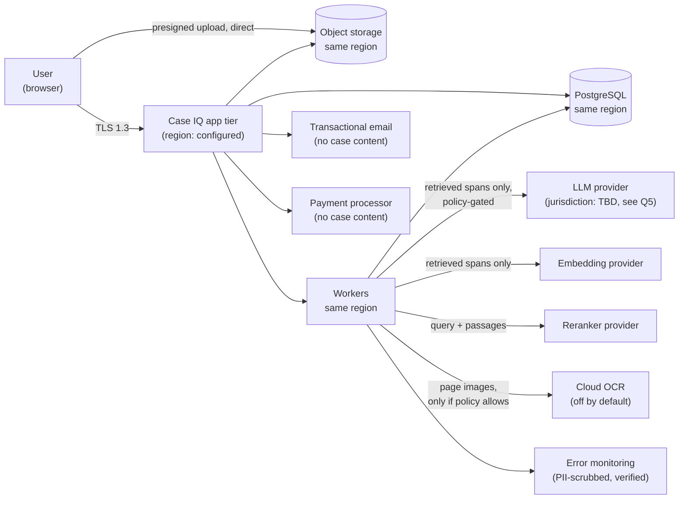

# 13 — Privacy and Legal Risks

> ## ⚠️ Status and limitation of this document
>
> **This is an engineering and product risk analysis, not legal advice.** It was prepared to
> identify the areas where professional legal and privacy review is required before launch, and to
> define the product controls that support compliance.
>
> It deliberately **does not** assert that Case IQ is compliant with any statute or regulation, and
> **does not** invent legal conclusions. Where a legal question is unresolved, it is listed in §10
> as an item requiring counsel's review rather than answered here.
>
> **No claim of compliance should appear in marketing, UI copy, contracts, or security
> documentation until it has been reviewed and approved by qualified counsel in each target
> jurisdiction.**

---

## 1. Why this product has unusual privacy exposure

Most SaaS products process data about their own users. Case IQ processes data about:

| Data subject | Relationship to Case IQ | Consent |
|---|---|---|
| Our user | Customer | Given at signup |
| **Opposing parties** | **Not users** | **None** |
| **Witnesses** | **Not users** | **None** |
| **Family members, including children** | **Not users** | **None** |
| **Third parties in communications** | **Not users** | **None** |
| **Employees named in corporate records** | **Not users** | **None** |

**This is the defining privacy characteristic of the product.** A single uploaded disclosure
package can contain personal information about dozens or hundreds of people who have never heard
of Case IQ, did not consent to anything, and in some cases are legally protected parties (children
in family matters, complainants in criminal matters, vulnerable witnesses).

### 1.1 Consequences that follow directly

1. **Consent from the user is insufficient as the only lawful basis.** We cannot rely on our
   customer's consent to process a third party's sensitive personal information. Other bases
   (legal claims, legitimate interests, legal obligation) must be analysed — **by counsel.**
2. **Data minimisation is not optional.** We must collect and retain only what the product needs,
   with retention limits and deletion that actually works.
3. **Sensitive-category data is the norm, not the exception.** Health information, financial
   information, alleged criminal conduct, family relationships, and children's data appear
   routinely. This raises the risk tier of the processing under most regimes.
4. **Access rights are complicated.** A third party named in a user's matter may have data
   subject rights, but those rights collide with our customer's confidentiality, with legal
   privilege, and with the litigation itself. Handling this requires a documented policy.
5. **Breach impact is multiplied.** A breach exposes not just our customer but many non-consenting
   individuals, several of whom may be harmed by disclosure (for example, a witness whose address
   becomes known to an opposing party).

### 1.2 The children's-data flag

Family matters routinely include children's names, dates of birth, schools, medical records, and
their own statements. Even where children are not the primary data subjects, their personal
information is pervasive.

**Product controls required before launch:**
- Children's data is treated as the highest sensitivity class; a matter can be marked as containing
  children's information, which tightens AI provider policy automatically.
- No minor's data is ever included in marketing materials, demo data, or synthetic datasets that
  are publicly shown.
- The sample case in `sample-case/` contains **no minors** — deliberate, and enforced by review.

---

## 2. Data inventory and flows

### 2.1 What we collect

| Category | Examples | Source | Sensitivity | Retention |
|---|---|---|---|---|
| Account data | Name, email, password hash, MFA secret | User | High | Life of account + 30 days |
| Matter metadata | Case title, court, file number, parties | User | High | Matter retention policy |
| Uploaded documents | PDFs, images, exports | User | **Very high** | Matter retention policy |
| Extracted text | Page text, chunks | Derived | **Very high** | Tied to document |
| Embeddings | Vectors of chunks | Derived | High (invertible in some cases) | Tied to chunk |
| Extracted entities | Names, roles, orgs, account refs | Derived | Very high | Tied to document |
| Financial data | Amounts, dates, masked account refs | Derived from documents | **Very high** | Matter retention policy |
| Communications | Email bodies, chat messages | User uploads | **Very high** | Matter retention policy |
| AI interaction | Queries, answers, retrieval metadata | User + derived | Very high | Matter retention policy |
| Audit log | Actor, action, target ID, timestamp | System | Medium | Per policy; separate from content |
| Usage and cost | Tokens, pages processed, cost | System | Low | Billing period + statutory |
| Support communications | Emails, tickets | User | Medium–high | Support policy |

### 2.2 Where the data goes

### 2.3 Cross-border transfer exposure

**This is the single largest privacy risk in the architecture.**

The data flows above cross borders whenever an AI provider processes in another country. For
Canadian and EU matters, that means personal information about non-consenting third parties may be
processed in the United States.

| Mitigation | Status |
|---|---|
| Per-matter policy can forbid third-party processing entirely | MVP requirement (F50) |
| Provider selection constrained by residency requirements | Design requirement |
| Data minimisation — only retrieved spans are sent, not the full matter | Architectural |
| No-retention contractual terms | Required before launch |
| Subprocessor list published and kept current | Required before launch |
| Regional deployment option for residency-committed customers | Phase 4 |
| **Client notification and consent** where required by law | **Requires counsel's determination — §10 Q4** |
| **Transfer impact assessment** | **Requires counsel — §10 Q5** |

**Honest position:** at MVP, the practical options are (a) accept the transfer risk with
contractual protection, (b) offer a deterministic-only mode with no AI, or (c) require a Canadian
or EU region for the AI provider. Option (c) may be the correct default for Canadian legal work
and must be resolved with counsel before launch. **This question is a launch blocker.**

---

## 3. Regulatory landscape

Regimes that plausibly apply. **Applicability determinations require counsel** — this section
identifies the areas, not the answers.

### 3.1 Canada

| Regime | Relevance | Key considerations |
|---|---|---|
| **PIPEDA** | Federal, applies to private-sector organizations in commercial activity; also to interprovincial and international flows | Consent, knowledge, limited collection/use/disclosure/retention, accuracy, safeguards, openness, individual access, accountability. Consent for sensitive information should generally be express. Breach notification obligations for real risk of significant harm. |
| **Ontario privacy legislation** | Largely health-sector focused (PHIPA) and municipal (MFIPPA). PIPEDA governs most Ontario private-sector commercial activity. | Health information appearing in a personal-injury or disability matter may engage PHIPA obligations for the *custodian* — our user — rather than for us, but the analysis needs counsel. |
| **Quebec — Law 25** | Amended Quebec private-sector privacy law with GDPR-like features | Privacy officer designation, privacy impact assessments for certain projects, consent and transparency requirements, portability, and significant penalties. Applies to Quebec residents' data. |
| **Alberta PIPA, BC PIPA** | Substantially similar provincial regimes | Largely parallel to PIPEDA, with differences in breach reporting and access procedures. |
| **Canada's Anti-Spam Legislation (CASL)** | Marketing email | Express or implied consent, identification, unsubscribe. |
| **Provincial law society rules** | Govern our *lawyer* users, not us directly | Confidentiality, competence, technology, file retention, and outsourcing obligations. Relevant to our professional tier and to our own marketing. |

### 3.2 United States

| Regime | Relevance |
|---|---|
| State comprehensive privacy laws (California CCPA/CPRA, Virginia, Colorado, Connecticut, and others) | Likely applicability depends on thresholds and whether we act as a service provider. Consumer rights of access, deletion, correction, portability, and opt-out of certain processing. |
| State biometric, wiretap, and recording laws | Relevant if audio/video transcription ships (F44) — two-party consent states create real exposure. This is a primary reason F44 is deferred. |
| FTC Act Section 5 | Unfair or deceptive practices. Directly relevant to marketing claims — including any overclaim about AI accuracy or security. |
| GLBA / financial data rules | If we process financial records, definitions of "financial institution" and "non-public personal information" need analysis. |
| State professional conduct rules | Govern our lawyer users; several states have issued AI-specific guidance. |

### 3.3 European Union / UK (where relevant)

| Regime | Relevance |
|---|---|
| **GDPR** | Applies if we offer services to EU residents or monitor their behaviour. Special-category data (health, alleged offences) triggers Article 9 conditions; Article 35 requires a DPIA for high-risk processing; Article 22 restricts solely automated decision-making with legal effects; Articles 13–22 provide data subject rights; Chapter V governs transfers. |
| **UK GDPR** | Parallel regime with its own adequacy and transfer position. |
| **EU AI Act** | See §6 — the obligations and timeline need a specific analysis. |

### 3.4 The Article 22 question, raised deliberately

A system that characterises evidence could, in an aggressive reading, be argued to contribute to
"a decision producing legal effects." Our position is that **the system produces no decision** —
it organises evidence for a human — and the architecture supports that position:

- No conclusion about a person is ever produced (no credibility, no guilt).
- Every assertion is attributable and verifiable.
- The human user owns the narrative and the export.
- The system refuses to answer legal questions.

**This position must be tested with counsel.** It is materially weaker if the product ever ships
a feature that scores a case, predicts an outcome, or recommends a course of action — all of which
are out of scope permanently per `01-product-vision.md` §10.

---

## 4. Privacy principles for the product

Eight commitments, chosen to be *implementable* rather than aspirational. Each maps to a product
control.

| # | Commitment | Product control |
|---|---|---|
| P1 | **Collect the minimum** | No analytics beyond product telemetry; no third-party advertising or tracking scripts; no session recording; no data enrichment from external sources |
| P2 | **Purpose limitation** | Case content is used to provide the service and nothing else. **Contractual and technical prohibition on using customer case content to train models** — ours or a vendor's. |
| P3 | **Retention limits** | Per-matter retention policy; automatic review prompts at the retention date; honest disclosure of backup purge windows |
| P4 | **Real deletion** | Deletion purges objects, text, chunks, embeddings, graph edges, caches, exports, and share links, with a verifiable receipt |
| P5 | **Data minimisation to processors** | Only retrieved spans are sent to AI providers, never a whole matter; cloud OCR off by default; page images sent only under explicit policy |
| P6 | **Transparency** | Published subprocessor list; plain-language explanation of what AI does and does not do; disclosure of every model that processed a document (professional users) |
| P7 | **User control** | Per-matter AI policy; export everything; delete everything; no lock-in — a documented export format |
| P8 | **No dark patterns about privacy** | Consent is not bundled; settings are not buried; declining AI processing does not degrade the core product |

### 4.1 On training data

**Case IQ does not train models on customer case content, and contractually requires its AI
processors not to either.** This is stated plainly in the privacy notice and in enterprise
documentation, because it is the first question a lawyer asks.

Any future change to this policy requires:
1. A stated, separate, opt-in consent that is genuinely optional.
2. A privacy review and a DPIA update.
3. A prominent notice to existing users with the right to decline.
4. **No retroactive application to existing case content.**

---

## 5. Data subject rights in a multi-party-content product

The hardest operational privacy problem in this product.

### 5.1 The conflict

| Right | Requested by | Conflict |
|---|---|---|
| Access | A witness named in a case | Disclosing it reveals our customer's litigation strategy and may breach their confidentiality |
| Erasure | An opposing party | Deleting would destroy our customer's evidence and could constitute spoliation |
| Rectification | A person misidentified by entity resolution | Directly conflicts with preserving the evidentiary record |
| Objection | A third party | Same as erasure |
| Portability | Our customer | Supported — this is F42 |

### 5.2 Our position (requiring counsel's review)

The framing we intend to adopt, subject to legal review:

1. **Our customer is the controller** of matter content as between us and them; **we are a
   processor** — for professional customers this is the natural fit and matches their
   confidentiality obligations. For **consumer (self-represented) customers the controller/
   processor analysis is less clear and needs counsel.** This distinction materially affects
   every rights procedure.
2. **Third-party requests are referred to the customer** unless a legal obligation requires
   otherwise. We assist the customer in responding; we do not unilaterally delete evidence.
3. **Rectification of a misidentification happens through the correction mechanism**, not by
   deleting the record: the erroneous attribution is corrected, the original is preserved, and both
   are visible. This satisfies accuracy in substance while preserving the integrity of the record.
   **Counsel must confirm this is defensible.**
4. **Legal holds and litigation preservation override deletion** where applicable, and this is
   disclosed in the retention policy. We do not advise users on their preservation obligations —
   we tell them to ask their lawyer.
5. **Every rights request is logged**, with the determination, the actor, and the rationale.

### 5.3 Required procedures before launch

| Procedure | Owner | Status |
|---|---|---|
| Access request process with identity verification | Privacy | **Required** |
| Erasure process distinguishing customer from third-party requests | Privacy + Legal | **Required** |
| Rectification process routed through corrections | Product + Legal | **Required** |
| Objection process | Legal | **Required** |
| Process for requests that conflict with a legal hold | Legal | **Required** |
| Documented controller/processor position per customer type | Legal | **Required** |
| Published data subject request contact and response commitment | Privacy | **Required** |

---

## 6. AI-specific regulatory considerations

### 6.1 EU AI Act

The Act introduces a risk-tiered framework with obligations phased over time, including
transparency duties, general-purpose AI model obligations, and prohibitions. **The classification
of Case IQ and the applicable obligations and dates require a specific analysis by counsel** —
this document does not assert a classification.

The design decisions that would support a lower-risk classification, and which are already product
requirements:

| Design choice | Relevance |
|---|---|
| No automated decisions about people | Supports the position that the system is not a decision-making system |
| No credibility or guilt determination (copy lint enforced) | Avoids the highest-risk categorisation |
| Human review built into the workflow (`review_state`, adoption) | Human oversight is architectural, not optional |
| Transparency about AI involvement | Disclosure is a feature, not an afterthought |
| Citation verification and abstention | Reduces the risk of harmful incorrect output |
| No biometric categorisation, no emotion inference, no social scoring | Explicitly out of scope permanently |
| Documentation of model, prompt version, and evaluation | Technical documentation already required for our own quality control |

**A specific red line to observe:** the Act (and analogous emerging rules) restricts emotion
recognition and certain inference about individuals. A feature that inferred a witness's
truthfulness or emotional state from their statements or from audio would cross into prohibited or
high-risk territory. **We will never build such a feature** — this is a permanent scope boundary,
recorded here so it cannot be added later by someone who has not read this analysis.

### 6.2 Automated decision-making and profiling

| Risk | Control |
|---|---|
| A user treats an AI summary as a legal determination | Class badges, confidence phrases, non-advice frames, refusal templates |
| A professional relies on an unverified extraction | `reviewed_adopted` state distinguishes machine suggestion from adopted work product |
| An allegation status reads as a verdict | Status enum has no verdict value; copy states the counts; copy lint forbids "proved" |
| Aggregated "case strength" inference (never built) | Out of scope permanently |

### 6.3 DPIA / PIA requirement

**A Data Protection Impact Assessment is required before launch** in our assessment, given: the
scale of sensitive data, the use of AI, the processing of data about non-consenting individuals,
and the potential for harm from disclosure or error. Even where a DPIA is not strictly mandated in
a given jurisdiction, producing one is the right engineering discipline and is required to answer
enterprise security questionnaires.

**DPIA scope (to be executed by privacy counsel with engineering input):**
1. Systematic description of the processing and purposes
2. Necessity and proportionality assessment
3. Data flow mapping including all processors and transfer mechanisms
4. Risk identification: to data subjects (especially non-consenting third parties), to customers, and to the business
5. Mitigation measures and residual risk
6. Consultation with the DPO/privacy officer and, where residual risk is high, with a supervisory authority
7. Sign-off, review schedule, and re-assessment triggers (new AI provider, new feature, new jurisdiction, audio/video shipping)

---

## 7. Data residency and retention

### 7.1 Residency

| Level | Approach |
|---|---|
| Default (MVP) | Single region, disclosed. Canadian matters ideally in a Canadian region if the providers offer it. |
| **AI processing** | **The open question.** Provider regions vary; some providers offer regional processing, others do not. This determines whether Canadian legal work can use third-party AI at all under an aggressive residency posture. |
| Firm commitment (Phase 4) | Per-tenant regional deployment |
| Regulated commitment | Dedicated single-tenant deployment |

**Marketing rule:** residency capabilities are described only when they exist and are verified.
"We are Canadian-hosted" is a claim with legal weight and must be true in every respect, including
backups, monitoring, and support tooling.

### 7.2 Retention framework

| Data | Default retention | User-configurable | Notes |
|---|---|---|---|
| Case content | Until the user deletes it, with an optional policy date | Yes | Default: retained until deletion, with periodic review prompts |
| Deleted case (recoverable) | 30 days | Yes | Then permanently purged |
| Backups | Rolling window, disclosed | No (operationally fixed) | Purged on the backup schedule; disclosed in the deletion receipt |
| Audit log | Longer than case content, by design | No | Content-free, so it does not retain personal information; needed for accountability. **Retention period requires counsel's confirmation.** |
| Usage and billing | Statutory accounting period | No | No case content |
| Support tickets | Support retention policy | Partially | Users can request deletion |
| Error monitoring | Short (e.g. 30 days) | No | PII-scrubbed and verified |
| Session and security logs | Short | No | Raw IPs retained only where justified |

**Retention honesty:** the deletion receipt states the backup purge window in days. Claiming
immediate eradication from backups would be false, and a false deletion claim is a regulatory
violation in several regimes.

### 7.3 The tension between retention and litigation

A user may have a legal obligation to preserve evidence. Our default retention policy is
user-controlled, and we do **not** advise on preservation obligations. The product says:

> "Deleting a case permanently removes your documents and everything we worked out from them. If
> you're involved in a legal proceeding, you may have an obligation to keep your documents. Ask
> your lawyer before deleting."

This appears in the deletion flow **before** confirmation. It is not a dark pattern — it is a
genuine warning about a real risk, and it protects the user rather than us.

---

## 8. Professional responsibility and unauthorized practice of law

### 8.1 The boundary

| Case IQ does | Case IQ does not |
|---|---|
| Organise documents | Advise on legal rights or obligations |
| Summarise what a document says | Interpret what the law requires |
| Show what evidence supports or contradicts an allegation | Conclude whether an allegation is legally made out |
| Identify apparent inconsistencies | Assess credibility or argue a position |
| Help the user prepare questions for their lawyer | Answer those questions |
| Produce a brief for a lawyer | Draft a document for filing |
| Explain what a document is | Explain what a document means legally |

### 8.2 UPL risk and controls

Unauthorized practice of law is a regulated activity in every Canadian province and US state, with
definitions that vary. **A consumer-facing tool that organises legal information for
self-represented litigants sits near the line, and where exactly it sits is jurisdiction-specific
and requires counsel's opinion.**

| Control | Purpose |
|---|---|
| No advice, no recommendations, no strategy | The core architectural boundary |
| Refusal templates for legal questions, tested adversarially | Consistent, enforced behaviour |
| Copy lint forbidding advisory language | Prevents drift as features are added |
| Non-advice footer on every export and every brief page | Visible, repeated disclosure |
| Marketing language review before every campaign | The riskiest surface is advertising, not the app |
| No outcome predictions, ever | Eliminates the most dangerous claim |
| "Not for filing" on the Lawyer Brief | Prevents a generated document being filed as a legal submission |
| Clear statement that we are not a law firm and no lawyer-client relationship is created | Standard, necessary |
| Terms of service reviewed by counsel, including limitation of liability and no-relationship clauses | Necessary |
| No use of the words "lawyer", "legal advice", or "representation" to describe our own service | UPL exposure |
| Jurisdictional gating if counsel advises that certain jurisdictions require it | Contingency |

### 8.3 Professional users' obligations

Our lawyer and paralegal users have their own duties, and we must not make it easy for them to
breach them.

| Duty | Obligation | Our support |
|---|---|---|
| **Confidentiality** | Must not expose client information to third parties without appropriate safeguards | No-retention AI processing; per-matter provider policy; encryption; access control; a DPA |
| **Competence (technology)** | Must understand the tools they use | Clear documentation of what the AI does, its limits, and how to verify; "How we know this" panels |
| **Verification / candour** | Must verify AI output before relying on or filing it | One-click verification; `reviewed_adopted` state; exports distinguish verified from unreviewed |
| **Supervision** | Must supervise non-lawyer assistants using the tool | Matter roles; audit log; review-state attribution |
| **Conflicts** | Must screen | Ethical walls and `can_view_privileged`; wall-attempt logging |
| **File retention** | Must retain client files per their rules | Full matter export; per-matter retention; we do not delete against their policy without notice |
| **Outsourcing / vendor due diligence** | Must vet service providers | Security documentation, subprocessor list, DPA, penetration test report, completed security questionnaire |

**Design principle:** the product should make the *compliant* path the *easy* path. A lawyer who
verifies extractions because it takes ten minutes will verify. One for whom it takes two hours
will not — and that is a product failure with professional consequences.

### 8.4 Regulatory guidance on AI (to verify with counsel)

Several bar associations and law societies have issued guidance on generative AI use by lawyers,
addressing confidentiality, competence, verification, fees, and disclosure. **Exact opinions,
dates, and jurisdictions must be verified by counsel rather than cited from memory** — that
verification is item Q10 in §10. The design intent is that Case IQ exceeds those expectations by
construction: verification is one click, the audit trail records adoption, and the AI's
involvement is disclosed on every exported artifact.

---

## 9. The disclosures the product must make

Required copy. Owned by Privacy/Legal, reviewed before each release. All of these are **product
requirements with acceptance criteria**, not documentation.

| # | Disclosure | Where it appears |
|---|---|---|
| D-1 | "Case IQ is not a law firm and does not provide legal advice. We help you organise your documents and prepare information for your lawyer." | Signup, footer, Terms, every brief page, AI assistant header |
| D-2 | "AI helped produce parts of this. Every statement shows where it comes from — check the source before relying on it." | Any AI-generated content surface |
| D-3 | "Prepared by [user] with AI assistance for discussion with counsel. Not legal advice. Not for filing." | Every page of the Lawyer Brief |
| D-4 | "Your documents are stored as you uploaded them, with a digital fingerprint so you can show they haven't changed. This is not a legal guarantee that a court will accept them." | Document library help, chain-of-custody panel |
| D-5 | "We use AI services to read and organise your documents. [Which ones] and [what they are permitted to do with your data]. You can turn this off for any case." | Privacy notice, matter settings, first upload |
| D-6 | "If you're involved in a legal proceeding, you may have an obligation to keep your documents. Ask your lawyer before deleting." | Deletion flow, before confirmation |
| D-7 | "This figure was read by computer from a scan. Check it against the original." | Every OCR-derived number |
| D-8 | "These statements appear inconsistent. That does not mean anyone is lying — there may be an explanation the documents don't show." | Conflict cards |
| D-9 | "This is a question for your lawyer." | Legal-question refusal |
| D-10 | "We don't train AI models on your case. Neither do our AI providers." | Privacy notice, marketing, sales |
| D-11 | "Turning off AI processing for a case means we won't summarise or answer questions about it. Your documents, search, and notes still work." | AI policy settings |
| D-12 | Subprocessor list with purpose, location, and data categories | Published page, linked from privacy notice |

---

## 10. Open legal and privacy questions requiring counsel

**Grouped by urgency. Q1–Q6 are launch blockers.**

| # | Question | Why it matters | Recommended default so work can continue |
|---|---|---|---|
| **Q1** | What is our controller/processor position for consumer (self-represented) customers, and does it differ from professional customers? | Determines every rights procedure, DPA, and notice | Processor for professional; for consumer, build as if processor-with-controller-obligations and document both positions |
| **Q2** | Is consent from the user a sufficient basis for processing third-party personal information, and if not, what is? | Goes to the lawfulness of the core processing | Assume not sufficient; document a multi-basis analysis; require express consent attestation from users that they have the right to upload |
| **Q3** | Does the product's activity constitute unauthorized practice of law in any target jurisdiction, and does it require jurisdictional gating? | Existential regulatory risk | Ship with all UPL controls in §8.2; obtain an opinion before paid launch in each launch jurisdiction |
| **Q4** | What client notification and consent is required for cross-border AI processing of third-party data? | Determines whether third-party AI can be used at all in Canada | Default matter policy to no third-party AI where the customer is Canadian until resolved; require Canadian/EU-region provider where available |
| **Q5** | Which transfer mechanisms (SCCs, adequacy, contractual clauses) are required, and is a transfer impact assessment needed? | Cross-border transfer legality | Prepare SCCs and a TIA template; do not rely on a single mechanism |
| **Q6** | How does the EU AI Act classify this system, what obligations attach, and on what dates? | If we serve EU users | Do not market to the EU until resolved; maintain the §6.1 design choices |
| Q7 | Can we defensibly require users to confirm they are lawfully entitled to upload third-party information, and does that shift or share liability? | Reduces exposure to unlawful-upload scenarios | Implement the attestation; have counsel review the wording and its enforceability |
| Q8 | How should we handle a third-party erasure request that conflicts with the customer's preservation obligation? | Irreconcilable-rights scenario | Refer to the customer, document the referral, do not unilaterally delete; counsel to confirm |
| Q9 | What audit-log retention period is defensible, given it contains identifiers but no case content? | Retention itself is regulated | Retain longer than content, content-free, with a documented rationale; counsel to confirm the period |
| Q10 | What are the current bar/law-society AI guidance documents in our target jurisdictions, and do we exceed their expectations? | Professional-user sales and our own credibility | Verify each opinion and date; map our controls to each; publish a compliance mapping |
| Q11 | What is required for breach notification across all jurisdictions we serve, and on what timelines? | Statutory deadlines | Build the notification decision tree with counsel; never delay notification for reputational reasons |
| Q12 | Is a DPIA mandatory in each target jurisdiction, and what must it contain? | AI + sensitive data + third parties makes it likely | Prepare a full DPIA before launch regardless; counsel to confirm statutory minimum |
| Q13 | Does processing financial records bring us within GLBA or analogous financial-privacy regimes? | Additional obligations | Assume it may; minimise financial data retention and avoid aggregating beyond case needs |
| Q14 | What recording-consent analysis applies if audio/video transcription (F44) ever ships? | Two-party-consent jurisdictions create real exposure | **Keep F44 deferred**; require a separate privacy review and DPIA before building |
| Q15 | What are our obligations regarding children's data, and do any regimes require age assurance? | Family matters contain children's data routinely | Treat as highest sensitivity; no age assurance at MVP since users are adults, but counsel to confirm |
| Q16 | What insurance is prudent (cyber liability, E&O, technology E&O), and what must the policies require? | Risk transfer | Obtain quotes before launch; align policy limits with the breach-impact assessment |
| Q17 | Does providing the product to self-represented litigants in a jurisdiction where they are unrepresented create any duty-of-care or access-to-justice obligations? | Novel and jurisdiction-specific | No product change; this is a legal and possibly policy question for counsel |
| Q18 | What must the Terms of Service, DPA, and AUP contain, and what limitations of liability are enforceable? | Foundational contracts | Counsel-drafted; include no-legal-relationship, no-guarantee, acceptable-use, and indemnity provisions |
| Q19 | Can we rely on legitimate interests for any processing, and what is the balancing test? | May be needed if consent is unworkable | Document a legitimate-interests assessment; do not rely on it alone |
| Q20 | Are there accessibility obligations (for example, public-sector or accessibility legislation) that apply? | Accessibility is regulated in Ontario and elsewhere | Build to WCAG 2.2 AA regardless; counsel to confirm reporting obligations |

### 10.1 How these questions are managed

1. **Every question has a recommended default** so engineering continues without waiting.
2. **Q1–Q6 block public launch**, not development.
3. Each question is tracked in `23-open-questions.md` with an owner and a status.
4. **An answer that changes a default triggers a product change request** — the defaults are not
   meant to be permanent.
5. The legal review is **budgeted and scheduled**, not deferred. A legal-tech product that skips
   legal review is not a legal-tech product.

---

## 11. Privacy acceptance criteria

Testable requirements. These are release gates, not aspirations.

| # | Criterion | Verification |
|---|---|---|
| PA-1 | A user can export everything in their matter in a documented format | F42 functional test |
| PA-2 | Permanent deletion removes objects, text, chunks, embeddings, graph edges, caches, exports, and share links | Automated inventory test post-deletion |
| PA-3 | Vector search over a deleted matter returns zero results | Automated similarity-search test |
| PA-4 | The deletion receipt lists categories, counts, and the backup purge window | Content assertion |
| PA-5 | `allow_third_party_ai = false` produces zero outbound AI calls | Network-level test |
| PA-6 | Cloud OCR is off by default and requires an explicit per-matter enabling | Configuration test |
| PA-7 | No case content appears in logs, error responses, notification bodies, or email subjects | Automated content scan |
| PA-8 | Only retrieved spans are sent to AI providers — never a whole document or matter | Request-payload inspection test |
| PA-9 | The subprocessor list is published and matches the configured providers | Deployment check |
| PA-10 | Every AI-processed document records which provider and model processed it | Schema + UI test |
| PA-11 | The non-advice disclosure (D-1) appears on signup, in the footer, and on every brief page | Snapshot test |
| PA-12 | The preservation warning (D-6) appears before deletion confirmation | Snapshot + flow test |
| PA-13 | The OCR caveat (D-7) appears on every OCR-derived numeric value | Automated scan of rendered output |
| PA-14 | Data subject request procedures are documented, with a published contact | Documentation review |
| PA-15 | A DPIA has been completed and signed off before launch | Process gate |
| PA-16 | A penetration test has been completed and findings remediated before launch | Process gate |
| PA-17 | Terms of Service, Privacy Notice, DPA, and AUP have been reviewed by counsel | Process gate |
| PA-18 | No marketing or UI copy claims compliance, certification, or security guarantees that have not been independently verified | Copy review gate |

---

## Related documents

- `12-security-architecture.md` — the technical controls that implement these commitments
- `09-evidence-provenance.md` §9 — chain of custody and the honest admissibility framing
- `23-open-questions.md` — Q1–Q20 tracked with owners
- `18-red-team-risks.md` — RT-10 to RT-13 on privacy failure modes
- `15-design-system.md` and `wireframes/` — where disclosures D-1 to D-12 are rendered
- `research-technical-best-practices.md` — external research on provider data handling and regulatory context
