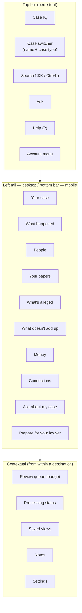

# 14 — UX Specification

Screen-by-screen specifications live in `wireframes/`. This document defines the principles,
information architecture, navigation, terminology, and interaction rules those screens must obey.

**The governing constraint:** the primary user may know nothing about law or technology, is
stressed, and is on a phone. Every design decision is tested against her.

---

## 1. UX principles

Twelve principles. They are numbered so they can be cited in review.

| # | Principle | What it means in practice | What it forbids |
|---|---|---|---|
| UX-1 | **Provenance is visible, not discoverable** | Every claim shows where it came from without the user looking for it | Hiding citations behind a "show details" link |
| UX-2 | **One click to the source** | Any claim reaches its evidence page in exactly one click, in an overlay that preserves context | Two-step "open document, then find the page" flows |
| UX-3 | **Say "not established" rather than guess** | The absence of an answer is a designed, reassuring state | Empty states that look like errors; hedging filler |
| UX-4 | **Class before content** | The assertion class badge is read before the claim text | Rendering an allegation in the same visual style as a fact |
| UX-5 | **Three things on the first screen** | Consumer surfaces surface a maximum of three primary actions | Feature-dense dashboards |
| UX-6 | **Plain words** | "Your papers", not "documents"; "people", not "entities"; "your case", not "matter" | Legal jargon on consumer surfaces (see §6) |
| UX-7 | **Honest progress** | Ranges, not countdowns. Named failures, not spinners that never end | Fake ETAs; indeterminate spinners for long jobs |
| UX-8 | **Never lose work** | Autosave, draft recovery, resume position, reversible actions | Modals that discard on `Esc` without warning |
| UX-9 | **The user owns the story** | AI drafts; the user edits and owns. Their words survive | Silent rewriting of user text into legal language |
| UX-10 | **Never characterise a person** | Neutral descriptions only | Any copy that implies lying, guilt, or credibility |
| UX-11 | **The system admits its limits** | Coverage gaps, OCR caveats, and unreadable pages are shown, not hidden | Silently omitting what failed |
| UX-12 | **Accessible by construction** | WCAG 2.2 AA, keyboard-complete, screen-reader-labelled, reduced-motion aware | Canvas-only graphs; colour-only meaning; focus traps |

---

## 2. Information architecture

### 2.1 The mental model

The user's mental model is **"my case file, organised."** The IA maps onto questions a person
actually asks, not onto database entities.

```
YOUR CASE
├── Where am I?              → Case Overview     "What's going on in my case?"
├── What happened?           → Timeline          "Show me the story in order"
├── Who's involved?          → People            "Who are these people?"
├── What do the papers say?  → Evidence          "Show me the documents"
├── What am I accused of?    → Allegations       "What are they saying about me?"  [Phase 2]
├── What doesn't add up?     → Conflicts         "Where do the stories differ?"    [Phase 2]
├── Where did the money go?  → Money             "Follow the money"                [Phase 3]
├── How is everyone linked?  → Relationships     "Who knows who"                   [Phase 3]
├── What do I ask?           → Ask about my case "Ask a question"
└── What do I hand over?     → Prepare for lawyer "Make my case package"
```

Everything else — folders, tags, saved views, settings, processing status — is **supporting
infrastructure reached from within** these ten destinations, never a top-level navigation item.

### 2.2 The ten primary destinations, and why exactly these

| Destination | Consumer label | Professional label | Question answered | Phase |
|---|---|---|---|---|
| Case Overview | **Your case** | Matter overview | Where am I? | MVP |
| Timeline | **What happened** | Chronology | When did things happen? | MVP |
| People | **People** | People & organizations | Who is involved? | MVP |
| Evidence | **Your papers** | Documents | What do the papers say? | MVP |
| Allegations | **What's alleged** | Allegations | What is claimed, and what supports it? | 2 |
| Conflicts | **What doesn't add up** | Inconsistencies | Where do accounts differ? | 2 |
| Money | **Money** | Financial evidence | Where did the money go? | 3 |
| Relationships | **Connections** | Relationship graph | How is everyone linked? | 3 |
| Ask | **Ask about my case** | Case assistant | What do my papers say about X? | MVP |
| Prepare | **Prepare for your lawyer** | Lawyer brief | How do I hand this over? | MVP |

**Deliberate inclusion of "Prepare for your lawyer" as top-level navigation.** It is the growth
loop and the moment of perceived value. Burying it under "Export" would cost the business its main
acquisition channel.

**Deliberate rejection of `Dashboard` as a destination.** "Dashboard" is software vocabulary. The
landing surface is *Your case* and it answers "where am I", not "here are nine widgets."

### 2.3 Progressive disclosure across phases

A user on the MVP sees six destinations. As modules ship, destinations appear — but only when the
case actually has data for them:

| Condition | Destination appears |
|---|---|
| Any document processing complete | What happened, People, Your papers |
| ≥ 1 allegation extracted or created | What's alleged |
| ≥ 3 statement pairs analysed | What doesn't add up |
| ≥ 1 document classified as financial | Money |
| ≥ 10 entities with ≥ 1 relationship | Connections |
| ≥ 1 reviewed timeline event | Prepare for your lawyer |

**Navigation never shows a destination the case cannot populate.** An empty "Money" tab on a
family matter is a defect, not a discoverable feature.

### 2.4 Global navigation structure



| Breakpoint | Navigation |
|---|---|
| ≥ 1280px | Persistent left rail, expanded labels, evidence viewer as a right split pane |
| 1024–1279px | Collapsed icon rail with tooltips; viewer as a right split pane |
| 768–1023px | Collapsed rail; evidence viewer as a full-screen overlay |
| < 768px | Bottom tab bar with the 5 highest-value destinations plus "More"; evidence viewer full-screen; **review flows optimised for thumbs** |

**Mobile is not a degraded desktop.** The three highest-frequency mobile actions are: check the
timeline, verify a citation, and approve/correct a review item. All three are first-class on a
phone.

---

## 3. Core interaction patterns

### 3.1 The evidence overlay (the most important pattern in the product)

Opened by any citation, from any surface, in one click.

```
┌───────────────────────────────┬──────────────────────────────────┐
│  SOURCE                       │  WHY YOU'RE SEEING THIS          │
│                               │                                  │
│  [page render, scrolled to    │  Found in your documents         │
│   the highlighted span,       │  "Supported by the records"      │
│   highlight in amber]         │                                  │
│                               │  "A transfer of $47,500 was      │
│  ┌─ highlighted quote ──────┐ │   made from Northgate Holdings   │
│  │ …on or about 14 June 2021│ │   to an account ending 4471."    │
│  │ the sum of $47,500.00 was│ │                                  │
│  │ transferred to account   │ │  Disclosure Vol. 7 · p. 88       │
│  │ ending 4471…             │ │  Email · 19 Jan 2023             │
│  └──────────────────────────┘ │  Read from the original PDF ✓    │
│                               │                                  │
│  [page 88 of 412]  ◀ ▶        │  [Looks right]  [Fix this]       │
│                               │  [Open full document]            │
│                               │  [Copy reference]                │
│                               │  ▸ How we know this              │
└───────────────────────────────┴──────────────────────────────────┘
```

Requirements:
- **One click** from any citation. Deep-linkable URL.
- The highlight is derived from `char_start`/`char_end` in the extraction run the citation binds
  to — never re-searched at render time.
- If the quote no longer matches the current text, the overlay **says so** instead of highlighting
  the wrong region.
- `Esc` closes and returns focus to the triggering element.
- "How we know this" is collapsed for consumer users and expanded by default for professional
  users, showing model, prompt version, and run timestamp.
- On mobile: full-screen, with the quote pinned at the top and the page image scrollable beneath.

### 3.2 The claim component

Every AI-generated or interpretive statement renders through one component with a fixed anatomy:

```
┌────────────────────────────────────────────────────────┐
│  FOUND IN YOUR DOCUMENTS          Supported by records │  ← class + confidence
│                                                        │
│  A transfer of $47,500 was made from Northgate         │  ← claim text
│  Holdings to an account ending 4471.                   │
│                                                        │
│  📄 Disclosure Vol. 7 · p. 88                          │  ← citation chip (1 click)
│  ⚠️ figure read from a scan — check the original       │  ← OCR caveat, when applicable
└────────────────────────────────────────────────────────┘
```

**Rules:**
- The component **cannot be rendered without a citation** (see `09-evidence-provenance.md` §4.1).
  There is no "claim without citation" variant.
- Class badge is always present, always first in reading order.
- Confidence is rendered as a phrase, never as a number, enum, or coloured score out of 5.
- OCR and low-confidence caveats appear **inline with the claim**, not in a footnote.
- The component has a `<NotEstablished>` sibling used when there is nothing to show.

### 3.3 The not-established component

```
┌────────────────────────────────────────────────────────┐
│  ✕  Your papers don't answer this yet                  │
│                                                        │
│  Nothing in the documents you've added establishes     │
│  who attended the 4 June meeting.                      │
│                                                        │
│  What your papers do show about June 2021:             │
│  · 2021-06-04  Meeting scheduled at Northgate offices  │
│    [Disclosure Vol. 2, p. 31]                          │
│  · 2021-06-11  Email confirming the meeting went ahead │
│    [Disclosure Vol. 4, p. 12]                          │
│                                                        │
│  [Add a question for your lawyer]  [Search your papers]│
└────────────────────────────────────────────────────────┘
```

**This is a feature, not an error state.** It is never red, never an exclamation mark, never
"Sorry, I couldn't find anything."

### 3.4 The class badge visual language

| Class | Consumer label | Treatment | Colour token |
|---|---|---|---|
| `SOURCE_EXCERPT` | From the document | Quotation styling, serif-ish italic | `--class-source` (slate) |
| `EXTRACTED_FACT` | Found in your documents | Solid neutral chip | `--class-fact` (indigo) |
| `ALLEGATION` | Alleged by a party | Outlined chip, amber accent | `--class-allegation` (amber) |
| `PARTY_POSITION` | A party's position | Outlined chip | `--class-position` (teal) |
| `USER_STATEMENT` | Your account | Distinct left border, italic body | `--class-user` (violet) |
| `AI_INFERENCE` | AI observation | Dashed border, sparkle icon | `--class-inference` (grey-blue) |
| `LEGAL_INTERPRETATION` | A legal question | Question-mark icon, panel treatment | `--class-legal` (neutral) |

**Colour is never the only signal.** Every badge carries text and a shape or icon difference, for
colour-blind users and for greyscale printing (which matters — the Lawyer Brief is printed).

### 3.5 The review interaction

Optimised for speed, keyboard-complete.

| Key | Action |
|---|---|
| `J` / `↓` | Next item |
| `K` / `↑` | Previous item |
| `Y` or `Enter` | Looks right |
| `F` | Fix this |
| `X` | Not right — remove |
| `Space` | Can't tell — defer |
| `O` | Open source overlay |
| `Esc` | Close overlay |
| `?` | Show shortcuts |
| `U` | Undo last action |

- Actions take effect immediately with an **undo toast** (6 seconds) rather than a confirmation
  dialog. Confirmations are reserved for batch actions.
- Progress is always visible: "142 of 380 checked".
- Batch actions show a preview of the first five affected items and the exact count.

### 3.6 Filters and views

- Filter state lives in the URL. Every filtered view is shareable and reloadable.
- Filters are shown as removable chips above the results; a "Clear all" is always available.
- Zero-result states name the filter most likely responsible and offer to remove it.
- Saved views are named by the user in their own words.
- **Never hide a filter's effect.** Result counts update visibly and state "showing X of Y".

### 3.7 The result-count and coverage pattern

Wherever results are shown, three numbers are available: shown, total matching, and **excluded**
(with the reason). Coverage honesty is a product principle (UX-11), not a statistic.

```
Showing 20 of 412 matching events
· 8 have no date and are listed separately
· 3 come from pages we couldn't read
```

---

## 4. Screen inventory

Full specifications in `wireframes/`. This is the complete inventory the MVP and Phase 2 require.

| Screen | File | Phase |
|---|---|---|
| Landing page | `wireframes/01-landing-and-auth.md` | MVP |
| Login / signup / MFA | `wireframes/01-landing-and-auth.md` | MVP |
| Onboarding wizard | `wireframes/02-onboarding.md` | MVP |
| Case dashboard (Your case) | `wireframes/03-case-dashboard.md` | MVP |
| Document upload | `wireframes/04-upload.md` | MVP |
| Documents (library) | `wireframes/05-documents.md` | MVP |
| Timeline | `wireframes/06-timeline.md` | MVP |
| Person profile | `wireframes/07-person-profile.md` | MVP |
| Witness profile | `wireframes/08-witness-profile.md` | Phase 2 |
| Allegation view | `wireframes/09-allegations.md` | Phase 2 |
| Evidence / citation viewer | `wireframes/10-evidence-viewer.md` | MVP |
| Financial transactions | `wireframes/11-money.md` | Phase 3 |
| Relationship graph | `wireframes/12-relationships.md` | Phase 3 |
| Case AI chat | `wireframes/13-ask.md` | MVP |
| Story builder | `wireframes/14-story-builder.md` | Phase 2 |
| Lawyer brief | `wireframes/15-lawyer-brief.md` | MVP |
| Review queue | `wireframes/16-review-queue.md` | MVP |
| Search results | `wireframes/17-search.md` | MVP |
| Processing status | `wireframes/18-processing-status.md` | MVP |
| Settings | `wireframes/19-settings.md` | MVP |
| Admin console | `wireframes/20-admin.md` | Phase 3 |

---

## 5. Copy and tone

### 5.1 Voice

| Attribute | We are | We are not |
|---|---|---|
| Tone | Calm, plain, respectful | Clinical, legalistic, chatty |
| Stance | Neutral observer of the record | Advocate, advisor, cheerleader |
| Certainty | Precise about what is known | Confident about what is not |
| Register | "Your papers say…" | "The documentation indicates…" |
| Empathy | Recognises difficulty without dramatising | "We understand this is stressful!" |

### 5.2 Mandatory copy patterns

| Situation | Pattern |
|---|---|
| Abstention | "Your papers don't answer this yet." + what they *do* show |
| Uncertain date | "On or about 14 June 2021 (the document says 'on or about')" |
| OCR-derived figure | "This figure was read by computer from a scan — check it against the original." |
| Allegation | "Alleged by [party]" — never in the grammatical voice of established fact |
| Apparent inconsistency | "These statements appear inconsistent as to timing." + possible explanations |
| Legal question | "This is a question for your lawyer." |
| Missing evidence | "Your papers don't include a bank statement for March–June 2021. Would that help?" |
| Empty case | "Nothing here yet. Add your papers to get started." |

### 5.3 Forbidden vocabulary

Enforced by a **copy lint in CI** over all string tables and generated templates.

| Never use | Why | Use instead |
|---|---|---|
| lied, lying, dishonest, untruthful, deceptive | Credibility judgement | "These statements appear inconsistent" |
| guilty, innocent, culpable | Adjudication | "The record does not address this" |
| proved, established that [person] | Usurps the court's role | "The documents state…"; "the evidence supports…" |
| fraud, fraudulent*, theft, stole, embezzled | Criminal characterisation | "The transaction shows…"; "the allegation is…" |
| suspicious, unusual, concerning (about a transaction) | Implies wrongdoing | State the amount, parties, date. Let the user conclude. |
| you should, you must, we recommend | Legal advice | "A question for your lawyer" |
| your best argument, your strongest point | Advocacy | "The evidence that supports this" |
| obviously, clearly, of course | Overclaims certainty | State the evidence |
| AI lawyer, AI legal advice, replaces a lawyer | UPL risk | "Organises your case for your lawyer" |
| will win, chances of success | Outcome prediction | Not a product capability |
| simply, just, obviously easy | Condescending | Plain statement |

\* `fraud` may appear **only** when quoting a document verbatim or naming the offence charged,
always inside a `SOURCE_EXCERPT`/`ALLEGATION` class context with the quotation marks intact.

### 5.4 The legal-advice refusal, verbatim

> "I can't tell you what your legal position is or what you should do — that's your lawyer's role.
> What I can do is show you what your documents say, and help you organise your questions for your
> lawyer.
> [Show me the evidence about this] [Add this to my questions for my lawyer]"

This exact string is required. Variants are permitted only for length; the two elements — the
declination and the redirect — are both mandatory.

---

## 6. Terminology map

The single source of truth for consumer-facing vocabulary. `persona_type` on the user selects the
column.

| Concept | Consumer (individual) | Professional | Never |
|---|---|---|---|
| Matter / case | **your case** | matter | "docket", "file" |
| Document | **paper** / **document** | document | "artifact", "item" |
| Entity | **person** / **organization** | entity | "entity" (consumer) |
| Allegation | **what's alleged** | allegation | "charge" (civil contexts) |
| Contradiction | **what doesn't add up** | inconsistency | "lie", "discrepancy" (alone) |
| Extraction | **what we found** | extraction | "parse", "annotation" |
| Confidence | **stated directly in a document** | HIGH/MEDIUM/LOW/UNKNOWN + phrase | percentages |
| Citation | **where this comes from** | citation, reference | "footnote", "source ID" |
| Pipeline state | **reading your papers** | processing state | "job", "queue", "worker" |
| Review queue | **things to check** | review queue | "QA queue", "validation" |
| Page | **page 88** | p. 88 | "offset", "span" |
| Embedding | (never shown) | (never shown) | "vector" |
| Model version | (only under "How we know this") | shown by default | model names in consumer UI |
| Parties | **the people and companies involved** | parties | "actors", "subjects" |

**The test:** if a phrase would not make sense to someone who has never read a court document,
it does not belong on a consumer surface.

---

## 7. Accessibility

WCAG 2.2 AA is a hard requirement, not an aspiration. The features this product most easily gets
wrong:

| Requirement | Implementation |
|---|---|
| **Accessible graph alternative** | Every graph has a keyboard-navigable table equivalent at the same URL (`?view=table`), and the graph itself is not the only way to reach any data |
| **Timeline alternative** | The visual timeline has a table view that is a genuine peer, not a fallback |
| **Colour independence** | Assertion classes differ in shape, border, and icon as well as colour; confidence differs in text and icon |
| **Focus management** | The evidence overlay traps focus, restores it on close; every modal has a labelled role and a described title |
| **Keyboard completeness** | Every action is reachable without a pointer, including review, filtering, and citation inspection |
| **Screen reader semantics** | Claim components expose structured semantics: the class and confidence are announced *before* the claim text, because that ordering carries meaning |
| **Live regions** | Processing status uses `aria-live="polite"` and announces transitions in words, not just progress percentages |
| **Reduced motion** | `prefers-reduced-motion` disables timeline animations, graph physics settling, and transitions; nothing conveys meaning through motion alone |
| **Click/touch targets** | Minimum 24×24 CSS px (WCAG 2.2 AA), 44×44 for primary mobile actions |
| **Text contrast** | ≥ 4.5:1 body, ≥ 3:1 large; amber OCR warnings meet contrast on their own background |
| **Zoom** | 200% reflow with no loss of function; the timeline degrades to the table view rather than overflowing |
| **Error identification** | Errors name the field and the fix in text; never colour alone |
| **Consistent help** | A `?` affordance in a consistent location on every screen |

**Print accessibility also matters** — the Lawyer Brief is printed and read on paper, in greyscale,
possibly by a judge. Class badges must be distinguishable without colour, which is why they carry
text and shape.

---

## 8. Performance budgets

Perceived performance is UX.

| Interaction | Budget (p95) |
|---|---|
| Any screen's first meaningful content | < 2.0s |
| Citation click → highlighted source visible | < 1.5s |
| Search keystroke → results | < 800ms |
| Review action → next item ready | < 300ms (optimistic) |
| Chat first token | < 3s |
| Timeline scroll (5,000 events) | ≥ 50fps |
| Document library scroll (2,000 docs) | ≥ 50fps |
| Upload progress update | ≤ 1s interval |

**Techniques:** server-side pagination, virtualised lists, optimistic mutations for review actions,
skeleton loaders shaped like the content, prefetch on hover/focus for citations, and streaming for
processing state.

**Never:** a full-page spinner for a partial-data screen. If some data is ready, show it.

---

## 9. Empty, loading, error, and partial states

Global criterion G-11: every feature specifies all four.

| State type | Rule | Example |
|---|---|---|
| **Empty (new user)** | Explain the value and give exactly one action | "No papers yet. Add your documents and we'll find the story in them. [Add your papers]" |
| **Empty (filtered to nothing)** | Name the likely filter and offer to remove it | "No events in June 2019. [Show all dates]" |
| **Loading (short)** | Skeleton shaped like the content | — |
| **Loading (long, > 5s)** | Progress with a phase name and an honest ETA range, plus a way to leave and be notified | "Reading your papers — about 4–9 minutes left. [Email me when it's done]" |
| **Error (recoverable)** | What happened, what was preserved, one action | "We couldn't read this file. Your original is saved. [Try again] [Download original]" |
| **Error (fatal)** | What happened plus a support reference; never a blank screen | "Something went wrong on our side. Reference: req_01H…" |
| **Partial** | Show what exists; name what is missing; never block | "Showing 142 of 180 events — 38 more coming as we finish reading. [See what's left]" |

---

## 10. Onboarding UX notes

Detail in `05-mvp-scope.md` and the wireframes. Key UX decisions:

1. **Five visible steps, not ten.** Allegations, story builder, witnesses, money, and brief
   generation are discovered in-product once there is data to populate them.
2. **Upload is skippable.** A user who is not ready must be able to create a case and come back.
3. **The first value moment is the timeline, shown in step 5** with three real events and their
   citations — the product's promise demonstrated in under a minute.
4. **No feature tour.** No coach marks. The interface is simple enough not to need them; if it
   needs a tour, it is too complex.
5. **Case type drives terminology immediately** — a family-matter user sees "the other party",
   an employment user sees "your employer".

---

## 11. Trust-building surfaces

Deliberate UX for a product asking users to trust AI with their legal matter.

| Surface | Purpose |
|---|---|
| "How we know this" on every claim | Show model, prompt version, extraction time, verification result |
| The coverage panel ("What we couldn't do") | Admit limits prominently and actionably |
| Confidence phrases instead of scores | Refuse fake precision |
| The "not established" component | Make abstention feel like an answer |
| The verification summary on the Lawyer Brief | State how many statements were human-checked |
| The OCR badge | Flag machine-read figures persistently |
| The chain-of-custody note | Explain hashing honestly, including what it does not prove |
| The non-advice footer | Repeat the boundary everywhere it could be forgotten |

**The strategic bet:** visible honesty converts better than confident-sounding claims for this
audience, because the audience has been burned by confident-sounding claims.

---

## Related documents

- `wireframes/` — screen-by-screen specifications
- `15-design-system.md` — tokens, components, and visual language
- `04-feature-specification.md` — features these screens implement
- `03-user-journeys.md` — the flows these screens serve
- `13-privacy-and-legal-risks.md` — why the copy rules in §5.3 exist
- `02-user-personas.md` — who the terminology in §6 serves
