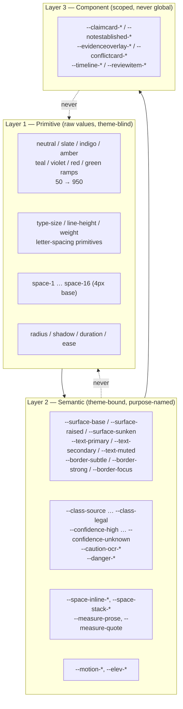
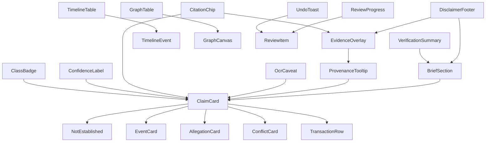

# 15 — Design System

This document defines the visual and interaction language every Case IQ screen is built from. It is
subordinate to `14-ux-specification.md`, which defines the principles, terminology, and copy rules.
Where this document and that one appear to conflict, that one wins and this one has a bug.

**The governing constraint, restated:** the primary user may know nothing about law or technology,
is stressed, and is on a phone. Tokens, components, and motion are all judged against her.

---

## 1. Design principles

Seven principles. Each is stated with the thing it **forbids**, because a principle that forbids
nothing is a slogan.

| # | Principle | What it means in practice | What it forbids |
|---|---|---|---|
| DS-1 | **Provenance is structural, not decorative** | The citation chip and the class badge are parts of the component's anatomy, not slots a screen may omit. A `ClaimCard` without a citation does not compile. | Any "compact claim" or "summary chip" variant that drops the citation or the class badge for density |
| DS-2 | **Shape carries meaning before colour does** | Class, confidence, and caution each have a distinct silhouette and icon. Colour is a reinforcement layer. | Any state that is distinguishable only by hue; any legend that says "amber = warning" |
| DS-3 | **The system never characterises a person** | Colour, weight, size, and position are never used to make a person look worse. Confidence attaches to an extraction, never to a human. | Red or green encodings of evidence strength; avatar prominence ranking; per-person "risk" scores |
| DS-4 | **Calm surfaces, loud exceptions** | The base surface is quiet, dense, and typographically restrained. Visual noise is spent only on things the user must not miss (OCR caveats, verification failures, disputed records). | Decorative gradients, drop-shadowed cards everywhere, more than three accent uses per screen |
| DS-5 | **Honest limits are first-class UI** | Coverage gaps, OCR caveats, unreadable pages, and abstention get designed, permanent components with their own tokens. | Toast-only or footnote-only disclosure of a limit; hiding a caveat behind a tooltip |
| DS-6 | **Print is a target, not an afterthought** | Every token and component must survive greyscale laser printing, because the Lawyer Brief is printed and possibly read by a judge. | Colour-only encoding; light-grey body text; hairlines below 0.75pt; screen-only affordances with no print form |
| DS-7 | **One control does one thing** | The same verb behaves identically everywhere. "Looks right" always means the same thing, in review, in the timeline, and in the brief preview. | Screen-specific re-labelling of a shared action; icon-only controls whose meaning changes by context |

---

## 2. Token architecture

### 2.1 Three layers

Tokens exist in three layers. Each layer may reference only the layer beneath it. A component may
reference semantic tokens only — never primitives.



**Rule:** `components/claim-card.css` may contain `color: var(--class-fact-ink)` and may not contain
`color: var(--indigo-600)`. CI enforces this with a stylelint rule that fails on a primitive token
reference inside any `packages/ui/src/components/**` file.

### 2.2 Naming grammar

```
--{layer-scope}-{category}-{role}-{modifier}
   semantic      text     primary   (state or scale position)
   component     claim    bg
```

- Semantic tokens never contain a colour name. `--text-muted` is correct; `--text-grey` is a defect.
- Component tokens always start with the component's kebab name: `--conflictcard-quote-bg`.
- Scale suffixes are numeric only where the scale is genuinely numeric: `--space-3`, `--radius-2`.
- No abbreviations except `bg`, `fg`, `xs/sm/md/lg/xl`.

### 2.3 Themes

Two themes ship at MVP: `light` (default) and `dark`. They are declared as CSS custom properties on
`[data-theme="light"]` and `[data-theme="dark"]` with `color-scheme` set. **No component may
hard-code a hex value.** A third theme, `print`, is a media-query override that collapses elevation,
forces greyscale-safe borders, and remaps the class ramp to outline weights (see §7.4).

---

## 3. Colour

### 3.1 Primitive ramps

Nine ramps. Each has 11 steps (50–950). Values are given in hex, with the OKLCH lightness in
parentheses where it clarifies the ramp's intent. These are the only raw colours in the system.

**Neutral** (surfaces, ink) — very slightly cool, so it reads as paper rather than as grey.

| Step | Hex | Where it is designed to land |
|---|---|---|
| 50 | `#F7F8FA` | app chrome, sunken header |
| 100 | `#F2F3F5` | page background (light) |
| 200 | `#E6E8EC` | dividers on sunken surfaces |
| 300 | `#D8DCE4` | subtle borders |
| 400 | `#B4BAC6` | disabled glyphs |
| 500 | `#8C94A3` | strong borders, placeholder text |
| 600 | `#5C6373` | muted text |
| 700 | `#4A5163` | secondary text |
| 800 | `#2E3442` | dark-theme borders |
| 900 | `#1B1F2A` | primary ink (light) |
| 950 | `#0E1116` | dark-theme page background |

**Slate** — same lightness ladder as neutral but cooler, reserved for `SOURCE_EXCERPT` and for the
quote surface so that quotations read as a distinct material.

| Step | Hex | | Step | Hex |
|---|---|---|---|---|
| 50 | `#F1F4F8` | | 500 | `#7C8AA0` |
| 100 | `#E6EBF2` | | 600 | `#52627A` |
| 200 | `#D2DAE6` | | 700 | `#3E4A5C` |
| 300 | `#B6C2D4` | | 800 | `#2C3542` |
| 400 | `#94A3B8` | | 900 | `#1E2530` |
| | | | 950 | `#12171F` |

**Indigo / primary** — the single brand ramp. Used for interactive affordances, `EXTRACTED_FACT`,
and focus.

| Step | Hex | | Step | Hex |
|---|---|---|---|---|
| 50 | `#EBEEFB` | | 500 | `#4A5FD9` |
| 100 | `#DCE2F8` | | 600 | `#2F3FA8` |
| 200 | `#BFC9F4` | | 700 | `#2438A8` |
| 300 | `#93A2EE` | | 800 | `#1D2C82` |
| 400 | `#6E80E6` | | 900 | `#182460` |
| | | | 950 | `#101838` |

**Amber** — reserved for two things only: `ALLEGATION` and the OCR/caution signal. Amber is never
used for emphasis, marketing, or "attention" in general; scarcity is what makes it legible.

| Step | Hex | | Step | Hex |
|---|---|---|---|---|
| 50 | `#FDF6E7` | | 500 | `#C2820F` |
| 100 | `#F7E7C4` | | 600 | `#9A5B00` |
| 200 | `#F5D79B` | | 700 | `#7A4A05` |
| 300 | `#F0C070` | | 800 | `#5E3903` |
| 400 | `#E0A03A` | | 900 | `#3F2704` |
| | | | 950 | `#241B0E` |

**Teal** — `PARTY_POSITION`.

| Step | Hex | | Step | Hex |
|---|---|---|---|---|
| 50 | `#E2F2F0` | | 500 | `#17827C` |
| 100 | `#C7E8E5` | | 600 | `#126E69` |
| 200 | `#9BD8D4` | | 700 | `#0F5D59` |
| 300 | `#77D6CE` | | 800 | `#0C4844` |
| 400 | `#2BA9A2` | | 900 | `#0A3633` |
| | | | 950 | `#0F2321` |

**Violet** — `USER_STATEMENT` and nothing else. This ramp is deliberately quarantined: if violet
appears on screen, it is the user's own words.

| Step | Hex | | Step | Hex |
|---|---|---|---|---|
| 50 | `#F3EBFB` | | 500 | `#8B54C4` |
| 100 | `#E7D8F7` | | 600 | `#7A47B0` |
| 200 | `#D6BDF1` | | 700 | `#6B3A9E` |
| 300 | `#CBA6F2` | | 800 | `#542C7C` |
| 400 | `#A97CE0` | | 900 | `#3E2160` |
| | | | 950 | `#1D1430` |

**Red** — reserved exclusively for **system failure and destructive actions** (upload failed, delete
case, verification failure). Red never encodes anything about evidence, a person, or a claim.

| Step | Hex | | Step | Hex |
|---|---|---|---|---|
| 50 | `#FDECEC` | | 500 | `#C0392B` |
| 100 | `#FAD9D9` | | 600 | `#A82A2E` |
| 200 | `#F5B8B8` | | 700 | `#9B2226` |
| 300 | `#F5A3A3` | | 800 | `#7A1B1E` |
| 400 | `#E06A6A` | | 900 | `#571417` |
| | | | 950 | `#271417` |

**Green** — used for exactly one thing: **the user's own completion milestones** (an item reviewed,
a section finished, a save confirmed). Green never encodes anything about evidence quality.

| Step | Hex | | Step | Hex |
|---|---|---|---|---|
| 50 | `#EAF6EE` | | 500 | `#2A8C4E` |
| 100 | `#D3EDDC` | | 600 | `#24794A` |
| 200 | `#A9DCBC` | | 700 | `#1F6B3A` |
| 300 | `#7FD6A0` | | 800 | `#185430` |
| 400 | `#48B473` | | 900 | `#123D23` |
| | | | 950 | `#0F2116` |

### 3.2 Semantic tokens — light theme

Contrast ratios below are computed against the stated background per WCAG 2.1 relative-luminance
formula. All values were verified numerically, not estimated.

#### Surfaces and text

| Token | Value | Intended background | Contrast | Requirement |
|---|---|---|---|---|
| `--surface-sunken` | `#F3F5F8` | — | — | — |
| `--surface-base` | `#F7F8FA` | — | — | page |
| `--surface-raised` | `#FFFFFF` | — | — | cards, panels |
| `--surface-overlay` | `#FFFFFF` at 98% + `--elev-4` | — | — | evidence overlay |
| `--text-primary` | `#1B1F2A` | `--surface-raised` | **16.46:1** | ≥ 4.5 body ✅ |
| `--text-primary` | `#1B1F2A` | `--surface-sunken` | **15.07:1** | ✅ |
| `--text-secondary` | `#4A5163` | `--surface-raised` | **7.93:1** | ✅ |
| `--text-muted` | `#5C6373` | `--surface-raised` | **6.02:1** | ✅ |
| `--text-muted` | `#5C6373` | `--surface-sunken` | **5.51:1** | ✅ |
| `--text-on-accent` | `#FFFFFF` | `--accent` `#2438A8` | **9.52:1** | ✅ |
| `--border-subtle` | `#D8DCE4` | `#FFFFFF` | 1.37:1 | decorative only |
| `--border-strong` | `#8C94A3` | `#FFFFFF` | **3.05:1** | ✅ non-text UI (WCAG 1.4.11) |
| `--border-focus` | `#2438A8` | `#FFFFFF` | **9.52:1** | ✅ |
| `--accent` | `#2438A8` | `#FFFFFF` | **9.52:1** | ✅ |
| `--accent-surface` | `#EBEEFB` | — | ink on it: **14.23:1** | ✅ |

`--text-muted` is the floor for body-sized text: nothing smaller than 16px may use a lighter value.
`--border-subtle` is explicitly **not** an accessible boundary and must never be the only thing
delimiting a control — it is for grouping whitespace, not for component edges.

#### Assertion-class tokens

Every class token resolves to a triple: `-ink` (text/icon), `-surface` (fill), `-border`. The
`-border` value always meets **3:1** against BOTH the class surface and the page surface, because
class borders are the primary non-colour signal in print.

| Class | Token | Value | Background | Contrast |
|---|---|---|---|---|
| `SOURCE_EXCERPT` | `--class-source-ink` | `#3E4A5C` | `--class-source-surface` `#F1F4F8` | **8.14:1** ✅ |
| | `--class-source-border` | `#52627A` | `#F1F4F8` | 6.4:1 ✅ |
| `EXTRACTED_FACT` | `--class-fact-ink` | `#2F3FA8` | `--class-fact-surface` `#EBEEFB` | **7.57:1** ✅ |
| | `--class-fact-border` | `#2F3FA8` | `#EBEEFB` | 7.57:1 ✅ |
| `ALLEGATION` | `--class-allegation-ink` | `#7A4A05` | `--class-allegation-surface` `#FDF6E7` | **6.95:1** ✅ |
| | `--class-allegation-border` | `#9A5B00` | `#FDF6E7` | **5.04:1** ✅ |
| `PARTY_POSITION` | `--class-position-ink` | `#0F5D59` | `--class-position-surface` `#E2F2F0` | **6.66:1** ✅ |
| | `--class-position-border` | `#126E69` | `#E2F2F0` | 5.6:1 ✅ |
| `USER_STATEMENT` | `--class-user-ink` | `#6B3A9E` | `--class-user-surface` `#F3EBFB` | **6.64:1** ✅ |
| | `--class-user-border` | `#7A47B0` | `#F3EBFB` | 5.5:1 ✅ |
| `AI_INFERENCE` | `--class-inference-ink` | `#3C4A63` | `--class-inference-surface` `#EEF1F6` | **7.89:1** ✅ |
| | `--class-inference-border` | `#52627A` | `#EEF1F6` | 6.4:1 ✅ |
| `LEGAL_INTERPRETATION` | `--class-legal-ink` | `#3A3F49` | `--class-legal-surface` `#F2F3F5` | **9.52:1** ✅ |
| | `--class-legal-border` | `#4A5163` | `#F2F3F5` | 7.9:1 ✅ |

#### Confidence tokens

| Level | Phrase | Token | Value | Background | Contrast |
|---|---|---|---|---|---|
| `HIGH` | "Stated directly in a document" | `--confidence-high-ink` | `#1F6B3A` | `#EAF6EE` | **5.87:1** ✅ |
| `MEDIUM` | "Supported by the records" | `--confidence-medium-ink` | `#3C4A63` | `#EEF1F6` | **7.89:1** ✅ |
| `LOW` | "Possible — worth checking" | `--confidence-low-ink` | `#7A4A05` | `#FDF6E7` | **6.95:1** ✅ |
| `UNKNOWN` | "Not established" | `--confidence-unknown-ink` | `#5C6373` | `#F3F5F8` | **5.51:1** ✅ |

Note that `HIGH` uses green at 5.87:1 — this is the **only** permitted use of green outside
completion milestones, and it describes the extraction's provenance, never a person. A reviewer who
sees green on a person's row is looking at a defect.

#### OCR / caution tokens (the 4.5:1 requirement)

Amber is the hardest colour to make accessible. These values were chosen to clear **4.5:1 against
their own surface**, and the border clears 4.5:1 too, so the caution signal is legible as text,
as a boundary, and in greyscale (via the icon and the double border, see §7).

| Token | Value | Own surface | Contrast |
|---|---|---|---|
| `--caution-ocr-ink` | `#7A4A05` | `--caution-ocr-surface` `#FFF7E8` | **7.02:1** ✅ |
| `--caution-ocr-border` | `#9A5B00` | `#FFF7E8` | **5.04:1** ✅ |
| `--caution-ocr-icon` | `#7A4A05` | `#FFF7E8` | **7.02:1** ✅ |
| `--caution-ocr-ink` | `#7A4A05` | `--surface-raised` `#FFFFFF` | **7.48:1** ✅ |

**The 4.5:1 floor applies to the caution text on any amber surface it can land on.** `#9A5B00`
(the former `--ocr-border` candidate at 3.42:1 on `#FFF7E8`) was rejected for text use and is
permitted only as a ≥ 2px boundary, which is still above the 3:1 non-text threshold.

#### Danger tokens

| Token | Value | Background | Contrast | Use |
|---|---|---|---|---|
| `--danger-ink` | `#9B2226` | `#FDECEC` | **6.94:1** ✅ | destructive confirmations, failed jobs |
| `--danger-border` | `#A82A2E` | `#FDECEC` | 6.0:1 ✅ | error boundaries |
| `--danger-solid` | `#9B2226` | `--text-on-accent` `#FFFFFF` | 6.94:1 ✅ | destructive button fill |

### 3.3 Semantic tokens — dark theme

Dark theme is not an inversion. Surfaces step *up* in lightness with elevation, ink steps *down* in
contrast against a near-black base, and every class colour is re-derived on its own dark surface.

| Token | Value | Background | Contrast |
|---|---|---|---|
| `--surface-sunken` | `#0E1116` | — | page base |
| `--surface-base` | `#12161C` | — | — |
| `--surface-raised` | `#1A1F27` | — | — |
| `--text-primary` | `#EEF1F7` | `#1A1F27` | **14.62:1** ✅ |
| `--text-primary` | `#EEF1F7` | `#151A21` | **15.45:1** ✅ |
| `--text-secondary` | `#AEB6C6` | `#0E1116` | **9.28:1** ✅ |
| `--text-muted` | `#969FB1` | `#0E1116` | **7.11:1** ✅ |
| `--text-muted` | `#969FB1` | `#151A21` | **6.57:1** ✅ |
| `--border-subtle` | `#262C36` | `#0E1116` | 1.4:1 | decorative only |
| `--border-strong` | `#3E4756` | `#0E1116` | 3.0:1 ✅ | non-text UI |
| `--border-focus` | `#8FA0FF` | `#0E1116` | **7.78:1** ✅ |
| `--accent` | `#8FA0FF` | `#0E1116` | **7.78:1** ✅ |
| `--text-on-accent` | `#0E1116` | `#8FA0FF` | **7.78:1** ✅ |
| `--class-source-ink` | `#C3CCDA` | `#171C24` | **10.56:1** ✅ |
| `--class-fact-ink` | `#AEB8FA` | `#141A33` | **9.01:1** ✅ |
| `--class-allegation-ink` | `#F0C070` | `#241B0E` | **10.08:1** ✅ |
| `--class-position-ink` | `#77D6CE` | `#0F2321` | **9.58:1** ✅ |
| `--class-user-ink` | `#CBA6F2` | `#1D1430` | **8.60:1** ✅ |
| `--class-inference-ink` | `#B9C4D6` | `#1C2129` | 9.18:1 ✅ |
| `--class-legal-ink` | `#D3D6DC` | `#1B1F26` | **11.35:1** ✅ |
| `--confidence-high-ink` | `#7FD6A0` | `#0F2116` | **9.63:1** ✅ |
| `--confidence-medium-ink` | `#B9C4D6` | `#1C2129` | 9.18:1 ✅ |
| `--confidence-low-ink` | `#F0C070` | `#241B0E` | **10.08:1** ✅ |
| `--confidence-unknown-ink` | `#969FB1` | `#171C24` | 6.22:1 ✅ |
| `--caution-ocr-ink` | `#F2C879` | `#2B2214` | **9.92:1** ✅ |
| `--caution-ocr-border` | `#F0C070` | `#2B2214` | 10.08:1 ✅ |
| `--danger-ink` | `#F5A3A3` | `#271417` | **8.88:1** ✅ |

**Dark-theme rule:** no class surface in dark theme is a pure tint of its hue at low lightness
*because that is the pattern that produces 2:1 text*. Every value above was chosen by solving for
the contrast floor first and picking the hue second.

### 3.4 High-contrast and forced-colors

`prefers-contrast: more` raises `--text-muted` to `--text-secondary`, sets `--border-subtle` to
`--border-strong`, and thickens class borders to 2px. Windows High Contrast Mode is supported by
never relying on `background-color` alone: class badges carry a 1px `border` and a text glyph, so
`forced-colors: active` renders them legibly with system colours.

### 3.5 The colour-independence rule

> **Every semantic signal must remain unambiguous in greyscale print and under every simulated
> colour-vision deficiency. Colour is the fourth channel, never the first.**

| Signal | Shape channel | Icon channel | Text channel | Border channel | Colour (reinforcement) |
|---|---|---|---|---|---|
| `SOURCE_EXCERPT` | Serif italic block, indented | `quote` (opening quote mark) | "From the document" | Left rule, 3px solid | slate |
| `EXTRACTED_FACT` | Solid filled chip | `document-check` | "Found in your documents" | none (filled) | indigo |
| `ALLEGATION` | Outlined chip, notch corner top-right | `gavel-outline` → replaced by `speech-mark` | "Alleged by a party" | 1.5px solid + corner notch | amber |
| `PARTY_POSITION` | Outlined chip | `shield-half` | "A party's position" | 1.5px solid | teal |
| `USER_STATEMENT` | Block with 4px left bar, italic body | `person` | "Your account" | left bar only | violet |
| `AI_INFERENCE` | Dashed border, all sides | `sparkle` | "AI observation" | 1px dashed | grey-blue |
| `LEGAL_INTERPRETATION` | Panel with hanging indent, rules top and bottom | `question` | "A legal question" | top + bottom rules | neutral |
| Confidence HIGH | Solid dot, filled | `check` | "Stated directly in a document" | — | green |
| Confidence MEDIUM | Half-filled dot | `tilde` | "Supported by the records" | — | grey-blue |
| Confidence LOW | Hollow dot | `magnifier` | "Possible — worth checking" | — | amber |
| Confidence UNKNOWN | Cross glyph `✕` | `x` | "Not established" | — | grey |
| OCR caveat | Double left rule (3px + 1px gap) | `scan-warning` | "read by computer from a scan — check the original" | 1px **dashed** amber | amber |
| Suppressed | Struck-through rule above the block, collapsed by default | `eye-off` | "AI suggested — not verified" | none | grey |
| Disputed | Record carries a diagonal hatch overlay at 6% | `flag` | "Disputed" | 2px double border | neutral |
| Source deleted | — | `broken-link` | "Source deleted" | 1px dashed on chip | grey |
| Danger/error | Block with 4px solid left bar | `alert` | named failure | 4px left bar | red |

**Verification procedure (CI, not manual):** a screenshot suite renders every component in the
inventory under (a) `filter: grayscale(1)`, (b) deuteranopia, protanopia, and tritanopia
simulations, and (c) `prefers-contrast: more`. Any pair of states whose simulated screenshots differ
by less than a perceptual hash threshold fails the build. This is the enforcement mechanism that
makes DS-2 real.

---

## 4. Typography

### 4.1 Families

| Role | Family | Fallback stack | Why |
|---|---|---|---|
| UI sans | **Inter** (variable) | `"Inter var", "Inter", -apple-system, "Segoe UI", Roboto, "Helvetica Neue", Arial, sans-serif` | Neutral, excellent at 13–15px, tabular figures, wide language coverage |
| Quotation / legal serif | **Source Serif 4** | `"Source Serif 4", Georgia, "Times New Roman", serif` | Verbatim quotations must *look* like documents, not like UI. Also the print face for the brief |
| Numeric / mono | **JetBrains Mono** | `"JetBrains Mono", "SF Mono", Consolas, "Liberation Mono", monospace` | Amounts, hashes, character offsets, account references. Monospaced tabular alignment for ledgers |

Three families is the ceiling. No display face, no decorative face, no second sans. Fonts are
self-hosted `woff2` with `font-display: swap`, Latin + Latin-Extended subsets at MVP, with
`unicode-range` slices for Cyrillic and Greek ready (F45).

**Variable-font axes used:** Inter `wght` 400–700, `opsz` 14–32. Source Serif 4 `wght` 400/600.
Optical sizing is set explicitly per size token so headings do not render too light on large sizes.

### 4.2 Type scale

A 1.200 minor-third scale from a 16px base, rounded to whole pixels at small sizes for crisp
rendering.

| Token | Size | Line-height | Weight | Tracking | Family | Use |
|---|---|---|---|---|---|---|
| `--type-display` | 40px | 44px (1.10) | 600 | −0.02em | sans | Landing hero, empty-state headline (max 2 lines) |
| `--type-h1` | 32px | 38px (1.19) | 600 | −0.015em | sans | Screen title |
| `--type-h2` | 26px | 32px (1.23) | 600 | −0.01em | sans | Section title, overlay title |
| `--type-h3` | 21px | 28px (1.33) | 600 | −0.005em | sans | Card group title, panel heading |
| `--type-h4` | 18px | 24px (1.33) | 600 | 0 | sans | Card title, dialog title |
| `--type-body-lg` | 17px | 26px (1.53) | 400 | 0 | sans | Primary reading text on consumer surfaces |
| `--type-body` | 15px | 23px (1.53) | 400 | 0 | sans | Default body, table cells |
| `--type-body-sm` | 13.5px | 20px (1.48) | 400 | 0.002em | sans | Metadata rows, dense tables |
| `--type-label` | 13px | 16px (1.23) | 600 | 0.01em | sans | Chip and badge text, form labels |
| `--type-caption` | 12px | 16px (1.33) | 400 | 0.005em | sans | Timestamps, counts, footnotes |
| `--type-overline` | 11px | 14px (1.27) | 700 | 0.08em | sans | Section eyebrows, ALL CAPS only here |
| `--type-quote` | 16px | 27px (1.69) | 400 | 0 | **serif** | Verbatim quotations |
| `--type-quote-lg` | 19px | 32px (1.68) | 400 | 0 | **serif** | The pinned quote in the evidence overlay |
| `--type-hand` *(removed)* | — | — | — | — | — | *Deliberately not defined* — see §4.4 |
| `--type-money` | 15px | 23px | 400 | 0 | **mono** | Ledger amounts, offsets, hashes |
| `--type-money-lg` | 21px | 28px | 600 | −0.01em | **mono** | Totals |
| `--type-code` | 13px | 20px | 400 | 0 | **mono** | Character offsets, quote hashes |

**Minimums:** nothing below 12px anywhere; nothing below 14px on a consumer surface; nothing below
16px for `--type-quote` (quotations are read carefully or not at all). Line-height never below 1.4
for any text the user reads as prose.

### 4.3 Verbatim quotation vs paraphrase — the rendering contract

This is the typographic expression of the product's central principle
(`01-product-vision.md` §4.1, `09-evidence-provenance.md` §1.1). **A reader must be able to tell,
at a glance and in greyscale, whether they are reading the document's words or ours.**

| Property | Verbatim (`SOURCE_EXCERPT`) | Paraphrase / normalised (`EXTRACTED_FACT`) |
|---|---|---|
| Family | `--type-quote` serif | UI sans |
| Style | Roman (never italic for the quotation body itself) | Roman |
| Weight | 400 | 400 |
| Quotation marks | **Present**, always — both marks, including for partial quotes with an ellipsis | **Absent** |
| Surface | `--class-source-surface`, indented block | Plain page surface |
| Left rule | 3px solid `--class-source-border` | none |
| Text colour | `--class-source-ink` | `--text-primary` |
| Line-height | 1.69 (looser than body, so the eye slows) | 1.53 |
| Measure | `--measure-quote` 62ch | `--measure-prose` 72ch |
| Ellipsis for omissions | `…` with a non-breaking space on each side, never mid-word | n/a |
| Bracketed editorial insert | `[ ]` in sans at 90% size, never silently merged | n/a |

**Prohibited typographic moves, without exception:**

1. Never set a quotation in sans "because it's in a card". The serif is what distinguishes it.
2. Never use italics for a paraphrase to make it look like a quotation. Italics are reserved for
   `USER_STATEMENT` bodies and for genuine emphasis *inside* a quotation.
3. Never remove the quotation marks when a quote is shortened. Use `"…"` not `…`.
4. Never letter-space or uppercase a quotation. Caps are reserved for `--type-overline`.
5. Never justify text. Ragged-right only; justification creates rivers and hurts dyslexic readers.
6. Never apply `text-transform: capitalize` to a quotation; it changes the document's words.

**Numeric typography:** every figure that came from a document is set in `tabular-nums` so columns
align, and — critically — **a figure carries its OCR caveat as part of the same typographic run**,
never as a separate line beneath. Offsets, hashes, and account references use `--type-money` so that
`4471` and `8892` are distinguishable character by character.

### 4.4 Measure, wrapping and language

- `--measure-prose: 72ch`, `--measure-quote: 62ch`, `--measure-narrow: 48ch` (form labels, dialogs).
- `text-wrap: pretty` on headings, `text-wrap: balance` on `--type-h1`–`--type-h3` only.
- `hyphens: auto` with `lang` set correctly; never hyphenate a quotation (it alters the appearance
  of the document's text) — quotations use `hyphens: none` and `overflow-wrap: break-word`.
- Long unbroken tokens (base64, hashes, emails) use `overflow-wrap: anywhere` inside mono only.

---

## 5. Space, radius, elevation, motion, z-index, breakpoints

### 5.1 Spacing — 4px base

| Token | Value | Primary use |
|---|---|---|
| `--space-0` | 0 | — |
| `--space-1` | 4px | Icon-to-label, chip padding block |
| `--space-2` | 8px | Inline gap, chip padding inline |
| `--space-3` | 12px | Card internal padding (dense), table cell |
| `--space-4` | 16px | Default gutter, card padding |
| `--space-5` | 20px | Card padding on consumer surfaces |
| `--space-6` | 24px | Between cards, panel padding |
| `--space-8` | 32px | Between sections |
| `--space-10` | 40px | Between major regions |
| `--space-12` | 48px | Page top padding (desktop) |
| `--space-16` | 64px | Landing sections, empty-state breathing room |
| `--space-20` | 80px | Landing hero only |

Semantic aliases: `--space-inline-xs|sm|md|lg` (4/8/12/16), `--space-stack-sm|md|lg|xl`
(8/16/24/40).

**Rhythm rule:** vertical rhythm inside a card uses `--space-3` between metadata rows and
`--space-5` between a claim block and its citation row. The citation row is never more than
`--space-3` from the text it cites — physical proximity is part of the provenance signal (DS-1).

### 5.2 Radius

| Token | Value | Use |
|---|---|---|
| `--radius-0` | 0 | Table cells, print |
| `--radius-1` | 3px | Chips, badges, inputs |
| `--radius-2` | 6px | Buttons, small cards |
| `--radius-3` | 10px | Cards, panels |
| `--radius-4` | 14px | Overlay, modal, dropzone |
| `--radius-full` | 999px | Avatar, count pill, progress track |

Notched corners are used as a semantic shape (see `ALLEGATION` in §7): implemented with
`clip-path: polygon(...)` on the chip's outer edge, never with a background image.

### 5.3 Elevation

| Token | Shadow | Use |
|---|---|---|
| `--elev-0` | `none` | Flat content on a surface |
| `--elev-1` | `0 1px 2px rgba(16,20,28,.06), 0 1px 1px rgba(16,20,28,.04)` | Raised card |
| `--elev-2` | `0 2px 6px rgba(16,20,28,.08), 0 1px 2px rgba(16,20,28,.05)` | Sticky header, dropdown |
| `--elev-3` | `0 8px 20px rgba(16,20,28,.10), 0 2px 6px rgba(16,20,28,.06)` | Popover, combobox |
| `--elev-4` | `0 18px 44px rgba(16,20,28,.16), 0 4px 12px rgba(16,20,28,.08)` | Evidence overlay, modal |
| `--elev-5` | `0 28px 64px rgba(16,20,28,.20)` | Full-screen mobile sheet |

In dark theme, elevation adds a **border** as well as a shadow: `--elev-2` onwards pairs with
`1px solid var(--border-strong)` because shadows are invisible on near-black. **Print collapses all
elevation to `--elev-0`.**

### 5.4 Motion

| Token | Value | Use |
|---|---|---|
| `--motion-instant` | 0ms | Focus ring, state colour change |
| `--motion-fast` | 120ms | Hover, chip select, checkbox tick |
| `--motion-base` | 180ms | Button press, tab switch, card expand |
| `--motion-slow` | 260ms | Overlay open/close, drawer, sheet |
| `--motion-deliberate` | 400ms | Timeline pan, graph focus transition |
| `--motion-progress` | 1200ms | Indeterminate progress sweep (loop) |
| `--ease-standard` | `cubic-bezier(.2, 0, 0, 1)` | Almost everything |
| `--ease-decelerate` | `cubic-bezier(.05, .7, .1, 1)` | Entrances |
| `--ease-accelerate` | `cubic-bezier(.3, 0, .8, .15)` | Exits |
| `--ease-spring-soft` | `cubic-bezier(.34, 1.4, .64, 1)` | Toast entrance only |

**Rules:** motion only animates `transform` and `opacity` (plus `filter` on hover of a single
element). Never animate `width`, `height`, `top`, or `left`. Nothing animates for longer than 400ms
except a progress indicator. **No motion ever conveys information that is not also present in text**
(`14-ux-specification.md` §7).

### 5.5 Z-index scale

| Token | Value | Layer |
|---|---|---|
| `--z-base` | 0 | Content |
| `--z-sticky` | 100 | Table headers, timeline axis |
| `--z-rail` | 200 | Left rail, bottom tab bar |
| `--z-dropdown` | 300 | Menus, combobox popovers |
| `--z-overlay` | 400 | Evidence overlay |
| `--z-sheet` | 500 | Mobile bottom sheet, full-screen viewer |
| `--z-toast` | 600 | Undo toast, save indicator |
| `--z-modal` | 700 | Destructive confirm, MFA prompt |
| `--z-tooltip` | 800 | Tooltips (above modals so guidance always works) |
| `--z-skip-link` | 900 | Skip-to-content, screen-reader-only live region |

### 5.6 Breakpoints

| Token | Range | Layout consequences |
|---|---|---|
| `--bp-sm` | 375–639px | Single column. Bottom tab bar (5 + More). Evidence viewer full-screen with quote pinned top. Review flows thumb-optimised (`Y`/`F` become 44px buttons). |
| `--bp-md` | 640–767px | Single column, wider gutters. Two-column card grid for People and Documents. |
| `--bp-lg` | 768–1023px | Icon rail; evidence viewer as a full-screen overlay; timeline switches to compact table mode above 200 events. |
| `--bp-xl` | 1024–1279px | Collapsed icon rail with tooltips; evidence viewer as a right split pane (55/45). |
| `--bp-2xl` | 1280px+ | Persistent expanded left rail; evidence viewer split pane (58/42) with the "why you're seeing this" column pinned. Timeline visual mode available with full axis labels. |
| `--bp-3xl` | 1600px+ | Content column caps at 1440px; extra width goes to the evidence pane, never to line length. |

**Container queries** are used inside cards (`--container-card`) so a card behaves correctly in a
narrow sidebar and a wide canvas without breakpoint-specific forks.

---

## 6. Component inventory

Forty-two components. Every component carries a provenance obligation where it renders a claim:
**if a component can display claim text, its props require a citation and it renders a class badge.
There is no component in this inventory that displays an AI claim without both.**

| # | Component | Purpose | Key props / variants | States | Accessibility notes |
|---|---|---|---|---|---|
| 1 | `ClaimCard` | The single renderer for any claim text | `assertion` (required), `citation` (required), `class`, `confidence`, `ocrDerived`, `suppressed`, `verdict`, `density`, `onOpenSource` | default · verified · fuzzy-match · low-confidence · ocr-derived · suppressed · unresolvable-source · disputed | `role="group"`, `aria-labelledby` → class badge; class+confidence announced before text; citation is a real link |
| 2 | `NotEstablished` | The designed abstention state | `subject`, `nearestFacts[]`, `onAskLawyer`, `onSearch` | default · no-nearest-facts · loading-nearest | Not an alert (`role="status"` on insert, not `alert`); never red; heading is an `h3` |
| 3 | `ClassBadge` | The seven-class marker | `class`, `withTooltip`, `size` | seven classes × (compact · full) | Text always present; `aria-label` includes the phrase; never icon-only |
| 4 | `ConfidenceLabel` | Ordinal confidence as a phrase | `level`, `variant` (`phrase` · `phrase+icon` · `professional`) | high · medium · low · unknown | Announces the phrase, never the enum; professional adds signals list |
| 5 | `CitationChip` | One-click route to the source | `citation`, `label`, `compact`, `onOpen` | default · hover · focus · source-deleted · unresolvable · fuzzy | Real `<a href>` to a deep link; `aria-label` = "Where this comes from: Disclosure Vol. 7, page 88" |
| 6 | `OcrCaveat` | Persistent machine-read-figure warning | `figure`, `ocrConfidence`, `onViewPage`, `inline` | inline · block · numeric-mismatch-suspected | Amber at ≥4.5:1; `role="note"`; never dismissible |
| 7 | `EvidenceOverlay` | The split-pane source viewer | `citationId`, `denormalisedContext`, `professional`, `onClose` | loading · ready · quote-mismatch · unverifiable · source-deleted · narrow-screen | `role="dialog"` `aria-modal="true"`, focus trap, `Esc` restores focus, deep-linkable URL |
| 8 | `TimelineEvent` | One event on the visual timeline | `event`, `precision`, `selected`, `inFocusBand`, `compact` | exact · approximate · inferred-range · unknown · disputed · user-created · merged | Rendered inside a `role="listitem"`; the axis is not the only route to the data |
| 9 | `TimelineTable` | The timeline's peer table view | `events[]`, `sort`, `columns`, `virtualised` | default · empty · virtualised · print | Real `<table>` with `<caption>` and `scope`; sticky header is `position: sticky`, not a fake header |
| 10 | `PersonCard` | A person summary row/card | `entity`, `mentionCount`, `roleClaims[]`, `possibleDuplicate`, `avatarLetter` | default · possible-duplicate · single-mention · merged | No credibility or frequency-based styling; avatar is initials only |
| 11 | `EventCard` | An event with its evidence | `event`, `citations[]`, `disputed`, `reviewState` | default · disputed · user-created · unreviewed | Class badge per citation line |
| 12 | `AllegationCard` | An allegation summary | `allegation`, `status`, `counts`, `allegedBy`, `dateFirstAlleged` | alleged · partially-supported · disputed · unsupported-in-evidence · unresolved · source-not-identified | Status label always accompanied by the counts that produced it |
| 13 | `ConflictCard` | Two-column quote comparison | `finding`, `statementA`, `statementB`, `subjectArea`, `possibleExplanations[]`, `disposition` | default · explainable · one-source-deleted · unresolvable · dismissed · pinned-important | Both quotes in serif blocks with separate citations; no merged quote |
| 14 | `TransactionRow` | One ledger line | `txn`, `ocrDerived`, `balanceCheck`, `confidence`, `linkedEntities` | default · ocr-flagged · balance-mismatch · unverified-extraction · duplicate-linked | Amount in mono, `aria-label` spells the figure out; OCR caveat inline |
| 15 | `BalanceMismatchWarning` | Statement does not reconcile | `region`, `suspectRows[]`, `expected`, `actual`, `onConfirm`, `onExcludeFromTotals` | open · confirmed · excluded-from-totals | `role="alert"` on first appearance only; names the suspect row, not just the broken row |
| 16 | `GraphCanvas` | Interactive relationship graph | `data`, `focusNode`, `depth`, `edgeFilter`, `layout` | loading · ready · partial-graph-capped · empty · reduced-motion-static · table-forced | `role="application"` with a keyboard nav model **and** a mandatory adjacent `GraphTable`; canvas is never the sole route |
| 17 | `GraphTable` | Accessible tabular equivalent | `nodes[]`, `edges[]`, `direction`, `groupBy` | default · empty · truncated-with-notice · print | The peer view at `?view=table`; each edge row expands to reveal its evidence citations |
| 18 | `ReviewItem` | One queue item to check | `item`, `kind`, `originalValue`, `correctedValue`, `impact`, `position`, `onDisposition` | unreviewed · looks-right · corrected · removed · cant-tell · deferred · batch-selected | Keyboard-driven; live region announces "142 of 380 checked"; disposes optimistically |
| 19 | `ReviewProgress` | Queue progress indicator | `checked`, `total`, `byKind`, `resumeAvailable` | default · all-done · no-items | `aria-live="polite"`; progress as text plus a bar ≥ 3:1 against its track |
| 20 | `ProcessingStatusRow` | One file's pipeline state | `fileName`, `state`, `stage`, `pagesRead`, `failureReason`, `onRetry` | waiting · uploading · reading · ocr · classifying · indexing · ready · failed-* · skipped-* · stuck | `aria-live="polite"` on the row's state cell; failure reason in text, never colour |
| 21 | `CoveragePanel` | "What we couldn't do" | `unreadablePages`, `failedFiles`, `undatedDocs`, `duplicateGroups`, `noTextLayer` | default · all-clear · partial · expanded | Heading level 3; every item is a link to the affected thing |
| 22 | `SearchResultRow` | One search hit | `result`, `snippet`, `matchReason`, `citation`, `group` | default · no-snippet · ocr-source · saved-view-applied | Snippet highlight uses `<mark>` with a ≥3:1 boundary, not colour alone |
| 23 | `SavedViewChip` | A named filter set | `name`, `count`, `pinned`, `shared`, `onApply`, `onRemove` | default · applied · stale-filter · pinned · error | `aria-pressed`; removing is a real button with a name containing the view name |
| 24 | `UploadDropzone` | The primary ingest surface | `accept`, `maxSize`, `multiple`, `onFiles`, `disabled` | idle · drag-over · too-large · unsupported-mixed · quota-exceeded · offline | Keyboard: Enter/Space opens the picker; drop is an enhancement, never the only route |
| 25 | `FileRow` | One file in an upload or library list | `file`, `progress`, `status`, `reason`, `onRetry`, `onRemove`, `duplicate` | waiting · uploading · paused · done · failed · unsupported · duplicate-of | Progress has a text equivalent ("142 of 180 uploaded"); remove is announced |
| 26 | `InterviewQuestion` | One story-builder question | `question`, `index`, `total`, `answer`, `skipped`, `proposals[]`, `onSave` | unanswered · answering · saved · skipped · contradicted-earlier · drafting | `fieldset` + `legend`; autosave indicator announced politely; never blocks on validation of tone |
| 27 | `NarrativeSection` | A narrative block with provenance markers | `section`, `paragraphs[]`, `markers`, `locked`, `onEdit`, `onFork` | draft · edited · evidence-inserted · missing-evidence-placeholder · locked-final · forked | Each paragraph exposes its attribution: "your words" or "from your documents: citation" |
| 28 | `BriefSection` | One of the 14 brief sections | `index`, `title`, `statements[]`, `mode` (`concise`/`full`), `unverifiedCount` | included · excluded · empty · unverified-present · privileged-excluded | Heading level reflects 1–3 for TOC; unverified statements carry a text marker |
| 29 | `VerificationSummary` | The brief's honesty header | `totalStatements`, `citedCount`, `unreviewedCount`, `unresolvableCount`, `excludedPrivileged` | all-verified · some-unreviewed · unresolvable-present · blocked | This is a `table` with a caption, not a row of numbers |
| 30 | `ShareLinkDialog` | Scoped, expiring access | `scope`, `expiry`, `passcode`, `onCreate`, `existing[]` | creating · created · copied · expired · revoked · error | Never auto-copies silently without announcing; expiry is stated in words and a date |
| 31 | `EmptyState` | First-run absence of content | `title`, `body`, `primaryAction`, `secondaryAction`, `illustration` | new-user · filtered-to-nothing · no-permission · processing-not-started | `h3` title; exactly one primary action |
| 32 | `ErrorState` | Recoverable failure | `whatHappened`, `whatWasPreserved`, `primaryAction`, `reference`, `fatal` | recoverable · fatal · partial · offline | `role="alert"` for fatal only; support reference is selectable text |
| 33 | `SkeletonLoader` | Content-shaped loading | `shape`, `lines`, `count`, `inline` | card · table-row · overlay · chat-answer · timeline | `aria-hidden="true"` plus an adjacent `role="status"` "Loading…"; never a lone spinner |
| 34 | `ConfirmDestructive` | Typed-confirmation gate | `what`, `counts[]`, `requireTypedName`, `recoveryWindow`, `onConfirm` | open · typed-match · typed-mismatch · irreversible | `role="alertdialog"`, focus on the cancel button initially, `Esc` cancels |
| 35 | `UndoToast` | Reversible action feedback | `message`, `undoLabel`, `timeoutMs` (default 6000), `onUndo` | shown · undoing · undone · expired | `role="status"`, `aria-live="polite"`; the toast never steals focus; `Ctrl+Z` also works |
| 36 | `KeyboardShortcutHint` | Discoverable keyboard help | `context`, `shortcuts[]`, `inline` | collapsed · expanded · modal (`?`) | Real `<dl>`; the `?` affordance sits in the same place on every screen |
| 37 | `DisclaimerFooter` | The non-advice boundary | `variant` (`app` \| `brief` \| `share`), `compact` | app · brief-page · share-page | Requires no interaction; text is real text, selectable, ≥ 4.5:1 |
| 38 | `ProvenanceTooltip` | "How we know this" disclosure | `assertion`, `run`, `professional`, `verdict` | collapsed · expanded · professional · no-run | A `<details>` element, keyboard-operable, not a hover-only tooltip |
| 39 | `CoverageChip` | Inline "showing X of Y" | `shown`, `total`, `excluded[]` | full · partial · excluded-present | Numbers in text; excluded reasons are a nested list, not a tooltip |
| 40 | `StatementEvolutionRow` | One statement in a person's chronology | `statement`, `forum`, `date`, `materialDifference`, `speakerUncertain` | default · material-difference · undated · speaker-uncertain | Difference label is `AI_INFERENCE` class and cites; never says "changed his story" |
| 41 | `FundTraceHop` | One hop in a fund trace | `from`, `to`, `amount`, `txn`, `citation`, `gap` | evidenced · ocr-flagged · gap-missing · aggregate | States explicitly that sequential transfers are not the same money; amounts in mono |
| 42 | `ProcessingEta` | Honest time-range estimate | `lowMinutes`, `highMinutes`, `basis`, `unknown` | known · widening · unknown-omitted | Never renders a countdown; when throughput is unknown it renders nothing but the phase name |

### 6.1 Component dependency map



### 6.2 Component specification template

Every component added to the library is documented with exactly these headings:

1. **Name and one-line purpose**
2. **Anatomy** — ASCII diagram with numbered regions
3. **Props** — table: name, type, required, default, notes
4. **Variants** — the enumerated set, and when each is used
5. **States** — every state including loading, empty, error, partial, and the provenance states
6. **Responsive behaviour** — what changes at each breakpoint
7. **Keyboard interaction** — every key, including where focus goes
8. **Screen-reader behaviour** — announcement order, roles, live regions
9. **Copy strings** — the actual strings, all of which must pass the §5.3 copy lint
10. **Do / Don't** — at least three of each
11. **Acceptance criteria** — numbered and testable
12. **Open questions**

---

## 7. Deep specification: the three most important components

### 7.1 `ClaimCard`

**Purpose.** The single renderer for any claim text in the product. If it is a statement the user may
read as a claim about the record, it renders through this component. There is no second path.

#### Anatomy

```
┌──────────────────────────────────────────────────────────────────────────┐
│ ①┌────────────────────┐ ②⑧┌──────────────────────────┐                   │
│  │ ▣ FOUND IN YOUR    │   │ ● Stated directly in a   │                  │
│  │   DOCUMENTS        │   │   document               │                  │
│  └────────────────────┘   └──────────────────────────┘                  │
│                                                                          │
│ ③ A transfer of CAD $310,000 was made from Northgate Holdings to         │
│    Meridian Payments Ltd. on 14 June 2021.                               │
│                                                                          │
│ ④ 📄 Disclosure Vol. 7 · p. 88       ⑤ ⚠ read by computer from a scan —   │
│                                          check the original [see page]   │
│                                                                          │
│ ⑥ ▸ How we know this                                         ⑦ [⋯]       │
└──────────────────────────────────────────────────────────────────────────┘
   ① class badge   ② confidence   ③ claim text   ④ citation chip
   ⑤ OCR caveat    ⑥ provenance disclosure      ⑦ overflow / actions
   ⑧ status row (only in `suppressed` and `unresolvable-source`)
```

Ordering is fixed. ① always precedes ②, which always precedes ③. This is not a style preference: it
is the reading order that carries meaning (`14-ux-specification.md` §7).

#### Props

| Prop | Type | Required | Default | Notes |
|---|---|---|---|---|
| `assertion` | `Assertion` | ✅ | — | Carries `text`, `assertionClass`, `confidence`, `subjectEntityId` |
| `citation` | `Citation` | ✅ | — | **Non-nullable by design.** There is no "claim without citation" variant |
| `ocrDerived` | `boolean` | — | `false` | Forces the amber caveat and caps rendered confidence at LOW |
| `verdict` | `'supported' \| 'partially_supported' \| 'not_supported' \| 'contradicts' \| 'not_run'` | — | `'not_run'` | Drives the hedge copy |
| `hedgeText` | `string` | — | — | Verifier-supplied rationale; required when `verdict='partially_supported'` |
| `suppressed` | `boolean` | — | `false` | Collapses claim text behind a disclosure |
| `suppressionReason` | `string` | — | — | Required when `suppressed` |
| `disputed` | `boolean` | — | `false` | Adds the hatch overlay and the Disputed chip |
| `density` | `'comfortable' \| 'compact' \| 'inline'` | — | `'comfortable'` | `inline` drops the disclosure row and citation chrome to a single chip |
| `professional` | `boolean` | — | from persona | Expands provenance by default |
| `onOpenSource` | `(citationId) => void` | ✅ | — | Must open the overlay in one click |
| `actions` | `ReactNode` | — | — | Rendered into ⑦ |

#### Every state

| State | Trigger | Visual | Copy |
|---|---|---|---|
| **default** | verified, confidence ≥ MEDIUM | Normal anatomy | *(claim text as extracted)* |
| **verified** | `verification_status = 'verified'`, exact | No added chrome | *(none)* |
| **fuzzy-match** | similarity ≥ 0.98, `match_quality = 'fuzzy'` | No visible warning; `data-match-quality="fuzzy"` retained for QA | *(none — deliberately silent; the flag is for QA, not the user)* |
| **low-confidence** | derived LOW | Hollow amber dot; a "worth checking" chip after the claim | "Possible — worth checking. Confirm this against the source before you rely on it." |
| **OCR-derived** | `ocr_derived = true` and the claim contains a numeric token | Double left rule; amber caveat inline; the figure itself set in mono | "This figure was read by computer from a scan — check it against the original." |
| **numeric-mismatch-suspected** | fuzzy match differing only in a numeric region | Amber caveat at full emphasis plus a direct page link | "A figure here doesn't match the text we read earlier. Check the original page." |
| **suppressed** | verification failed, or Tier 2 returned `not_supported`/`contradicts` | Claim text **not rendered**. A collapsed disclosure row replaces ③ | Collapsed: "AI suggested — not verified. [Show what was suggested]" · Expanded: the claim text at `--text-muted`, plus "This was not shown as a finding because the quoted page does not support it." |
| **unresolvable-source** | document deleted, extraction failed, or text drifted | Citation chip becomes a non-link chip; confidence re-rendered as Not established | "Source deleted" · "The document this came from is no longer in your case." |
| **unverifiable** | `verification_status = 'unverifiable'` | Downgraded block, dashed border, a re-verify affordance | "We couldn't check this against the source. [Check again]" |
| **disputed** | `disputed = true` | Diagonal hatch at 6% over the card; neutral "Disputed" chip next to the class badge | "Disputed" |

**Hard invariant:** there is no state in which claim text renders as an established statement without
a resolved citation. The type system prevents construction
(`09-evidence-provenance.md` §4.1).

#### Responsive behaviour

| Breakpoint | Behaviour |
|---|---|
| < 640px | Status row wraps to two lines (class on line 1, confidence on line 2). Claim text at `--type-body-lg` (17px) for legibility. Citation chip becomes full-width and 44px tall — tapping it is one of the three highest-frequency mobile actions. OCR caveat moves above the citation so it is inside the first scrollful. |
| 640–1023px | Status row inline; citation and caveat share a wrapping row. |
| ≥ 1024px | Full anatomy in a single row layout as diagrammed; `density="compact"` permitted inside table cells but the class badge and citation are still both present. |
| Print | Elevation removed; hatch overlay rendered as a 30% grey fill; class badge becomes a text label in brackets, e.g. `[Found in your documents]`, so it survives faxing. |

#### Keyboard interaction

| Key | Action |
|---|---|
| `Tab` | Moves to the citation chip (① and ② are not focusable; they are text) |
| `Enter` on the chip | Opens `EvidenceOverlay`; focus moves into the overlay |
| `Esc` in the overlay | Closes it and **returns focus to the citation chip** |
| `H` | Toggles the "How we know this" disclosure when the card has focus |
| `S` | Opens the source overlay (alias for `Enter`, matches the review-queue `O` where present) |
| `Tab` from the chip | Moves to actions in ⑦, then out of the card |
| `↑` / `↓` | Navigate between sibling `ClaimCard`s when the card is inside a `ClaimList`; the list manages roving tabindex |

The card body is **not** focusable and is not a button. Only the citation chip and the actions are.

#### Screen-reader announcement order

```
"Found in your documents."            ← class badge, via aria-labelledby
"Stated directly in a document."      ← confidence phrase
"A transfer of CAD three hundred and ten thousand dollars was made from
 Northgate Holdings to Meridian Payments Limited on 14 June 2021."
"This figure was read by computer from a scan — check it against the
 original."                            ← OCR caveat, role="note"
"Where this comes from: Disclosure Volume 7, page 88. Link."
"How we know this. Collapsed. Button."
```

Amounts inside claim text carry `aria-label` with the number spelled out, because screen readers
read `$310,000` inconsistently. The class and confidence are announced **before** the text — this
ordering is a requirement, not a nicety (`14-ux-specification.md` §7).

#### Copy for each state (the string table)

```
claim.class.source          "From the document"
claim.class.fact            "Found in your documents"
claim.class.allegation      "Alleged by a party"
claim.class.position        "A party's position"
claim.class.user            "Your account"
claim.class.inference       "AI observation"
claim.class.legal           "A legal question"

claim.confidence.high       "Stated directly in a document"
claim.confidence.medium     "Supported by the records"
claim.confidence.low        "Possible — worth checking"
claim.confidence.unknown    "Not established"

claim.ocr.caveat            "This figure was read by computer from a scan — check it against the original."
claim.ocr.link              "See the original page"
claim.ocr.numericMismatch   "A figure here doesn't match the text we read earlier. Check the original page."

claim.lowConfidence         "Confirm this against the source before you rely on it."

claim.hedge.partial         "The source supports part of this: {verifierRationale}"

claim.suppressed.collapsed  "AI suggested — not verified"
claim.suppressed.expand     "Show what was suggested"
claim.suppressed.explained  "This was not shown as a finding because the quoted page does not support it."

claim.unresolvable.chip     "Source deleted"
claim.unresolvable.body     "The document this came from is no longer in your case."
claim.unverifiable.body     "We couldn't check this against the source."
claim.unverifiable.action   "Check again"

claim.disputed.chip         "Disputed"
claim.provenance.toggle     "How we know this"
claim.citation.aria         "Where this comes from: {documentName}, page {page}"
```

Every string above passes the §5.3 forbidden-vocabulary lint. Notably: `claim.suppressed.explained`
says what the system did, not what a person did; `claim.lowConfidence` gives an instruction to
verify, not legal advice; and no confidence string contains a number.

#### Do / Don't

- **Do** render the class badge before the text in DOM order, always.
- **Do** keep the citation within `--space-3` of the claim text it supports.
- **Do** show the OCR caveat inline, in the same visual block as the figure.
- **Don't** add a `variant="minimal"` that drops the citation. A claim without a citation is not a
  smaller claim; it is `NotEstablished`.
- **Don't** render a confidence level as a percentage, a score, or a coloured bar length.
- **Don't** italicise paraphrased claim text to make it read as a quotation.

#### Acceptance criteria

1. Constructing `ClaimCard` without `citation` throws at runtime and fails to type-check. *(F16 AC-1)*
2. Class and confidence are the first two nodes in the accessibility tree order. *(14-UX §7)*
3. In greyscale, `disputed`, `suppressed`, and default states are pairwise distinguishable. *(DS-2)*
4. OCR caveat text meets ≥ 4.5:1 against its own surface in both themes. *(14-UX §7)*
5. `Esc` from the opened overlay restores focus to the citation chip that opened it. *(F15)*
6. No state renders a numeric confidence value anywhere in the DOM. *(09-EP §2.3)*

---

### 7.2 `EvidenceOverlay`

**Purpose.** The most important pattern in the product
(`14-ux-specification.md` §3.1): one click from any claim to the exact place in the source, without
losing context.

#### Anatomy

```
┌───────────────────────────────────────────┬──────────────────────────────────────┐
│ SOURCE                                    │  WHY YOU'RE SEEING THIS       [✕ Esc]│
│ ┌───────────────────────────────────────┐ │                                      │
│ │ [page render — scrolled to the        │ │ ⑤ Found in your documents            │
│ │  highlighted span; highlight amber,   │ │   Supported by the records           │
│ │  char_start/char_end from the run]    │ │                                      │
│ │                                       │ │ ⑥ "A transfer of CAD $310,000 was    │
│ │   ┌── highlighted quote ──────────┐   │ │   made from Northgate Holdings to    │
│ │   │ …on or about 14 June 2021 the │   │ │   Meridian Payments Ltd."            │
│ │   │  sum of CAD $310,000.00 was   │   │ │                                      │
│ │   │  transferred to account…      │   │ │ ⑦ Disclosure Vol. 7 · p. 88          │
│ │   └───────────────────────────────┘   │ │   Email · 19 Jan 2023                │
│ └───────────────────────────────────────┘ │   Read from the original PDF ✓        │
│ ④ [page 88 of 412]  ◀ ▶   [Fit] [100%]    │                                      │
│                                           │ ⑧ [Looks right]  [Fix this]          │
│                                           │   [Open full document]                │
│                                           │   [Copy reference]                    │
│                                           │ ⑨ ▸ How we know this                  │
│                                           │ ⑩ In this document: 4 other claims    │
└───────────────────────────────────────────┴──────────────────────────────────────┘
```

#### Props

| Prop | Type | Required | Default | Notes |
|---|---|---|---|---|
| `citationId` | `string` | ✅ | — | The overlay is addressable; `/matters/:id/evidence/:citationId` deep-links here |
| `citation` | `Citation` | — | fetched | Passed inline when available so the overlay paints before the network |
| `highlight` | `{ charStart, charEnd, pageNumber }` | ✅ | — | From the stored citation, **never re-searched at render time** |
| `context` | `{ assertion, class, confidence }` | — | — | The claim that triggered the overlay |
| `mode` | `'overlay' \| 'pane' \| 'fullscreen'` | — | by breakpoint | `pane` ≥ 1024px, `overlay` 768–1023, `fullscreen` < 768 |
| `professional` | `boolean` | — | from persona | Controls ⑨ default state |
| `onClose` | `() => void` | ✅ | — | Must restore focus to the trigger |
| `onDisposition` | `(d: 'looks_right' \| 'fix') => void` | — | — | Absent when opened from a non-review surface |
| `readOnly` | `boolean` | — | `false` | True for share-link viewers |

#### Every state

| State | Visual | Copy |
|---|---|---|
| **loading** | Skeleton of a page render plus skeleton metadata lines; `role="status"` | "Opening the source…" |
| **ready** | Highlight drawn on the page at the stored offsets | — |
| **quote-mismatch** | **No highlight drawn.** An amber panel replaces the highlight, with the closest match shown greyed | "The quoted text no longer matches this page. We haven't highlighted anything rather than mark the wrong words." + the stored quote + `[Flag as misattributed]` |
| **unverifiable** | Page render absent (extraction failed or source unreadable) | "We can't show this page — we couldn't read the file." + `[Download the original]` |
| **source-deleted** | Empty source column with a neutral illustration | "The document this came from was deleted. Your note about it is kept." |
| **privileged-locked** | Source column blurred/dimmed, metadata visible | "This document is marked privileged. You do not have access to view its contents." (and the access attempt is logged) |
| **ocr-source** | Amber banner above the page render | "This page was read by computer from a scan. Figures may be wrong — check the image." |
| **page-not-in-render** | Office files show extracted text, not an image | "We can show the text we read from this file. [Open the original]" |
| **narrow-screen** | Quote pinned at top; page image scrolls beneath; sticky action bar | as ready |
| **reduced-motion** | Page never animates to the highlight; it is positioned directly | — |

**Critical rule (F15 AC-2, 09-EP §6.3):** if the stored quote does not match the current text of the
cited page, the overlay **never** highlights a best-guess region. It says so.

#### Responsive behaviour

| Breakpoint | Behaviour |
|---|---|
| < 768px | Full-screen sheet. The quote is pinned in a collapsible header (collapsed to two lines). Page image scrolls under it. Actions become a sticky bottom bar with 44px targets. `Esc` and the grab handle both close. |
| 768–1023px | Full-screen overlay with a 60/40 horizontal split and a visible close button. |
| 1024–1279px | Right split pane at 55/45. The underlying screen stays visible and interactive except for the trigger list, which dims. |
| ≥ 1280px | Right pane at 58/42 with ⑨ expanded by default for professionals. |
| Print | Not printed directly; the *brief* carries citations as `[Doc N, p. X]` anchors instead. |

#### Keyboard interaction

| Key | Action |
|---|---|
| `Esc` | Close; focus returns to the triggering element |
| `Tab` / `Shift+Tab` | Cycle within the overlay only (focus trap while `mode="overlay"` or `"fullscreen"`) |
| `[` / `]` or `PgUp` / `PgDn` | Previous / next page |
| `←` / `→` | Previous / next page when the page render has focus |
| `+` / `-` | Zoom in / out; `0` resets to fit-width |
| `Y` | Looks right (when `onDisposition` is present) |
| `F` | Fix this |
| `O` | Open the full document |
| `C` | Copy reference |
| `H` | Toggle "How we know this" |
| `?` | Shortcut hint |
| `Home` / `End` | First / last page of the document |

#### Screen-reader announcement order

On open (the overlay is `role="dialog"` with `aria-modal="true"` and
`aria-labelledby` → the overlay title):

```
"Source. Dialog."                                   ← role + label
"Page 88 of 412. Page image."                        ← the render's alt/description
"Highlighted text: on or about 14 June 2021 the sum of CAD three hundred
 and ten thousand dollars was transferred to account…"
"Found in your documents."                           ← class
"Supported by the records."                          ← confidence
"{assertion text}"
"Disclosure Volume 7, page 88. Email, 19 January 2023."
"Read from the original PDF."
"Looks right. Button." → "Fix this. Button." → "Open full document. Link."
```

Focus moves to the overlay's heading on open. On close, focus returns to the citation chip. The page
image is announced by its accessible description, and its description states the page number and
whether it was read by computer from a scan.

#### Copy strings

```
overlay.title.ready          "Source"
overlay.loading              "Opening the source…"
overlay.page.position        "Page {page} of {total}"
overlay.highlight.alt        "Highlighted text: {quote}"
overlay.mismatch.title       "The quoted text no longer matches this page"
overlay.mismatch.body        "We haven't highlighted anything rather than mark the wrong words."
overlay.mismatch.action      "Flag as misattributed"
overlay.ocr.banner           "This page was read by computer from a scan. Figures may be wrong — check the image."
overlay.unreadable           "We can't show this page — we couldn't read the file."
overlay.deleted              "The document this came from was deleted. Your note about it is kept."
overlay.privileged           "This document is marked privileged. You do not have access to view its contents."
overlay.textOnly             "We can show the text we read from this file."
overlay.action.openFull      "Open full document"
overlay.action.copyRef       "Copy reference"
overlay.action.looksRight    "Looks right"
overlay.action.fixThis       "Fix this"
overlay.action.flag          "Flag as misattributed"
overlay.copied               "Reference copied"
overlay.why.title            "Why you're seeing this"
overlay.inThisDocument       "In this document: {n} other claims"
overlay.verify.match         "Read from the original PDF"
overlay.verify.notextlayer   "No text layer — we read this scan"
```

#### Do / Don't

- **Do** position the highlight from stored offsets, so the same citation highlights the same span
  forever.
- **Do** keep the underlying screen's scroll position on close.
- **Do** show the page number and the document's own date next to the claim being verified.
- **Don't** fall back to a text search for the quote when offsets are missing; that is how a
  misattributed highlight gets drawn.
- **Don't** auto-advance to the next citation without user action; the user must be able to stop.
- **Don't** label the highlight colour as the signal; the highlight is a *span marker*, and its
  boundary is drawn at ≥ 3:1 so it survives greyscale.

#### Acceptance criteria

1. Opening a citation reaches a highlighted source in under 1.5s at p95. *(14-UX §8)*
2. One click from any surface; the URL is deep-linkable and restores the same view. *(F15, 09-EP §5.1)*
3. A mismatched quote produces the mismatch state and **no highlight**. *(F15 AC-2)*
4. Focus is trapped while open and restored to the trigger on close. *(14-UX §7)*
5. Works at 375px with the quote pinned and 44px targets. *(F15 AC-5)*
6. Every action on a privileged document writes an audit entry. *(F15 AC-4)*
7. `prefers-reduced-motion` removes the scroll-to-highlight animation with no loss of function.
   *(14-UX §7)*

---

### 7.3 `ConflictCard`

**Purpose.** Present two statements that appear inconsistent, side by side, with both sources
resolvable in one click and without ever implying bad faith
(`03-user-journeys.md` J7, `04-feature-specification.md` F27, `sample-case/README.md` §6.3).

#### Anatomy

```
┌──────────────────────────────────────────────────────────────────────────────┐
│ ① ⚑ Possible inconsistency — timing                   ② Supported by the     │
│                                                          records            │
│                                                                              │
│ ③ "These statements appear inconsistent as to when Michael Chen first        │
│    learned of the transfer."                                                 │
│                                                                              │
│ ┌── ④ Statement A ──────────────────┐ ┌── ⑤ Statement B ──────────────────┐  │
│ │ 2024-02-14 · affidavit            │ │ 2021-06-11 · email                │  │
│ │ ┌───────────────────────────────┐ │ │ ┌───────────────────────────────┐ │  │
│ │ │ "I first became aware of the  │ │ │ │ "Please confirm the receiving │ │  │
│ │ │  Northgate transfer in or     │ │ │ │  account for the Meridian     │ │  │
│ │ │  around March 2023…"          │ │ │ │  payment. We will be sending  │ │  │
│ │ │                               │ │ │ │  CAD 310,000 on Monday."      │ │  │
│ │ └───────────────────────────────┘ │ │ └───────────────────────────────┘ │  │
│ │ Michael Chen · Affidavit ¶3       │ │ M. Chen → Meridian Payments       │  │
│ │ 📄 Disclosure Vol. 3 · p. 412     │ │ 📄 Disclosure Vol. 2 · p. 19      │  │
│ └───────────────────────────────────┘ └───────────────────────────────────┘  │
│                                                                              │
│ ⑥ What the documents do not resolve                                          │
│   • The 2021 email may concern a different transaction with the same         │
│     recipient.                                                               │
│   • "Became aware of the Northgate transfer" may refer to a specific         │
│     internal review rather than the payment generally.                       │
│   • The affidavit may be inaccurate as to the date.                          │
│                                                                              │
│ ⑦ The uploaded case materials do not establish what Michael Chen knew, or    │
│   when he knew it.                                                           │
│                                                                              │
│ ⑧ [Important] [Not actually inconsistent] [Explained] [Needs investigation]  │
│ ⑨ ▸ How we know this        ⚠ read by computer from a scan (when applicable)  │
└──────────────────────────────────────────────────────────────────────────────┘
```

#### Props

| Prop | Type | Required | Default | Notes |
|---|---|---|---|---|
| `finding` | `ConflictFinding` | ✅ | — | Carries `subjectArea`, `neutralDescription`, `confidence`, `citations[]` |
| `statementA` | `StatementRef` | ✅ | — | `{ quote, date, forum, speaker, citation }` |
| `statementB` | `StatementRef` | ✅ | — | Same shape; the two are given equal visual weight |
| `possibleExplanations` | `string[]` | ✅ | — | At least two non-culpable explanations where such explanations exist in the record; if none exist, render the explicit string in `conflict.explanations.none` |
| `disposition` | `'important' \| 'explained' \| 'not_actually_contradictory' \| 'requires_investigation' \| 'send_to_lawyer' \| null` | — | `null` | Reversible; recorded in the audit log |
| `unresolvable` | `boolean` | — | `false` | One source deleted → finding leaves active counts |
| `ocrDerived` | `boolean` | — | `false` | Applies to either statement |
| `onDispose` | `(d) => void` | ✅ | — | Optimistic with a 6s undo toast |
| `onOpenSource` | `(citationId) => void` | ✅ | — | One click, as everywhere else |

#### Every state

| State | Visual | Copy |
|---|---|---|
| **default** | Two equal columns, serif quotes, both citations live | heading: "These statements appear inconsistent as to {subjectArea}." |
| **explainable** | A neutral "A possible explanation is in the record" chip above ⑥; the explanations list leads with the record-based one | "The documents suggest a possible explanation: {explanation}" |
| **one-source-deleted** | The affected column's quote is preserved but its citation becomes "Source deleted"; the finding is dimmed and marked | "One of these sources was deleted. We've kept both quotes but this can't be checked any more." |
| **unresolvable** | Card moves out of active counts into a "Can't be checked now" group | "This can't be checked now — one of its sources is no longer in your case." |
| **dismissed** | Collapsed row with a "Not actually inconsistent" tag, restorable | "You marked this as not actually inconsistent. {reason}" |
| **pinned-important** | A flag glyph in ①, card sorts first, and it is offered to the brief's Contradictory Evidence section | "Important — included in your notes for your lawyer" |
| **ocr-source** | Amber caveat under the affected quote, with a page link | "This quote came from a scan. Check it against the original." |
| **low-confidence** | Confidence phrase becomes "Possible — worth checking"; a note says the finding needs confirmation | "Possible — worth checking." |
| **reduced-motion** | Columns stack instantly; no transition | — |
| **narrow-screen** | Columns stack vertically with an "A" / "B" label prefix on each | — |

**Prohibited states.** There is deliberately no state that says a person lied, changed their story,
was inconsistent in character, was evasive, or is not credible. The `subjectArea` vocabulary is
restricted to `timing` · `amount` · `presence` · `knowledge` · `ownership` · `sequence`.

#### Responsive behaviour

| Breakpoint | Behaviour |
|---|---|
| < 640px | Statements stack; each keeps its full serif quote and citation; the explanation list becomes a bulleted list with 44px disposition buttons in a wrapping row. |
| 640–1023px | Two columns at 50/50, quotes truncate at 6 lines with a "show the full quote" expander. |
| ≥ 1024px | Two columns at 50/50, quotes shown whole up to 10 lines; explanations in a right-hand sub-column at 40% width. |
| Print | Both columns retained side by side in greyscale; the hatch/flag becomes a bracketed `[Possible inconsistency]` tag; the explanations list is printed in full — never dropped for space, because it is the part that prevents misreading. |

#### Keyboard interaction

| Key | Action |
|---|---|
| `Tab` | A's citation → B's citation → disposition buttons |
| `Enter` on either citation | Opens the evidence overlay at that statement |
| `I` | Mark Important |
| `E` | Mark Explained (opens a reason field, optional) |
| `N` | Mark not actually inconsistent (requires a reason) |
| `R` | Mark as needing investigation |
| `Z` | Undo the last disposition |
| `J` / `K` | Next / previous conflict in the list |

#### Screen-reader announcement order

```
"Possible inconsistency, timing."                       ← ① + ②
"These statements appear inconsistent as to when Michael Chen first learned
 of the transfer."                                       ← ③ neutral description
"Statement A. 14 February 2024, affidavit. Michael Chen.
 Quote: I first became aware of the Northgate transfer in or around March
 2023, when I was informed by the finance department during a routine review.
 Source: Disclosure Volume 3, page 412. Link."
"Statement B. 11 June 2021, email. Michael Chen to Meridian Payments.
 Quote: Please confirm the receiving account for the Meridian payment. We
 will be sending CAD three hundred and ten thousand dollars on Monday.
 Source: Disclosure Volume 2, page 19. Link."
"What the documents do not resolve. Three possible explanations. List of 3 items."
"The uploaded case materials do not establish what Michael Chen knew, or
 when he knew it."
"Important. Button. Not actually inconsistent. Button. Explained. Button.
 Needs investigation. Button."
```

Both quotes are announced **in full and separately**. A merged or shortened quote is a defect: the
user must be able to check each half against its own page.

#### Copy strings

```
conflict.heading.timing      "These statements appear inconsistent as to timing."
conflict.heading.amount      "These statements appear inconsistent as to the amount."
conflict.heading.presence    "These statements appear inconsistent as to who was present."
conflict.heading.knowledge   "These statements appear inconsistent as to what was known."
conflict.heading.ownership   "These statements appear inconsistent as to ownership."
conflict.heading.sequence    "These statements appear inconsistent as to the order of events."

conflict.label.a             "Statement A"
conflict.label.b             "Statement B"
conflict.sources.unresolved  "What the documents do not resolve"
conflict.explanations.none   "The documents do not suggest an explanation either way."
conflict.conclusion          "The uploaded case materials do not establish {what}."
conflict.hedge.mandatory     "This does not mean anyone has done anything wrong — there may be an explanation the documents do not show."

conflict.action.important    "Important"
conflict.action.notActually  "Not actually inconsistent"
conflict.action.explained    "Explained"
conflict.action.investigate  "Needs investigation"
conflict.action.sendToLawyer "Send to my questions for my lawyer"

conflict.state.dismissed     "You marked this as not actually inconsistent."
conflict.state.pinned        "Important — included in your notes for your lawyer"
conflict.state.sourceDeleted "One of these sources was deleted. We've kept both quotes but this can't be checked any more."
conflict.state.unresolvable  "This can't be checked now — one of its sources is no longer in your case."
conflict.state.ocr           "This quote came from a scan. Check it against the original."
conflict.reason.required     "Add a short reason (optional, but it helps later)."
```

`conflict.hedge.mandatory` is required whenever a finding is displayed. It is drawn from
`sample-case/README.md` §6.3 and is the sentence that keeps the module honest.

#### Do / Don't

- **Do** give both statements identical visual weight, size, and prominence.
- **Do** print the explanations in full in every export, including the brief.
- **Do** keep a dismissed finding retrievable, with the user's reason.
- **Don't** use the word "contradiction" in user-facing copy; the surface is "What doesn't add up"
  and the finding is "these statements appear inconsistent" (`14-ux-specification.md` §6).
- **Don't** order the columns by which statement the system believes. Order by date, oldest first,
  and label them A and B.
- **Don't** include a "credibility" or "reliability" field anywhere in the component's props.

#### Acceptance criteria

1. Both quotes render verbatim, in serif, with separate resolvable citations. *(F27 AC-2)*
2. Copy lint over this component's string table fails the build on credibility vocabulary. *(F27 AC-1)*
3. At least two non-culpable explanations are shown where the record contains them; where it does
   not, `conflict.explanations.none` is shown instead of an accusation. *(F27 AC-4)*
4. Findings are never auto-added to the Lawyer Brief. *(F27 AC-7)*
5. A deleted source moves the finding to the unresolvable group and out of active counts.
   *(F27 AC-6)*
6. Dispositions are reversible and audit-logged. *(F27 AC-5)*

---

## 8. Data visualisation

### 8.1 When a chart, when a table

| Question the user is asking | Use | Never |
|---|---|---|
| "What happened, in order?" | Timeline (visual) **with the table as an equal sibling** | A chart with time on an axis and no readable labels |
| "Give me the list, sorted and filterable" | Table | — |
| "Where did the money go?" | Ordered ledger table + a flow diagram for one trace | A pie chart of spending categories; a treemap |
| "How much in total?" | A total **with its constituent count and rows** | A single big number with no rows behind it |
| "Who is linked to whom?" | Node-link graph **plus** the mandatory table equivalent | A graph as the only route to any relationship |
| "How did the amount change over time?" | Line or column chart, one series | Dual-axis charts; smoothed curves that invent values between points |
| "How many documents of each type?" | Horizontal bar, sorted by count, with numbers on the bars | Donut charts; 3-D anything |
| "Compare two periods" | Two-column small multiples or a table | Stacked bars that hide the second series |

**Any dataset with fewer than 8 rows gets a table, not a chart.** Charts earn their space only when
the shape of the data is the message.

| Do | Don't |
|---|---|
| Label axes with units | Rely on a legend alone |
| Sort categorical bars by value | Alphabetical order when magnitude is the point |
| Start bar/area charts at zero | Truncated axes, ever |
| Show the n behind every aggregate | Percentages with no denominator |
| Provide the table alternative at the same URL (`?view=table`) | A chart with no textual equivalent |
| Use a single sequential ramp for magnitude | Rainbow ramps |
| Annotate the one point that matters | Annotate every point |

### 8.2 Timeline

- Horizontal, zoomable, grouped year → month. Exact dates are drawn as a **filled** marker;
  approximate dates as a **hollow** marker with a dashed connecting stem; `inferred_range` as a
  bracket; `unknown` events do not appear on the axis at all and are listed in a separate group
  beneath it (`sample-case/README.md` §5.1 requires this).
- Above 200 events in the viewport, the visual mode switches to a density band with month
  aggregates and a "switch to table" prompt. Above 1,000, it opens in table mode by default with a
  persistent banner explaining why.
- Colour is **not** used for significance. Significance is a filled/hollow marker, a label, and
  ordering.
- `prefers-reduced-motion` disables pan inertia and zoom easing; the axis jumps.
- **The table view is a genuine peer**, not a fallback: it has the same filters, the same sort,
  keyboard navigation, virtualised scrolling at ≥ 50fps with 5,000 events, and CSV export with
  citation columns (F12 AC-8).

### 8.3 Relationship graph

- One node shape per type, distinguishable without colour: person = circle; organization = rounded
  square; account = hexagon; document = rectangle; event = diamond; court case = double-outline
  square. Edge types differ by **line style**: solid for evidenced, dashed for `AI_INFERENCE`,
  dotted for suggested-and-unconfirmed.
- Every edge is clickable and reveals its supporting sources with citations and assertion class.
  **An edge with no evidence is not drawn as an edge** (F34).
- Node position is deterministic for a given dataset so a screenshot is reproducible (F34 AC-7).
- The `GraphTable` is mandatory, at the same URL, reachable by a visible "View as table" control
  that is also a link — so it works without JavaScript routing.
- Reduced motion: the layout is computed once and rendered statically, with no physics settling.
- Performance: 300 nodes / 800 edges at ≥ 40fps; above the cap the graph aggregates and announces
  "Showing part of the graph" (never silently truncates).

### 8.4 Financial charts

- **Amounts are set in mono with tabular figures**, always, and always with an explicit currency
  code (`CAD`, `USD`). No implicit FX conversion, ever (F32 AC-6).
- Totals are rendered as `CAD $372,500.00 · 3 transactions` — the count is part of the total's
  typography, not a separate caption (F32 AC-5).
- A total is always accompanied by an expander showing its constituent rows.
- The OCR flag and the balance-check status travel with the amount wherever it appears: in the
  ledger, in a chart label, in an export, and in the brief.
- A bar chart of debits over time is permitted. A pie chart of where money went is **not** —
  it implies a closed universe, and the record is always open (the trace in
  `sample-case/README.md` §8.3 terminates in a gap).

### 8.5 The two visual prohibitions

**1. Never encode a person's credibility or character in a visual.**

No node size proportional to mention count presented as importance. No colour by "reliability". No
avatar prominence ranking. No badges like "key witness", "unreliable", "hostile", or "credible".
Mention count may be *stated as a number* — "mentioned in 47 documents" — because that is a fact
about the record, but it must not be *drawn* as a bigger or brighter node, because size and
saturation read as judgement (`14-ux-specification.md` UX-10, `01-product-vision.md` §3.2).

The reason is not squeamishness. A user who is accused of something will look at a graph and read
the visual encoding as the system's verdict, and so will a lawyer, and so — one day — will a judge
looking at a printed page. The product's credibility rests on never having rendered one.

**2. No red/green for "good/bad evidence".**

Red and green are reserved for **system state** (failure, destructive action) and **user
completion** (an item reviewed, a save confirmed). They are never used for evidential weight,
support versus contradiction, or allegation status.

**Why the system does not judge.** The system cannot know which evidence is good: it has not seen
the whole record, it cannot assess admissibility, it cannot weigh a witness, and it is not the
tribunal. A green "supporting evidence" chip and a red "contradicting evidence" chip would be a
verdict rendered without a hearing, and it would be wrong in exactly the cases that matter most —
where the supporting evidence is a party's own pleading and the contradicting evidence is a bank
record, or the reverse. So instead:

| Signal | Encoding |
|---|---|
| Supporting evidence | Neutral chip, direction word in text: "Supports this allegation" |
| Contradicting evidence | Identical neutral chip, different word: "Does not support this allegation" |
| Both sides present | The `disputed` status, shown as a count pair: "3 items support · 2 do not" |
| Allegation status | A word, plus the counts that produced it (never a colour) |
| Evidential confidence | The four confidence phrases, tied to extraction provenance, not strength |
| Disputed records | A hatch overlay plus the word "Disputed" |

The differential between "supports" and "does not support" is a **direction glyph** — an arrow into
the allegation and an arrow away from it — which survives greyscale, colour-blindness, and printing.

---

## 9. Iconography

### 9.1 Rules

1. **Grid and stroke.** 24×24 viewBox, 1.75px stroke at 24px, round caps and joins, currentColor
   only. No filled icons except where a filled form is the semantic signal (recording dot, filled
   confidence dot). At 16px, the stroke stays 1.75px — we do not scale stroke with size.
2. **No icon stands alone for an action that writes data.** Icons may be standalone only for
   universally-understood, non-destructive actions (close, expand, search, next/previous page) and
   always carry `aria-label` plus a tooltip.
3. **Every icon used for a semantic signal has a text twin.** The icon is never the only carrier of
   the meaning; the class badge, confidence label, and OCR caveat each pair a glyph with a phrase.
4. **Icons never depict people in a judging posture.** No scales in a "verdict" context, no gavel as
   a status icon, no fingerprint, no magnifying glass over a face, no eye as "suspicion". A gavel
   appears once, in the Legal-question class icon, and only because the class is explicitly
   *unresolved*.
5. **Optical alignment over mathematical alignment.** A circle icon in a square container is
   optically resized by 2% where needed; document this in the component, not in a hack.
6. **Directionality and RTL.** Icons with intrinsic direction (arrows, chevrons, undo) mirror under
   `dir="rtl"`. Icons representing real objects (document, camera, bank) do not.
7. **Naming.** `icon-{object}-{modifier}`, kebab-case, semantically named by what it *is*, not what
   it does: `icon-document-check`, not `icon-approve`.

### 9.2 Named set recommendation

**Vendor: [Lucide](https://lucide.dev)** (ISC licence), tree-shaken per icon.

Rationale: 24px grid with 2px nominal stroke maps cleanly onto rule 1 at 1.75px; ~1,500 icons covers
our whole surface without a bespoke set; ISC is permissive with no attribution burden; it has an
existing React package with per-icon imports, so a screen pulls ~15 icons, not 1,500; and it is
visually quiet enough not to fight the serif quotations, which are the real typographic event on
every screen.

**Named icons by component** (the complete MVP set, 58 icons total):

| Context | Icons |
|---|---|
| Classes | `quote`, `document-check`, `speech-mark`*(custom)*, `shield-half`, `person`, `sparkle`, `question` |
| Confidence | `check`, `tilde`*(custom)*, `magnifier`, `x` |
| Caution / provenance | `scan-warning`*(custom: document + exclamation)*, `eye-off`, `broken-link`, `info`, `link`, `hash`, `fingerprint`*(chain of custody only)* |
| Navigation | `file-text`, `clock`, `users`, `folder-open`, `scale`*(allegations only)*, `git-compare-arrows`*(conflicts)*, `banknote`, `share-2`, `message-circle`, `printer` |
| Timeline | `calendar`, `calendar-dot`*(approximate)*, `calendar-range`, `flag`, `arrow-right-left` |
| Documents | `upload`, `folder-plus`, `file-archive`, `file-image`, `file-spreadsheet`, `mail`, `message-square`, `file-warning`, `copy`, `files` |
| Review | `check-check`, `pencil`, `trash-2`, `circle-help`, `list-checks`, `skip-forward` |
| Graph | `network`, `table`, `maximize-2`, `focus`, `zoom-in`, `zoom-out` |
| Money | `arrow-down-left`, `arrow-up-right`, `triangle-alert`, `sigma`, `equal-not` |
| Actions | `plus`, `search`, `filter`, `chevron-down`, `chevron-right`, `x`, `more-horizontal`, `download`, `share`, `lock`, `unlock`, `settings`, `help-circle` |

**Custom icons (drawn to the same grid, owned by us):** `speech-mark` (ALLEGATION — a
speech-bubble with a notch, deliberately not a gavel, because an allegation is not a decision),
`tilde` (MEDIUM confidence), `scan-warning` (OCR caution), `direction-into` / `direction-away`
(support / contradiction direction, used instead of red and green).

**Vendoring rule.** Vendor an icon library rather than hand-rolling. Draw a custom icon only when
no candidate carries the *right* meaning without implying a judgement we refuse to make — which is
currently exactly four icons, and should stay that small.

---

## 10. Motion principles

### 10.1 Principles

1. **Motion explains a change, or it does not happen.** Every animation answers "what just
   changed?" — a panel that slid in, an item that moved because it was re-sorted, a highlight that
   arrived at its span. Decorative motion is prohibited (DS-4).
2. **Nothing moves the user's reading position.** The evidence overlay never scrolls the underlying
   page. A review action never reflows a card the user is reading; the next item replaces the
   current one in place.
3. **Enter faster than exit feels.** Entrances use `--ease-decelerate`; exits use
   `--ease-accelerate` at 80% of the entrance duration.
4. **Long jobs show progress, never a spinner.** Processing has named phases, an honest range, and
   a way to leave (UX-7, `14-ux-specification.md` §9).
5. **Motion never carries information alone.** If the only way to know an item was verified is
   that a check animated in, the design has failed for every user with reduced motion.
6. **Nothing animates longer than the user's patience for it.** 400ms is the ceiling for a
   transition; the progress sweep is the only infinite animation in the product.

### 10.2 Concrete durations

| Interaction | Duration | Easing |
|---|---|---|
| Focus ring appears | 0ms | — |
| Hover state (button, row) | 120ms | `--ease-standard` |
| Chip select, checkbox tick | 120ms | `--ease-standard` |
| Card expand / collapse | 180ms | `--ease-standard` |
| Tab panel cross-fade | 120ms | `--ease-standard` |
| Evidence overlay open (desktop pane) | 260ms | `--ease-decelerate` |
| Evidence overlay open (mobile sheet) | 260ms | `--ease-decelerate`, translateY 100% → 0 |
| Evidence overlay close | 200ms | `--ease-accelerate` |
| Review item advance | 180ms | `--ease-standard`, opacity + 8px translateX |
| Undo toast enter | 200ms | `--ease-spring-soft`, translateY 12px |
| Undo toast exit | 160ms | `--ease-accelerate` |
| Timeline pan inertia | ≤ 400ms | `--ease-decelerate` |
| Graph focus transition | 400ms | `--ease-decelerate`, max 300 nodes |
| Skeleton shimmer | 1200ms loop | linear, opacity 0.5 → 0.8 |
| Processing progress sweep | 1200ms loop | linear |
| Chat answer token stream | instantaneous per token | — |
| Save indicator fade | 180ms in, 400ms hold, 180ms out | `--ease-standard` |

### 10.3 The reduced-motion contract

`prefers-reduced-motion: reduce` is honoured at the token layer, not per component. The `--motion-*`
tokens are redefined to `1ms` under the media query, so **every** consumer of a motion token is
compliant by construction, and a component cannot accidentally opt out.

Specifically, reduced motion:

- sets `--motion-instant/fast/base/slow/deliberate: 1ms`, keeping `--motion-progress` at 1200ms but
  replacing the sweep with a static 40% filled track plus a phase name;
- disables timeline pan inertia and zoom easing (the axis jumps to the target);
- renders the relationship graph as a static computed layout with no physics settling (F34 — the
  layout is already deterministic);
- removes the review-item advance transition (the next item simply appears);
- keeps the evidence overlay's highlight **positioned directly**, never scrolled to;
- keeps all `aria-live` announcements, because they were never motion-dependent;
- preserves every functional outcome: no feature becomes unreachable or ambiguous.

Additionally, `prefers-reduced-transparency` removes the 98% overlay backdrop, and a global
in-product setting (`Settings → Reduce motion`) forces the same behaviour for users whose OS does
not expose the preference. That setting is the canonical override and is stored per user.

---

## 11. Accessibility contract

Engineering must pass every line of this checklist before a component is merged. It restates and
extends `14-ux-specification.md` §7.

### 11.1 Colour and contrast

- [ ] Every text/background pair meets **≥ 4.5:1** for body and **≥ 3:1** for text ≥ 24px or ≥ 18.66px
      bold.
- [ ] Every non-text UI boundary that conveys state meets **≥ 3:1** (WCAG 1.4.11).
- [ ] **Amber/OCR-caution text meets ≥ 4.5:1 on its own surface in both themes.**
- [ ] No state is distinguishable by colour alone; verified by the greyscale + CVD screenshot suite
      in §3.5.
- [ ] `--text-muted` is never used below 16px.

### 11.2 Keyboard

- [ ] Every action is reachable with the keyboard alone, including review, filtering, citation
      inspection, graph exploration, and timeline navigation.
- [ ] Focus is always visible: `2px solid var(--border-focus)` with a `2px` offset, meeting 3:1
      against adjacent colours.
- [ ] Focus order follows reading order; no positive `tabindex`.
- [ ] The evidence overlay traps focus and restores it to the trigger on close.
- [ ] `Esc` closes any overlay, dialog, or sheet, and never discards unsaved work without a warning.
- [ ] Keyboard shortcuts are documentable in-product via `?`, and every shortcut has a
      non-keyboard equivalent.

### 11.3 Screen readers

- [ ] Claim components announce **class, then confidence, then claim text** — in that order.
- [ ] Every chart, graph, and timeline has a table equivalent at the same URL (`?view=table`), and
      that table is keyboard-navigable with a `<caption>` and scoped headers.
- [ ] Processing status uses `aria-live="polite"` and announces transitions **in words**, e.g.
      "Reading your papers — 46 of 180 finished", not only a percentage.
- [ ] Money is announced with its currency and its digits spelled out.
- [ ] Progress indicators expose `role="progressbar"` with `aria-valuetext` in words.
- [ ] Decorative icons are `aria-hidden="true"`; semantic icons have `aria-label` plus a visible
      text twin.

### 11.4 Structure and semantics

- [ ] One `<h1>` per screen; heading levels never skip.
- [ ] Landmarks: `banner`, `navigation`, `main`, `complementary`, `contentinfo`, each labelled.
- [ ] A skip-to-content link is the first focusable element (`--z-skip-link`).
- [ ] Tables use `<caption>`, `<thead>`, `scope`, and `aria-sort` on sortable columns.
- [ ] Forms use `<label>` (never placeholder-as-label), `aria-describedby` for hints, and
      `aria-invalid` plus a text error message.
- [ ] Errors name the field and the fix in text, never by colour alone.

### 11.5 Motor and touch

- [ ] Minimum target **24×24 CSS px**; **44×44** for every primary mobile action and every review
      disposition.
- [ ] Drag interactions (upload drop, graph pan) all have a non-drag alternative.
- [ ] No action requires a double-click or a long-press.
- [ ] No time-limited interaction except the undo toast, which also exposes `Ctrl+Z` / `Cmd+Z`.

### 11.6 Motion, media, and zoom

- [ ] `prefers-reduced-motion: reduce` removes or reduces all motion per §10.3, with no loss of
      function.
- [ ] No autoplaying media, ever.
- [ ] 200% zoom reflows with no loss of function and no horizontal scrolling at 375px.
- [ ] Text spacing overrides (line-height 1.5×, letter-spacing 0.12em, word-spacing 0.16em) do not
      clip or overlap content.

### 11.7 Print

- [ ] The Lawyer Brief prints in greyscale with class badges legible as text.
- [ ] Every page carries the non-advice footer.
- [ ] No interactive affordance prints with no meaning (no "click here", no dead button shapes).
- [ ] Citations print as `[Doc N, p. X]` with a matching Document Index entry.

**Verification.** Axe-core in CI on every routed screen; a Playwright keyboard-only suite over the
five highest-traffic journeys; a manual screen-reader pass (NVDA + VoiceOver) on the twelve core
components per release; and a print-rendering snapshot test on the brief. Automated checks are
necessary and not sufficient: the review-queue flow and the evidence overlay each get a manual pass
before release, because both are load-bearing.

---

## 12. Contribution and governance

### 12.1 Adding a component

A component is added only when a screen needs it and no existing component can be extended. The
process, in order:

1. **Check the inventory.** If an existing component can take a variant, add the variant. Variants
   are cheap; components are forever.
2. **File the proposal** as an ADR-style issue using the spec template in §6.2, with all twelve
   headings filled in. Incomplete proposals are closed without review.
3. **Provenance review** (mandatory). The design-system owner plus one engineer answer, in writing:
   can this component ever render claim text? If yes, does its type signature *require* a citation
   and *require* a class badge? A component that can render a claim without both is rejected, not
   revised.
4. **Token review.** Every value must resolve to a semantic or component token. Any proposed
   primitive reference in component code is rejected.
5. **Colour-independence review.** The component is rendered in the greyscale/CVD screenshot suite
   across every state. States that collapse into each other are rejected.
6. **Accessibility review** against the §11 checklist, with a real screen reader, not a checklist
   alone.
7. **Copy review** against the forbidden-vocabulary lint in `14-ux-specification.md` §5.3 and the
   terminology map in §6.
8. **Two consumers before promotion.** A component ships as page-local until **two** screens use it.
   Only then does it move into `packages/ui` and gain component tokens. Premature promotion is how
   design systems accumulate dead weight.
9. **Documentation and a decision record.** The spec page lands with the code, in the same pull
   request. No doc, no merge.

### 12.2 Naming

| Thing | Convention | Example |
|---|---|---|
| Component | `PascalCase`, noun phrase, no `Base`/`Custom`/`My` prefixes | `ClaimCard`, `ConflictCard` |
| Component file | `kebab-case.tsx` beside `kebab-case.spec.md` | `claim-card.tsx`, `claim-card.spec.md` |
| Variant prop | `variant`, values are lowercase kebab nouns, never adjectives like `big`/`pretty` | `density="compact"` |
| Boolean prop | `is`/`has` implied, never prefixed: `suppressed`, not `isSuppressed` | `ocrDerived` |
| Semantic token | `--{category}-{role}-{modifier}`, no colour names | `--text-muted`, `--class-fact-ink` |
| Component token | `--{component}-{part}-{property}` | `--claimcard-citation-gap` |
| Event handler prop | `on{Verb}{Noun}` | `onOpenSource`, `onDisposition` |
| Test id | `data-testid="{component}-{part}"`, only where no accessible query works | `claim-card-citation` |

**Banned in names:** `Wrapper`, `Container`, `Base`, `Generic`, `New`, `V2`, `Temp`, `Util`. If a
component needs one of these, its boundary is wrong.

### 12.3 Vendoring versus building

The default is **vendor and wrap**. Build only where the component carries a product invariant that
no library can express. Decision table:

| Need | Decision | Reasoning |
|---|---|---|
| Icons | **Vendor** — Lucide | Commodity, huge surface, no invariant |
| Primitives (popover, dialog, combobox, tooltip, focus trap, roving tabindex) | **Vendor** — a headless primitive library, wrapped in our own components | Focus management and ARIA are solved problems; re-solving them badly is the most common accessibility failure in this class of product |
| Virtualised list and table | **Vendor** | Performance engineering, not product differentiation |
| Graph rendering and layout | **Vendor the renderer, own the data contract** | Layout algorithms are commodity; the edge-must-have-evidence rule is ours |
| Timeline rendering | **Build** | The precision semantics (`exact` / `approximate` / `inferred_range` / `unknown`), the table peer, and the reduced-motion behaviour are a product invariant that no timeline library models |
| `ClaimCard`, `NotEstablished`, `ClassBadge`, `ConfidenceLabel`, `CitationChip`, `OcrCaveat`, `ConflictCard`, `VerificationSummary`, `CoveragePanel`, `DisclaimerFooter` | **Build** | These *are* the product's guarantees. A library cannot enforce "citation required"; our type signature can |
| Date and money formatting | **Vendor** (formatting) + **own the rules** | `Intl` for formatting; decimal-only money and the no-implicit-FX rule are ours |
| Rich-text narrative editor | **Vendor the editor, build the provenance markers** | Editing is commodity; per-paragraph attribution is not |

**Every vendored dependency** is pinned, licence-checked (permissive only), and recorded in
`24-architecture-decisions.md`. A vendored component that cannot be styled with our tokens is
wrapped rather than forked; we do not maintain forks.

### 12.4 Governance and change control

- **Two owners.** A design owner and an engineering owner for `packages/ui`. Both must approve a
  breaking change.
- **Versioning.** Semver on the UI package. A change that alters a state's appearance or a
  component's accessible name is **minor**; a change to a prop signature is **major**.
- **Deprecation.** One full phase. The deprecated prop logs a development warning naming its
  replacement, and the removal is announced in the release notes with the migration snippet.
- **The tokens are the contract.** A token rename is a breaking change even if no component code
  changes, because design files and print stylesheets consume them.
- **Provenance invariants are never relaxed by governance.** Any proposal to allow a claim without a
  citation, or a confidence rendered as a number, is out of scope for this working group and
  belongs in a product-principles review (`01-product-vision.md` §4.1).
- **Quarterly audit.** Every component is re-checked against §11, and any component whose consumer
  count has dropped to zero is proposed for removal. A design system that never deletes anything
  stops being a system.

---

## Related documents

- `14-ux-specification.md` — the principles, terminology, and copy rules this system implements
- `09-evidence-provenance.md` — the citation and confidence semantics the components enforce
- `01-product-vision.md` §4 — why provenance is structural
- `04-feature-specification.md` — the features the components serve
- `wireframes/` — screen specifications built from this system
- `16-testing-strategy.md` §10 — how the §11 accessibility checklist is verified
- `14-ux-specification.md` §7 — the WCAG 2.2 AA requirements this system must satisfy
