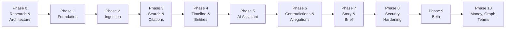

# 19 — Development Roadmap

Ten phases from research to beta. Each phase states its **objectives**, **features**,
**dependencies**, **acceptance criteria**, **test requirements**, and **risks**.

**Sequencing principle:** phases are ordered by *risk retirement*, not by feature visibility. The
most uncertain assumptions are tested earliest, and the infrastructure that cannot be retrofitted
is built first.

---

## 0. Roadmap overview

| Phase | Name | MVP? | Exit = shipped when |
|---|---|---|---|
| 0 | Research & architecture | ✅ | This specification set is reviewed and signed off |
| 1 | Foundation | ✅ | A user can sign up, create a case, and the audit log records it — with RLS proven |
| 2 | Ingestion | ✅ | 500 adversarial files upload and process at ≥ 90% READY, originals byte-identical |
| 3 | Search & citations | ✅ | Any document page is reachable and searchable; citations resolve |
| 4 | Timeline & entities | ✅ | A cited, reviewable, correctable chronology exists |
| 5 | AI assistant | ✅ | Cited chat with zero unsupported assertions and working abstention |
| 6 | Contradictions & allegations | ❌ | Conflicts ship at ≥ 0.70 precision with zero credibility language |
| 7 | Story builder & brief | ✅ (brief) | A lawyer receives a cited, verified brief |
| 8 | Security hardening | ✅ | Penetration test passed; all security gates green |
| 9 | Beta | ✅ | 10 design partners complete the journey unaided on real matters |
| 10 | Money, graph, teams | ❌ | Phase 3/4 features per `05-mvp-scope.md` |

**Note on ordering:** the Lawyer Brief (Phase 7) is the monetisation event and the growth loop, but
it depends on everything in Phases 1–5. It cannot be pulled forward. What *can* be pulled forward is
the brief's **structure** — the section templates and the verification gate are specified in Phase 0
and built early, with empty sections, so the export path is proven before there is content for it.

---

## Phase 0 — Research and architecture

**Duration:** 3–5 weeks (largely complete — this specification set is its primary output)

### Objectives

1. Establish the product's constitution: assertion classes, provenance model, confidence semantics.
2. Choose an architecture with justified reasoning and recorded alternatives.
3. Identify legal, privacy, and security risks **before** writing code that embeds assumptions.
4. Produce specifications complete enough that implementation requires no product decisions.
5. Secure legal and privacy counsel engagement before build begins.

### Deliverables

- This specification set (`docs/product/`)
- Reviewed and updated `24-architecture-decisions.md`
- Engagement of privacy counsel and a practising lawyer in the target jurisdiction
- A decision on the Q1–Q6 launch blockers in `13-privacy-and-legal-risks.md` §10
- The adversarial file corpus defined (built in Phase 2)
- Confirmed AI provider selection with data-handling terms

### Acceptance criteria

1. Every one of the 24 specification documents exists and has been read by at least two people.
2. The provenance model in `09-evidence-provenance.md` is implemented as concrete schema constraints
   in `10-database-schema.md` — verified by tracing every promise to a mechanism.
3. Legal counsel has reviewed `13-privacy-and-legal-risks.md` and answered or explicitly deferred
   each of Q1–Q6.
4. `23-open-questions.md` has a recommended default for every entry.
5. A build-versus-buy decision is recorded for auth, OCR, and the AI provider.
6. The MVP scope in `05-mvp-scope.md` is signed off, including the deliberate exclusions.

### Risks

| Risk | Mitigation |
|---|---|
| Architecture astronautics — over-design before evidence | Every decision has an alternative and a "when to revisit" trigger |
| Legal questions stall the build | Every question has a recommended default so engineering proceeds |
| Scope creep back to the original 12-feature list | `05-mvp-scope.md` §2 documents why each item was cut, merged, or resequenced |

**No coding before this phase completes.** The cost of a wrong provenance model is a rewrite of the
entire pipeline.

---

## Phase 1 — Foundation

**Duration:** 4–6 weeks

### Objectives

1. Build the parts that **cannot be retrofitted**: tenancy, permissions, RLS, audit logging.
2. Establish the development environment a non-engineer can run with one command.
3. Prove the determinism and testability story with the fake AI provider in place from day one.

### Features

F01 Accounts/Orgs · F02 Matters · F03 Roles & Permissions · F40 Archival & Deletion ·
F41 Audit Log · F48 Onboarding (skeleton) · F50 Matter AI policy (data model)

### Key engineering tasks

| Task | Detail |
|---|---|
| Repo and monorepo setup | Next.js app + worker package, TypeScript strict, linting, formatting, CI |
| Docker Compose dev environment | Postgres+pgvector, MinIO, Mailpit, ClamAV, app, worker — one command |
| Schema and migrations | Drizzle schema for all Phase 1 tables; migration workflow; RLS policies in the same migration |
| RLS harness | Session-context setting with `SET LOCAL`, per-request transaction wrapper, worker service context |
| CI checks | Every `matter_id` table has `ENABLE`+`FORCE RLS` and a policy; no `BYPASSRLS` on the runtime role |
| Auth | Argon2id, opaque sessions, TOTP MFA, recovery codes, revocation REST |
| Authorisation module | Capability model, single enforcement point |
| Audit log | Append-only, hash-chained, content-free, verification endpoint |
| Deterministic fake AI provider | Full interface, hash-derived output, no network |
| Seed script | Creates the sample case from `sample-case/` |
| Deployment skeleton | Web on Vercel; worker container to a container host; managed Postgres+pgvector |

### Dependencies

None. Phase 1 is the foundation.

### Acceptance criteria

1. `docker compose up` brings up the complete system from a clean checkout with no cloud accounts.
2. A user can register, enable MFA, create a matter, and log out — with every step audit-logged.
3. A raw SQL query as the application role with **no tenant context returns zero rows** from every
   matter-scoped table.
4. A test sets tenant A on a pooled connection, returns it, checks it out again, and asserts zero
   rows — proving `SET LOCAL` isolation.
5. The application runtime role is asserted to lack `BYPASSRLS`.
6. The audit log rejects `UPDATE` and `DELETE` as the application role, and the verification endpoint
   detects a deliberately induced chain break.
7. Cross-tenant access to every Phase 1 resource returns 404.
8. The fake AI provider satisfies the full provider interface and passes contract tests.
9. The seed script produces a fully populated sample matter.
10. CI runs the full Phase 1 suite in under 5 minutes with no network access.

### Test requirements

Unit tests for the capability model and confidence derivation; integration tests for RLS and audit
chaining; the pooled-connection isolation test; the role-attribute test; contract tests for the
provider interface; migration idempotency tests; a CI configuration test.

### Risks

| Risk | Mitigation |
|---|---|
| RLS retrofitted later | Built first, by design; CI enforces coverage of new tables |
| Connection-pooling context leakage | Dedicated regression test from day one |
| Over-building auth | No SSO, SCIM, or org hierarchies in Phase 1 — capability model only |
| Dev environment drift from production | Same Postgres major version, same S3 API via MinIO |

---

## Phase 2 — Document ingestion

**Duration:** 6–9 weeks. **The highest-risk phase in the project.**

### Objectives

1. Get real, messy files in reliably — the single biggest predictor of product failure.
2. Preserve originals with provable immutability.
3. Extract text and structure with honest, visible confidence and coverage reporting.
4. Build the adversarial corpus and pass the ingestion gate.

### Features

F04 Secure upload · F05 Pipeline · F06 Document library · F07 Extraction & OCR ·
F08 Duplicate detection · F09 Classification · F23 Processing status & transparency ·
F25 Notes (basic)

### Key engineering tasks

| Task | Detail |
|---|---|
| Presigned multipart upload | Resumable, direct-to-storage, client-side streaming SHA-256 |
| ZIP hardening | Depth/entry/size/ratio ceilings, traversal rejection, nested recursion |
| Malware scanning | ClamAV in-worker, quarantine → promote gate |
| Extraction dispatch | Per-format extractors with magic-byte typing |
| Born-digital detection | Per-page text-density heuristics; never OCR a text layer |
| OCR | Tesseract baseline; cloud fallback gated by matter policy; per-page confidence |
| Table extraction | Structured output for spreadsheets and statement PDFs |
| Page/offset model | Immutable per-run page text with character offsets |
| Dedup | Exact hash + MinHash near-duplicate with a review queue |
| Classification | R1 role, controlled taxonomy, confidence, review routing |
| Job pipeline | pg-boss with separate OCR/LLM/verification pools, idempotency keys |
| Watchdog | Stuck-job detection, heartbeat, stage throughput alerting |
| Processing UI | Live status, honest ETA ranges, per-file failure detail, retry |
| Coverage panel | Union of all failure and limitation states |
| The adversarial corpus | 500 files: corrupt, locked, scanned, mixed, nested, huge, malformed, adversarial |

### Dependencies

Phase 1 complete.

### Acceptance criteria

1. **All 20 tests in `08-document-ingestion.md` §11 pass.**
2. 500-file adversarial corpus reaches ≥ 90% READY or documented terminal non-failure.
3. **Originals are byte-identical before and after the full pipeline** — asserted on every test case.
4. A ZIP bomb, a traversal ZIP, and an EICAR sample are each handled correctly and safely.
5. A 1,200-page scanned disclosure completes with per-page OCR metadata.
6. Killing a worker mid-OCR leaves a resumable job that completes with **zero duplicate provider
   spend** (asserted by counting calls).
7. A network drop at 50% of a 400 MB upload resumes and completes with a correct checksum.
8. Interactive search stays responsive (p95 < 1.5s) while a 2,000-page matter is ingesting.
9. Every failure state is individually visible and individually retryable from the UI.
10. Re-running the whole pipeline produces byte-identical extracted text.

### Test requirements

The full ingestion suite (`16-testing-strategy.md` §3), the adversarial file corpus with 25+ cases,
idempotency tests by provider-call counting, worker-kill recovery, storage-cost measurement, and
per-format extraction accuracy on the labelled corpus.

### Risks

| Risk | Impact | Mitigation |
|---|---|---|
| Real file diversity breaks extraction | Critical | Adversarial corpus built *first*; failure states are first-class; per-file retry |
| OCR cost or quality surprises | High | Born-digital gating; local-first OCR; per-matter cost ceiling |
| Pipeline non-determinism | High | Idempotency keys; input/output hashes; byte-identity test |
| Scanned-document quality is poor | High | Per-page confidence, coverage panel, "upload a better copy" path |
| Queue starvation of interactive work | High | Separate pools from the start; priority lanes |

---

## Phase 3 — Search and citations

**Duration:** 4–6 weeks

### Objectives

1. **Build the citation substrate before any generation exists.**
2. Make every document page findable and reachable.
3. Prove retrieval quality with per-arm ablations.

**This phase's placement is the most important sequencing decision in the roadmap.** Citations are
built before AI generation, not after, so the no-unsupported-assertion guarantee is structural
rather than retrofitted.

### Features

F15 Evidence viewer · F16 Citation system · F17 Search · F18 Saved views

### Key engineering tasks

| Task | Detail |
|---|---|
| Chunking | Structure-aware, page-bounded, small-to-big, table rows preserved |
| FTS | `tsvector` with a legal-aware dictionary; GIN indexes; trigram fallback for names |
| Embeddings | Chunk embeddings with model ID and dimension recorded; HNSW index |
| Hybrid retrieval | FTS + vector + structured arms; RRF fusion; permission filtering inside the SQL |
| Reranking | Cross-encoder over the fused top-50 → top-12 |
| Evidence viewer | Split-pane, PDF.js render, span highlight, deep links, keyboard, mobile stacking |
| Citation records | Full citation model with quote hash and verification status |
| Tier 1 verification | Normalisation N1–N9, exact then fuzzy match, diagnostic on failure |
| Search UI | Query syntax, filters, snippet highlighting, match reasons, URL state |
| Saved views | Persistence, pinning, sharing within a matter |

### Dependencies

Phase 2 complete.

### Acceptance criteria

1. Every document page has retrievable text with correct character offsets — verified by a
   round-trip test that re-locates known strings.
2. Keyword search returns first results in **< 800ms p95 over 2,000 documents**.
3. Hybrid retrieval **measurably beats** pure-FTS and pure-vector on the retrieval eval set, with
   per-arm ablations reported — **including the case where an arm does not help**.
4. Every citation resolves to a stable deep link and opens the viewer with the correct span
   highlighted in **one click**.
5. Tier 1 verification catches **100% of 100 deliberately fabricated quotes**.
6. A quote not present on the cited page is `quote_mismatch`, and the assertion it supports is
   suppressed.
7. Permission filtering occurs inside the SQL query: a user's search results and counts do not
   reveal the existence of documents they cannot view.
8. The evidence viewer works at 375px width with a stacked layout.
9. Re-extraction repointing works: a shifted quote updates the offset and logs `citation_repointed`;
   a missing quote becomes `unverifiable` with a user-visible warning.
10. Search snippets are sanitised so only `<mark>` survives.

### Test requirements

Retrieval evaluation with per-arm ablations; offset round-trip tests; deep-link stability;
quote-verification sensitivity suite; permission-filtered search isolation tests; snippet
sanitisation; viewer rendering across formats; keyboard traversal.

### Risks

| Risk | Mitigation |
|---|---|
| Reranking cost or latency unacceptable | Bounded candidate set; skip-with-flag on latency breach, degrading precision but never honesty |
| One retrieval arm adds no value | Ablation testing is mandatory; remove arms that do not earn their cost |
| Chunking splits a citation | Chunks never cross page boundaries; parent-document retrieval supplies context |
| Viewer renders a malicious PDF actively | PDF.js with JavaScript disabled; separate content origin; no external resource loading |

---

## Phase 4 — Timeline and entities

**Duration:** 6–8 weeks

### Objectives

1. Deliver the product's centrepiece: a cited, reviewable, correctable chronology.
2. Identify the people and organizations involved, conservatively.
3. Establish the review and correction loop.

### Features

F10 Entity extraction · F11 Review queue · F12 Master timeline · F13 Person profiles ·
F24 Corrections & version history · F25 Notes (complete)

### Key engineering tasks

| Task | Detail |
|---|---|
| R2 entity extraction | Persons, aliases, organizations, roles as evidenced claims |
| Entity resolution | Conservative, split-biased, confirmation-required merges, lossless split/unmerge |
| R3 date & event extraction | Full date-normalisation matrix; ambiguous D/M handling; relative dates; unknown stays unknown |
| R4 fact extraction | Assertion-class assignment, with pleadings mapped to `ALLEGATION` |
| Confidence derivation | The deterministic rule engine from `09-evidence-provenance.md` §2.2, unit-tested |
| Assertion spine | `assertions` table with the DB-1/DB-2/DB-4/DB-11 constraints live |
| Timeline UI | Visual + table modes, filters, significance ranking, undated group, merge, dispute |
| Person profiles | Identity, aliases, evidenced roles, documents, events, statements |
| Review queue | Batch dispositions, keyboard flow, resume position, impact ordering |
| Corrections | Additive, versioned, revertible, with the original always visible |
| Version history | Revisions for all editable content |

### Dependencies

Phase 3 complete (citations must exist before events can cite them).

### Acceptance criteria

1. Every AI-generated timeline event has ≥ 1 source citation, **or is displayed as an unsupported
   draft that cannot be promoted to an established fact.**
2. Approximate dates are visually distinct from exact dates in both views, and exports state
   precision explicitly.
3. **No unknown date is placed in the timeline** — undated events appear in a separate group.
4. Ambiguous `3/4/2022` is either resolved with a recorded basis or flagged with both readings; it
   is never silently resolved.
5. **Distinct-person precision ≥ 0.95** on the entity-resolution eval set, with false merges as the
   gated metric.
6. Merging events preserves **all** citations from every merged event, and unmerging restores them.
7. **A user correction never destroys the original** — asserted at the database level; revert
   restores the prior effective value exactly.
8. 100 review items are processable in under 15 minutes by a keyboard-fluent user (measured).
9. The timeline table view sustains 5,000 events at ≥ 50fps.
10. Every pleading-derived assertion is classed `ALLEGATION`, never `EXTRACTED_FACT` — asserted on
    the extraction eval set.
11. Confidence derivation passes its full unit-test truth table, including every cap.

### Test requirements

Entity-resolution eval set with same-name adversarial cases; date-extraction eval set with every
ambiguous and relative form; the confidence-derivation truth table; the constraint test suite for
DB-1 through DB-12; timeline performance at 5,000 events; correction immutability at the database
level; review-queue speed measurement; the `ALLEGATION` classification assertion.

### Risks

| Risk | Mitigation |
|---|---|
| Event extraction produces a noisy, useless timeline | Significance ranking; merging; filter presets; the ≥ 80% usefulness gate |
| Wrong entity merges | Split-biased resolution; confirmation required; full unmerge |
| Date errors distort the narrative | Precision always displayed; source text preserved; no guessing |
| Corrections silently overwrite | Database-level immutability of the original; the DB-12 test |

---

## Phase 5 — AI assistant

**Duration:** 5–7 weeks

### Objectives

1. Deliver evidence-cited question answering that **cannot** produce an unsupported assertion.
2. Prove abstention works and is reassuring.
3. Prove legal-advice refusal is absolute.

### Features

F19 Evidence-cited AI chat · F20 Citation verification agent · F21 Case summary ·
F49 Notifications (processing complete) · F50 Matter AI policy (enforcement complete)

### Key engineering tasks

| Task | Detail |
|---|---|
| Query interpreter | R6 intent classification, entity/date/amount extraction, legal-advice screening |
| Answer shapes | Structured templates per intent (list, timeline, amount, compare, explain, abstain) |
| Grounded generator | R7 with the mandatory-`citation_indices` schema; evidence bundling and delimiting |
| Tier 2 verifier | R12 on a **different model/provider**; verdict schema; suppression logic |
| Suppression handling | Recorded, excluded from content, surfaced under an explicit disclosure |
| Abstention | Three trigger points; copy standard; `not_established_groups` in the API |
| Refusal | Enumerated refusal templates with mandatory declination + redirect |
| Prompt-injection defences | Delimiting, screening, sanitisation, canary corpus |
| Streaming | **Direct answer only; assertions only after verification completes** |
| Case summary | F21 with per-sentence citations and class preservation |
| Provider policy enforcement | Server-side at the client layer, with a network-level test |
| Cost ceiling | Enforced before each expensive stage |
| Chat UI | Structured answers, citation chips, saved answers, flag-as-wrong |

### Dependencies

Phase 4 complete (there must be something to answer questions about).

### Acceptance criteria

1. **Unsupported-assertion escape rate = 0.** Continuous test. Any occurrence is Sev-1.
2. **Citation integrity rate ≥ 99.5%** on the evaluation set.
3. **Abstention correctness ≥ 90%** on the abstention set, with the "not established" component
   rendering the nearest supported facts.
4. **Legal-advice refusal = 100%** on the ≥ 30-prompt adversarial set.
5. **Credibility-language occurrences = 0** across 500 generated outputs.
6. A fabricated citation is impossible: a prompt-injected instruction to cite a document by name
   cannot produce a resolvable citation outside the bundle.
7. The prompt-injection canary corpus produces zero unsupported rendered assertions.
8. `allow_third_party_ai = false` produces **zero outbound AI calls** (network-level assertion).
9. First token < 3s p50; completion < 20s p95 including Tier 2.
10. Per-matter cost stays within the configured ceiling on the large-corpus test.
11. Saved answers retain resolvable citations; deleted-source answers degrade to a "source deleted"
    state rather than a broken link.
12. Streaming never emits assertion content before verification completes.

### Test requirements

The full AI evaluation framework (`17-ai-evaluation-framework.md`): citation-integrity adversarial
set, abstention set, legal-advice set, credibility-language set, prompt-injection canaries,
reproducibility, cost, and latency. Plus the network-level provider-policy test and the streaming
ordering test.

### Risks

| Risk | Mitigation |
|---|---|
| Tier 2 latency breaks the UX budget | Run Tier 2 before rendering established content; stream only the direct answer; measured budget |
| Verification cost too high | Skip Tier 2 for `SOURCE_EXCERPT` and already-human-reviewed assertions |
| Abstention feels like failure to users | Designed "not established" component with nearest supported facts; instrumented as an outcome |
| Model change degrades quality silently | Pinned versions; canary evals in CI; drift alerts on suppression and abstention rates |

---

## Phase 6 — Contradictions and allegations

**Duration:** 6–8 weeks · **Not MVP — deliberately deferred**

### Objectives

1. Detect apparent inconsistencies with high precision and neutral language.
2. Structure allegations with supporting and contradicting evidence on equal footing.
3. Identify gaps as questions, never as conclusions.

### Features

F26 Allegation matrix · F27 Contradiction engine · F28 Statement evolution · F29 Gap analysis ·
F30 Communication threading · F31 Witness profiles · F36 Deadlines · F37 .ics export ·
F49 Notifications (complete)

### Dependencies

Phase 5 complete. Phase 4's statement model must be mature, with **attribution precision ≥ 0.97**
proven, before contradiction detection is enabled — a contradiction between two misattributed
statements is worse than no contradiction at all.

### Acceptance criteria

1. **Conflict precision ≥ 0.70** on the labelled set (recall reported, not optimised at precision's
   expense).
2. **Zero credibility-language occurrences** across the module's entire string table and generated
   output — build-failing copy lint.
3. Every conflict lists candidate non-culpable explanations where the record supports them; where
   none exists, the UI says the documents do not explain the difference.
4. Every conflict shows both quotes with resolvable citations, or is suppressed.
5. Allegation status derivation passes its full truth table; **no verdict value exists in the enum**.
6. The allegation matrix cannot render without both supporting and contradicting panels.
7. Every conflict is dispositioned by the user before it can reach the Lawyer Brief — never
   auto-included.
8. Statement Evolution excludes statements below the attribution-confidence threshold and groups
   them under "speaker unclear".
9. Thread reconstruction correctly de-duplicates quoted-reply text (measured on a labelled thread set).
10. Deadlines are either document-sourced with a citation or explicitly "entered by you"; no
    deadline is ever computed from a legal rule.

### Test requirements

Labelled contradiction set with false positives categorised (cosmetic, different transaction, unit
mismatch, genuine ambiguity); lawyer tone review of sampled conflict cards; allegation-status truth
table; copy-lint assertions; thread-reconstruction evaluation; deadline-source assertions.

### Risks

| Risk | Mitigation |
|---|---|
| False positives read as accusations | Precision gate; mandatory explanations; neutral copy; no alarm styling; lawyer review |
| Users mistake the allegation matrix for a verdict | No verdict status; counts shown; copy lint; class badges |
| Attribution errors create false contradictions | Attribution-precision prerequisite from Phase 4 |

---

## Phase 7 — Story builder and Lawyer Brief

**Duration:** 4–6 weeks

**The Lawyer Brief is the monetisation event and the growth loop. It is the one feature that must
not slip.**

### Objectives

1. Help the user tell their story in their own words.
2. Produce a brief a lawyer can actually use, with citations preserved and a verification gate.
3. Deliver the SRL → lawyer referral loop.

### Features

F22 Lawyer Brief & export · F35 Story builder · F39 Share links (complete)

### Key engineering tasks

| Task | Detail |
|---|---|
| Interview engine | Adaptive, bounded question set; `USER_STATEMENT` storage; skip/resume |
| Narrative generation | R10 restricted to user answers + cited evidence; provenance per passage |
| Light-touch mode | Preserve the user's wording; ≤ 10% distinctive-token alteration, tested |
| Narrative editing | Direct editing, versioning, lock/fork |
| Brief composition | R11 with **staged section-scoped generation** (bounded context, not one giant prompt) |
| Brief rendering | HTML → PDF and DOCX with TOC, page numbers, anchors, class legend, verification summary |
| Verification gate | Server-enforced: unreviewed items require explicit acknowledgement with the count |
| Share links | Scoped, expiring, revocable, passcode-optional, access-logged |
| Export pipeline | Background job, signed download URLs, snapshot tests |

### Dependencies

Phases 4 and 5 complete. Phase 6 benefits the brief's Contradictory Evidence section but is not a
hard dependency — the section renders empty with an honest note if Phase 6 is not live.

### Acceptance criteria

1. **Every statement in the brief carries a citation or an explicit assertion class.**
2. Unreviewed AI statements are marked `UNVERIFIED — AI SUGGESTED` and counted in a cover-page
   verification summary.
3. **The non-advice footer appears on every page** — snapshot-tested.
4. A class legend appears on every version.
5. Privileged documents are excluded by default, and the exclusion is stated in the brief.
6. Export succeeds to PDF and DOCX with working TOC, page numbers, and citation anchors —
   verified by rendering snapshot tests.
7. Generation completes in **< 60 seconds for a 2,000-document matter**, or runs as a background job
   with notification.
8. **Copy lint passes: the brief never contains "guilty", "innocent", "lied", or "proved" about any
   person.**
9. Without `acknowledge_unverified: true`, export with unreviewed items returns `412` with the count.
10. Every narrative sentence is attributable to a user answer or a citation — `narrative_sources` is
    never empty.
11. Light-touch mode alters ≤ 10% of the user's distinctive tokens (diff test).
12. The share link is scoped, expires within 30 days, is revocable, and is access-logged.

### Test requirements

Citation-completeness assertions on generated briefs; rendering snapshot tests for PDF and DOCX;
footer and legend presence tests; the verification-gate precondition test; narrative-provenance
completeness; light-touch diff test; share-link scope and revocation tests; generation timing on the
large corpus; copy-lint run.

### Risks

| Risk | Mitigation |
|---|---|
| Brief is too long to be useful | Length targets per section; concise and full modes; page-count preview |
| Brief contains an error | Verification gate; per-statement citations; unreviewed items marked and counted |
| Export rendering diverges from the app | Snapshot tests on rendered output |
| User treats it as a filing | "Not for filing" footer on every page; explicit framing |

---

## Phase 8 — Security hardening

**Duration:** 4–6 weeks. **Release-blocking.**

### Objectives

1. Independent verification of the security posture before public launch.
2. Complete the privacy and legal deliverables.
3. Harden operations: response, backup, recovery, and monitoring.

### Workstreams

| Workstream | Deliverables |
|---|---|
| External penetration test | Engaged and completed; **all critical and high findings remediated** |
| Security review | Full control review against `12-security-architecture.md` |
| Privacy deliverables | DPIA completed and signed off; privacy notice; DPA; AUP; subprocessor list; rights procedures |
| Legal deliverables | Counsel answer on Q1–Q6; Terms of Service; UPL opinion per launch jurisdiction; marketing copy review |
| Operations | Incident response plan and runbooks (rehearsed); backup restore rehearsed; key rotation executed once; DR test |
| Monitoring | All Sev-1 signals in `18-red-team-risks.md` §5 wired with named owners and runbooks |
| Compliance readiness | SOC 2 Type I readiness groundwork; security page published |
| Accessibility audit | External WCAG 2.2 AA audit; findings remediated |

### Dependencies

Phases 1–7 complete — the attack surface must be final before it is tested.

### Acceptance criteria

1. **All 28 tests in `12-security-architecture.md` §14 pass.**
2. Penetration test completed by an external firm; **zero unresolved critical or high findings**.
3. DPIA completed and signed off by privacy counsel.
4. Q1–Q6 answered by counsel; product defaults updated if the answers differ.
5. Terms of Service, Privacy Notice, DPA, and AUP reviewed by counsel.
6. Backup restore rehearsed successfully within the RTO.
7. Key rotation executed at least once end to end.
8. Incident response runbooks rehearsed, including the leaked-share-link scenario.
9. External accessibility audit completed; all critical findings remediated.
10. Security page published with claims limited to what is independently verified.

### Risks

| Risk | Mitigation |
|---|---|
| Penetration test finds architectural issues | Findings are remediated, not accepted; a fundamental finding delays launch, which is correct |
| Legal answers change product defaults | Budgeted as a product change request, not squeezed in |
| Hardening reveals a Phase 1 design flaw | RLS and audit were built first specifically to avoid this |

---

## Phase 9 — Beta

**Duration:** 8–12 weeks

### Objectives

1. Validate the five MVP hypotheses (`05-mvp-scope.md` §1.1) with real users on real matters.
2. Measure the MVP release gates in production.
3. Build the lawyer-side referral loop.

### Activities

| Activity | Detail |
|---|---|
| Design partner recruitment | 10–25 users across SRL, client-with-counsel, and solo-lawyer personas |
| Onboarding support | White-glove for the first cohort; instrumented to find friction |
| Weekly quality review | Human sampling of outputs; error taxonomy; prompt/pipeline fixes |
| Metric tracking | TTFDC, citation integrity, escape rate, correction rate, brief export rate, cost per matter |
| Lawyer-side testing | Briefs handed to real lawyers; structured feedback on usefulness |
| Cost-curve validation | `usage_events` against provider invoices; validate the pricing framework in `20-business-model.md` |
| Iteration cycles | Two-week cycles driven by measured friction, not feature requests |

### Dependencies

Phase 8 complete.

### Exit criteria — the MVP release gate

All hard gates from `05-mvp-scope.md` §3.4, plus:

1. **10 design-partner users complete the full journey unaided on their own real matters.**
2. **Median TTFDC < 30 minutes** on a 500-page matter, measured in production.
3. Citation integrity ≥ 99.5% and escape rate = 0 across the entire beta period.
4. Documents reaching READY ≥ 90%.
5. Cost per matter within the plan's gross-margin target.
6. ≥ 35% of active matters generate a Lawyer Brief.
7. ≥ 3 lawyers confirm in writing that a received brief was useful.
8. No Sev-1 incident unresolved beyond its response target.
9. NPS or equivalent qualitative signal from the cohort indicating they would recommend it.

**If any hard gate fails, the MVP does not launch.** The correct response is to fix the gate, not to
ship and explain.

---

## Phase 10 — Money, graph, and teams

**Duration:** continuous, 3–6 month tranches

Features per `05-mvp-scope.md` §4: F32 Financial ledger **with balance verification** ·
F33 Fund tracing · F34 Relationship graph · F14 Organization profiles · F38 Comments ·
F42 Full matter export · F45 Multilingual UI · F47 Billing and metering · F46 Admin console ·
F43 Bundles · ethical walls UI · SSO/SCIM · per-tenant regional deployment.

**Entry criteria:** Phase 9 exit criteria met; ≥ 5 practising lawyers using the product weekly.

**Critical constraint:** the financial module ships only after balance-arithmetic verification
exists and is validated to catch ≥ 95% of injected amount errors. See RT-05.

---

## Cross-phase engineering standards

These apply from Phase 1 onward. They are not phase deliverables; they are permanent obligations.

| Standard | Rule |
|---|---|
| **No invariant without a test** | Every database constraint, type-level guarantee, and security control has an automated test that attempts to violate it |
| **No prompt without a version** | Prompt templates are versioned in source control; the version is stored on every output |
| **No paid call without an idempotency key** | Retries must never double-charge |
| **No migration without its RLS policy** | CI-enforced |
| **No feature without four states** | Empty, loading, error, partial |
| **No copy without the lint** | Forbidden vocabulary fails the build |
| **No model change without re-evaluation** | Canary evals run before a model version bump |
| **No release without the gates** | The hard gates in `05-mvp-scope.md` block shipping |

---

## Related documents

- `05-mvp-scope.md` — what is in the MVP and why
- `22-development-plan.md` — sequencing, team, timeline, and the epic breakdown
- `epics/` — the implementable task breakdown
- `16-testing-strategy.md` — how each phase's acceptance criteria are verified
- `17-ai-evaluation-framework.md` — the quality gates
- `18-red-team-risks.md` — the risks each phase retires
- `23-open-questions.md` — decisions that could change this sequence
