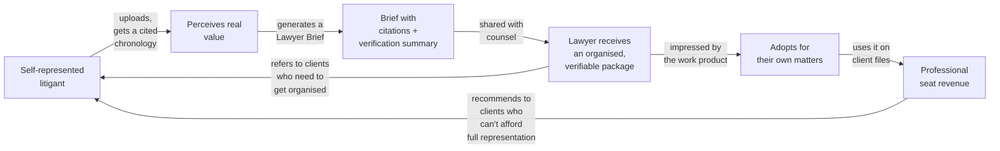

# 20 — Business Model

> **Read this warning first.** This document deliberately contains **no invented price points**.
> Pricing a product whose dominant cost is variable inference and OCR, before that cost has been
> measured, produces a margin surprise rather than a business. What follows is a **framework with
> variables**, a **cost model**, and the **measurements that must be taken before a price is set**.
>
> Every number below is either (a) a structural parameter we control, or (b) explicitly marked as
> **TO BE MEASURED**. Nothing is guessed and presented as fact.

---

## 1. The uncomfortable truth about this business model

Case IQ has a cost structure that is unusual and must be understood before any pricing decision:

| Characteristic | Consequence |
|---|---|
| **Cost is dominated by variable per-matter processing** (OCR, extraction, embedding, verification) | Gross margin depends on plan design, not just price. A generous page allowance destroys margin. |
| **Cost is front-loaded and incurred before the user has confirmed value** | A user who uploads 2,000 pages and abandons has cost real money and produced no revenue. |
| **Usage is extremely skew-heavy** | Most matters are small; a minority are enormous. Averages hide the tail that kills margin. |
| **Storage and egress are perpetual costs on a possibly one-time payment** | A per-matter one-time fee with indefinite retention is a liability that compounds. |
| **Value is episodic for consumers, recurring for professionals** | Two different business models in one product. |
| **Trust is the product** | Cutting cost by reducing verification quality destroys the thing being sold. This is the sharpest constraint in the model. |

**The single most important implication:** the **metered unit must be pages processed, not
documents**. A 20-page affidavit and a 900-page disclosure are not remotely comparable in cost, and
a document-count plan will be arbitraged by exactly the users who cost the most.

---

## 2. The cost stack

### 2.1 Cost drivers

| # | Driver | Scales with | Nature | Control lever |
|---|---|---|---|---|
| C1 | **Text extraction** | Pages | Near-zero marginal (CPU) | Local, no external cost |
| C2 | **OCR** | **Scanned pages only** | **High marginal, CPU or per-page API** | Born-digital gating (never OCR a text-layer PDF); local Tesseract before cloud |
| C3 | **Classification** | Documents | Low (small model, first pages) | Cheap model tier; batch API |
| C4 | **Extraction** (entities, events, facts) | Pages/chunks | **High marginal (LLM)** | Model tiering; batch API; prompt caching; skip-on-sufficiency |
| C5 | **Transaction extraction** | Financial statement pages | High (high tier) | Only for financial document types |
| C6 | **Embedding** | Chunks | Low marginal | Small embedding model; batch |
| C7 | **Verification Tier 2** | Generated assertions | **Medium marginal (LLM)** | Skip for `SOURCE_EXCERPT` and human-reviewed assertions (ADR-020) |
| C8 | **Chat** | Queries | Bursty | Per-matter ceiling; rate limits |
| C9 | **Reranking** | Queries | Low | Bounded candidate set |
| C10 | **Storage** | GB-months, **perpetual** | **Compounding** | Retention policy; delete renders; lifecycle derivatives |
| C11 | **Egress** | GB downloaded | Medium | Cloudflare R2 or equivalent; avoid vendor egress traps |
| C12 | **Infrastructure** | Baseline | Fixed | Modest at MVP |
| C13 | **Human review** (internal QA) | Sampled assertions | **Ongoing operational** | Automate sampling; this is a real cost often forgotten |

### 2.2 The cost model

```
cost_per_matter =
    fixed_infra_allocated
  + pages_total      × c_extract_cpu
  + pages_scanned    × c_ocr                      # born-digital gating applies here
  + pages_scanned    × p_cloud_ocr × c_cloud_ocr  # policy-gated; p is usually 0 at MVP
  + documents        × c_classify
  + chunks           × c_extract_llm
  + chunks           × c_embed
  + assertions_t2    × c_verify_tier2
  + queries          × c_chat
  + gb_months        × c_storage × retention_months
  + gb_egress        × c_egress
  + human_review_minutes × c_reviewer_time
```

Where every `c_*` is **TO BE MEASURED** during Phase 2 and Phase 5, and recorded per matter in
`usage_events` (which is why cost metering ships in Phase 1, long before there is a billing UI).

### 2.3 Required instrumentation

`usage_events` records, per event: `kind`, `provider`, `model_id`, `units` (tokens, pages, bytes),
`cost_estimate_cents`, `idempotency_key` (UNIQUE — so a retry cannot double-charge), and `matter_id`.

This gives, from day one of Phase 2:

| Measurement | Derivation |
|---|---|
| Cost per 500-page matter | Sum of `usage_events` for that matter |
| Cost per 2,000-page matter | Same |
| **Cost by page type** (born-digital vs scanned) | Join to `document_pages.extraction_method` |
| **Cost by stage** | Group by `kind` — reveals which stage actually dominates |
| Cost per chat answer | Sum for chat events ÷ answer count |
| **Cost distribution and p95** | The tail is the business risk, not the mean |
| Reconciliation vs provider invoices | Sum of estimates vs invoiced amounts, with a tolerance |

**Rule: no price is set, and no plan allows a page count, until the p95 cost per matter is known.**

---

## 3. The pricing framework

### 3.1 Choosing the value metric

A value metric should scale with the value the customer receives *and* with our cost.

| Candidate metric | Scales with value? | Scales with cost? | Verdict |
|---|---|---|---|
| Seats | Poorly for consumers | No | Wrong for consumers; right for firms |
| Documents | Poorly | **No — dangerously** | **Rejected.** A 900-page disclosure and a 2-page letter are one document each. |
| **Pages processed** | Yes — more evidence, more work | **Yes** | ✅ **Primary consumer metric** |
| Matters | Yes for consumers (episodic) | Partially | ✅ **Container metric** |
| AI questions asked | Weakly | Yes | Usable as an overage guard, poor as a primary metric |
| Storage GB | Weakly | Yes | Overage guard only |

**Decision: matters × pages, with seat-based pricing layered on for professionals.**

### 3.2 Plan shapes by persona

| Persona | Shape | Rationale |
|---|---|---|
| **A. Self-represented litigant** | **Per matter**, including a page allowance | Episodic need; a one-time payment for one outcome matches willingness to pay. A subscription would be cancelled the month after the matter resolves. |
| **B. Client with a lawyer** | Same as A | Same product, same episodic shape |
| **C. Solo/small-firm lawyer** | **Monthly seat + pooled matter allowance** | Predictable billing; firms need a monthly line item. Pooling lets them absorb a large matter without a plan upgrade. |
| **D. Legal team** | **Seat bundle + pooled allowance + admin** | Procurement-shaped; needs SSO, audit, retention policy (Phase 4) |
| **E. Advocate / clinic** | Non-profit tier (Phase 3) | Mission alignment; lower cost per user; tight budget |

### 3.3 The plan ladder (structure, not prices)

| Tier | Matters | Pages per matter | AI chat | Brief export | Sharing | Target |
|---|---|---|---|---|---|---|
| **Preview** | 1 | Small cap | ❌ | ❌ | ❌ | Demonstrate the timeline only |
| **Trial** | 1 | Full cap | ✅ | ✅ | ✅ | Time-boxed, full-featured |
| **Individual** | 1 | Standard cap | ✅ | ✅ | ✅ | Persona A/B, one matter |
| **Individual+** | 3 | Standard cap | ✅ | ✅ | ✅ | Persona A with multiple matters |
| **Professional** | Pooled | Large cap | ✅ | ✅ | ✅ | Persona C |
| **Team** | Pooled | Large cap | ✅ | ✅ | ✅ + roles | Persona D |

**Design rules for the ladder:**

1. **Pages, not documents, are the metered resource.** Documents are unlimited within a page cap.
2. **The Brief export is never gated below the paid tier.** It is the value moment and the growth
   loop. Gating it would cripple referral.
3. **AI chat is the overage risk**, not extraction. Cap it per matter with a visible meter, and let
   the user raise the ceiling deliberately rather than failing mid-session.
4. **Never fail mid-job on a quota.** Check at upload start and before each expensive stage, and warn
   before the work is done, not after (`04-feature-specification.md` F47 AC-3).
5. **Show the projected cost before a large upload.** "This is 1,900 pages — that's within your
   plan" or "…that will use 60% of your remaining pages."

### 3.4 Price-setting procedure

A procedure, not a number:

| Step | Action | Output |
|---|---|---|
| 1 | Measure p50 and **p95** cost per matter for 500-page and 2,000-page matters | Cost curve |
| 2 | Set a **gross margin target floor** (see §4) | Margin floor |
| 3 | Compute the minimum viable price: `p95_cost / (1 − margin_floor)` | Price floor |
| 4 | Research **current** competitor price points for the nearest substitutes | Market anchors |
| 5 | Test willingness to pay with the design-partner cohort — **Van Westendorp-style questioning** on 15–25 participants | WTP range |
| 6 | Set the price within `[price_floor, WTP_high]` | Price |
| 7 | Re-measure at 90 days against real usage distribution | Validated price |
| 8 | Adjust plan **limits** before adjusting price | Margin repair |

**Note on step 3:** using the **p95** cost rather than the mean is deliberate. The tail matters:
pricing on the average means the largest matters are sold at a loss, and those are exactly the
matters the product is most valuable for.

---

## 4. Unit economics and margin

### 4.1 Margin structure

| Cost type | Behaviour | Margin implication |
|---|---|---|
| Processing (C1–C9) | Per matter, one-time | Recovered on a per-matter fee |
| Storage and egress (C10–C11) | **Perpetual** | **Not recovered by a one-time fee** — see §4.2 |
| Infrastructure (C12) | Fixed | Improves with volume |
| Human QA (C13) | Per sampled assertion | Scales with volume; must be automated down over time |

### 4.2 The perpetual-storage problem

A consumer pays once for a matter, then we hold their documents indefinitely. Ten years later the
storage cost is still being paid with no revenue attached.

**Three options, with a recommendation:**

| Option | Effect | Verdict |
|---|---|---|
| Ignore it | Margin erodes slowly and invisibly | ❌ |
| Perpetual free storage with an indefinite promise | Simple, honest, but a real liability | ⚠️ Acceptable only with a stated retention policy |
| **Stated retention with a clear policy and an optional extension** | Honest, bounded, and forces the retention conversation | ✅ **Recommended** |

**Recommended policy:** case content is retained while the matter is active; after a stated period
of inactivity the user is prompted to keep, export, or delete; deletion is free; extended retention
is available at a low cost or bundled into the professional tier. **The user is always offered a
free full export before anything is removed.** That is the honest version, and it is also the version
that is defensible to a regulator.

### 4.3 Gross margin targets

| Tier | Target gross margin | Why |
|---|---|---|
| Individual | **≥ 70%** at p95 usage | Consumer economics require high margin; there is no upsell to recover a loss |
| Professional | **≥ 75%** | Higher price, larger matters, but predictable usage |
| Team | **≥ 80%** | Contract value absorbs the tail |

**These are targets for a service business with real COGS, not SaaS fantasy margins.** AI inference
is a genuine cost. A model that assumes 90% gross margin on a per-matter product with LLM and OCR
COGS is not credible.

### 4.4 The economics of the free trial

A trial that processes 2,000 pages and converts at 10% loses money on 90% of trials.

**Design rules:**
- Cap trial pages so the maximum loss per trial is bounded and known.
- **Estimate the maximum acquisition cost of a trial before launching it**: `trial_cost ÷ conversion
  rate` must be below the CAC budget for the tier.
- Prefer a **smaller page cap with full features** over a large cap with features removed — a capped
  trial still demonstrates the citation guarantee, which is the thing that sells.

---

## 5. Cost reduction levers

Ranked by impact, with the honest trade-off for each.

| # | Lever | Saving | Trade-off | Risk |
|---|---|---|---|---|
| 1 | **Born-digital gating** — never OCR a PDF with a text layer | Large (eliminates most OCR) | None; it also *improves* quality | — |
| 2 | **Batch APIs for ingestion** | Large (~50% on extraction) | Ingestion latency rises; acceptable because ingestion is not interactive | None |
| 3 | **Model tiering** | Large | Quality must be measured, not assumed | Quality regression if untested |
| 4 | **Prompt caching** | Medium | Requires stable prompt prefixes — already our design | None |
| 5 | **Skip-on-sufficiency** — skip expensive stages for documents yielding nothing | Medium | A document that would have yielded something is skipped | Recorded reason, retryable |
| 6 | **Duplicate short-circuit** — don't reprocess exact duplicates | Medium on disclosure-heavy matters | None | — |
| 7 | **Tier 2 verification skipping** for `SOURCE_EXCERPT` and human-reviewed assertions | Medium | Reduces verification coverage on quoted material — but Tier 1 already covers quotes | **Must not be extended to inference classes** |
| 8 | **Local Tesseract before cloud OCR** | Large | Lower quality on poor scans | Mitigated by confidence gating |
| 9 | **Per-matter cost ceiling** | Prevents catastrophic single-matter loss | A user's matter pauses | Must be communicated clearly, not a silent failure |
| 10 | **Storage lifecycle** — expire renders, keep originals | Medium, recurring | Renders regenerate on demand | Slight latency on first view |
| 11 | **R2/zero-egress storage** | Medium | Provider lock-in is minimal (S3 API) | — |
| 12 | **Fine-tuning a small model on our extraction tasks** | Large at volume | Needs ≥5,000 labelled examples and an eval harness; see Q-R04 | Premature optimisation |
| 13 | **Self-hosting an embedding model** | Medium at volume | GPU ops burden | Not worth it before volume |

**Levers that are OFF the table:**
- ❌ Reducing verification to save cost (that is the product)
- ❌ Skipping the citation check on any user-visible assertion
- ❌ Using a cheaper model for transaction extraction without re-validating balance-check catch rates
- ❌ Sending whole documents to a provider to avoid retrieval cost
- ❌ Storing case content less securely to save money

**The line:** we reduce cost by being *smarter about what to process*, never by processing
carelessly.

---

## 6. Willingness to pay

### 6.1 Why the anchors are strong

The relevant comparison is not another app subscription. It is:

| Alternative | Cost shape |
|---|---|
| One hour of a lawyer's time | High, and it is consumed on document sorting rather than strategy |
| A paralegal's hourly rate | Moderate to high, ongoing |
| A junior associate building a chronology | Very high, and it is the first task cut when budgets tighten |
| **Doing nothing** | Free, with the risk of missing the document that matters |

**The consumer's framing:** "one hour of my lawyer's time" is a natural, comprehensible anchor for a
per-matter price, and it is honest — the product's purpose is to make that hour more productive.

**The professional's framing:** if the product saves five hours of a paralegal's or junior's time on
a single matter, the seat pays for itself many times over. That is a defensible ROI conversation, and
it does not require an inflated claim.

### 6.2 Segmentation, not a single price

Willingness to pay varies enormously across:

| Segment | WTP signal | Pricing implication |
|---|---|---|
| SRL in a family matter, modest means | Low, but highly motivated | Needs a genuinely affordable entry point; consider a legal-aid or clinic tier |
| SRL in a commercial dispute | High — the amount in dispute dwarfs the price | Value-based anchoring is legitimate here |
| Client with counsel | High, and they are already spending | Price is a rounding error against their legal spend |
| Solo lawyer | Moderate per matter, needs predictability | Monthly seat with a pooled allowance |
| Small firm | Higher, and buys on ROI | Seat-based with admin features |

**Design implication:** the plan ladder must serve a **low-ability-to-pay** segment credibly. A
product for self-represented litigants that only prices for people in commercial disputes has
abandoned its stated mission — and the mission is the differentiation.

---

## 7. Go-to-market and the growth loop

### 7.1 The loop



**This loop is why the Lawyer Brief is a non-negotiable MVP feature** (ADR-026). Every brief is a
warm, credible introduction to a professional buyer, delivered by the artifact itself. That is a
far cheaper acquisition channel than advertising, and it is the only one this product has that
scales without a sales team.

### 7.2 Channels, honestly assessed

| Channel | Cost | Speed | Assessment |
|---|---|---|---|
| **Lawyer Brief referral** | Very low | Slow | **The primary channel.** Built into the product. |
| **Legal-aid clinics and duty counsel** | Low | Slow | Mission-aligned; high-trust referral; limited budget |
| Court self-help centre partnerships | Low | Very slow | Institutional; needs credibility and probably a pilot |
| SEO on specific, high-intent problems | Medium | Medium | "how to organise disclosure", "what is an affidavit" — content-led, honest, no advice |
| Community (forums, Reddit, local groups) | Low | Medium | Genuine participation, not promotion |
| Bar association and CLE channels | Medium | Slow | Best route to persona C; requires credibility |
| Paid search | **High** | Fast | **Caution:** legal keywords are among the most expensive CPC categories. Only viable once LTV is measured. |

**Explicit anti-channel:** we do not advertise as an "AI lawyer", we do not promise outcomes, and we
do not target vulnerable people with fear-based messaging. Beyond the ethics, RT-23 and RT-25 make it
a genuine regulatory and liability risk.

### 7.3 The trust requirement in marketing

For this audience, **visible honesty outperforms confident claims**. Marketing copy must:

- Show the citation behaviour, not just claim accuracy
- Use the phrase "we'll show you where it came from" as a headline benefit
- Say plainly that it is not legal advice
- Never imply an outcome
- Never imply a certification we do not hold

A claim register exists (see `13-privacy-and-legal-risks.md` D-1 to D-12 and RT-25) listing what may
and may not be said. Every campaign is reviewed against it.

---

## 8. Business model risks

| # | Risk | Impact | Mitigation |
|---|---|---|---|
| **BM-1** | **Cost per matter exceeds the price** at p95 usage | Critical — the model does not work | Cost metering from Phase 1; p95-based pricing; page caps; per-matter ceiling; re-measure at 90 days |
| **BM-2** | **Abandoned matters** — cost incurred, no conversion | High | Bounded trial caps; partial results shown early so value is perceived before processing completes |
| **BM-3** | **Skew-heavy usage** — a few enormous matters destroy margin | High | Page caps by tier; overage priced explicitly; the tail is priced in, not averaged away |
| **BM-4** | **Perpetual storage liability** | Medium, compounding | Retention policy with periodic review prompts; free export always offered |
| **BM-5** | **Provider price increases** | High | Two providers (ADR-005); abstraction makes switching a config change; tiering means we can move down a tier |
| **BM-6** | **Consumer churn is inherent** — matters end | Medium | The professional tier is the recurring revenue; consumer is the acquisition funnel |
| **BM-7** | **CAC exceeds LTV** if paid channels are used | High | Measure LTV before spending on paid search; prioritise the referral loop |
| **BM-8** | **Low-ability-to-pay users are priced out** | Mission risk | Non-profit/clinic tier; a genuinely affordable entry plan; do not let the mission be priced away |
| **BM-9** | **Competitor bundles the feature** at a lower marginal price | High | Provenance rigour is the durable differentiator, not the feature list (see `21-competitive-analysis.md`) |
| **BM-10** | **A quality incident raises support and QA cost** | High | The quality gates in `17-ai-evaluation-framework.md`; automated sampling; incident runbooks |
| **BM-11** | **Verification cost scales with content**, not users | Medium | Tier 2 skipping rules (bounded and validated); caching by quote hash |
| **BM-12** | **Legal/insurance costs exceed budget** | High | Budgeted explicitly per `22-development-plan.md`; scope launch to one jurisdiction |

---

## 9. What must be measured before pricing is set

The checklist that gates the pricing decision.

| # | Measurement | Source | Status |
|---|---|---|---|
| M1 | Cost per 500-page born-digital matter | `usage_events` | ⬜ TO BE MEASURED |
| M2 | Cost per 500-page **scanned** matter (OCR-heavy) | `usage_events` | ⬜ |
| M3 | Cost per 2,000-page matter (mixed) | `usage_events` | ⬜ |
| M4 | **p95** cost per matter across the beta cohort | `usage_events` | ⬜ |
| M5 | Cost by stage — which driver actually dominates | `usage_events` grouped by `kind` | ⬜ |
| M6 | Cost per chat answer | `usage_events` | ⬜ |
| M7 | Storage cost per matter per month, and growth rate | Storage metrics | ⬜ |
| M8 | Trial conversion rate and cost per converted user | Product analytics | ⬜ |
| M9 | Real page-count distribution across matters | Product analytics | ⬜ |
| M10 | Reconciliation of estimates against provider invoices | Finance | ⬜ |
| M11 | **Willingness to pay** across segments | Design-partner research | ⬜ |
| M12 | Time-to-value (TTFDC) so the value claim is grounded | Product analytics | ⬜ |
| M13 | Support cost per matter | Support tooling | ⬜ |
| M14 | Internal QA minutes per matter | Manual tracking | ⬜ |

**Until M1–M5 and M11 exist, no public price list is published.** A design-partner price is fine;
a public price list is a commitment.

---

## 10. Business model acceptance criteria

Testable requirements for the business layer.

| # | Criterion | Verification |
|---|---|---|
| BA-1 | Every metered event is recorded idempotently; a retry never double-charges | Automated test with a forced retry; assert one `usage_event` |
| BA-2 | A user can see current usage and projected overage before starting a large upload | Flow test |
| BA-3 | Quota is checked at upload start and before each expensive stage | Route-level test |
| BA-4 | No job fails mid-execution due to a quota | Fault-injection test |
| BA-5 | Cost per matter is queryable by stage, page type, and model | Analytics query |
| BA-6 | Estimates reconcile with provider invoices within the documented tolerance | Monthly reconciliation report |
| BA-7 | The p95 cost per matter is computed and monitored, not just the mean | Dashboard assertion |
| BA-8 | A cost-ceiling breach pauses the matter and notifies the user rather than silently overspending | Functional test |
| BA-9 | No pricing plan offers unlimited pages | Configuration review |
| BA-10 | The Lawyer Brief export is available on every paid tier | Plan-matrix test |
| BA-11 | A free full export is offered before any retention-based deletion | Flow test |
| BA-12 | No marketing claim asserts an outcome, a certification, or a guarantee | Copy review gate |

---

## 11. Summary of decisions and non-decisions

**Decided:**
- Pages processed, not documents, is the metered unit.
- Per-matter pricing for consumers; seat + pooled allowance for professionals.
- The Lawyer Brief is never gated below a paid tier.
- The referral loop is the primary acquisition channel.
- Cost metering ships in Phase 1, before any billing UI.
- Gross margin floors: 70% / 75% / 80% by tier.
- Storage retention is stated with a policy, not promised indefinitely.
- Verification is never a cost-reduction target.

**Deliberately not decided, and why:**
- **Specific prices** — cannot be set responsibly before the p95 cost curve exists.
- **Free tier permanence** — depends on trial conversion data.
- **International expansion** — depends on the jurisdiction decision (Q-T01) and counsel.
- **Non-profit tier mechanics** — Phase 3, after the consumer product is stable.

---

## Related documents

- `23-open-questions.md` — Q-M01 to Q-M04 and Q-A06
- `21-competitive-analysis.md` — market pricing context and differentiation
- `05-mvp-scope.md` — what is built first, and the cost implications of scope
- `11-api-specification.md` §3.15 / F47 — usage metering endpoints
- `10-database-schema.md` §12 — the `usage_events` table
- `13-privacy-and-legal-risks.md` — retention, disclosure, and marketing-claim constraints
- `18-red-team-risks.md` RT-19, RT-25 — cost and marketing-claim risks
