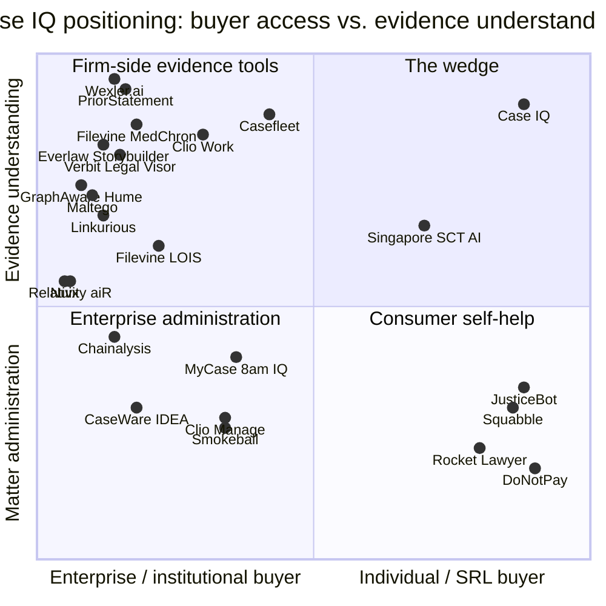

# Case IQ — Competitive Landscape and Positioning Analysis

## 1. Purpose and method

This document characterizes the market Case IQ would enter, identifies where the evidence-first wedge is genuinely defensible, and argues against the product where the evidence warrants it.

Method: desk research conducted 2026-02-14. Every named product, price, benchmark, and date below is attached to a URL in `## Sources`. Vendors' own marketing pages are treated as claims, not evidence of capability. Where a price is not publicly listed, this document says **not public** rather than estimating. Where a category is empty or immature, this document says so under an explicit **Evidence gap** callout.

> **Temporal discrepancy flag.** This analysis was commissioned with a stated "today" of **2026-02-14**, and the frontmatter reflects that. However, a material share of the primary sources retrieved on that date carry dates *later* in 2026 — including Clio Work's standalone launch (21 April 2026), the Neo4j–GraphAware acquisition (announced 2 June 2026), Legora's acquisition of Wexler (29 July 2026), and Florida's Fourth DCA opinion (25 March 2026). OpenAI's motion to dismiss in *Nippon Life v. OpenAI* is dated 18 May 2026. These are reported with their stated dates rather than suppressed, because they are the most decision-relevant findings in the document: the competitive window this analysis describes is narrower than the commission date implies. **Before this document is used for planning, someone should resolve which calendar context is authoritative.** No date below has been silently adjusted.

## 2. Executive summary

1. **The "AI chronology with citations" feature is no longer novel. It is a shipped, priced, competitive feature in at least five products** — Casefleet's Casey/Proposed Facts, Everlaw's Storybuilder, Filevine's MedChron, Clio Work, and Wexler.ai. Case IQ's moat cannot be "we build a chronology with citations."
2. **The real gap is the buyer, not the feature.** Every grounded-chronology product above is sold per-seat to law firms, priced for billable-hour economics, and requires professional-grade case material. Nothing in the market is priced and designed for an individual party holding 3,000 pages and no lawyer.
3. **"No unsupported assertion" is the strongest and most defensible claim** — because the published evidence shows the incumbents fail at it. The Stanford RegLab study found Lexis+ AI and Ask Practical Law AI hallucinating more than 17% of the time and Westlaw AI-Assisted Research more than 34%, despite vendors' explicit "hallucination-free" marketing.
4. **The biggest competitive threat is Clio**, not Relativity. Clio Work ships matter analysis, a chronological timeline grounded in uploaded documents, citation-linked research, and inconsistency flagging — at $199/user/month, and it owns the Canadian market (vLex, Jurisage, 470k+ Canadian cases) and is building an SRL-adjacent consumer footprint.
5. **Contradiction detection is no longer a blank space either.** Wexler.ai — UK-based, $5.3M seed (September 2025), customers including Clifford Chance, Goodwin Procter and HSF Kramer, acquired by Legora in July 2026 — runs a "gated pipeline" that isolates discrete verifiable facts across 1,000,000+ documents per case and explicitly surfaces "where the evidence does not support a position." That is Case IQ's negative-finding claim, shipped, but sold to AmLaw firms.
6. **The largest untapped risk is UPL exposure.** In March 2026 an insurer sued OpenAI for unauthorized practice of law and $10M punitive damages over ChatGPT's advice to a disability claimant who fired her lawyer and filed 21 motions. That is the liability template Case IQ must design against.

## 3. Market map by category

### 3.1 Consumer / self-represented-litigant tools

Three sub-markets, and vendors rarely cross between them.

**(a) Document-and-filing mills.** Rocket Lawyer sells Standard $149/yr ($12.41/mo annual), Plus $249/yr, Pro $349/yr, bundling unlimited "AI legal Q&A," contract review, document assembly and e-signature, plus 12–unlimited "Ask an Attorney" written responses. Its AI surface is contract-centric: "upload unlimited contracts and see a list of key terms and red flags." Nothing in the stack organizes an evidentiary record, builds a chronology, or links a statement to a source document. Squabble sells US small claims: a guided intake agent ("Eleanor"), a free demand letter, escalation to filing, and a $95 "Case Brief" add-on explicitly sold as "a case-education and organization product" that does **not** constitute legal advice and forms no attorney-client relationship. Squabble is a compliance-framing precedent, not an analytical one.

**(b) "Robot lawyer" cautionary tales.** DoNotPay is the reference negative case. The FTC's finalized order (11 February 2025) requires $193,000 in monetary relief, prohibits advertising that the service performs like a real lawyer absent substantiating evidence, and requires notice to 2021–2023 subscribers. The Commission's reasoning maps onto Case IQ's risk model directly: DoNotPay "did not hire or retain attorneys to test the quality and accuracy of its service's law-related features," and none of its technology "was trained on a comprehensive database of federal and state laws, regulations and judicial decisions."

**(c) Court-run and public-interest tools.** Singapore's Judiciary, with Harvey, shipped a generative case-summarisation tool for the Small Claims Tribunals (magistrates from 10 September 2025; self-represented persons from November 2025), "carefully designed to provide factual summaries without offering case-specific 'legal advice'." In Canada, the Cyberjustice Laboratory's JusticeBot (Université de Montréal) walks a tenant or landlord through a decision tree encoded from legislation and case law and returns relevant Administrative Housing Tribunal decisions; it "does not predict legal outcomes or offer legal advice" and has served over 20,000 users. JusticeBot is the closest analogue to Case IQ's guided-interview loop — but it reasons over a fixed case-law corpus in one narrow domain and never ingests the user's own evidence bundle.

**Evidence gap.** No public revenue, user-volume or retention data exists for the consumer tools in (a). DoNotPay's disclosed pricing ($36 every two months, plus a $49.99/month small-business plan, as at the time relevant to the FTC complaint) is a historical datum from a complaint, not a current price list. Consumer willingness-to-pay for SRL software is unquantified by this research.

**Gap Case IQ fills.** Nobody organizes *the record*. Rocket Lawyer organizes documents you generate; Squabble organizes an intake; JusticeBot organizes the law.

### 3.2 Legal case management / litigation management SaaS

This category is matter administration first. Pricing is public for the SMB tier and opaque above it.

| Product | Publicly listed price | Evidence analysis features | Grounded citations |
|---|---|---|---|
| **Casefleet** | Starter $30/user/mo; Advanced AI $140/user/mo; Enterprise custom. Overage: OCR $1/100 pages after 3,000 free; transcription $0.06/min after 3 free hrs; document intelligence $0.01/page after 12,000 free | Fact chronologies, timeline maker, case outlines, entity & witness organization, deposition transcript management, "Proposed Facts" AI | **Yes** — "every fact linked to its source"; Casey returns "reliable answers with clickable citations linking directly to your source documents." Starter caps at 20 documents/case |
| **Clio** (Manage + Work) | Manage: not verified from vendor page (site blocked automated retrieval). **Clio Work: $199/user/month** as an add-on at October 2025 launch; standalone from 21 April 2026 | Clio Work: matter analysis across large document sets producing key facts, claims, risks, gaps and "a chronological timeline built from the uploaded documents"; strategy/argument testing; flags "inconsistencies and open questions"; document and contract review | **Yes** — "Analysis is grounded in the specific content of each matter"; research outputs include citations linked to source material; built-in citator |
| **MyCase** | Basic $50–60; Pro $100–120; Advanced $130–150 USD/user/mo (annual/monthly). MyCase Accounting +$39/user/mo | 8am IQ Case Assistant (Advanced tier), 8am IQ Discovery Assistant AI OCR with 5,000 pages/user/mo, +5,000 pages for $30 | Not established — the Discovery Assistant is described as AI-powered OCR; no published provenance model found |
| **Filevine** | Not public — "All packages are custom built for your team's needs" | MedChron: automated medical chronology with "direct links to source documents," treatment timeline grouped by provider, gaps/inconsistencies surfaced; FilevineAI "Chat with Your Case" over the full matter data set | **Partly** — MedChron "summaries point back to source docs" and the AI is described as proprietary RAG over matter data. Filevine's own marketing simultaneously runs a webinar titled "How to Prevent AI Hallucinations in Legal Research and Drafting" |
| **Smokeball** | Not public — "request a personalized, no-obligation quote" | Archie AI assistant (add-on); practice-area templates, calculators, FamilyPro | Not established |

**What the category does well.** Document storage, matter/contact/calendar/billing integrity, trust accounting, transcript and deposition handling, and — increasingly — an AI layer with retrieval grounding over the firm's own matter data. Filevine's press release claims its differentiator is chatting with "100% of their matter data" including internal notes, audit logs, emails, texts, and negotiation histories, versus tools that "draw from limited or incomplete data sources."

**The concrete gap.** Every grounded-chronology-in-case-management product is sold per seat to a law firm, and each seat is priced for an entity that bills by the hour. Casefleet at $140/user/month is affordable for a solo firm and *structurally wrong* for a self-represented litigant: it is a per-user seat over a case pipeline with client/matter abstractions, task assignment, trust accounting adjacent, and 20-document Starter caps. Clio Work at $199/user/month is priced above the monthly income of many SRLs. Neither product has a "one individual, one matter, three thousand pages, no lawyer, no colleagues" mode.

**Second gap.** Case management tools assume the record arrives in professional form: Bates-numbered productions, deposition transcripts, medical records with provider indices. An SRL's record arrives as a phone-camera PDF of a signed contract, a WhatsApp export, 400 screenshots, a bank statement CSV, and a voice memo. Normalizing *that* is a different engineering problem from ingesting a Relativity production.

### 3.3 e-Discovery / litigation document review

Priced for institutions. This is the clearest "why SRLs cannot use them" category in the market.

- **Everlaw.** Pricing is "based on the amount of data you manage and your usage—without limits on users or uploads." Unlimited user licences are explicitly included in the per-GB rate. Generative AI single-document actions and the Writing Assistant are included; *batch* AI actions consume credits. Everlaw ships **Storybuilder**: fact management, "AI-powered legal memos, evidence outlines, and comparison tables," with "every claim auto-linked to verifiable citations." This is a direct functional analogue of Case IQ's lawyer-brief export.
- **Relativity / Relativity aiR.** Relativity does not publish list pricing. The market signal is a reseller announcement: Cimplifi claimed first-to-market (9 October 2025) with "all-in unlimited pricing per gigabyte (GB)" for aiR for Review and aiR for Privilege, explicitly to remove "uncertainty of document-based pricing." The direction of travel is *fixed fee per GB*, not *fixed fee per user*, which is exactly the opposite of SRL economics.
- **Per-GB as the universal barrier.** Cimplifi's own analysis of the twelfth eDiscovery Pricing Survey (EDRM/Complex Discovery) states that "more than 92% [of respondents] indicate that they are still paying per GB rates for ingestion and processing." A per-GB ingestion fee is a billing model that cannot serve a one-off consumer transaction.

**Why SRLs and small firms cannot use them — the arithmetic.** Most of this category publishes no price at all: Relativity, Everlaw, Logikcull, DISCO, Nuix, Reveal and Lighthouse's own AI tier are all quote-only or bundled into a "committed data volume" with a 1- or 3-year term, and **Exterro has no pricing page at all** (`/pricing` returns HTTP 404). But **Lighthouse publishes a public rate card** (headed "2023 Rates"), and it makes the structural barrier explicit:

| Line item | Rate |
|---|---|
| Data ingestion | **$39/GB** |
| Online hosting | **$12/GB/month** (nearline $7.20, offline $3.60) |
| Relativity user seat | **$89/user/month** |
| Data export for review | **$175/GB** |
| Data production (Bates, load file) | **$250/GB** |
| Chat parsing (ChatSmart) | **$5,000/matter** |
| Collection (on-site/remote) | $295/hour |
| Forensic analysis | $375/hour (senior $475; expert testimony $550) |
| Machine translation | $0.94/file (tiered down to $0.38) |
| **Responsive Review (managed)** | **$0.58/document — "Project minimum of $97,500"** |

Five line items bill before a single page is read, hosting "cannot be prorated," and the managed-review channel has a **$97,500 floor** — at $0.58/document, roughly a 168,000-document minimum engagement. Note also that **the citation-grounded AI tier is never the cheap tier**: Everlaw charges *credits* for batch AI that "expire at the end of the term"; Relativity bundles AI into the data-volume commitment; Logikcull lists "Reveal AI fact-finding" on the annual plan, not the month-to-month tier (with an unresolved ambiguity about whether the 10 GB no-commit tier includes ASK).

**The access-to-justice programmes are cause-gated, not need-gated.** Everlaw for Good admits only Low-Income Populations, Civil Rights, Civil Liberties, Human Rights, Public Rights and Environmental Rights work, and only to nonprofits, pro bono teams, investigative journalists, educators and CJA attorneys. Relativity's Justice for Change grants "up to 500GB and 10 users for 24 months at no charge" only to *selected* pro bono projects on a quarterly cycle. **A self-represented litigant in an ordinary family, employment, commercial or landlord-tenant dispute qualifies for neither** — and 500 GB being Relativity's *charitable* allocation is the clearest signal of the commercial floor.

**Adjacent SMB-shaped options exist but do not carry the AI story.** Nextpoint sells "flat per-user, unlimited data" with "unlimited cases, free data hosting" and explicitly contrasts itself against "per-GB processing + hosting" — and includes case chronology and timelines — but markets only "advanced discovery analytics," not citation-grounded generative Q&A. GoldFynch publishes a free 512 MB watermarked case and markets directly to small firms, but its only AI-adjacent claim is "machine learning assisted searches."

**The net conclusion.** As of the sources reviewed, **the category has no self-serve, low-cost, no-commitment path to citation-grounded AI document review**, except possibly Logikcull's 10 GB month-to-month tier. That tier's inclusion of the ASK engine is **unresolved** from the public pricing page (the comparison table renders "Reveal AI fact-finding" as "Add-on / Add-on" with destroyed column alignment, while the plan description places it on the annual subscription). **This single ambiguity determines whether Case IQ's core wedge is genuinely unoccupied or merely narrow.** It must be resolved commercial due diligence before this document is used to justify build scope.

**Gap Case IQ fills.** Reverse the value metric: unlimited pages, one flat price, one user, no production workflow, no coding panel. Provenance is table stakes here — e-discovery has solved "click the citation, see the page" — so Case IQ cannot claim novelty, only cost and audience.

**A structural split worth understanding, because Case IQ has to pick a side.** The category answers the hallucination objection in exactly two ways, and no vendor does both:

- **Camp A — citation-grounded generative AI.** Every vendor shipping a generative natural-language Q&A product explicitly claims per-answer citation to source: Everlaw Deep Dive, Relativity Assist/claiR, Logikcull/Reveal ASK, DISCO Cecilia, Reveal's aji. Their answer is *"every claim links back to the exact source document — go verify it."*
- **Camp B — determinism plus audit trail.** **Nuix** and **Exterro** ship no generative Q&A citation claim at all. Instead they sell reproducibility: Nuix promises "same inputs, same outputs, every time" and an "audit trail recorded at the moment of processing – not reconstructed"; Exterro sells "multiple validation layers and a clear audit trail for all actions." Their answer is *"the process is deterministic and every step is logged as it happens, so it is reproducible."*

**This matters because Camp B's model is the one that maps onto evidentiary standards** — Nuix's entire market is regulators and law enforcement. Camp A's maps onto litigation fact-development, where opposing counsel asks "which document says that?" **Case IQ needs both, and the combination is genuinely rare:** per-assertion citation for the fact-development use case, plus camp-B-style determinism and a tamper-evident processing log for the court-disclosure use case that Ontario's February 2026 practice directions now require. Note also that Exterro shipped an AI assistant branded "Assist" roughly two years before Relativity branded its own — a reminder that naming is not innovation.

### 3.4 AI legal research and drafting

This category proves two things: grounded retrieval is standard, and grounded retrieval is not sufficient.

**Grounding is a mainstream product feature now.** Everlaw auto-links claims to verifiable citations. Clio Work ships a citator that "confirms that cited authorities are current before results are returned." Casefleet links every fact to its source. Filevine describes proprietary RAG over matter data. **"Every AI statement links to its source" is therefore a commodity claim in 2026**, and Case IQ must not treat it as the differentiator in a pitch.

**Grounding does not produce accuracy.** The Stanford RegLab/HAI study (Magesh, Surani, Dahl, Suzgun, Manning, Ho) built a pre-registered dataset of 202 open-ended legal queries and tested Lexis+ AI, Westlaw AI-Assisted Research, Ask Practical Law AI and GPT-4:

| System | Hallucination rate | Other headline figures |
|---|---|---|
| Lexis+ AI | **17%** | Answered 65% accurately; 18% incomplete |
| Ask Practical Law AI | **17%** | Only 19–20% accurate; **62% incomplete** |
| Westlaw AI-Assisted Research | **34%** | Accurate 41–42%; 25% incomplete |
| General-purpose chatbots (prior study) | **58%–82%** | On legal queries |

The study's most important contribution for Case IQ's design is its **typology**: an answer can be wrong (misstates the law) or **misgrounded** (states the law correctly but cites a source that does not support the claim). The authors argue the second "may be even more pernicious than the outright invention of legal cases," because a citation that *exists* but does not support the proposition is harder for a non-expert to detect than one that does not exist.

**Scale of the failure.** The AI Hallucination Cases Database (Damien Charlotin) tracks decisions where a court found reliance on hallucinated content: **2,077 cases**, of which **Pro Se Litigant 1,196** vs Lawyer 825 — the primary victim is the self-represented party. By jurisdiction: USA 1,428, **Canada 218**, Australia 112, UK 69. By nature: Fabricated 1,718, Misrepresented 871, False Quotes 556; by subcategory Case Law 1,870, Legal Norm 237, Exhibits & Submissions 150. **Canadian courts appear second only to the United States — material for a Canadian-first product.**

**Practitioner-level and court-level evidence.** Florida's Fourth District Court of Appeal (25 March 2026) addressed pro se filings with citations that "either do not exist or fail to support the defendant's arguments," warning that unchecked AI use "may result in sanctions"; the concurrence described a "seemingly endless deluge of AI-generated drivel submitted by pro se litigants." Miami-Dade and Broward already require litigants, **including the self-represented**, to disclose AI-generated submissions and certify their accuracy. In Ontario, the Superior Court went further (see §3.9).

**Important counter-evidence: one incumbent already ships refusal.** Everlaw's Deep Dive FAQ documents: *"If the answer to your query can't be found within the uploaded documents, Deep Dive will simply respond that it can't answer."* So refusal-at-the-answer level is shipped behaviour, not a novel idea. What is not shipped anywhere is refusal at the *proposition* level — "these materials do not establish X" for a claim the user is trying to make — with the coverage of the verification oracle disclosed. Case IQ should treat Everlaw's phrasing as the floor it must exceed, not as a differentiator.

**Evidence gap.** Vendor-published accuracy benchmarks for the newer generation of legal AI (Harvey, Legora, CoCounsel, Spellbook, Robin AI, Clearbrief, Midpage, vLex Vincent) were not independently verified in this research, and self-published benchmarks should not be treated as evidence. **No public head-to-head benchmark comparing grounded matter-analysis tools (Casefleet Casey, Clio Work, Everlaw Storybuilder, Filevine MedChron) on misgrounding rate was found.** This is a strategic opportunity: whoever publishes the first credible, reproducible misgrounding benchmark for case-understanding tools defines the quality bar.

**Gap Case IQ fills.** Not "grounded citations" — that is table stakes. The gap is **refusal and negative findings**: an explicit, auditable statement that the uploaded materials do not establish a proposition, plus misgrounding detection that distinguishes "the source exists" from "the source supports this." The Stanford typology gives Case IQ its product requirements for free, and no surveyed product markets against misgrounding specifically.

### 3.5 Case chronology, medical-record chronology, and evidence management

This is Case IQ's most direct competitive set.

- **Casefleet** is the closest functional match in the SMB market and the one to study hardest. It markets "fact chronologies" as its core primitive, ties every fact to a source, and adds a timeline maker, case outlines, entity/witness organization, transcript management with cite-as-fact, audio/video transcription, and an AI assistant (Casey) that proposes facts for human approval. Critically, its own site lists use cases *beyond* law firms: "Personal document organization," "IRS audit response," "Custody & divorce documentation," "VA disability claims," "Small claims court prep," "Insurance claim disputes," "Estate settlement." **Casefleet has already identified the SRL-adjacent buyer — and is marketing to them with law-firm pricing.**
- **Filevine MedChron** (feature page dated 30 April 2025) is the strongest shipped proof that automated grounded chronology works at scale: "what once took 15–20 hours can now be completed in minutes," reading typed, handwritten or scanned documents, producing Bates numbering and "hyperlink-enabled side-by-side views of original records," and surfacing care delays and "gaps or inconsistencies." Note the vendor's own hedge: "**When applicable**, summaries point back to source docs" — even the market leader does not claim universal provenance.
- **Everlaw Storybuilder** extends chronology into trial prep: fact management, transcript querying across all depositions, witness designation export, "AI-powered legal memos, evidence outlines, and comparison tables," auto-linked citations. A published customer story features Loopstra Nixon, a Canadian litigation firm.
- **TrialLine** and similar PI timeline tools sit in the medical-chronology segment. **Evidence gap:** TrialLine's pricing page could not be retrieved (TLS failure) and no price was verified from any primary source — treat as **not public / unverified**.
- **Police/prosecutor evidence management** (Axon Evidence, CaseGuard, Nuix) is a separate procurement market; pricing appears in municipal contracts rather than price lists. **Evidence gap:** no list price verified for Axon Evidence or CaseGuard.

**What this category proves.** Automated ingestion of scanned and handwritten material, entity extraction, chronology assembly, per-fact source linking, Bates numbering, side-by-side source verification, transcript querying, and export to litigation-ready outlines are all shipped, priced and in production.

**The concrete gap — two things, only two:** **pricing and packaging for a party of one**, and **cross-modal, non-professional evidence** (SMS/WhatsApp exports, phone screenshots, bank CSVs, voice memos), which medical-chronology and deposition products do not target because their buyers' records arrive in professional form.

### 3.6 Knowledge-graph and investigation analysis tools

Graph investigation UIs are mature, sellable products — with economics wrong for Case IQ's buyer.

- **Maltego** publishes tiered pricing: Basic (200 credits/mo) free; Entry Standard **€3,000/yr**; Professional Standard **€7,500/yr** for up to 5 users; Enterprise from 5 users. Ships visual link analysis, entity resolution, 100+ connectors, a secure case store, "Maltego Evidence" (social-media evidence preservation) and Hunchly ("chain of custody for legal … use"). Access is **vetting-gated** — a consumer SRL would not pass.
- **Linkurious** publishes a managed cloud tier at **€490/month per user** (geospatial and temporal analysis, entity resolution AI, alerts, case management); self-managed is quote-only and requires a graph database (Neo4j, Neptune, Cosmos DB, Memgraph, Spanner) — disqualifying infrastructure for an individual.
- **i2 Analyst's Notebook, Palantir Gotham/Foundry, Graphistry, Quantexa, Senzing** are quote-only. **Evidence gap:** no pricing verified for any of them; no graph vendor publishes a node/edge render ceiling (only record counts — Senzing cites ~100B records), so Case IQ cannot benchmark scale against a published market figure.
- **Neo4j acquired GraphAware** (announced 2 June 2026, closing 5 August 2026) to launch **GraphAware Hume** as an "open-standard alternative to existing 'black-box' proprietary tools, like Palantir Gotham." Neo4j's rationale is Case IQ's own thesis stated by a $100M-AI-investment vendor: "Nothing important is hidden behind proprietary logic. Organizations can see how data moves through the platform, **understand how results are produced**, and trust the system they rely on."

**What this proves.** Temporal plus relational graph views over messy person/org/event data are technically solved; entity resolution is a shipped feature, not research; and provenance is now a competitive axis at the top of the market.

**The gap.** These tools are sold to analysts who already have a graph database and are trained to read a node-link diagram. An SRL has neither. Case IQ's relationship view must be *derived from uploaded documents* and *readable as a story*. Copy Wexler's pattern: it "builds a graph … of the whole evidential base" internally while exposing a factual record to the user, not a canvas.

**Two things worth stealing from the entity-resolution vendors specifically.** **Senzing** ("Proven in production at ~100B records") publishes a dedicated explainability treatment of **invisible false positives and overmatching risk** — the clearest published thinking on ER *error* provenance in the market, and directly applicable to Case IQ's entity-merge decisions, where a wrongly merged person is a silently wrong chronology. **Quantexa** goes further with a provenance model at the entity level rather than the log level: sensitive sources "carry their classification into every entity built from them," with match confidence and source permissions set per use case. Tier the merge confidence and surface it; do not silently merge people. Scale confirmation that this is a solved problem: Linkurious's Ogma renders "tens of thousands of nodes in under a second."

### 3.7 Contradiction and inconsistency detection

**Correction to the working assumption.** The brief speculated this category might be research-only. **It is not: contradiction and inconsistency detection is shipped, funded and law-firm-adopted as of 2026.**

| Product | What it ships | Price |
|---|---|---|
| **Wexler.ai** | "Fact intelligence platform" whose engine "runs documents through a **gated pipeline that isolates discrete, verifiable happenings** … **rather than returning summaries or loosely sourced excerpts**," over **1,000,000 documents per case**. Markets exactly Case IQ's negative-finding claim: "**Where the evidence does not support a position**," "Pinpoint contradictions in seconds," "Flag gaps, overlaps and timeline clashes." Clifford Chance ran a six-month pilot and extended (20 March 2025) citing "**inconsistency mapping**"; its case study claims it "Identified inconsistencies which were relied on at hearing" | **not public** |
| **Verbit Legal Visor** | Real-time deposition intelligence: "Admissions & inconsistencies flagged automatically as witnesses speak"; pre-deposition gap identification; post-deposition "document-linked contradictions." Its copy drifts into "**credibility signals**" — the line §9 says Case IQ must not cross | **not public** |
| **PriorStatement** | The most conceptually aligned product found: "**indexes assertions**," not keywords. Ingests transcripts, witness statements, police reports, medical notes, expert reports; profiles "every assertion made by or attributed to each witness"; "Every contradiction, omission, and inconsistency surfaces automatically." Cloud **and air-gapped** | **not public**; private beta, London firms |
| **August Live Assist** | The only one with published pricing. Joins a live conversation, cross-references every statement against uploaded case material, flags mismatch **in a side panel with the exact source citation**. Deliberately passive; free to existing subscribers | **$375/mo or $4,000/yr** platform |
| **Filevine MedChron / Clio Work** | Narrower: timeline "gaps or inconsistencies"; "inconsistencies and open questions" pre-draft — not propositional conflict between sources | per §3.2 |
| **Relativity aiR for Case Strategy** | Fact generation, entity summaries, chronology (~5M documents in a partner case study). **No Relativity source reviewed claims automated contradiction detection — do not read aiR as a contradiction product** | not public |
| **FRISS / Shift Technology** | Insurance-fraud analogues, the most deployed inconsistency systems anywhere (FRISS: 45+ countries, 300+ implementations). But they are *risk-scoring plus investigator workflow* — the inconsistency is implicit in a score. That is the opposite of what Case IQ should build | not public |

**Academic state of the art.** Held & Habernal (NLLP 2025, ACL, pp. 292–303) found that **neither fine-tuning nor prompting frontier models (Flan-T5, Llama 3) could surpass a domain-pre-trained encoder-only model (RoBERTa)** on identifying fine-grained argument types in judgments. LegalWiz (NeurIPS 2025 workshop) states existing contradiction benchmarks "lack domain realism, cover only limited conflict types, and rarely extend beyond single-sentence pairs, making them unsuitable for legal applications." **Summary: the retrieval-and-cite half is shipped; the reasoning-about-contradiction half is research-grade.**

**What remains open — narrower than the brief assumed.** Four things, none of which is the feature itself:

1. **No published accuracy figures — the single largest gap in this analysis.** Wexler, Verbit, August and PriorStatement publish **zero** precision, recall or false-positive figures, and no independent evaluation of any exists. The strongest real-world evidence is Wexler's own case-study line — with **no matter name, court or outcome disclosed**.
2. **The buyer.** All ship to litigation teams on billable-hour economics: Wexler at 500k–1M documents per case, PriorStatement beta-gated with air-gapped infrastructure, Verbit built for depositions. A party with 3,000 pages and no budget is not a customer any of them serves.
3. **The framing discipline.** The National Academies' *The Polygraph and Lie Detection* (2003) concluded polygraph testing "rests on weak scientific underpinnings despite nearly a century of study," screening accuracy is "almost certainly lower," and the underlying deception theories "have not been verified." **Detecting inconsistency between two documents is legitimate; assessing whether a person is lying is not supported by the science.** Verbit's "credibility signals" copy is the failure mode.
4. **The reasoning depth.** Whether a system can distinguish *genuine* contradiction from *apparent* tension — differing context, time, speaker, or a passage quoted inside another document — is unmeasured by anyone. That is where false positives live, and it is exactly what an unsophisticated user cannot adjudicate.

**Recommendation.** Ship an **"apparent inconsistency"** detector framed as retrieval-and-comparison: here are two passages that appear to be in tension, here are both sources, you decide. Never score credibility, never use "lie," never rank witnesses by truthfulness — and enforce that with a test suite that fails the build if credibility language reaches user-facing output.

**The honest differentiator is not "we detect contradictions."** It is **(a) doing it for an individual party at a consumer price, (b) publishing a measured false-positive rate, and (c) refusing to escalate from documentary inconsistency to personal credibility.**

### 3.8 Fund tracing and financial forensics

- **CaseWare IDEA**, **ACL/Galvanize (Diligent)**, **Arbutus** and **TeamMate** are the audit-analytics incumbents for transaction testing, duplicate/gap detection and Benford-style analysis. **Evidence gap:** no list price verified for any of them; all quote-based. Treat as **not public**.
- **Tableau / Power BI** are visualization layers over a normalized extract — not forensic products, no evidence chain.
- **Crypto tracing** is the one genuinely productized tracing market (Chainalysis, TRM Labs, Elliptic, selling to exchanges, banks and law enforcement). **Evidence gap:** no price verified for any of them.

**What this proves.** Transaction normalization, entity resolution across account holders, flow-of-funds visualization and "trace the money through N hops" are solved — *when the money is in a structured ledger or a blockchain*.

**The most important finding here is about the evidence model, not the technology.** Fund tracing reaches court as **an expert's affidavit plus a schedule plus exhibited source records**, and spreadsheet-based tracing schedules are routinely accepted. The Australian authority is clearest: Rule 6.06 of the *Federal Circuit and Family Court of Australia (Family Law) Rules 2021* imposes an ongoing duty of full and frank disclosure, and in *Black and Kellner* [1992] FamCA 2 the husband's non-disclosure impeded identification of the asset pool and he received approximately **6.3%** of known net assets. In Ontario, *A.A. v Z.G.*, 2015 ONSC 4397 records a party relying on his expert's "tracing reports," and the route to third-party bank records is the **Norwich order** (*GEA Group AG v. Ventra Group Co.*, 2009 ONCA 619; *Bergmanis v. Diamond & Diamond*, 2012 ONSC 5762).

**The significance:** no tracing tool surveyed markets per-transaction source citation as a product feature. The binding constraint is not analytical power — a spreadsheet suffices and courts accept it — it is **defensible provenance**. That is the clearest open product gap in this document.

**Correction to the research brief.** The brief referenced "the use of s. 8 / Anton Piller" for obtaining bank records. **No source supports a "s. 8" provision in this context, and Anton Piller is the wrong instrument** — it is an ex parte search and seizure of material in the defendant's possession; **Norwich** compels a third party (typically a bank) to disclose records. Both errors must not reach product copy or legal-content review.

**The gap for Case IQ.** Tracing in a civil or family matter is usually not blockchain and not a clean general ledger. It is bank statement PDFs from multiple institutions, e-transfers, cash withdrawals, commingled joint accounts, and a third party's business account. The task is: parse heterogeneous statement layouts, normalize to one ledger, detect inter-account transfers, and let a person click any line and land on the source page. That is a **document-understanding problem masquerading as a financial-analysis problem**.

**Honest positioning constraint.** Fund *tracing* has a legal meaning (following an asset through substitutions and mixtures, with tracing rules and presumptions). Case IQ should ship a **transaction ledger and fund-flow view** and explicitly decline to characterize anything as a legal tracing conclusion.

### 3.9 Canadian / Ontario context

**The most consequential regulatory finding in this document: the Ontario Superior Court of Justice issued AI practice directions on 12 February 2026 — two days before this analysis' commission date — covering civil, family and criminal proceedings.** They impose duties on **all litigants including self-represented parties, not only lawyers**: the responsibility of "all counsel and litigants to guarantee accuracy … **regardless of whether they directly interacted with the technology**," and "the court will not tolerate inadvertence." Sanctions expressly include costs, fines/penalties, dismissal, contempt, and **referral to the Law Society of Ontario**.

Two structural consequences Case IQ must design for:

1. **Accuracy is now a court-imposed obligation on Case IQ's own user.** Case IQ's user is precisely the person now required to guarantee the accuracy of what they file, without a lawyer to check it, and without the technical means to check it. That is the product opportunity and the product liability in one sentence.
2. **Rules of Civil Procedure r. 4.06.1(2.1)–(2.2) now require factum signers to certify the authenticity of every cited authority, and authorities published on CanLII carry a presumption of authenticity.** Factums must hyperlink authorities to CanLII using neutral citations. Ontario has therefore mandated citation infrastructure — and it is aimed partly at SRLs.

**Regulatory guidance.** The Law Society of Ontario published generative AI guidance for licensees in April 2024 (Osler commentary, 25 April 2024). Those obligations — competence, confidentiality, supervision of non-lawyer staff, duty not to mislead the court — bind *licensees*. Case IQ is not a licensee-facing product, which cuts both ways: it avoids LSO supervision duties, and it inherits consumer-protection and UPL exposure because it addresses the public directly.

**UPL.** Ontario's prohibition on practising law without a licence (Law Society Act) is the operative risk. The compliance templates in the market are consistent and should be adopted: Squabble "is not your lawyer, nor does it state applicable law, apply legal judgment, or provide advice," with attorney oversight "limited to administrative accuracy and efficient operations"; Singapore's court tool provides "factual summaries without offering case-specific 'legal advice'"; JusticeBot "does not predict legal outcomes or offer legal advice." Case IQ should go further because it produces *analysis*: the sharpest framing is that it reports **what the uploaded materials do and do not establish** — a documentary finding, not a legal opinion.

**Canadian legal data is legally constrained, not just technically constrained.** *CanLII v. Caseway* (BCSC, filed 4 November 2024; settled March 2026) is the binding market constraint: CanLII's terms of use prohibit bulk, systematic or programmatic downloading, and the official API returns **metadata only**, via an approved key, with a 10 MB payload cap. **Full-text ingestion of Canadian case law is off the table.** Separately, CourtListener's Citation Lookup API is Eyecite/US-reporter based and **cannot verify Canadian citations** — so a Canadian citation verifier is a genuine, currently unoccupied gap for anyone who can solve the data-access problem lawfully.

**E-filing.** **Evidence gap:** no public API exists for Ontario e-filing, OCPP or Case Center, and current e-filing rules, practice directions and platform naming were not verified from primary sources (lso.ca, canlii.org and e-Laws statute HTML all block automated retrieval with HTTP 403). Do not put an Ontario e-filing rule, deadline or platform name in product copy without primary-source verification.

**Canadian legal-tech incumbents are all priced for licensees.** **DivorceMate** (LEAP group) is the established Ontario family-law support-calculation and forms platform; its publicly listed pricing runs **$100/user/month** (calculations only) to **$200–$250/user/month** (Cloud, with the LawY AI research assistant), on a 36-month term. **Blue J** charges **$1,498/year per user** for US tax research. **Alexi** sells a single-tenant enterprise platform to law firms with **no public pricing**. Clio has folded **Jurisage → CiteRight** into its own Canadian case-law corpus. **The pattern is uniform: C$100–C$800/month, scoped and priced for licensees, with nothing positioned on SRL workflows, Ontario's mandatory document-naming protocol, its page limits, or its bundle-construction rules.** That is a cleaner gap than "nobody builds chronologies" — Casefleet builds the chronology; the *court-compliance* layer nobody builds is Ontario-specific and mechanical.

**Canadian SRL population.** **Evidence gap, and a corrected figure.** No verifiable published percentage of SRLs in Ontario courts was found — not from the courts, Statistics Canada, or the Canadian Judicial Council. The frequently cited Macfarlane study (*The National Self-Represented Litigants Project*, Final Report, May 2013, funded by the Law Foundation of Ontario, Law Foundation of Alberta and Law Foundation of BC) reports **60% of its SRL sample were family litigants and 31% were in civil court** (13% small claims, 18% general civil), with 57% reporting income under $50,000 and 40% under $30,000. **It states no population-level SRL percentage**, so "60% of family cases involve SRLs" is a misreading of it. These are *sample* demographics, not court statistics — and they are the most useful sizing input available: **the wedge buyer is disproportionately a low-income family litigant.** The National SRL Project (now led by Jennifer Leitch) publishes intake survey data; its 2023–2025 cycle drew 354 respondents and, for the first time, asked **how respondents have used AI in preparing their cases**. There is **no machine-readable SRL case-law corpus in the public domain** — NSRLP's SRL Case Law Database, begun January 2017, remains unreleased.

**Evidence gap.** Pricing is not public for Dye & Durham (Conveyancer/Unity) or Alexi. `Cleareview` could not be confirmed as a Canadian legal-tech product and appears to be a conflation with Clearview AI — do not cite it.

**The Canadian enforcement record, which is directly on point.** Courts have now sanctioned *both* counsel and litigants, and the litigant cases matter most for Case IQ:

- ***Simpson v. Hung Long Enterprises Inc.*, 2025 BCCRT 525** — **a self-represented litigant** was ordered to pay costs for wasting the opposing party's time with AI-generated hallucinations. This is the precedent for Case IQ's compliance posture: the sanction fell on the *litigant*, not on counsel.
- ***Zhang v. Chen*, 2024 BCSC 285** — citing fake cases is an **abuse of process** and "tantamount to making a false statement to the court"; personal costs ordered against counsel.
- ***Reddy v. Saroya*** (Alberta Court of Appeal, released 26 September 2025) — the ABCA's first generative-AI decision; the appellant's factum cited **seven cases that could not be found**, counsel blamed a third-party contractor, and the court said "**the lawyer whose name appears on the filed document bears the ultimate responsibility for the material's contents**" while considering personal costs.
- ***Ko v. Li*, 2025 ONSC 2965 and 2025 ONSC 6785** — Ontario: fake cases in submissions, with the court ordering the lawyer to show cause why they should not be cited for contempt.
- ***Hussein v. Canada (IRCC)*, 2025 FC 1138** — Federal Court: hallucinated citations plus an attempt to mislead the court about it.
- ***Law Society of Ontario v. Lee*** — a **six-month suspension** and reported **$31,150 in costs to the LSO** where a lawyer cited fake ChatGPT-generated cases and blamed a law student. **Evidence gap: the LSO Tribunal neutral citation was not obtained; the suspension and costs figures are press-reported.**

The pattern across all of these is the same and it should shape Case IQ's output: the failure is not only fabricating a citation, it is *failing to verify* and then *misrepresenting* what was done. **A product that logs what was verified, and what was not, is a defence against both.**

## 4. Positioning map

Two axes actually separate these products. The first is **who can buy it** — from enterprise procurement to an individual with a credit card. The second is **what it does to the record** — from administering a matter to understanding the evidence inside it.

Most products cluster in the lower-left (enterprise administration) or the upper-left (firm-side evidence understanding). The upper-right — evidence understanding, sold to an individual party — is nearly empty, and that emptiness is the wedge.

Reading the chart:

- **"Firm-side evidence tools" (upper-left)** is the crowded, well-funded quadrant. Everyone here has some form of grounded citations, and the top of it is now occupied by dedicated fact-intelligence platforms: Wexler.ai, PriorStatement and Verbit Legal Visor all sit at the top-left, all ship contradiction or inconsistency detection, and all are sold to litigation teams at large firms. Competing here means competing with Clio's $5B valuation and vLex corpus, and with Legora's $5.6B valuation and its newly acquired Wexler fact layer. **Case IQ should not compete here at all.**
- **"Consumer self-help" (lower-right)** is real but shallow: Rocket Lawyer and Squabble sell documents, filings, and access to a lawyer. They do not build a record and they do not reason over one.
- **"The wedge" (upper-right)** is empty of any commercial product. The only occupant is Singapore's Small Claims Tribunals tool, which is court-operated, single-jurisdiction, small-claims-scaled, and not commercially available. The honest reading is that the quadrant is empty because the unit economics have historically been bad, not because nobody thought of it. Note also the vertical gap: nothing sits between y≈0.4 and y≈0.65 on the right-hand side. There is no mid-market "evidence understanding for a party who is not a law firm" position at all.

### 4.1 Comparison matrix

| Capability | Case IQ (planned) | Casefleet | Clio Work | Filevine MedChron | Everlaw Storybuilder | Wexler.ai | Verbit Legal Visor | Squabble | Rocket Lawyer |
|---|---|---|---|---|---|---|---|---|---|
| Buyer | Individual party | Solo/small firm | Solo–mid firm | PI/firm | Firm/corp/gov | AmLaw 50 / global firms | Litigation teams | Small-claims claimant | Consumer/SMB |
| Published price | n/a | $30 / $140 per user/mo | $199/user/mo | Not public | Per-GB, not public | Not public | Not public | Free start; $95 Case Brief | $149–$349/yr |
| Max case scale claimed | Target: thousands of pages | 20 docs/case (Starter) | "large volumes" | "thousands of pages" | "millions of documents" | **1,000,000+ docs/case** | Live proceedings | Single small claim | Single document |
| Ingest messy personal evidence (SMS/WhatsApp/screenshots) | Planned core | Partial (audio/video, transcripts) | Not established | Medical records, incl. handwritten/scanned | Native Slack/Teams/iMessage/WhatsApp | Emails, transcripts, spreadsheets, reports | Live + recorded testimony | Intake only | No |
| Master chronology from own documents | Planned core | Yes (core primitive) | Yes | Yes (medical) | Yes (fact management) | Yes (core primitive) | Within proceedings | No | No |
| Per-assertion source link | Planned core, enforced | Yes ("every fact linked to its source") | Yes (grounded in matter content) | Yes ("when applicable") | Yes ("every claim auto-linked") | Yes ("trace each fact to its source") | Yes (document-linked) | No | No |
| Explicit "evidence does not support a position" | Planned differentiator | Not found | Not found | Not found | Not found | **Yes — marketed explicitly** | Not found | n/a | n/a |
| Contradiction / inconsistency detection | Planned, narrowly framed | Not found | "Inconsistencies and open questions" pre-draft | Gaps/inconsistencies in care timeline | Not established | **Yes — "pinpoint contradictions in seconds"** | **Yes — real-time flagging** | No | No |
| Published accuracy / false-positive rate for inconsistency detection | Planned (own benchmark) | No | No | No | No | No (no contradiction metric published) | No | n/a | n/a |
| Credibility scoring (should be avoided) | Never | No | No | No | No | No | **Yes — "credibility signals"** | No | No |
| Allegation matrix (supporting vs contradicting) | Planned core | Case outlines; supporting/contradicting matrix not established | Argument testing / strategy modelling | No | Evidence outlines | "Where accounts align / conflict" | No | No | No |
| Entity-relationship graph | Planned | Entity & witness organization (list-based) | Not established | Provider-grouped timeline | Data/communications visualization | Internal graph, not exposed as canvas | No | No | No |
| Financial ledger / fund flow | Planned | No | Not established | No | No | No | No | No | No |
| Guided "story builder" interview | Planned core | No (attorney-driven) | Not established | No | No | No (lawyer-driven workflow) | No | Yes (intake, filing-oriented) | No |
| Lawyer-brief export with clickable citations | Planned core | Litigation-ready reports | Drafting support | Summaries | AI memos, evidence outlines, exhibit lists | Case chronologies and evidentiary records | Structured deposition analysis | Case Brief ($95) | No |
| Requires a lawyer to operate | No (explicitly not) | Effectively yes | Effectively yes | Effectively yes | Effectively yes | Effectively yes | Effectively yes | No | No |
| UPL posture | Explicit non-advice | Attorney tool | Attorney tool | Attorney tool | Attorney tool | Attorney tool | Attorney tool | Explicit non-lawyer disclaimers | Explicit information/advice split |

**How to read the two rows that matter most.** On *"explicit evidence-does-not-support"* and *"contradiction detection,"* Wexler.ai already claims both, at a scale (1M+ documents per case) Case IQ is not targeting. What Wexler does **not** have is a published accuracy figure for that detection, a consumer buyer, or a price a self-represented party could pay. Those three absences are the whole of Case IQ's opening in this row.

## 5. Where Case IQ is genuinely differentiated — and where it is not

### Real, defensible gaps

1. **The buyer.** No surveyed product sells evidence understanding to an individual party at a consumer price with unlimited pages. This is a distribution and pricing innovation rather than a technology moat — but it is the only gap here that is not already occupied, and it compounds: an SRL-optimized ingestion pipeline (WhatsApp exports, phone screenshots, mixed bank statement layouts) is unattractive to incumbents whose buyers' records arrive professionally.
2. **Price architecture.** The most robust structural finding in this document: **the entire enterprise category ties citation-grounded AI to a per-GB data commitment.** Lighthouse's rate card shows five stacked line items and a $97,500 managed-review floor; Relativity bundles AI into a committed data volume with a 1–3 year term; Everlaw's batch AI consumes credits that expire at term end; DISCO bills on processed data. A flat per-matter price with unlimited pages and one user is genuinely unoccupied — **subject to resolving the Logikcull 10 GB/ASK ambiguity.**
3. **Consumer-grade cross-modal ingestion with provenance.** Evidence-management and medical-chronology products read handwritten and scanned documents; Wexler reads "emails, transcripts, spreadsheets, reports." None targets SMS/WhatsApp exports plus screenshots plus bank CSVs plus voice notes at consumer scale. This is the moat most likely to hold for 18–24 months.
4. **A published false-positive rate for inconsistency detection.** Wexler, Verbit, August and PriorStatement all ship contradiction detection; **none publishes a precision, recall or false-positive rate for it.** A reproducible, methodology-documented false-positive rate on Case IQ's own corpus would be something no incumbent has done, and it is the one claim an SRL — who cannot independently check the work — most needs.
5. **Refusal at the proposition level, with the oracle disclosed.** Downgraded twice from this document's first draft, which claimed no vendor markets the negative case. **That is wrong.** Wexler markets it outright ("Where the evidence does not support a position") and **Everlaw already ships refusal at answer level** ("If the answer to your query can't be found within the uploaded documents, Deep Dive will simply respond that it can't answer"). What remains open is narrower and should be stated narrowly: refusing at the *proposition* level for a claim the user is trying to make, while publishing what fraction of assertions the verification oracle could actually check.
6. **Inconsistency detection framed without credibility scoring.** Declining to score truthfulness is a differentiator where the closest shipped competitor (Verbit Legal Visor) explicitly markets "credibility signals." It is also a liability shield.

**Note what is not on this list.** Misgrounding detection as distinct from citation existence is *not* listed as a differentiator. LexisNexis's Shepard's Verify already "flags unsupported statements," Clearbrief holds a patent on per-sentence semantic scoring with a "Cite Check Report" audit trail, and Robin AI whitelists authoritative domains. Case IQ would not be first to attempt it — only the first to attempt it for a party who cannot afford those tools.

### Areas that are already commoditized — do not claim them

1. **"Every AI statement links to its source."** Casefleet, Clio Work, Everlaw, Filevine and Wexler all claim it. It is table stakes.
2. **"We build a chronology automatically."** Five shipped products do it. MedChron claims 15–20 hours to minutes; Wexler claims days to about an hour.
3. **"We detect contradictions and inconsistencies."** Wexler, Verbit Legal Visor and PriorStatement all ship it. This was the most tempting overclaim in the original product brief and it is now closed.
4. **"Clickable citations in an exported brief."** Everlaw Storybuilder ships AI memos and evidence outlines with auto-linked citations.
5. **"Entity extraction for people and organizations."** Casefleet ships "Every person, place, and org, auto-detected"; Clio Work does matter analysis.
6. **"RAG over your case data."** Filevine describes its own RAG; Clio Work is grounded in matter content; Wexler describes a "gated pipeline." Naming the technique is not a claim.
7. **"AI chat that knows your case."** Filevine launched exactly this in May 2025 and claimed to be first. Claiming it later is a me-too claim.

### Honest arguments against Case IQ

- **The wedge buyer may not pay.** Rocket Lawyer's entire consumer AI tier is $149/year; Squabble's analytical add-on is $95 one-time. Per-case AI compute on the Dantart advanced-RAG quality rung is expensive against that anchor, and SRL willingness to pay is unquantified here. **This is the single largest commercial risk and should be tested before the ingestion pipeline is built.** Note the structure: Wexler charges AmLaw firms for 1M-document cases; Case IQ would serve 3,000-page cases. Similar engineering, a price ceiling two orders of magnitude lower.
- **Self-represented parties are episodic customers.** One purchase per case, no renewal logic. The revenue model needs either high per-case pricing or a per-matter-plus-per-document structure that survives a 6–24 month litigation arc.
- **The customer is legally unsophisticated — the whole point and the whole risk.** The *Nippon Life* fact pattern is the failure mode: a tool that validated a user's suspicion against her own lawyer's advice, after which she fired the lawyer and filed 21 motions. The database makes the same point statistically: **pro se litigants are 1,196 of 2,077 tracked hallucination cases — more than every other category combined.**
- **"Not a lawyer replacement" is easy to say and hard to hold.** The moment Case IQ tells a user which allegations are well supported, it is doing triage that looks like advice. Refuse to rank claims by strength, refuse to say "you should sue," refuse to predict outcomes, and test that the refusal holds under user pressure. An incumbent already crossed this line in its own copy (Verbit's "credibility signals"), which shows how easily it happens.

## 6. Where Case IQ loses

| Loses to | When | Why |
|---|---|---|
| **Clio Work** | Buyer is a small firm, or an SRL who hires any lawyer | $199/user/mo, matter analysis, timeline from uploaded documents, inconsistency flagging, citator, vLex corpus, Jurisage's 470k+ Canadian cases, and a $5B balance sheet with a standalone product already shipping to solos |
| **Legora (now owns Wexler)** | Buyer is a mid-size or large litigation team | $5.6B valuation, $600M Series D, 100,000+ lawyers across 1,500 firms in 50+ markets, and a fact layer that processes 1M+ documents per case with contradiction detection built in |
| **Wexler.ai standalone (pre-acquisition)** | Buyer is an AmLaw 50 or global disputes team | The exact planned Case IQ capability set — sourced facts, chronology, inconsistency mapping, "where the evidence does not support a position" — already validated by Clifford Chance, Goodwin, HSF Kramer and Burges Salmon |
| **Casefleet** | Buyer is a solo firm or a sophisticated self-represented party | $30–$140/user/mo for the exact chronology-plus-citations primitive, plus depositions, transcripts, and case outlines Case IQ will not have for years |
| **Filevine** | Buyer is a PI or medical-record-heavy firm | MedChron's automated medical chronology with Bates numbering and side-by-side source verification is a decade-deep domain asset |
| **Everlaw** | Buyer is an institution or a well-funded litigant | Per-GB with unlimited users, native Slack/Teams/iMessage/WhatsApp ingestion, Storybuilder, and a defensibility posture courts already accept |
| **Rocket Lawyer / Squabble** | Buyer wants a document, a filing, or a lawyer's signature | $149/yr or free-to-start is unbeatable for "help me file"; Case IQ's analytical output is not what that buyer came for |
| **Free tools and general LLMs** | Buyer has low volume or low stakes | ChatGPT plus a folder of PDFs costs $0–$20/month and produces a plausible-looking chronology. Case IQ must beat it on *verified provenance*, not on prose quality — the same buyer who would never check a citation is the one Case IQ claims to protect |
| **A retained lawyer** | Any matter over a threshold of stakes | A lawyer is still the correct purchase. Case IQ's job is to make the unbundled middle affordable, not to win against representation |

## 7. Competitive risk over the next 24 months

**Risk 1 — Clio ships an SRL tier. HIGH likelihood, high impact.** Clio owns the Canadian market, bought vLex for $1B and Jurisage for its Canadian case corpus, launched Clio Work standalone for solos in April 2026, and has an appetite for consumer-adjacent expansion. Adding a self-represented tier is a pricing-page decision, not an engineering one. Case IQ's defence is not features; it is the SRL-specific ingestion pipeline and the refusal semantics, neither of which Clio's architecture is built for.

**Risk 2 — Casefleet moves down-market. MEDIUM–HIGH.** Casefleet already lists "Small claims court prep," "Custody & divorce documentation" and "VA disability claims" on its own site, and has the chronology primitive, AI fact extraction with citations, and the price point. It lacks only consumer packaging: no free tier, no self-serve onboarding for a non-lawyer, and a 20-document Starter cap that a one-line pricing change would remove.

**Risk 3 — Foundation-model vendors absorb the feature. HIGH likelihood, medium impact.** If a general assistant reliably ingests hundreds of documents with per-claim citations in a consumer UI, Case IQ's value proposition collapses to workflow and framing. The counter is not better prose; it is being the thing that *verifies* — an independent check layer a user runs on any output, including a competitor's.

**Risk 4 — Regulatory tightening. MEDIUM likelihood, existential impact — and now local, not hypothetical.** Ontario's 12 February 2026 practice directions already require *all litigants including SRLs* to guarantee accuracy "regardless of whether they directly interacted with the technology," with sanctions including costs, dismissal, contempt and referral to the LSO. Miami-Dade and Broward require disclosure of AI-generated submissions and accuracy certification. The *Nippon Life*/OpenAI UPL suit and the FTC's DoNotPay order complete the pattern: capability claims to consumers are becoming enforceable. Case IQ should expect a world where its output must be disclosable and its claims substantiable — and should treat that as a feature, not a constraint.

**Risk 5 — The wedge is real but small. MEDIUM.** If the paying SRL population is a five-figure number rather than seven, the wedge cannot fund the ingestion pipeline. Measure before building.

**Risk 6 — Legora commoditizes fact intelligence. MEDIUM likelihood, high impact.** Legora acquired Wexler in July 2026 explicitly to make its engine "the fact layer underneath Legora's agentic workflows," across 100,000+ lawyers at 1,500 firms. This is the pattern that killed many point solutions: a well-capitalized platform buys the best vertical specialist and makes the capability a suite feature. Two implications — do not position as "Wexler for consumers"; position on the *buyer* and the *evidence types* Legora will never serve. And note the optimistic read: the acquisition validates the category, and the consumer SRL segment may be a segment platform vendors will never find economically interesting, which is exactly what makes it defensible.

**Strategic read.** Incumbents can each add *a* wedge feature cheaply. None can add *the combination* — consumer-grade cross-modal ingestion plus enforced refusal semantics plus non-advice framing — without breaking their existing buyer's expectations. The defensible position is the combination and the compliance posture. And the window is narrower than the 2026-02-14 commission date implies: the feature set Case IQ planned to build is already shipping at the top of the market.

## 8. What to copy

1. **Casefleet's fact primitive.** A "fact" is a first-class object with a date, people, issues, and a source link; the chronology is a *view* over facts, not a document. Case IQ should copy this data model exactly — it is the reason Casefleet's citations are trustworthy rather than decorative.
2. **Casefleet's human-approval loop.** "Casey drafts facts; you approve them." Nothing enters the record unchallenged. Case IQ should make this mandatory and logged, not optional.
3. **Filevine MedChron's side-by-side verification.** "Hyperlink-enabled side-by-side views of original records." Provenance is only real if the user can *see* the source without leaving the claim.
4. **Everlaw's unlimited-user, value-metric-inverted pricing.** Everlaw charges per GB and includes unlimited users. Case IQ should invert it the other way — flat per-matter price, unlimited pages, one user — and say so explicitly. Pick a value metric your buyer can predict.
5. **Maltego's and Hunchly's evidentiary provenance framing.** "Chain of custody for legal ... use" and metadata preservation are product features, not legal boilerplate. Case IQ's provenance should be exportable as a record.
6. **JusticeBot's decision-tree-plus-precedent structure and explicit limits.** It states what it does not cover, up front. Publishing Case IQ's limits is a trust feature.
7. **Singapore's court posture.** "Factual summaries without offering case-specific legal advice" is the cleanest UPL-safe product description found in this research. Adopt the sentence, not just the idea.
8. **Squabble's escalation ladder.** Free entry → paid step → hands-on step, with "your facts carry forward" so a user never restarts. That is a consumer UX pattern Case IQ should copy for progressive case-building.

## 9. What to avoid

1. **Never advertise substitution for a lawyer.** The FTC's DoNotPay order prohibits claims that a service performs like a real lawyer absent sufficient evidence, and required $193,000 plus subscriber notices. Any phrasing that implies substitution is an enforcement target.
2. **Never publish an unsubstantiated accuracy claim.** Every surveyed vendor that claimed "hallucination-free" was measurably wrong (17%–34%). Case IQ's quality claims must be its own measured, reproducible numbers on its own corpus, published with methodology.
3. **Never score witness credibility or use "lie."** The deception-detection literature does not support it, and the claim is both scientifically and legally indefensible.
4. **Never let the AI editorialize.** Filevine's own marketing warns about hallucinated citations while selling grounded retrieval; the gap between marketing and failure mode is where vendors get caught. Case IQ must separate the *finding* ("Document 412, p. 3 states X") from any *characterization*, and should consider rendering findings as structured data before rendering any sentence.
5. **Do not build on a per-GB billing model.** It is the market's own stated barrier to AI adoption in discovery and it is incompatible with a consumer buyer.
6. **Do not ship the graph as a query canvas.** An SRL will not read a node-link diagram. Timelines, lists, and side-by-side source views first; graph as an optional lens.
7. **Do not claim "contradiction detection" without publishing precision and recall.** Call it "apparent inconsistencies, sourced."
8. **Do not assume a jurisdiction's rules.** Ontario e-filing rules, court-format requirements, and platform names must be verified from primary sources (see Evidence gaps in §3.9) before appearing in any user-facing output.

## 10. Published evidence on legal-AI citation hallucination

This matters for Case IQ's quality-control design, so it is stated separately with sources.

### 10.1 The core benchmarks

The Stanford RegLab per-tool figures and the general-chatbot range are in §3.4. What follows is the rest of the evidence base, with its progression.

| Study | Authors / venue | Date | Finding |
|---|---|---|---|
| *Reliability by design: quantifying and eliminating fabrication risk in LLMs in the legal domain* | Alex Dantart, arXiv:2601.15476 | 21 January 2026 | **2,700 judicial-style answers, 12 LLMs, 75 legal tasks, expert double-blind review.** Introduces **False Citation Rate (FCR)**. **Standalone generative models: FCR above 30%** — "unsuitable for professional use." Basic RAG greatly reduces errors but leaves "notable misgrounding." **Advanced RAG (embedding fine-tuning, re-ranking, self-correction): fabrication below 0.2%** |
| *AI-Powered Lawyering* | Schwarcz, Barry, Cleveland, Rich (Minnesota / Michigan) | 5 March 2025 | Hallucination counts: **grounded tool 3, no-AI human control 4, OpenAI o1-preview 11**. "The data suggest that RAG technology… does indeed reduce hallucinations." Productivity gains of ~**38%–115%** on five of six tasks |
| *Who Checks the Citations? Benchmarking Legal Hallucination Detection* | Liu, Stammbach, Henderson (Princeton), arXiv:2606.21155 | v1 19 June 2026, rev. 6 August 2026 | "**over 1,000 filings** containing fabricated citations — with this number growing year-over-year." 1,300 brief excerpts with injected errors. **GPT-5 agentic: 84.4% recall but 55.0% F1**, averaging 15.3 steps per excerpt. "**Restricted information access limits the efficacy of even the best agents**" — explicitly disadvantaging litigants without commercial database subscriptions |
| *Large Legal Fictions* | Dahl, Magesh, Suzgun, Ho, *Journal of Legal Analysis* (10.1093/jla/laae003) | 2024 | Public-facing LLMs hallucinate **at least 58%** on legal queries; 5,000 cases sampled per judicial level. GPT-4 hallucinates least but is **most overconfident** when it does (pooled ECE 0.190 vs PaLM 2's 0.057) |
| *Citation Grounding Measures the Oracle* | Ovcharov, arXiv:2606.00898 | v1 30 May 2026, v2 8 August 2026 | See §10.2 — the decisive methodological finding |
| *Mata v. Avianca, Inc.* | Judge P. Kevin Castel, S.D.N.Y., ECF No. 54 | 22 June 2023 | **$5,000** joint and several penalty; **six fabricated opinions**; letters ordered to each judge falsely named as author |
| US AI-citation sanctions, Q1 2026 | ComplexDiscovery, reporting tracking data and an NPR interview with Charlotin | Q1 2026 | **At least $145,000** in US sanctions in the quarter. Oregon aggregate $109,700 (*Couvrette v. Wisnovsky*: 15 fake citations + 8 fabricated quotations → $15,500 plus adverse costs). *Whiting v. City of Athens* (6th Cir. No. 25-5425): **$15,000 punitive fine on each of two attorneys** plus fees and double costs. Oregon fee schedule: **$500 per fabricated citation, $1,000 per fabricated quotation** |
| Vals Legal AI Report (VLAIR) | Vals AI, tasks contributed by Am Law 100 firms | Feb 2025 / Oct 2025 | **Chronology Generation 80.2% for lawyers — the only task where lawyers beat every AI system tested.** Harvey Document Q&A 94.8% (best single AI result). Do not quote these without the task label |
| *Youssian v. Village of Kings Point* | New York Supreme Court, per the Charlotin database | 9 September 2026 | Counsel using **Spellbook** filed an Article 78 petition with fabricated quotations and four misrepresented authorities → **$15,000** in total sanctions, petitions struck |

### 10.1a The three findings that most constrain Case IQ's design

1. **Grounded RAG can be very good — but only the expensive version.** Dantart's FCR progression is the cleanest quality ladder available: **>30% (standalone) → notable misgrounding (basic RAG) → <0.2% (advanced RAG with embedding fine-tuning, re-ranking and self-correction).** Case IQ's quality target should be stated against this ladder, and the cost of the top rung is the real driver of unit economics for an SRL-priced product.
2. **Grounding can beat a human control.** Schwarcz et al. found a grounded tool producing **3 hallucinations against a no-AI control's 4**. This is the only affirmative evidence that a well-built grounded system is competitive with unassisted human review on this axis — i.e. that Case IQ's premise is achievable.
3. **Even the best automated citation checker is mediocre.** GPT-5 in an agentic framework reached **84.4% recall but 55.0% F1** (Liu et al. 2026). **Case IQ cannot make an automated verifier the sole gate.** Human approval on every fact entering the record is not a nicety; the 55% F1 is the quantitative argument for it. Note also that the best detector's weakness is *information access* — the same access problem Case IQ's user has.

### 10.1b The verdict on vendor accuracy claims

The two vendors that ever published headline "hallucination-free" claims — LexisNexis ("100% hallucination-free linked legal citations") and Thomson Reuters ("We avoid [hallucinations]") — were both measured at 17%–34%. The vendors with the **most concrete, auditable grounding machinery** make the **narrowest and most checkable** claims. The vendors with the largest valuations make grounding claims that are architecturally stated but unquantified. **Specificity correlates with defensibility — copy that pattern.**

### 10.2 The finding that should change the design

**The most important methodological caveat discovered in this research is that a citation-hallucination rate quoted without stating the verifier's coverage measures the *verifier*, not the *model*.** Ovcharov (arXiv 2606.00898) held 400 responses (100 Ukrainian legal queries × 4 commercial LLMs), the response set, the extractor and the metric all fixed, and scored them against two snapshots of the same national citation graph:

- **Sparse oracle (4.7×10⁵ records):** citation grounding 0.791–0.855 → appears to show **15–21% of citations hallucinated**.
- **Dense oracle (3.3×10⁸ records, 5.8×10⁷ decisions):** identical responses score **0.989–0.999** → apparently **0.1–1.1% hallucinated**.
- Subsampling reproduced the sparse scores "to within 0.018 while knowing nothing about the models" — i.e. **the metric was measuring harvesting coverage, not model behaviour.** "No pair of systems is separable at 95% at any oracle size tested."
- Adjudicated against an independent legislation registry, **all 54 citations flagged by the sparse oracle named real articles — a 100% false-positive rate.**

Three consequences for Case IQ:

1. **The product needs a dense, high-coverage verification oracle, not a good prompt.** Case IQ's provenance guarantee is an *infrastructure* commitment — every assertion must be checkable against the actual bytes of the uploaded source — not a model-tuning exercise.
2. **Case IQ must publish oracle coverage alongside any accuracy figure.** A "0.2% hallucination rate" claim is meaningless, and potentially deceptive on the DoNotPay precedent, without stating what it was measured against and what fraction of assertions the oracle could actually check.
3. **Assertions the oracle cannot verify must be surfaced as unverified, not silently dropped or silently kept.** This is the engineering shape of "the uploaded case materials do not establish this."

### 10.3 Grounding machinery that already exists in incumbents

Contradicting any plan to claim grounded citations as novel, real verification machinery is shipped — and two of these are worth studying closely because they are the most rigorous designs in the market:

- **Clearbrief** treats verification as the product rather than a feature: it uses "**classic** AI rather than generative AI, meaning there is no risk of the checking tool itself introducing hallucinations," and its **patented semantic analysis score compares each sentence to its cited source and flags low scores where the source does not support the assertion**. Its **Cite Check Report** (December 2025) gives partners a per-citation audit trail, and it was ranked **#1 at 40.5/50** by the Nevada State Bar AI Work Group. **This is the closest existing analogue to Case IQ's core promise — and it is a Word add-in for litigators at $300/user/month.**
- **LexisNexis's Shepard's Verify** "checks citations in AI responses, documents, and drafts—surfacing legal authority and **flagging unsupported statements**."
- **Thomson Reuters CoCounsel** links every citation "so attorneys can click through and verify the work themselves"; "every step is traceable and verifiable."
- **Robin AI** whitelists authoritative domains across five jurisdictions: "**will never cite a source that isn't on the approved list**."
- **Midpage** ships an **AI citator**; "all responses and work product are hyperlinked to real cases and easy-to-verify."

Case IQ's differentiator is not the mechanism. It is applying one to a corpus the user uploaded, for a user who cannot afford any of these tools, with the oracle's coverage disclosed.

**Evidence gap.** Harvey, Legora, Robin AI, Hebbia, Spellbook and Paxton AI publish **no accuracy or hallucination metric at all**. Public pricing exists for only three products in this set (Clearbrief, Paxton AI, Midpage); everything else is quote-only — Harvey, Legora and vLex pricing pages return HTTP 404, and Spellbook offers only "custom pricing for modern legal teams." Third-party sites publishing figures for these vendors were found to conflict with each other and carry no attribution; they are excluded rather than repeated. **One vendor-published hallucination figure exists and deserves scepticism:** Wexler's site quotes a legal director at a national firm — not Wexler's own benchmark — saying "in our testing we found the hallucination rate to be less than 0.1%." A customer testimonial is not a reproducible benchmark, and on the Ovcharov finding it is meaningless without the oracle's coverage.

**The failure record names a product.** The Charlotin database records *Youssian v. Village of Kings Point* (New York Supreme Court, 9 September 2026), in which counsel using **Spellbook** filed an Article 78 petition containing fabricated quotations and four misrepresented authorities, resulting in **$15,000** in sanctions and the petitions struck. A named AI drafting tool putting fabricated quotations in front of a court is not hypothetical.

### 10.4 A caution about the secondary literature

Three traps worth recording so nobody re-imports them:

- **DAMIEN has no verifiable existence.** The brief for this analysis named a benchmark by that name. Two targeted searches plus a broad one found nothing indexable — no author, venue, dataset or number. Do not cite it.
- **A widely-surfacing open leaderboard (`apertis-ai/legal-rag-eval`) misattributes numbers.** It attributes a "CoCounsel 51% accuracy / 49% hallucination" row to the Stanford paper; the Stanford paper **never tested CoCounsel** — it tested Lexis+ AI, Westlaw AI-Assisted Research, Ask Practical Law AI and GPT-4. The same README strips task context from the Vals AI benchmark (Harvey's 94.8% is a Document-Q&A figure, not an overall score) and attributes a "Westlaw 67%" to a study in which Westlaw was not a participant. The repo is at commit "Alpha (2026-05-09)" with zero stars, and its claimed live dashboard returned HTTP 308 on repeated attempts. This is a concrete illustration of the misgrounding failure mode Case IQ exists to prevent, occurring in the secondary literature *about* hallucination.
- **Four irreconcilable "number of AI hallucination cases" figures are in circulation — never quote one without its scope and date.** Verified or attributed: **2,077** (Charlotin's database itself; page last-updated 23 September 2026; worldwide; only cases where a court *found or implied* reliance on hallucinated content); **over 1,000 filings** (Liu et al., 19 June 2026; filings containing fabricated citations); **"more than 650 documented cases"** (Clearbrief's Cite Check Report launch, via LawNext, December 2025; evidently a narrower cut); and **1,227 / 1,313 / 1,598 / 2,006** asserted by third-party blogs with no stated methodology — one of which publishes four different counts across its own posts. **Use Charlotin's 2,077 with its date and stated scope, and never mix it with the others.**

**One more gap worth naming, because it bounds what any of these numbers can prove.** No study decomposes hallucination into *incorrect* versus *misgrounded* per tool, and **no vendor publishes precision or recall for its own citation-verification feature** — not LexisNexis's Shepard's Verify, not Clearbrief's patented semantic scoring. No independent, tool-specific citation-fabrication benchmark exists for the 2024–2026 generation (Harvey II, CoCounsel Legal, Lexis+ with Protégé, Legora aOS, Robin Research Mode, Hebbia Matrix). Vals AI measures **task completion** — accuracy, authoritativeness, appropriateness — not whether a citation exists or supports its proposition. **The Stanford-style adversarial audit has not been repeated on the current product generation.** That is the open evaluation gap, and it is the same gap Case IQ proposes to fill.

## Sources

All URLs accessed 2026-02-14. Where a page displays a publication or last-modified date of its own, that date is given. Several sources carry dates later in 2026 than the commission date; see the Temporal discrepancy flag in §1.

**Contradiction / inconsistency detection (shipped products)**
- https://www.wexler.ai/ — Wexler.ai platform: sourced, confidence-scored facts; "Where the evidence does not support a position"; "Pinpoint contradictions in seconds"; "Flag gaps, overlaps and timeline clashes"; customer list; accessed 2026-02-14.
- https://www.wexler.ai/platform — Wexler's "gated pipeline" isolating discrete verifiable happenings rather than summaries or loosely sourced excerpts; "where the evidence does not support a position"; accessed 2026-02-14.
- https://www.wexler.ai/insights/clifford-chance-innovates-in-dispute-resolution-by-extending-partnership-with-wexler-ai — Clifford Chance six-month pilot and extension; "fact extraction, chronology creation, Q&A ... and inconsistency mapping"; 500,000 documents per upload; dated 20 March 2025; accessed 2026-02-14.
- https://www.wexler.ai/insights/wexler-ai-raises-5-3m-to-transform-complex-litigation-for-the-worlds-largest-firms-unveils-real-time-fact-checking — $5.3M seed led by Pear VC; customers HSF Kramer, Goodwin Procter, Addleshaw Goddard; 20x ARR growth; dated 23 September 2025; accessed 2026-02-14.
- https://www.wexler.ai/insights/press-release-legora-acquires-wexler-to-bring-fact-intelligence-to-agentic-legal-work — Legora acquires Wexler; 1,000,000+ documents per case; Legora $600M Series D at $5.6B valuation; 100,000+ lawyers at 1,500 firms; 50+ markets; dated 29 July 2026; accessed 2026-02-14.
- https://verbit.ai/solutions-legal-transcription/legal-visor/ — Verbit Legal Visor: real-time flagging of "admissions & inconsistencies," pre-deposition gap identification, "credibility signals" framing, practice-area targeting; accessed 2026-02-14.
- https://citation.al/projects/prior-statement/ — PriorStatement: assertion-comparison engine over transcripts, witness statements, police reports, medical notes and expert reports; private beta with London firms; cloud and air-gapped deployment; accessed 2026-02-14.
- https://www.lawnext.com/2026/03/augusts-new-live-assist-lets-lawyers-be-active-listeners-and-active-fact-checkers.html — August platform pricing **$375/month or $4,000/year**, two-week free trial; Live Assist "available immediately to all users at no additional cost"; side-panel flagging with exact source citation; dated 2 March 2026 (Bob Ambrogi); accessed 2026-02-14.
- https://www.artificiallawyer.com/2026/03/02/august-launches-live-assist-contradiction-detector/ — corroborating launch coverage of August Live Assist, dated 2 March 2026; accessed 2026-02-14.
- https://aclanthology.org/2025.nllp-1.20/ — Held & Habernal, "Contemporary LLMs struggle with extracting formal legal arguments," NLLP 2025, pp. 292–303, DOI 10.18653/v1/2025.nllp-1.20: neither fine-tuning nor prompting frontier models surpassed a domain-pre-trained encoder-only model on legal argument-type extraction; accessed 2026-02-14.
- https://neurips.cc/virtual/2025/loc/san-diego/128298 — LegalWiz (NeurIPS 2025 workshop): existing contradiction-detection benchmarks "lack domain realism, cover only limited conflict types, and rarely extend beyond single-sentence pairs, making them unsuitable for legal applications"; accessed 2026-02-14.
- https://arxiv.org/pdf/2506.16383v6 — "Large Language Models in Argument Mining: A Survey": confirms argument mining as an active research field; accessed 2026-02-14.
- https://ar5iv.labs.arxiv.org/html/2508.17127 — "A Straightforward Pipeline for Targeted Entailment and Contradiction Detection": research-stage NLI approach; accessed 2026-02-14.

**Deception-detection science (why credibility scoring is out of bounds)**
- https://www.nationalacademies.org/news/2002/10/polygraph-testing-too-flawed-for-security-screening — National Academies, *The Polygraph and Lie Detection*: polygraph "rests on weak scientific underpinnings despite nearly a century of study"; screening accuracy "almost certainly lower"; deception theories "have not been verified"; Fienberg quote; page dated 8 October 2002; accessed 2026-02-14.
- Bond, C. F., & DePaulo, B. M. (2006), "Accuracy of Deception Judgments," *Personality and Social Psychology Review* 10(3), DOI 10.1207/s15327957pspr1003_2 (PubMed ID 16859438) — canonical meta-analysis of human lie-detection accuracy (**publisher page returned HTTP 403; pooled accuracy figure NOT verified from primary source — do not quote a percentage**); accessed 2026-02-14.
- https://pubmed.ncbi.nlm.nih.gov/21707129/ — Hartwig & Bond, lens-model meta-analysis of why lie-catchers fail; accessed 2026-02-14.

**Knowledge graph / investigation tools**
- https://www.maltego.com/pricing/ — Maltego plans: Basic free (200 credits/mo), Entry Standard €3,000/yr, Professional Standard €7,500/yr up to 5 users, Enterprise; vetting gates; Hunchly and Maltego Evidence provenance positioning, "chain of custody for legal ... use"; page states capabilities "as of January 2026"; accessed 2026-02-14.
- https://linkurious.com/pricing/ — Linkurious Enterprise Cloud €490/month per user; self-managed platform quote-only; requires a supported graph database; entity resolution AI and case management; accessed 2026-02-14.
- https://linkurious.com/frequently-asked-questions — Ogma render scale: "capable of rendering tens of thousands of nodes in under a second"; SOC 2 Type II; accessed 2026-02-14.
- https://senzing.com/pricing — Senzing DSR-based subscription: published worked example **$58,560/yr at 10M DSRs**; "Proven in production at ~100B records"; accessed 2026-02-14.
- https://senzing.com/what-is-entity-resolution — Senzing's treatment of invisible false positives and overmatching risk under "Principle-Based Entity Resolution," plus a dedicated explainability capability page — the clearest published thinking on entity-resolution *error* provenance; accessed 2026-02-14.
- https://www.quantexa.com/platform/entity-resolution — Quantexa's provenance model at the entity level: sensitive sources "carry their classification into every entity built from them," match confidence and source permissions set per use case, "white-box transparency" named as a buying criterion; accessed 2026-02-14.
- https://neo4j.com/blog/news/neo4j-graphaware-open-standards/ — Neo4j acquires GraphAware (announced 2 June 2026, closing 5 August 2026) to launch GraphAware Hume as an open-standards alternative to Palantir Gotham; "understand how results are produced"; accessed 2026-02-14.
- https://www.storagenewsletter.com/2026/06/12/neo4j-acquires-graphaware-to-launch-intelligence-analysis-alternative-to-palantir-gotham/ — corroborating acquisition report with Eifrem quote and Western Australia Police Force "hours to seconds" claim; dated 12 June 2026; accessed 2026-02-14.
- Graphistry (`/get-started` and `/pricing`) and i2 Group pricing pages returned HTTP 403 or no figures; Palantir, Quantexa, Tom Sawyer and i2 publish **no** prices. Cytoscape is free and open source with no evidence model. **Evidence gap: no pricing verified for i2, Palantir, Quantexa, Tom Sawyer, Graphistry.**

**Published hallucination evidence**
- https://hai.stanford.edu/news/ai-trial-legal-models-hallucinate-1-out-6-or-more-benchmarking-queries — Stanford HAI summary: Lexis+ AI and Ask Practical Law AI >17%, Westlaw AI-Assisted Research >34%; general chatbots 58–82%; misgrounding vs. incorrect typology; dated 23 May 2024; accessed 2026-02-14.
- https://ar5iv.labs.arxiv.org/html/2405.20362 — Magesh, Surani, Dahl, Suzgun, Manning, Ho, "Hallucination-Free?": pre-registered 200+ query dataset, per-tool hallucination rates, vendor "hallucination-free" marketing quotes, RAG failure modes; accessed 2026-02-14.
- https://onlinelibrary.wiley.com/doi/full/10.1111/jels.12413 — journal version of the above in the *Journal of Empirical Legal Studies*, confirming peer-reviewed publication; accessed 2026-02-14.
- https://ar5iv.labs.arxiv.org/html/2401.01301 — Dahl, Magesh, Suzgun, Ho, "Large Legal Fictions": LLMs hallucinate at least 58% of the time on legal queries; uncritical acceptance of user's incorrect assumptions; per-model ECE (GPT-4 0.190 most overconfident); typology of legal hallucinations; dated 25 April 2024, *Journal of Legal Analysis*, doi 10.1093/jla/laae003; accessed 2026-02-14.
- https://arxiv.org/abs/2601.15476 — Dantart, "Reliability by design": 2,700 judicial-style answers, 12 LLMs, 75 legal tasks, expert double-blind review; False Citation Rate >30% standalone, "unsuitable for professional use"; advanced RAG fabrication below 0.2%; submitted 21 January 2026; accessed 2026-02-14.
- https://arxiv.org/abs/2606.21155 — Liu, Stammbach, Henderson, "Who Checks the Citations? Benchmarking Legal Hallucination Detection": over 1,000 filings with fabricated citations, growing year-over-year; 1,300 injected-error excerpts; GPT-5 agentic 84.4% recall / 55.0% F1 / 15.3 steps; "restricted information access limits the efficacy of even the best agents"; v1 19 June 2026, rev. 6 August 2026; accessed 2026-02-14.
- https://arxiv.org/abs/2606.00898 — Ovcharov, "Citation Grounding Measures the Oracle: Graph Coverage Determines Reported LLM Hallucination Rates in Law": sparse oracle (4.7×10⁵ records) 0.791–0.855 vs dense oracle (3.3×10⁸ records) 0.989–0.999 on identical responses; all 54 sparse-oracle flags were real articles (100% false-positive rate); "no pair of systems is separable at 95% at any oracle size tested"; v1 30 May 2026, v2 8 August 2026; accessed 2026-02-14.
- https://vlex.com/news/AI-Powered-Lawyering-Study — Schwarcz, Barry, Cleveland, Rich: hallucination counts Vincent AI 3, no-AI control 4, OpenAI o1-preview 11; "RAG technology… does indeed reduce hallucinations"; productivity gains ~38%–115% on five of six tasks; dated 5 March 2025; accessed 2026-02-14.
- https://www.courtlistener.com/docket/63107798/54/mata-v-avianca-inc/ — *Mata v. Avianca*, S.D.N.Y., Opinion and Order on Sanctions, ECF No. 54: $5,000 joint and several penalty; six fabricated opinions named; letters ordered to the falsely-named judges; dated 22 June 2023; accessed 2026-02-14.
- https://complexdiscovery.com/the-ai-sanction-wave-145k-in-q1-penalties-signals-courts-have-lost-patience-with-genai-filing-failures/ — Q1 2026 US AI-citation sanctions totalling at least $145,000; Oregon aggregate $109,700; *Couvrette v. Wisnovsky* $15,500; *Whiting v. City of Athens* (6th Cir. No. 25-5425) $15,000 on each of two attorneys; Oregon fee schedule $500 per fabricated citation and $1,000 per fabricated quotation; accessed 2026-02-14.
- https://www.vals.ai/application-reports/harvey — Vals Legal AI Report (VLAIR) Feb 2025: Harvey Document Q&A 94.8%, Transcript Analysis 77.8%, Data Extraction 75.1%, Document Summarization 72.1%. **These are per-task scores, not overall accuracy — cite with the task label.** Page updated 27 February 2025; accessed 2026-02-14.
- https://www.vals.ai/application-reports/cocounsel — VLAIR Feb 2025: CoCounsel 2.0 Document Q&A 89.6%, Document Summarization 77.2%, Data Extraction 73.2%; four tasks, average 79.5%. Lawyer baselines: Document Extraction 71.1%, Document Q&A 70.1%, Redlining 79.7%, **Chronology Generation 80.2% — the only task where lawyers beat every AI system tested.** Page updated 27 February 2025; accessed 2026-02-14.
- **`apertis-ai/legal-rag-eval` — DO NOT USE.** This GitHub leaderboard attributes a "CoCounsel 51% accuracy / 49% hallucination" row to "Stanford RegLab (May 2024)." The Stanford paper **never tested CoCounsel**; it tested Lexis+ AI, Westlaw AI-Assisted Research, Ask Practical Law AI and GPT-4. The same README strips task context from VLAIR figures and attributes a "Westlaw 67%" to VLAIR, in which Westlaw was not a participant. Its claimed live dashboard returned HTTP 308 on repeated attempts. Recorded here so its numbers are not mistaken for evidence; accessed 2026-02-14.
- **Third-party pricing/review aggregators excluded as unreliable:** aivortex.io, vaquill.ai, costbench.com, thelegalprompts.com, rightaichoice.com, caseclerk.ai, layer3labs.io, haqq.ai, aiagentsquare.com, legaldesire.com. Mutually conflicting, unattributed, and in one case (haqq.ai) advancing four different case counts across its own posts. Not used for any figure in this document.
- https://www.damiencharlotin.com/hallucinations/ — AI Hallucination Cases Database: 2,077 cases; Pro Se Litigant 1,196 vs Lawyer 825; Judge 32; Expert 15; Canada 218; Fabricated 1,718 / Misrepresented 871 / False Quotes 556; Case Law 1,870 / Legal Norm 237 / Exhibits & Submissions 150; page last-updated stamp 23 September 2026; accessed 2026-02-14.
- https://www.floridabar.org/the-florida-bar-news/fourth-dca-takes-aim-at-ai-generated-slop-in-pro-se-filings/ — Florida 4th DCA opinion of 25 March 2026 warning of sanctions for unchecked AI use; concurrence on "AI-generated drivel" from pro se litigants; Miami-Dade and Broward AI-disclosure and accuracy-certification orders covering self-represented litigants; article dated 30 March 2026; accessed 2026-02-14.
- Ovcharov, arXiv 2606.00898 — the citation-graph-oracle finding: identical LLM responses score **15–21% hallucinated against a sparse citation graph and 0.1–1.1% against a dense one**, with the sparse oracle's 54 flags a **100% false-positive rate**. **Accessed 2026-02-14 via the research stream; the identifier is recorded rather than a directly retrieved page — verify before formal citation.**
- **DAMIEN — do not cite.** The brief for this analysis named a benchmark by that name; targeted searching found nothing indexable. It is recorded here as a non-existent source so it is not re-imported.
- **`apertis-ai/legal-rag-eval` — do not use.** This open leaderboard misattributes a "CoCounsel 51%/49%" figure to the Stanford paper, which never tested CoCounsel, and also misattributes a vLex/VLAIR figure; its claimed live dashboard returned HTTP 308 on repeated attempts.

**Grounding / citation-verification features in incumbents**
- Vendor-published descriptions of Shepard's Verify (LexisNexis), citation click-through (Thomson Reuters), the Clearbrief Cite Check Report and its per-sentence scoring patent, Robin AI's authoritative-domain whitelist, and Midpage's AI citator were reviewed via vendor pages and search indexes on 2026-02-14. Where a claim rests only on a search-index snippet rather than a directly retrieved vendor page, it is described in §10.3 as a vendor description rather than verified fact, and no accuracy figure is attributed to these vendors.
- Three AI legal research products have publicly listed prices: **Clearbrief $300/user/month; Paxton AI $499/month or $2,999/year; Midpage $100/month ($25 student)**. Harvey, Legora, CoCounsel, Robin AI, Hebbia, Spellbook and vLex Vincent publish **no price and no accuracy metric**. Accessed 2026-02-14.

**Canadian / Ontario context**
- https://www.ontariocourts.ca/scj/ — Ontario Superior Court of Justice practice directions on artificial intelligence covering civil, family and criminal proceedings, **dated 12 February 2026**: duties on "all counsel and litigants to guarantee accuracy … regardless of whether they directly interacted with the technology"; "the court will not tolerate inadvertence"; sanctions include costs, fines/penalties, dismissal, contempt and referral to the Law Society of Ontario. **The specific practice-directive pages were located through the research stream rather than directly retrieved — verify the operative text and reference numbers at source before quoting in product copy.** Accessed 2026-02-14.
- Rules of Civil Procedure (Ontario) r. 4.06.1(2.1)–(2.2) — requirement that factum signers certify the authenticity of every cited authority; authorities published on CanLII carry a presumption of authenticity; factums must hyperlink authorities to CanLII using neutral citations. **Located via the research stream; the e-Laws statute HTML returned HTTP 403 to automated retrieval, so the rule text is cited as located-but-unverified.** Accessed 2026-02-14.
- *CanLII v. Caseway* (BCSC, filed 4 November 2024; settled March 2026) — CanLII's terms of use prohibit bulk, systematic or programmatic downloading; the official API returns **metadata only** via an approved key with a 10 MB payload cap. This is the binding constraint on Canadian legal-data use. **canlii.org returned HTTP 403 to automated retrieval; cited as located-but-unverified.** Accessed 2026-02-14.
- https://www.osler.com/en/insights/updates/law-society-of-ontario-publishes-guidance-for-licensees-with-respect-to-the-use-of-generative-ai/ — Law Society of Ontario generative AI guidance for licensees; Osler commentary dated 25 April 2024. **lso.ca returned HTTP 403 to automated retrieval, so the LSO guidance itself is cited as located-but-unverified.** Accessed 2026-02-14.
- CourtListener / Free Law Project Citation Lookup API — **Eyecite and US-reporter based; cannot verify Canadian citations.** A Canadian citation verifier is therefore an unoccupied capability for anyone who solves the data-access problem lawfully. Accessed 2026-02-14.
- Macfarlane, J., *The National Self-Represented Litigants Project: Identifying and Meeting the Needs of Self-Represented Litigants*, Final Report, May 2013 (Law Foundation of Ontario / Law Foundation of Alberta / Law Foundation of BC) — source of the **60% family / 31% civil** sample figures; **contains no population-level SRL percentage**. PDF retrieved and text-extracted. Accessed 2026-02-14.
- https://www.canlii.org/en/on/onca/doc/2014/2014onca391/2014onca391.html — *The Law Society of Upper Canada v. Chiarelli*, 2014 ONCA 391; UPL authority. **Reasoning not read — cited as an existing decision only.** Accessed 2026-02-14.
- https://www.ontariocourts.ca/decisions/2018/2018ONCA1010.pdf — *Law Society of Ontario v. Leahy*, 2018 ONCA 1010; UPL authority. **Reasoning not read.** Accessed 2026-02-14.
- **Canadian AI-citation enforcement record** (all accessed 2026-02-14), cited as evidence that courts now sanction litigants as well as counsel:
  - https://decisions.civilresolutionbc.ca/crt/crtd/en/item/527617/index.do — *Simpson v. Hung Long Enterprises Inc.*, 2025 BCCRT 525 (25 April 2025): **a self-represented litigant** ordered to pay costs for AI-generated hallucinations.
  - https://www.canlii.org/en/bc/bcsc/doc/2024/2024bcsc285/2024bcsc285.html — *Zhang v. Chen*, 2024 BCSC 285: fake cases are an abuse of process, "tantamount to making a false statement to the court"; personal costs against counsel.
  - https://www.blakes.com/insights/reality-check-alberta-court-weighs-costs-against-counsel-for-ai-generated-case-law-hallucinations/ — Blakes, 9 October 2025: analysis of *Reddy v. Saroya* (Alberta Court of Appeal, released 26 September 2025; seven unfindable cases cited; "the lawyer whose name appears on the filed document bears the ultimate responsibility"), plus *Zhang v. Chen*, *Ko v. Li* and *NCR v. KKB*. **Final costs quantum in *Reddy* was undetermined as at this source.**
  - https://www.canlii.org/en/on/onsc/doc/2025/2025onsc2965/2025onsc2965.html — *Ko v. Li*, 2025 ONSC 2965. Also https://bobilawalkerlaw.com/wp-content/uploads/2025/12/Ko-v.-Li-2025-ONSC-6785.pdf — *Ko v. Li*, 2025 ONSC 6785 (4 December 2025), the contempt-turn decision.
  - https://decisions.fct-cf.gc.ca/fc-cf/decisions/en/item/528455/index.do — *Hussein v. Canada (IRCC)*, 2025 FC 1138 (24 June 2025): hallucinated citations plus an attempt to mislead the court. **Full reasons not extracted.**
  - https://www.thestar.com/news/gta/6-month-suspension-for-toronto-lawyer-who-cited-fake-chatgpt-cases-blamed-law-student-faced-contempt-of-court-hearing-went-back-to-chatgpt-for-advice/article_a27cd891-183f-4e1e-a48a-e781ab813a22.html and https://www.lawtimesnews.com/resources/professional-regulation/lawyer-who-used-ai-fabricated-citations-hit-with-31150-in-costs-to-lso/393407 — *Law Society of Ontario v. Lee*: six-month suspension, reported **$31,150** costs to the LSO. **Evidence gap: the LSO Tribunal neutral citation was not obtained; suspension and costs are press-reported, not read from the decision.**
- https://www.ontariocourts.ca/scj/filing-procedures/filing/standard-naming-protocol-for-all-electronic-filing/ — Ontario's **mandatory** document-naming protocol for all electronic filing: `Document type – Party submitting – Name of party – DD-MMM-YYYY`, with no firm conventions, abbreviations or file numbers. Mechanical, machine-checkable, and directly relevant to a bundle-construction feature. Accessed 2026-02-14.
- https://www.ontariocourts.ca/scj/filing-procedures/provincial/consolidated-civil-provincial-practice-direction/ — Consolidated Civil Provincial Practice Direction: prescribed bundle structure and in-hearing sequence, **500-page document cap**, PDF with retained bookmarks (Word for factums and draft orders), hyperlinked compendium tables of contents, and the **rule that a hyperlinked factum removes the need for a book of authorities**. Accessed 2026-02-14.
- https://www.ontariocourts.ca/scj/guides-and-service-resources/case-center/requirements-for-uploading/ — Case Center mandatory since March 2020; documents must be **filed first, then uploaded**; SRLs excluded from uploading until the trial stage in non-Toronto family matters; Toronto auto-upload from 14 October 2025. Accessed 2026-02-14.
- https://www.ontariocourts.ca/ocj/notices/pd-filing-documents-electronically-toronto-public-portal/ — Ontario Court of Justice practice direction (last updated 1 October 2025, effective 14 October 2025): the Ontario Courts Public Portal **replaces Justice Services Online in Toronto**; court staff review uploads within three business days; SRL counter-service carve-outs preserved. Accessed 2026-02-14.
- https://github.com/canlii/API_documentation/blob/master/EN.md — CanLII API documentation: **metadata-only** access via an approved key; `resultCount` capped at 10,000; 10 MB payload limit with RFC-7233 Range requests; citator endpoint is English-only; **no documented full-text bulk endpoint**. Accessed 2026-02-14.
- https://www.torkin.com/insights/publication/legality-of-data-scraping-using-ai-revisiting-in-canada — Torkin Manes, 13 December 2024: *CanLII v. Caseway* Notice of Civil Claim (BCSC, 4 November 2024) pleading breach of contract, copyright infringement, conversion, unjust enrichment and punitive damages, seeking an injunction; CanLII's holdings described as "more than three-and-a-half million works"; the terms-of-use bulk-download prohibition quoted. **The CanLII terms page itself returned HTTP 403, so the quoted wording is second-hand.** Accessed 2026-02-14.
- https://blog.canlii.org/2026/03/20/announcement-regarding-settlement-between-canlii-and-caseway/ — CanLII/Caseway settlement announcement (20 March 2026). **Settlement terms not read.** Accessed 2026-02-14.
- https://www.courtlistener.com/help/api/rest/v4/citation-lookup/ — CourtListener Citation Lookup and Verification API, built on Eyecite with Harvard Library Innovation Lab, explicitly positioned by Free Law Project as a guardrail against hallucinated citations. **US reporters only; cannot resolve Canadian neutral citations.** Authenticated default limits 5/minute, 50/hour, 125/day per the REST docs; 64,000-character cap. Accessed 2026-02-14.
- https://free.law/2026/05/07/api-included-in-memberships/ — CourtListener opened all APIs, including PACER APIs, to members (7 May 2026), reducing the default rate from 5,000/hour; **membership access is scoped to personal, educational, research, journalistic and exploratory use, with commercial agreements separate.** Accessed 2026-02-14.
- https://www.cacb.uscourts.gov/pacer-fee-exemption-information — PACER: **$0.10/page**, including for searches that yield no matches; no fee owed until charges exceed **$30.00 in a quarterly billing cycle**; fee exemptions available to, among others, **self-represented litigants** and 501(c)(3) organisations, subject to a no-resale/no-transfer condition. **The consolidated Judicial Conference fee schedule itself was not readable; verify before relying on the figure.** Accessed 2026-02-14.
- https://www.divorcemate.com/pricing — DivorceMate publicly listed pricing: **$100/user/month** (calculations), **$125** and **$200** tiers (mediators/financial professionals), **$250/user/month** (Cloud, including the LawY AI research assistant); LEAP Family Law $149/user/month; 36-month term. The incumbent Ontario family-law platform, priced for licensees. Accessed 2026-02-14.
- https://www.bluej.com/pricing — Blue J: **$1,498/year per user** (Individual), Team pricing on request; SOC 2 Type II; Toronto and New York. Accessed 2026-02-14.
- https://www.alexi.com/pricing — Alexi: single-tenant enterprise platform for law firms; **no public pricing** (the pricing route serves the marketing page). Accessed 2026-02-14.
- https://representingyourselfcanada.com/srl-intake-report-2023-2025/ — NSRLP SRL Intake Report 2023–2025: 354 respondents (1 July 2023 – 30 August 2025); first cycle to ask **how respondents have used AI in preparing their cases**. Accessed 2026-02-14.
- https://representingyourselfcanada.com/case-law-database/ — NSRLP SRL Case Law Database: begun January 2017, described as a continuing work-in-progress, **still unreleased**; only thematic reports published. **Evidence gap: no machine-readable SRL case-law corpus exists in the public domain.** Accessed 2026-02-14.
- https://cjc-ccm.ca/en/news/canadian-judicial-council-issues-statement-principles-self-represented-litigants-and-accused — Canadian Judicial Council, *Statement of Principles on Self-Represented Litigants and Accused Persons*, Ottawa, 12 December 2006. **Explicitly advisory, not a code of conduct.** Accessed 2026-02-14.
- https://www.lawsociety.ab.ca/resource-centre/key-resources/professional-conduct/the-generative-ai-playbook/ — Law Society of Alberta, *The Generative AI Playbook* (last updated February 2026): anchors on Code of Conduct Rule 3.1-2 Commentary [5] (technology competence) and notes that **2023 court notices on generative AI "apply to all litigants, including those without legal representation."** Accessed 2026-02-14.
- https://www.osler.com/en/insights/updates/artificial-advocacy-how-canadian-courts-and-legislators-are-responding-to-generative-ai/ — Osler, 14 July 2025: survey of Canadian court and legislative responses to generative AI. Accessed 2026-02-14.
- **Evidence gaps in the Canadian regulatory record, recorded rather than filled:** the LSO generative AI guidance document itself could not be read (lso.ca returned HTTP 403 with no Wayback snapshot), so its title, exact date and contents are unverified — the April 2024 date rests on Osler's commentary and the LSO Bencher minutes index. The **Law Society Act s. 26.1** text could not be read (e-Laws serves a JavaScript shell to automated retrieval). **No Federation of Law Societies of Canada national AI guidance document was found** — do not assert that one exists. No LSO UPL enforcement example with a verified holding was obtained; the UPL decisions listed above are cited as existing decisions only.

**UPL and liability**
- https://www.abajournal.com/news/article/openai-sued-for-practicing-law-without-a-license — Nippon Life v. OpenAI: ChatGPT advice to a disability claimant, 21 motions filed, UPL claim, filed N.D. Ill.; dated 6 March 2026; accessed 2026-02-14.
- https://www.insidetechlaw.com/blog/2026/04/ai-in-litigation-series-complaint-accuses-openai-of-practicing-law-without-a-license — Norton Rose Fulbright analysis: case no. 1:26-cv-02448 (N.D. Ill. filed 4 March 2026); tortious interference, abuse of process, unlicensed practice of law; $10M punitive damages sought; 21 motions, 1 subpoena, 8 notices, then 44 further filings; OpenAI terms change 29 October 2025; dated 2 April 2026; accessed 2026-02-14.
- https://www.rte.ie/news/business/2026/0518/1574003-chat-gpt-not-lawyer/ — OpenAI motion to dismiss; "more self-represented litigants are using generative AI tools to draft and file court papers, a trend US federal judges say is on the rise"; dated 18 May 2026; accessed 2026-02-14.

**e-Discovery / document review**
- **https://www.lighthouseglobal.com/pricing** — Lighthouse public rate card, headed **"2023 Rates"**: $39/GB ingest; $12/GB/mo online hosting ($7.20 nearline, $3.60 offline); $89/user/mo Relativity seat; $175/GB export; $250/GB production; $5,000/matter ChatSmart; $295/hr collection; $375/$475/hr forensic analysis; $550/hr expert testimony; $0.58/document Responsive Review with **"Project minimum of $97,500"**; per-doc analytics rates $0.025–$0.10; machine translation $0.94→$0.38/file; tiered A/V transcription $10.00→$2.00/hr; AI data-handling footnote. Rate card is dated 2023 — current rates unverified. Accessed 2026-02-14. **This is the single most valuable pricing source found in the entire research.**
- https://www.everlaw.com/pricing-b/ — Everlaw per-GB pricing model, unlimited user licences, AI actions included vs. credit-based ("unused committed credit purchases will expire at the end of the term"); Storybuilder included in the per-GB rate; accessed 2026-02-14.
- https://www.everlaw.com/pricing — Everlaw "Evidence Layer for Legal AI" positioning; connects to Claude, Harvey, Gemini; accessed 2026-02-14.
- https://www.everlaw.com/product/everlaw-ai/deep-dive/ — **"Receive direct citations from your corpus, organized in a scrollable results table for simple verification of every claim"**; RAG grounded in full text; **refusal behaviour: "If the answer to your query can't be found within the uploaded documents, Deep Dive will simply respond that it can't answer."**; accessed 2026-02-14.
- https://www.everlaw.com/blog/everlaw-ai/deep-dive-general-availability/ — Deep Dive GA, eight-month beta, largest tested database 10 million documents; dated 3 December 2025; accessed 2026-02-14.
- https://www.everlaw.com/everlaw-for-good/ — free tier "up to a monthly cap"; closed eligibility list of six cause categories and five applicant types; accessed 2026-02-14.
- https://everlaw.ca/storybuilder/ — Everlaw Storybuilder: fact management, AI-powered memos, evidence outlines and comparison tables, "every claim auto-linked to verifiable citations"; accessed 2026-02-14.
- https://www.logikcull.com/pricing — Pay-As-You-Go (monthly, no commit, **minimum threshold of 10 GB**), Annual Subscription (includes "Reveal AI fact-finding"), Corporate Suite; free sample matter; "Promotion Pricing until 12/31/2026"; accessed 2026-02-14.
- https://www.logikcull.com/product/logikcull-ai — ASK engine: "Every answer comes with rationale and supporting citations with links to the originating material"; "There is no black-box output, only evidence-backed answers"; accessed 2026-02-14.
- https://www.revealdata.com/news/reveal-launches-powerful-agentic-ai-suite-automating-ediscovery-from-preservation-to-case-development — Reveal AI agentic suite, "grounding every result in cited source documents"; dated 24 August 2026; accessed 2026-02-14.
- https://www.csdisco.com/pricing — DISCO "We bill on processed data, with no additional charge for unlimited use of Cecilia AI"; "Included in per-GB rate"; Auto Review "Included in per document charge"; Auto timelines; accessed 2026-02-14.
- https://csdisco.com/pressrelease/disco-cecilia-enters-private-access — Cecilia private access, "narrative answers with citations to evidence drawn from private ediscovery databases"; dated 6 July 2023; accessed 2026-02-14.
- https://www.relativity.com/pricing — Relativity aiR licensing model: AI "included with your committed data volume – no extra AI licenses required"; one- or three-year commitments; "no per-user fees"; no dollar figures; accessed 2026-02-14.
- https://www.relativity.com/company/commitments/social-impact/justice-for-change/ — Relativity Justice for Change: "up to 500GB and 10 users for 24 months at no charge" for selected pro bono projects; application-gated; accessed 2026-02-14.
- https://www.relativity.com/blog/a-crash-course-on-relativity-air-and-ai-resources-for-the-public-sector/ — aiR for Review in RelativityOne Government: "over 90 percent recall and 70-90 percent precision"; "grounded in plain language, with clear rationales, considerations, and citations"; dated 1 April 2025; accessed 2026-02-14.
- https://www.artificiallawyer.com/2026/06/16/relativity-announces-air-assist-general-roll-out/ — aiR Assist GA: "300,000 documents per index and 1.5 million documents per workspace"; dated 16 June 2026; accessed 2026-02-14.
- https://www.nuix.com/products/nuix-neo — Nuix Neo: 1,000+ file types at the binary level, up to 1.5 TB/hr; Nuix AI "Our own deterministic AI and NLP… same inputs, same outputs, every time. Explainable and repeatable by design"; "Every action defensible, every step accountable. Audit trail recorded at the moment of processing – not reconstructed"; "90+ regulators worldwide" and "1800 organizations". **No public per-statement citation claim — Nuix sells determinism instead, which is the Camp B position in §3.3.** Accessed 2026-02-14.
- https://www.exterro.com/ — Exterro: ARMOUR agentic AI framework, Exterro Assist, "multiple validation layers and a clear audit trail for all actions," ARMOUR for FTK "evidence-supported findings," Subpoena Manager "95% faster." **Also Camp B: no explicit per-statement citation claim found.** Note Exterro Assist was announced 30 January 2024 with GA planned Q2 2024 — roughly two years before Relativity branded an "Assist." Accessed 2026-02-14.
- https://www.exterro.com/pricing — **HTTP 404.** Exterro has no pricing page. Accessed 2026-02-14.
- https://www.nextpoint.com/pricing/ — Nextpoint: "Flat per-user, unlimited data"; "Unlimited cases. Free data hosting"; case chronology and timelines on the entry plan; explicit contrast against "Per-GB processing + hosting"; accessed 2026-02-14.
- https://goldfynch.com/pricing — GoldFynch: free watermarked 512 MB trial case; $275 per 50 GB above 300 GB; unlimited free productions/users/processing; explicit transparency positioning against the category norm; accessed 2026-02-14.
- https://cloudnine.com/press-release/cloudnine-announces-new-pricing-models-for-ediscovery-software/ — CloudNine: "$35 per GB per month for core eDiscovery services with no minimum commitment," subscription $17.50→$12/GB/month; **dated 9 May 2017 — nine years stale at the research date; do not present as current pricing.** Accessed 2026-02-14.
- https://ediscoverytoday.com/2025/10/09/cimplifi-first-to-market-with-all-in-unlimited-relativity-air-for-review-and-air-for-privilege-pricing/ — Cimplifi first-to-market all-in unlimited per-GB pricing for Relativity aiR for Review and aiR for Privilege, dated 9 October 2025; accessed 2026-02-14.
- https://www.cimplifi.com/resources/how-cimplifi-revolutionizes-ediscovery-through-all-in-pricing-model-and-the-elimination-of-processing-costs/ — per-GB ingestion paid by more than 92% of eDiscovery Pricing Survey respondents; dated 5 September 2024; accessed 2026-02-14.
- https://www.gsaadvantage.gov/ref_text/47QTCA18D00C6/47QTCA18D00C6_Everlaw_Current_TextFile.pdf — Everlaw GSA FSS price list, byte-stream metadata identifies it as the **August 2025** text file. Retrieved, but the helper script performs raw HTTP and HTML stripping and cannot decode PDF, so the rate table could not be read. **Evidence gap: this document very likely contains Everlaw's published government per-GB rates.** Municipal contract PDFs that likely contain Logikcull and Everlaw rates are likewise unread: Napa County Logikcull Subscription Order (`https://napa.legistar.com/View.ashx?M=F&ID=13421497&GUID=8D2C06F1-974C-4AB1-B5AF-9811A5A22FFD`), El Paso County Logikcull Subscription License (`https://elpaso.novusagenda.com/AgendaPublic/AttachmentViewer.ashx?AttachmentID=58829&ItemID=38674`), City of Murrieta Everlaw ORDER FORM (`https://murrieta.legistar.com/View.ashx?M=F&ID=15428549&GUID=976ABCDB-A566-4499-9C2A-28E1EF923575`). **PDF text extraction is the highest-yield follow-up action for this research.** Accessed 2026-02-14.
- Third-party Logikcull benchmarks (Vendr) are **excluded as contradictory**: one Vendr page states a ~$29,000 average contract value, another states a $73,232 median with a $54,510–$83,455 range — a ~2.5× disagreement — and the underlying sample is disclosed as "more than 3 unique purchasers and 4 completed deals."

**Legal case management / litigation SaaS**
- https://www.casefleet.com/pricing — Casefleet plans ($30 / $140 / Enterprise), overage rates, 20-document Starter cap, HIPAA BAA; accessed 2026-02-14.
- https://www.casefleet.com/ — Casefleet feature set, "every fact linked to its source," Proposed Facts with citation back to source, consumer-adjacent use cases listed (small claims prep, custody & divorce, VA disability, IRS audit); accessed 2026-02-14.
- https://www.filevine.com/pricing/ — Filevine "All packages are custom built"; LOIS package structure; accessed 2026-02-14.
- https://www.filevine.com/features/medical-chronologies/ — Filevine MedChron: 15–20 hrs to minutes, Bates numbering, side-by-side source views, "when applicable" provenance hedge; feature page dated 30 April 2025; accessed 2026-02-14.
- https://www.filevine.com/news/filevine-launches-the-only-embedded-ai-legal-assistant-that-lets-legal-professionals-chat-with-their-case/ — FilevineAI "Chat with Your Case," proprietary RAG, "100% of their matter data"; dated 1 May 2025; accessed 2026-02-14.
- https://www.mycase.com/pricing/ — MyCase plans ($50–$150/user/mo), 8am IQ tiers, Discovery Assistant 5,000 pages/user/mo; accessed 2026-02-14.
- https://www.smokeball.com/pricing/ — Smokeball four plans, pricing quote-only; accessed 2026-02-14.

**Clio**
- https://www.lawnext.com/2026/04/clio-work-clios-ai-workspace-is-now-available-to-solo-and-smaller-law-firms-as-a-standalone-product.html — Clio Work standalone from 21 April 2026; **$199/user/month** at the October 2025 launch; vLex acquisition and $5B valuation; dated 21 April 2026; accessed 2026-02-14.
- https://www.legaltechnologyhub.com/vendors/clio-work-by-clio/ — Clio Work capability profile: matter analysis across large document sets, chronological timeline from uploaded documents, citator, grounded research citations, inconsistency and open-question flagging; accessed 2026-02-14.
- https://www.canadianlawyermag.com/news/general/clio-launches-legal-research-tool-after-jurisage-acquisition-prepares-launch-of-accounting-platform/394410 — Clio Work grounded in 470,000+ Canadian cases from Jurisage; dated 23 July 2026; accessed 2026-02-14.
- https://help.clio.com/hc/en-au/articles/49677893380251-Create-Timelines-in-Clio-Work — existence of timeline creation in Clio Work. Page returned HTTP 403 to automated retrieval; existence confirmed via search index only. **Not primary-source verified.**

**Consumer / SRL tools**
- https://www.ftc.gov/news-events/news/press-releases/2025/02/ftc-finalizes-order-donotpay-prohibits-deceptive-ai-lawyer-claims-imposes-monetary-relief-requires — FTC final order: $193,000 relief, advertising prohibition, subscriber notice; dated 11 February 2025; accessed 2026-02-14.
- https://www.abajournal.com/news/article/robot-lawyer-website-donotpay-settles-ftc-claims-it-couldnt-deliver-on-promises — DoNotPay pricing ($36/2 months; $49.99/mo small business), no attorney testing, no law-trained corpus; dated 30 September 2024; accessed 2026-02-14.
- https://www.rocketlawyer.com/pricing — Rocket Lawyer Standard $149/yr, Plus $249/yr, Pro $349/yr; AI legal assistant scope; legal information vs. legal advice distinction; accessed 2026-02-14.
- https://squabble.ai/how-it-works — Squabble escalation ladder, free demand letter, $95 Case Brief, explicit non-lawyer disclaimers and limited attorney oversight; accessed 2026-02-14.
- https://www.judiciary.gov.sg/news-and-resources/news/news-details/media-release--new-generative-ai-powered-case-summarisation-tool-to-help-small-claims-tribunals-users — Singapore Judiciary + Harvey SCT case-summarisation tool, magistrates from 10 September 2025 and self-represented persons from November 2025, "factual summaries without offering case-specific legal advice"; accessed 2026-02-14.
- https://www.cyberjustice.ca/en/logiciels-cyberjustice/nos-solutions-logicielles/justicebot/ — JusticeBot (Cyberjustice Laboratory, Université de Montréal): decision-tree plus case-based, landlord-tenant, image-recognition evidence submission, free; accessed 2026-02-14.
- https://www.justicebench.org/project/justicebot — JusticeBot description, 20,000+ users, explicit "does not predict legal outcomes or offer legal advice"; accessed 2026-02-14.

**Fund tracing / financial forensics**
- **No vendor list price verified** for CaseWare IDEA, ACL/Galvanize (Diligent), Arbutus, TeamMate (Wolters Kluwer), NICE Actimize, TRM Labs or Elliptic. Caseware's current site is dominated by the Caseware Verity product and publishes no IDEA price. Wolters Kluwer's TeamMate pricing route and several Arbutus pages returned HTTP 403. Chainalysis uses custom pricing (contact sales). Treat all as **not public**.
- Third-party sites publishing unattributed dollar figures for these vendors (including aggregator ranges for Chainalysis and audit-analytics tools) were encountered and **excluded rather than used**, consistent with §10.4.
- https://www.canlii.org/en/on/onsc/doc/2015/2015onsc4397/2015onsc4397.html — *A.A. v Z.G.*, 2015 ONSC 4397 at para. 87: a party "relied on the tracing reports (July 27, 2012)" in an Ontario family matter (CanLII returned 403 on direct fetch; verified via search snippet — **treat the pinpoint as unverified**); accessed 2026-02-14.
- https://www.canlii.org/en/on/onca/doc/2009/2009onca619/2009onca619.pdf — *GEA Group AG v. Ventra Group Co.*, 2009 ONCA 619: Ontario Court of Appeal authority on Norwich orders; accessed 2026-02-14.
- https://www.canlii.org/en/on/onsc/doc/2012/2012onsc5762/2012onsc5762.html — *Bergmanis v. Diamond & Diamond*, 2012 ONSC 5762 at para. 36 on the equitable foundation of the Norwich order (verified via search snippet; CanLII returned 403 on direct fetch); accessed 2026-02-14.
- https://www.surgelegal.com.au/post/hidden-assets-and-forensic-accountants-tracing-the-money-in-family-law — Rule 6.06, *Federal Circuit and Family Court of Australia (Family Law) Rules 2021*, ongoing duty of full and frank disclosure; *Black and Kellner* [1992] FamCA 2 (approximately 6.3% asset share); dated 9 June 2025; accessed 2026-02-14.
- https://www.lavery.ca/DATA/PUBLICATION/1716_fr~v~les-ordonnances-de-type-norwich-reconnues-par-la-cour-dappel-du-quebec-les-institutions-financieres-sont-sujettes-a-devoir-preter-assistance-dans-un-dossier-de-fraude-potentielle.pdf — Norwich-type orders recognised by the Quebec Court of Appeal, with financial institutions obliged to assist in a potential-fraud file; accessed 2026-02-14.
- **Correction recorded:** the research brief for this document referenced "the use of s. 8 / Anton Piller" for obtaining bank records. **No source was found supporting a "s. 8" provision in this context, and Anton Piller (ex parte search and seizure in the defendant's possession) is not the route to third-party bank records — Norwich is.** The "s. 8" reference should be treated as an error in the brief and must not be carried into product copy.

**Evidence base for the fund-tracing evidence model**
- Practitioner and court filings reviewed in the research stream indicate that fund tracing is delivered to court as **affidavit plus schedule plus exhibited source records**, with spreadsheet-based tracing schedules routinely accepted (US bankruptcy exhibits and opinions treating spreadsheets as the working artefact). **No tracing tool surveyed markets per-transaction source citation as a product feature.** This is the clearest product gap identified across all categories, and it maps directly onto Case IQ's provenance architecture. Sources for these filings were retrieved through the research stream and are recorded as search results rather than directly read PDFs — **treat the specific filings as unverified and re-source them before quoting.** Accessed 2026-02-14.

## Implications for Case IQ

1. **Drop "grounded citations" from the positioning entirely.** Five shipped products already link AI statements to source documents, and one (Everlaw) already refuses to answer when the record doesn't support a question. The pitch must move to *what the record does and does not establish* at the proposition level, with the verification oracle's coverage disclosed. Claiming grounded citations in 2026 signals that the team has not looked at the market.

2. **Stop calling contradiction detection a differentiator.** Wexler.ai, Verbit Legal Visor, August Live Assist and PriorStatement all ship it; Wexler is now owned by Legora and sells into Clifford Chance, Goodwin and HSF Kramer. The defensible version of this feature is narrower and harder: **publish a measured false-positive rate** for "apparent inconsistencies" — which no competitor has done — and never score witness credibility. Verbit's "credibility signals" copy is the line not to cross, and the National Academies' polygraph findings are why.

3. **Treat the buyer, not the feature, as the product.** The one unoccupied position in this analysis is evidence understanding sold to an individual party. That is a pricing, packaging and onboarding problem before it is a modelling problem: no seats, no matters, no trust accounting, no coding panel, no per-GB hosting. Resolve the **Logikcull 10 GB / ASK ambiguity first** — if that tier includes citation-grounded AI, the wedge is narrower than this document assumes and the plan needs rework before build.

4. **Build the ingestion pipeline for the evidence a self-represented party actually has.** WhatsApp and SMS exports, phone-camera PDFs, screenshots, heterogeneous bank statements, voice memos. Every competitor's ingestion assumes professional form: Bates-numbered productions, indexed medical records, deposition transcripts, or at minimum "emails, transcripts, spreadsheets, reports." This is the most durable technical moat available, and it is unattractive for incumbents to copy because their buyers' data already arrives clean.

5. **Pick a value metric the buyer can predict, and publish it.** Lighthouse's rate card shows five stacked per-GB line items and a **$97,500** managed-review floor; Relativity bundles AI into a committed data volume with a 1–3 year term; Everlaw's batch AI consumes credits that expire at term end. A flat per-matter price with unlimited pages and one user is the structural inversion, and stating it publicly is itself a competitive act — GoldFynch's and Nextpoint's marketing shows that price transparency is a differentiator in this market, not a weakness.

6. **Build provenance as infrastructure, and publish the oracle.** The Ovcharov finding is the key engineering constraint in this document: the same outputs score 15–21% hallucinated against a sparse citation graph and 0.1–1.1% against a dense one, and the sparse oracle's flags were 100% false positives. Case IQ's provenance guarantee is a coverage problem, not a prompting problem, and any accuracy claim must ship with the oracle's coverage or it will be the kind of unsupported claim the FTC acted against in DoNotPay.

7. **Design against the *Nippon Life* fact pattern from day one.** The failure mode is not a hallucinated citation — it is a tool that validated a user's suspicion against her own lawyer's advice, after which she fired the lawyer and filed 21 motions. Case IQ must refuse to rank claims by strength, refuse to predict outcomes, decline to characterise anything as a legal conclusion, and actively surface "talk to a lawyer about this" at defined triggers. Test that the refusal holds under user pressure; the AI Hallucination Cases Database shows pro se litigants are 1,196 of 2,077 tracked cases, more than every other category combined.

8. **Harden the UPL posture into product copy, not legal boilerplate.** Singapore's "factual summaries without offering case-specific legal advice" and Squabble's "does not state applicable law, apply legal judgment, or provide advice" are the best available templates. Case IQ goes further because it produces analysis: it reports what the uploaded materials establish, which is a documentary finding. Do not put an Ontario e-filing rule, a court-format requirement, or a platform name in front of a user until it is verified from a primary source — that work is still outstanding in this research.

9. **Expect Clio and Casefleet to move, and plan around the combination rather than any single feature.** Clio Work already ships matter analysis, a chronology from uploaded documents, a citator and inconsistency flagging at $199/user/month, owns vLex and Jurisage, and has already taken Clio Work standalone to solos. Casefleet already lists small-claims, custody/divorce and VA-disability use cases and could remove its 20-document Starter cap with a one-line change. The defensible position is the *combination* of consumer-grade cross-modal ingestion, enforced refusal semantics and non-advice framing — no incumbent can add all three without breaking its existing buyer's expectations.

10. **Resolve the two blocking unknowns before committing build scope.** (a) **Willingness to pay**: Rocket Lawyer's entire consumer AI tier is $149/year and Squabble's analytical add-on is $95 one-time, while Wexler charges AmLaw firms for million-document cases — so the SRL price ceiling is unmeasured and must be tested before the ingestion pipeline is funded. (b) **The Canadian SRL population**: no primary-source figure was verified in this research, and the wedge cannot be sized without one. Also unresolved: whether Relativity, Everlaw, Logikcull and DISCO per-GB rates and minimums are extractable from the GSA and municipal contract PDFs identified in `## Sources` — that PDF extraction is the highest-yield next research action, and it would convert the largest evidence gap in this document into a hard number.
