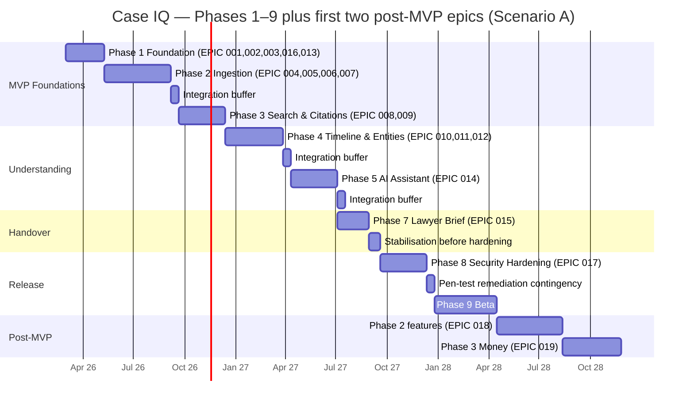

# 22 — Development Plan

This document is the *how* that sits under the roadmap in `19-roadmap.md`. It assumes the reader
is the founder, who is **not primarily a software engineer**, and that most of the code will be
written by **AI coding agents working one task at a time**.

Everything here is downstream of one constraint: **a coding agent cannot ask you a follow-up
question.** If a task is ambiguous, the agent will invent an answer, and the invention will look
plausible. The plan's job is to make invention unnecessary.

---

## 1. How this plan is meant to be used

### 1.1 The execution model

Work proceeds in a strict nesting: **one epic at a time → one task at a time → one verifiable
result at a time.**

1. Open the epic file in `docs/product/epics/`.
2. Read the epic's **Prerequisites** and confirm every dependency task is merged and its
   acceptance test passes on `main`.
3. Pick the **lowest-numbered unstarted task** whose own dependencies are merged. Do not reorder
   without writing down why.
4. Give the agent the task verbatim (see §10.1) — not a summary of it.
5. The agent implements, runs the acceptance test, and reports the raw command output.
6. You verify (§10.3). Only then does the task get marked done.

**Never more than one task in flight per file area.** Two agents editing the same directory will
produce conflicts, duplicated helpers, and two incompatible interpretations of the same spec
paragraph. If you want parallelism, split by *package or module* — one agent in
`packages/ingest`, another in `apps/web` — never by task within the same area.

### 1.2 The rule that matters most: never let an agent redesign the product

**The specs win.** `docs/product/01`–`24` are authoritative. An agent's opinion about a better
schema, a cleaner API shape, a nicer abstraction, or a more modern library is not a decision it
is permitted to make. Its job is to implement what is written.

If an agent believes a spec is wrong, it must **stop and raise it** — it must not implement its
preferred alternative, and it must not implement the spec "loosely" while noting the objection in
a comment. The correct output in that situation is a task report that says: *"Spec section X
requires Y; I believe Y is wrong because Z. I have not implemented either. Awaiting a decision."*
That is a successful task outcome, not a failure.

Why this is absolute: the specs are where the product's guarantees live, and the guarantees are
mutually dependent. DB-1 (`10-database-schema.md` §5.3) makes an uncited assertion unrepresentable.
ADR-019 makes a fabricated citation unrepresentable. The render contract in
`09-evidence-provenance.md` §4.1 makes uncited claim text unrenderable. Each of these is trivial to
"improve" in isolation and fatal to the combination. An agent optimising locally will remove the
friction that *is* the product.

**When the spec genuinely is wrong**, the fix is a spec change made deliberately by a human, with a
**note in the spec recording the change, its reason, and its date**. Then the code changes. Never
the other way around.

### 1.3 What "one task at a time" buys you

- **Attributable failures.** When something breaks, you know which task broke it.
- **A green repo at every commit** (§2.8). You can stop at any point and still have a working system.
- **Cheap reversal.** A wrong task is a small revert, not an archaeology project.
- **Agent-sized context.** A task that fits in one prompt is a task an agent can actually finish.

---

## 2. Development principles for AI-assisted implementation

These twelve rules are non-negotiable. They exist because each one corresponds to a way
agent-written codebases rot.

1. **Implement exactly what the spec says.** Not "a reasonable interpretation of," not "a cleaner
   version of." Where a task cites a spec section, that section is the requirement. Where the spec
   is silent, stop and raise it (§10.6).

2. **Write the test before or with the code.** For anything with a stated acceptance test, write
   the test first. Agent-written code that passes a test written *afterwards* proves very little —
   the test tends to encode whatever the code happens to do.

3. **Never skip the acceptance test.** A task is not done because the code "looks right" or because
   it compiles. It is done when the command in the task's acceptance line has been run and its
   output pasted. There is no exception for small changes; small changes are how DB-4 gets dropped.

4. **Stop and ask when the spec is ambiguous rather than guessing.** A guessed date format, a guessed
   confidence rule, a guessed API error code — each becomes a silent, load-bearing product decision.
   Guessing is the highest-cost mistake available to an agent, because it is invisible.

5. **Never weaken a security control to make a test pass.** If RLS returns zero rows when the test
   expected a row, the bug is in the test or the context-setting code — never in the policy. If
   deleting a `FORCE ROW LEVEL SECURITY` line makes a test green, the test is the problem. This is
   a stop-and-escalate condition, always.

6. **Never add a dependency without recording it.** Dependencies are approved and recorded per §11.
   An agent that reaches for a library to solve a problem already solved in the repo has created
   duplication, a licence question, and a supply-chain surface — for nothing.

7. **Keep changes small and reviewable.** One task, one coherent diff, touching the files the task
   lists. Opportunistic refactors of adjacent code are prohibited: they make the diff unreviewable
   and they couple an unrelated change to the acceptance test.

8. **Leave the repo in a working state at every commit.** `pnpm test`, `pnpm typecheck`, and
   `pnpm lint` must pass on `main` after every merged task. No half-migrated schema, no commented-out
   assertion, no `test.skip` left behind. If a task cannot be finished cleanly, revert it rather than
   committing a broken intermediate state.

9. **Update the spec when reality diverges — with a note.** If implementation reveals that the spec
   is wrong, the spec is edited in the same pull request, with a dated note recording what changed
   and why. A codebase that has drifted from its spec is a codebase no future agent can work in.

10. **Never implement a Phase 2+ feature during MVP work.** The MVP is defined by
    `05-mvp-scope.md` §3.2 and nothing else. Contradiction detection, the allegation matrix, the
    financial ledger, the relationship graph, and the story builder are **out of scope** until their
    phase. `05-mvp-scope.md` §6 names scope creep as a *high-likelihood* risk; this rule is its only
    real mitigation.

11. **Never commit secrets.** No API keys, no connection strings, no tokens, no `.env` files, no
    fixtures containing real credentials. Secrets come from environment variables validated at boot
    (`06-system-architecture.md` §8.1). A secret scanner runs in CI and in a pre-commit hook
    (§4.4). A leaked key in git history is not fixed by a later commit — it requires rotation.

12. **Never modify an original evidence file. This is the hardest rule in the document.**
    **⚠️ Why:** the user's uploaded file is irreplaceable. It may be the only copy of the evidence
    that decides their case. `09-evidence-provenance.md` §9.1 and ADR-027 make immutability a property
    of the storage layer (Object Lock/WORM) precisely because application discipline is not a
    control: **one bug in a "normalise the PDF" step that writes back to the source destroys evidence
    permanently, and no test, backup, or apology recovers it.** Concretely: no code path may
    overwrite, rename in place, re-encode, truncate, "fix", or write back to anything under the
    `originals/` prefix. All processing writes *derivatives* elsewhere. The runtime role holds no
    write permission to that prefix after promotion. Every ingestion test asserts SHA-256 identity
    of every original before and after the full pipeline (`08-document-ingestion.md` §11 test 2).

---

## 3. Repository and monorepo layout

Monorepo with **pnpm workspaces**. The layout mirrors `06-system-architecture.md` §3.3's module
structure; the modules stay inside the app because ADR-001 chose a modular monolith, while code
shared with the worker moves into packages.

```
caseiq/
  apps/
    web/                      # Next.js App Router: UI + REST API
      src/app/                # routes, route handlers, server components
      src/modules/            # the modular monolith (below)
      src/shared/             # errors, logging, config, Result types
      src/jobs/               # pg-boss job definitions and handlers
      src/db/                 # Drizzle schema, SQL migrations, RLS policies
    worker/                   # long-lived container process (ADR-014)
      src/pools/              # ocr | llm | verification | export pools
      src/handlers/           # thin wrappers over packages/* services
  packages/
    db/                       # schema, migrations, RLS, seeds, test harness
    ai/                       # provider abstraction, roles, prompts, verification
    ingest/                   # extraction, OCR, ZIP, dedup, tables
    shared/                   # types, Zod schemas, Result, assertion classes
    config/                   # env validation, typed config, feature flags
  docs/
    product/                  # 01–24, epics/
    adr/                      # ADR files (mirrors 24-architecture-decisions.md)
  fixtures/
    sample-case/              # seeded development matter
    adversarial-corpus/       # the 500-file corpus (EPIC-020)
    prompts/                  # versioned prompt templates
  tests/
    integration/              # cross-package, requires Docker services
    e2e/                      # Playwright
    security/                 # the suite from 12-security-architecture.md §14
    eval/                     # AI evaluation sets and runner config
```

### 3.1 Module structure inside `apps/web/src/modules/`

Identical to `06-system-architecture.md` §3.3: `identity/`, `orgs/`, `matters/`,
`permissions/`, `documents/`, `ingest/`, `provenance/`, `entities/`, `timeline/`, `search/`,
`ai/`, `analysis/`, `finance/`, `graph/`, `reports/`, `audit/`, `billing/`. Modules created in
later phases exist as empty directories with a README until their epic starts.

### 3.2 Package responsibilities and permitted dependencies

| Package | Responsibility | May import | **Must not** import |
|---|---|---|---|
| `packages/config` | Env schema, boot-time validation, typed config object | — | anything |
| `packages/shared` | Assertion classes, confidence enum, `Result`, error codes, shared Zod schemas | config | db, ai, ingest |
| `packages/db` | Drizzle schema, migrations, RLS policies, seed, tenant-context helper, test harness | shared, config | ai, ingest |
| `packages/ai` | **The only place a vendor SDK is imported.** Provider adapter, roles R1–R13, prompt registry, retrieval, verification, budget guard | shared, db, config | web, worker |
| `packages/ingest` | Extraction, OCR dispatch, ZIP hardening, dedup, table extraction, classification orchestration | shared, db, ai, config | web, worker |
| `apps/web` | UI, route handlers, module services | all packages | worker |
| `apps/worker` | Job consumers, pools, watchdog | all packages | web (except types) |

**The vendor-SDK rule is a security and cost control, not tidiness.** ADR-005 and
`07-ai-architecture.md` §10.2 rule 1: *no vendor SDK import outside `providers/`.* Enforced by an
ESLint `no-restricted-imports` rule plus a CI grep that fails the build on a vendor package name
appearing anywhere else. Rationale: the matter-level AI policy (F50) and the per-matter cost ceiling
are enforced *at the provider client*. A direct SDK call bypasses both — producing an
unpoliced outbound call, an unmetered charge, and a `PA-5` violation.

Two further boundary rules, both CI-enforced:

- **Module boundary:** a module may read another module's tables only through that module's exported
  service functions (`06-system-architecture.md` §3.3).
- **Type-only imports from `apps/web`:** `apps/worker` may import types from web, never runtime code.

---

## 4. Environment and tooling setup

### 4.1 Core tooling decisions

| Concern | Decision | Note |
|---|---|---|
| Package manager | **pnpm workspaces** | Strict `node_modules`, fast, one lockfile |
| Language | **TypeScript, `strict: true`** + `noUncheckedIndexedAccess`, `exactOptionalPropertyTypes`, `noImplicitOverride` | Same config in every package via a shared tsconfig base |
| Runtime | **Node.js 22 LTS** | `06-system-architecture.md` §3.1 |
| Lint / format | **ESLint** (flat config, typed rules) + **Prettier** | Boundary rules live here |
| Unit / integration tests | **Vitest** | Fast, ESM-native, good workspace support |
| Browser tests | **Playwright** | 375px mobile viewport is a first-class target |
| Migrations | **Drizzle Kit → reviewable SQL files** | Forward-only in production; RLS policies inside the migration (`10-database-schema.md` §16) |
| Local services | **Docker Compose**: Postgres 16 + pgvector + pg_trgm, MinIO, Mailpit, ClamAV, app, worker | One command, no cloud accounts (ADR-015) |
| Queue | **pg-boss** | Tables in the primary database (ADR-009) |
| CI | **GitHub Actions** | Jobs below |

`docker compose up` must bring the whole system up from a clean checkout with no cloud accounts.
This is a **hard requirement** (`19-roadmap.md` Phase 1 acceptance criterion 1), because the founder
has to be able to run the system.

### 4.2 CI jobs

| Job | Runs | Fails the build when |
|---|---|---|
| `setup` | Install with frozen lockfile, cache | Lockfile drift |
| `typecheck` | `tsc --noEmit` across all packages | Any type error |
| `lint` | ESLint incl. module-boundary and vendor-SDK rules | Boundary violation, vendor SDK outside `packages/ai/src/providers/` |
| `unit` | Vitest across packages | Any failure |
| `db-migrate-and-rls` | Apply migrations to a fresh Postgres; run `db:check-rls` | A table with `matter_id` lacking `ENABLE`+`FORCE RLS`+policy (DB-7); or runtime role has `BYPASSRLS` |
| `db-constraints` | The DB-1…DB-12 constraint suite | A forbidden write succeeds, or a required rejection fails |
| `integration` | Vitest + Testcontainers, `AI_PROVIDER=fake` | Failure; **no network access** |
| `security` | `12-security-architecture.md` §14 suite | Any of the 28 tests fails |
| `copy-lint` | Forbidden vocabulary over all string tables and generated fixtures | Any credibility/legal-advice term |
| `secrets` | Secret scanner over the full git history | Any finding |
| `deps` | Dependency + licence audit against the allowlist (§11) | Disallowed licence, or a banned addition |
| `e2e` | Playwright on the built app with seeded fixture data | Failure |

**No CI job may make a live AI or OCR call.** CI runs with `AI_PROVIDER=fake`, `OCR_PROVIDER=local`,
and no provider credentials present. This makes CI free, fast, deterministic, and offline
(ADR-015, §13 below).

### 4.3 Pre-commit hooks

`lint-staged` → Prettier + ESLint on staged files; secret scan; `tsc` on the affected package.
Hooks catch what the agent did not run. They are convenience, not the gate — the gate is CI.

### 4.4 Local quality-of-life

`pnpm dev` runs app + worker with hot reload. `pnpm db:seed` produces a fully populated sample case
from `fixtures/sample-case/`. `pnpm test:live` is the opt-in suite (§13). Mailpit captures all
outbound email; no test email leaves the machine.

---

## 5. Team and capacity assumptions

Honest statement of the situation: **this is specified for one part-time founder plus AI coding
agents, with an optional contract engineer.** There is no team.

The estimates in §6 are calibrated for a *solo non-engineer founder working with agents*, where the
founder's time goes to: writing and sequencing tasks, verifying acceptance tests, reviewing diffs,
running the system, and making spec decisions — **not** to writing code. Agent throughput is high;
founder verification capacity is the bottleneck. That is the single most important capacity fact in
this plan.

### 5.1 Three scenarios

| | **A — Solo + agents** | **B — Solo + 1 contractor** | **C — 2–3 engineers** |
|---|---|---|---|
| Founder time | 15–20 h/week | 15–20 h/week | Full-time |
| Coding capacity | Agents, verified part-time | Agents + ~20 h/week experienced review & surgery | Agents + 2–3 experienced engineers |
| Phase 1–5 (MVP core) | 9–13 months | 6–8 months | 3.5–5 months |
| Phases 1–9 (to beta) | 14–20 months | 9–13 months | 5–7 months |
| Phase 8 pen test affordable | **Barely — one firm, once** | Yes | Yes |
| Legal review affordable | **Yes, but scope-limited** | Yes | Yes, comprehensive |
| Correct response to slippage | Cut scope (§5.3) | Absorb | Absorb |

A single external penetration test and one legal review pass are **fixed, non-negotiable costs in
every scenario** — they are release gates (`19-roadmap.md` Phase 8; `13-privacy-and-legal-risks.md`
§11 PA-15/PA-16/PA-17). What varies is breadth: Scenario A gets one jurisdiction, one pen-test
window, and no re-test budget. Scenarios B and C get remediation re-testing and multi-jurisdiction
review.

### 5.2 Who does what

| Work | Owner |
|---|---|
| Task authoring, sequencing, DoR/DoD enforcement | Founder |
| Acceptance-test verification, diff review | Founder |
| Spec decisions and spec-change notes | Founder |
| Security- and provenance-sensitive review (second pair of eyes) | Contractor (B, C) or a **different agent** acting as reviewer (§9) |
| Product/copy review against `14-ux-specification.md` §6 and the copy lint | Founder |
| Legal, privacy, pen test | External, engaged in Phase 0 and re-engaged in Phase 8 |

### 5.3 What must be cut in the smallest scenario (A)

Cut in this order, using `05-mvp-scope.md` and ADR-026:

1. **AI chat (F19)** — ADR-026 states explicitly that chat is cut before the brief, because the brief
   is the monetisation event and chat is the highest-risk surface.
2. **Rich per-document summaries** — already deferred by `05-mvp-scope.md` §2 (cost multiplier).
3. **Saved views (F18)** — search filters persist in the URL, which covers most of the value.
4. **Notes (F25)** reduced to matter-level notes only.
5. **Phase 2 breadth**: the allegation matrix is cut before the contradiction engine's precision work
   is finished; communication threading (F30) is last.

**Never cut, in any scenario:** RLS and the audit log (cannot be retrofitted), the citation system
and Tier 1 verification, the lawyer brief, deletion and its receipt, the honesty/coverage panel, or
the security and copy-lint gates. Cutting any of these converts a schedule problem into a
product-integrity problem.

---

## 6. Timeline and milestones

### 6.1 Estimating basis, stated plainly

**All estimates are uncertain by roughly ±40%.** They are calibrated from the durations in
`19-roadmap.md`, adjusted upward for the founder-verification bottleneck (§5) and for the fact that
Phase 2 is described in the roadmap itself as "the highest-risk phase in the project." Treat every
number below as a planning centre with a wide band, not a commitment. The plan's protection against
that uncertainty is not better estimates — it is the phasing in §7.3 and the scope cuts in §5.3.

Weeks are **calendar weeks of elapsed work**, at the founder's stated availability. Scenario A is
shown, because it is the plan's default and the largest risk.

### 6.2 Phase schedule (Scenario A, 14–20 months)

| Phase | Epic(s) | Weeks | Cumulative | Milestone |
|---|---|---|---|---|
| **1 — Foundation** | 001, 002, 003, 016 (shell), 013 (abstraction), 020 (harness start) | 8–12 | 12 | A user signs up, creates a matter, audit log records it, **RLS proven** |
| **2 — Ingestion** | 004, 005, 006, 007 | 14–20 | 32 | 500 adversarial files ≥ 90% READY, originals byte-identical |
| **3 — Search & citations** | 008, 009 | 10–14 | 46 | Every page reachable; citations resolve; Tier 1 catches 100% of fabricated quotes |
| **4 — Timeline & entities** | 010, 011, 012 | 12–18 | 64 | Cited, reviewable, correctable chronology; distinct-person precision ≥ 0.95 |
| **5 — AI assistant** | 014, 015 (brief structure) | 10–14 | 78 | Cited chat with escape rate 0 and working abstention |
| **7 — Brief** | 015 | 6–9 | 87 | A lawyer receives a cited, verified brief |
| **8 — Security hardening** | 017 | 10–14 | 101 | Pen test passed; all Phase 8 gates green |
| **9 — Beta** | — | 12–20 | 121 | 10 design partners complete the journey unaided |
| **Phase 2 post-MVP** | 018 | 14–20 | 141 | Conflict precision ≥ 0.70, zero credibility language |
| **Phase 3 post-MVP** | 019 | 12–18 | 159 | Balance verification catches ≥ 95% of injected amount errors |

**Buffers, explicitly:**

- **Within every epic:** each task carries its own estimate; the epic total includes ≈15% for the
  integration friction that no task lists. This is inside the numbers above.
- **After Phase 2, Phase 4, and Phase 5:** a **2-week integration buffer** each, unscheduled. These
  are the three phases where a subsystem's quality gates can fail late. Total 6 weeks, not included
  in the table.
- **Before Phase 8:** a **3-week stabilisation buffer** to freeze the attack surface. Phase 8's
  dependency is that the surface is final; testing a moving target wastes the pen-test budget.
- **After Phase 8, before Phase 9:** a **2-week contingency** for remediating pen-test findings.
  Critical and high findings must be remediated before beta, and they are not negotiable
  (`19-roadmap.md` Phase 8 acceptance criterion 2).

Total unscheduled buffer: **13 weeks**. A defensible planning envelope for Scenario A is therefore
**16–23 months**, and the honest statement to a design partner is "roughly a year and a half, with
real uncertainty."

### 6.3 Gantt chart



Note the deliberate gap at **Phase 6** (contradictions and allegations) — the roadmap sequences it
between Phase 5 and Phase 7, but the MVP brief (Phase 7) must not wait on it: `19-roadmap.md` Phase 7
says Phase 6 "benefits the brief's Contradictory Evidence section but is not a hard dependency — the
section renders empty with an honest note if Phase 6 is not live." Running EPIC-018 **after** beta is
therefore both permitted and, for Scenario A, necessary.

### 6.4 Critical path

> **003 (data layer + RLS) → 004 (upload) → 005/006 (extraction + OCR) → 008 (chunking, FTS, vectors)
> → 009 (citations + Tier 1 verification) → 010/011 (entities → timeline) → 014 (chat generation) →
> 015 (brief) → 017 (hardening) → 009/Phase 9 beta.**

The path is the roadmap's central sequencing decision, restated: **citations precede generation**
(`05-mvp-scope.md` §7, `19-roadmap.md` Phase 3). S2 precedes S4 deliberately. Anything that delays
`packages/db` delays everything; anything that delays Tier 1 verification delays the brief.

---

## 7. The critical path and its risks

### 7.1 Why this is the critical path and not another

The true critical path runs **ingestion → citations → timeline → verification → brief** because each
link is a hard prerequisite of the next, and none can be parallelised away:

- **Ingestion** produces the page text and character offsets that citations index into. No page text,
  no citation — `document_pages` is the substrate.
- **Citations** produce the `VerifiedAssertion` type, which is the *only* renderable claim type
  (`09-evidence-provenance.md` §4.1). The timeline cannot render an event without one.
- **Timeline** is the product's centrepiece and the north-star metric's denominator (TTFDC). It is
  also what the brief's longest section is built from.
- **Verification** is the gate that makes the brief defensible. The brief's verification gate
  (`11-api-specification.md` §3.15) is meaningless without Tier 1 and Tier 2 producing statuses.
- **Brief** is the monetisation event and the growth loop (ADR-026). It cannot be pulled forward;
  what *can* be pulled forward is its structure and templates, which is why EPIC-015's first tasks
  build empty-section scaffolding early.

### 7.2 Top eight schedule risks

| # | Risk | Why it bites the schedule | Mitigation | Trigger to act |
|---|---|---|---|---|
| **R1** | **Extraction quality arrives later than hoped** | Every downstream feature consumes extractions. Poor precision in Phase 4 silently invalidates the timeline, chat, and brief in later phases — so the slippage appears *three phases after* its cause | Measure precision on a labelled set from the first extraction task (EPIC-005-T09/T19); ship the review queue as the fallback UX; treat precision as a gate, not a metric. Build the labelled set before the extractor (EPIC-020-T03) | Precision < 0.90 on the labelled set, or an unflagged regression in CI |
| **R2** | **OCR surprises** | OCR is the highest-variance subsystem: 1,200-page scans, skewed pages, handwriting, digit confusion. If Tesseract quality is unacceptable on the real corpus, cloud OCR becomes mandatory — which is a policy, privacy, **and** cost change, not a code change | Born-digital gating so OCR is never invoked unnecessarily (EPIC-005-T04); local Tesseract first, cloud opt-in per matter (EPIC-006-T04/T05); per-page confidence and the coverage panel so partial failure is visible rather than fatal; measure OCR cost per matter from the first corpus run | > 15% of pages below confidence threshold on the standard corpus, or OCR cost per 500-page matter exceeding the ceiling in the cost test |
| **R3** | **AI provider evaluation takes longer than planned** | Choosing and contracting providers involves data-handling terms, no-retention commitments, residency, and DPAs. This is **calendar time with a third party**, which no amount of agent throughput compresses | **Do not block on it.** The deterministic fake provider (EPIC-013-T02, ADR-015) makes all AI-dependent work proceed without a provider. Provider selection is decoupled from development. Local OCR is the default path | If provider selection is not settled two weeks before EPIC-014 needs live Tier 2, ship the abstraction + fake + one provider, and add the second provider as a follow-up task |
| **R4** | **Legal review takes longer than planned** | Counsel availability, not effort, is the constraint. Q1–Q20 in `13-privacy-and-legal-risks.md` §10 are open, and the DPIA is a Phase 8 gate | **Engage counsel in Phase 0 and keep them engaged continuously** rather than attempting a single end-of-project review. Write briefings from `13-` directly — the document is already counsel-shaped. Every open question has a recommended default so engineering never blocks on an answer | Any Q1–Q6 item unanswered 6 weeks before Phase 8 |
| **R5** | **Citation verification architecture costs more than budgeted** | Tier 2 runs a second model over every user-visible assertion. On a matter with thousands of assertions, that can dominate inference cost — and a cost overrun at Phase 5 forces either a quality or a pricing decision late | Skip Tier 2 for `SOURCE_EXCERPT` (a verbatim quote needs no entailment check) and for human-reviewed assertions (ADR-020, `07-ai-architecture.md` §7); cache verification by `quote_hash`; enforce the per-matter ceiling *before* each stage; measure real cost per 500-page and 2,000-page matter in the cost test before pricing | Tier 2 exceeding its per-assertion ceiling in the cost test, or `quote_mismatch` + suppression rates showing Tier 2 spending on assertions that Tier 1 already settled |
| **R6** | **Real-world file diversity breaks ingestion** | The roadmap's named "critical" risk. Corrupt, locked, nested, enormous, and adversarially-crafted files are normal inputs, not edge cases | Build the 500-file adversarial corpus **first** (EPIC-020-T02); make every failure state first-class and individually retryable; test the corpus continuously from the first pipeline task | READY rate < 90% on the corpus at any point in Phase 2 |
| **R7** | **Agent-authored code diverges from spec** | The characteristic failure of agent development: plausible, working, spec-violating code that passes a test written to match it | Two-agent review for provenance- and security-sensitive code (§9.3); acceptance tests taken *from the spec documents*, not from the task author; the constraint suite (EPIC-003-T08) as a backstop that catches spec violations regardless of who wrote the code | Any review comment of the form "the spec says X but this does Y" |
| **R8** | **Founder verification becomes the bottleneck** | Agents can produce more code per week than one part-time non-engineer can verify. The queue grows, review quality drops, and defects reach `main` | Keep tasks small (§2.7) so verification is minutes not hours; make every acceptance test a single runnable command; batch verification into two fixed sessions per week; **stop starting tasks when the verification queue exceeds three** | More than three completed-but-unverified tasks, or any merged task without a pasted acceptance-test output |

### 7.3 The plan's real protection

If two or more of R1–R4 materialise, the response is **§5.3's cut list**, executed in order. The
plan is designed so that each cut removes value without removing a guarantee. That is why chat is
cut before the brief, why Phase 2/3 features are deferred rather than partially built, and why the
non-cuttable list in §5.3 is short and specific.

---

## 8. Definition of Ready and Definition of Done

### 8.1 Definition of Ready — a task may be started only when all of these are true

- [ ] The task exists in an epic file in `docs/product/epics/` with an ID, and its `depends_on` tasks
      are merged and passing.
- [ ] **Files/paths** the task creates or modifies are listed explicitly.
- [ ] The **acceptance test** is stated as a command to run or an observable behaviour — not as
      "works correctly."
- [ ] The relevant **spec sections are cited** (F-ID, DB-ID, ADR-ID, RT-ID, or a document section),
      so the agent reads the requirement rather than inferring it.
- [ ] The **scope boundary is explicit**, including at least one "do NOT do X."
- [ ] Any trap is called out in a "watch out for" note with its reference.
- [ ] The estimate is **≤ 6 hours** of agent work. If longer, split the task.
- [ ] The repo is green: `pnpm typecheck`, `pnpm lint`, `pnpm test` pass on `main`.
- [ ] The local environment runs (`docker compose up`) so the acceptance test can actually execute.
- [ ] No other in-flight task touches the same file area.
- [ ] Where the spec is silent on something required, a **"Spec gap — decide before implementing"**
      callout exists and has been resolved by a human.

### 8.2 Definition of Done — a task is complete only when all of these are true

- [ ] The acceptance test has been **run**, and its **raw output is pasted into the task report**.
- [ ] Tests were written **before or with** the code, and they fail when the implementation is
      reverted (spot-checked for non-trivial tasks).
- [ ] `pnpm typecheck`, `pnpm lint`, `pnpm test` all pass locally **and** in CI.
- [ ] The diff touches only the files the task listed. Any extra file is explained in the report.
- [ ] No new dependency was added, **or** the addition is recorded per §11.
- [ ] No security control was weakened. If a test required it, the task is **not done** — it is
      escalated (§2.5).
- [ ] No secret, token, or credential appears anywhere in the diff.
- [ ] **No original evidence file was modified**; if the task touches the ingestion or storage path,
      the SHA-256 identity assertion passes.
- [ ] New non-obvious decisions have a code comment explaining *why* (§12).
- [ ] Any divergence from the spec is recorded as a dated note **in the spec** (§2.9).
- [ ] Any new module/directory has a README (§12).
- [ ] Prompt changes bumped the prompt version, and the version is stored on outputs (§12).
- [ ] The task's status in the epic file is updated, with the merge commit reference.
- [ ] The repo is left in a working state: no `test.skip`, no commented-out assertion, no
      half-applied migration.

---

## 9. Code review and quality gates

### 9.1 Who reviews

| Stage | Reviewer |
|---|---|
| Phases 1–3 (Scenario A) | **Founder**, using the checklist below |
| Scenario B/C from Phase 2 onward | **Contract engineer** for anything security- or provenance-sensitive; founder for everything else |
| Any time, any scenario | **A second, different AI agent** acting as reviewer against the spec (the two-agent pattern, §9.3) |

The founder is not expected to review code as an engineer. The founder's review is **spec
conformance and observable behaviour**: does the acceptance test pass, does the diff do what the task
said, does the running system behave as described. That is a review a non-engineer can perform
rigorously, and it is the review that catches the failure mode that matters (spec divergence).

### 9.2 What every review must check

- [ ] **Spec conformance.** Does the code implement the cited spec section, and nothing more?
- [ ] **Acceptance test present, meaningful, and passing.** Does the test actually test the
      requirement, or does it test the implementation's incidental behaviour?
- [ ] **Scope.** Is the diff confined to the task's listed files? Any opportunistic refactor is
      rejected.
- [ ] **Security controls intact.** RLS policies, `FORCE`, capability checks, `SET LOCAL`
      (never `SET`), audit writes, and the auth path are unchanged in behaviour.
- [ ] **Provenance controls intact.** `assertion_class` immutability, `citation_count` invariants,
      the `VerifiedAssertion` construction path, and suppression semantics.
- [ ] **Originals untouched.** No write path to `originals/`.
- [ ] **Idempotency.** New money-spending operations carry an idempotency key.
- [ ] **Error handling.** Errors are `Result`-typed where expected, never leak internals, and carry
      a machine code plus a next action.
- [ ] **Copy.** No credibility vocabulary, no legal advice, no numeric confidence.
- [ ] **Tests not weakened.** No assertion loosened, no timeout raised to hide flakiness, no
      `test.skip` added.
- [ ] **Documentation.** README and comments where required; spec note where the spec diverged.

### 9.3 The two-agent review pattern

For any task touching `packages/db`, `modules/permissions`, `modules/provenance`, `modules/audit`,
the auth path, or the storage/immutability path, use **two different agents**:

1. **Agent A (implementer)** receives the task exactly as written and implements it.
2. **Agent B (reviewer)** receives: the task text, the diff, **and the cited spec sections** — but
   *not* Agent A's reasoning or its self-assessment. Agent B's instruction is:

   > "You are reviewing an implementation against a specification. Read the spec sections named
   > below. Then read the diff. Report: (a) any place the code does not do what the spec requires;
   > (b) any place the code does more than the spec requires; (c) any place the spec is ambiguous
   > and the code silently chose an interpretation; (d) any security or provenance control that is
   > weaker than the spec describes. Do not comment on style. Do not propose refactors. If you find
   > no issues, say so explicitly."

Agent B is deliberately **not** told what Agent A thought it did. A reviewer primed with the
implementer's narrative reviews the narrative, not the code. Agent B's **option (c) is the most
valuable output** — a silent interpretation of an ambiguous spec is exactly the failure this whole
plan is built to prevent.

**Security-sensitive and provenance-sensitive code always gets a second pair of eyes.** In
Scenario A that second pair is Agent B plus, at minimum, a contractor review before Phase 8. The
penetration test is not a substitute: it tests the deployed system's attack surface, not whether
`SET LOCAL` was used where `SET` was available.

### 9.4 Quality gates that block merge

A task cannot merge if any of these fail: `typecheck`, `lint`, `unit`, `db-migrate-and-rls`,
`db-constraints`, `integration`, `security`, `copy-lint`, `secrets`, `deps`. Green CI is necessary
but not sufficient — the human/agent review in §9.2 is the other half. **A pass in CI never
overrides a review finding that the spec is violated.**

---

## 10. Working with AI coding agents

### 10.1 How to prompt for a task

Give the agent the **task verbatim** from the epic file, plus a fixed preamble. Do not paraphrase:
a summary is where the "do NOT do X" clause disappears.

```
You are implementing one task in the Case IQ repository.

TASK (verbatim from docs/product/epics/<epic file>):
<paste the entire task block>

REQUIRED BEFORE YOU WRITE CODE:
1. Read docs/product/<the spec files named in the task>.
2. Read the "watch out for" note and the referenced ADR / DB-constraint / RT-ID.
3. Read any file in the "Files" list that already exists.

RULES:
- Implement exactly what the spec and the task say. Not more, not less.
- Write the acceptance test first, or with the code.
- Touch only the files listed. If you need another file, stop and say so.
- Do NOT add a dependency without stopping and asking.
- Do NOT weaken any security or provenance control for any reason.
- Do NOT modify anything under originals/. Ever.
- Do NOT implement anything from a later phase.
- If the spec is ambiguous or wrong, STOP and report the ambiguity. Do not guess.

WHEN YOU FINISH, REPORT:
1. The acceptance-test command and its RAW output.
2. The list of files changed.
3. Any place you had to interpret the spec — quote the spec text and your interpretation.
4. Any dependency you wanted to add but did not.
5. Anything you could not do, and why.
```

Item 3 of the report format is the highest-value question. It surfaces silent guesses, which are the
failure mode that otherwise reaches production undetected.

### 10.2 How to keep an agent from over-reaching

- **Name the files, and say "do not touch any other file."** Agents fill silence with helpfulness.
- **Include an explicit "Do NOT" for the most tempting adjacent thing.** For a timeline task:
  "Do NOT implement event merging — that is a later task." For an extraction task: "Do NOT build a
  UI for this."
- **Say "one task."** If the agent proposes a multi-step plan, stop it and re-scope.
- **Forbid refactoring explicitly.** "Do not rename, reformat, or reorganise existing code."
- **Set a diff budget.** "The diff should be under ~300 lines. If it is larger, stop and report."
- **Reject forward references.** If the agent imports something a later task creates, it has reached
  ahead and broken the repo's working state.
- **Do not ask an agent to "improve" anything.** Improvement is unbounded; tasks are bounded.

### 10.3 How to verify an agent's work

Three steps, in order, and all three are required:

1. **Run the acceptance test yourself.** Not the agent's summary of it — the command. Paste-free
   verification: if the agent says "all tests pass," run them.
2. **Inspect the diff.** `git diff` against the merge base. Look for: files outside the task's list,
   weakened assertions, removed `FORCE ROW LEVEL SECURITY`, `SET` where `SET LOCAL` belongs, a new
   dependency, a `test.skip`, a hard-coded value that should be config, and any string containing
   credibility vocabulary.
3. **Check against the spec.** Open the cited spec section and read the requirement. Ask: does this
   code do *that*? This is where spec divergence is caught, and it is the step agents cannot do for
   their own work.

For provenance- and security-sensitive tasks, add the two-agent review (§9.3).

### 10.4 When an agent's output is plausible but wrong

This is the most dangerous category, because it passes tests and reads well. Symptoms:

- A test that passes for the wrong reason (it asserts on a mock's return value, not on behaviour).
- A constraint implemented in application code instead of the database.
- A citation rendered from an object the code constructed itself, rather than from the verification
  module.
- A confidence value computed inline instead of via the rule engine.
- An idempotency key derived from a timestamp or UUID.
- `catch (e) { return null }` around a verification step.
- An error message that leaks a provider name or a file path.

**Response:** do not patch it in review. Revert the task, strengthen the task text with the specific
failure mode as a "watch out for" note, and re-run. A plausible-but-wrong implementation that gets
patched in review leaves the underlying ambiguity in the spec, and the next agent makes it again.

### 10.5 An agent must never mark a task done without running its test

State it in the prompt, enforce it in review (§8.2). A task report without raw test output is an
**incomplete task**, not a completed one. If the agent cannot run the test — the environment is
broken, a Docker service is down — the correct report is "blocked: cannot run the test, because X."
That is a useful outcome. "Implemented, should work" is not.

### 10.6 When an agent wants to change a spec

Three legitimate outcomes, and no illegitimate ones:

1. **The spec is ambiguous.** The agent stops and reports the ambiguity. The human resolves it by
   editing the spec with a dated note, then re-runs the task. **Guessing is never acceptable.**
2. **The spec is wrong.** The agent stops and reports *why*, with evidence (a constraint that cannot
   coexist, an API shape that cannot represent a required state). The human decides: either the spec
   changes (with a dated note recording the change and reason) or the implementation changes. The
   agent does neither unilaterally.
3. **The spec is silent on something the task needs.** This is a **"Spec gap — decide before
   implementing"** callout. The agent reports it as a blocker with its recommended default; the human
   either fills the gap in the spec or amends the task.

**Illegitimate:** implementing the agent's preferred alternative "while noting the deviation in a
code comment." A comment does not fix a spec violation, and the next agent reads the code, not the
comment.

### 10.7 Working rhythm

Two verification sessions per week. Each session: pull completed tasks, verify each with the three
steps, mark done, and queue the next tasks. **If more than three tasks are completed-but-unverified,
stop starting new ones.** Unverified work is not progress; it is debt with interest.

---

## 11. Dependency and license policy

### 11.1 Approval and recording

A new runtime dependency requires, in the pull request:

1. **The problem it solves**, stated in one sentence.
2. **Why the repo cannot already solve it**, naming the existing code that was considered. This is
   the question that rejects most additions.
3. **The package, version, licence, and maintenance status** (last release, open criticals, weekly
   downloads as a rough liveness signal).
4. **Its transitive dependency count**, as reported by the dependency audit job.
5. **An entry in `docs/product/dependency-register.md`** with the above plus the date and the
   approving owner.

An addition without a register entry **fails CI**. The register is the artefact that makes
`docs/product/24-architecture-decisions.md` auditable: it is how a future reader learns why a
package is present.

### 11.2 Prefer boring, stable dependencies

Choose the dependency that is old, widely used, narrowly scoped, and boring. Prefer:

- Few or zero transitive dependencies.
- A stable major version, released more than a year ago.
- TypeScript types shipped or available first-party.
- A single, well-defined purpose.

Actively avoid: single-maintainer packages for anything load-bearing, packages whose primary value
is convenience around something the standard library does, anything requiring a native build step
where a pure-JS alternative exists, and anything that would appear in a security review as an
unexplained licence or jurisdiction risk.

### 11.3 Licence allowlist

**Allowed:** MIT · ISC · Apache-2.0 · BSD-2-Clause · BSD-3-Clause · 0BSD · CC0-1.0 · Unlicense ·
Python-2.0 · MPL-2.0 (as an unmodified dependency).

**Requires explicit approval and a register note:** LGPL-2.1/3.0 · EPL-2.0 · CC-BY-4.0 (assets) ·
any dual-licence arrangement.

**Banned:** GPL-2.0/3.0, AGPL-3.0, SSPL, BUSL, Commons Clause, Elastic License, "source available"
licences, and any package with **no licence file**. AGPL in particular is fatal for a SaaS product:
it would oblige us to offer the source of our service to users.

The `deps` CI job enforces this and fails on a banned licence, an unknown licence, or a missing
licence file. Licences are checked for **transitive** dependencies too, because those are the ones
nobody reads.

### 11.4 The ban on solving a solved problem

**Do not add a dependency for something already solved in the repo.** Concretely: do not add a date
library — `packages/shared` owns date normalisation and precision. Do not add a validation library —
Zod is already the contract layer. Do not add a retry/backoff library — pg-boss provides it. Do not
add an HTTP client wrapper — the provider adapters own transport. Do not add a UUID library —
`uuid` v7 generation is already wired. Do not add a state-management library — the architecture
deliberately uses server state plus URL state (`06-system-architecture.md` §3.2).

Duplicated solutions are worse than duplicated code: they diverge, they double the audit surface,
and they leave two answers to "how does this work?" — which is precisely the ambiguity this plan
exists to eliminate.

---

## 12. Documentation obligations

Documentation is not optional garnish; in an agent-built codebase it is **the only durable transfer
of intent between tasks.**

| Obligation | Rule |
|---|---|
| **Every module gets a README** | `apps/web/src/modules/*/README.md` and `packages/*/README.md`. Contents: what it is responsible for, its public service functions, which tables it owns, which modules it may call, and which spec document governs it. A new module without a README fails review |
| **Every non-obvious decision gets a code comment** | Comments explain **why**, never what. The code already says what. A comment is required wherever a naive reader would change the code: why `SET LOCAL` and never `SET`; why a check is in the database rather than the handler; why an idempotency key is derived from a hash rather than a timestamp; why a value is denormalised |
| **Every divergence from the spec gets a note in the spec** | Dated, in the spec document itself, recording what changed, why, and by whom (§2.9). The codebase and the specs must not disagree without a written record of the disagreement |
| **Prompts are versioned files** | `packages/ai/src/prompts/r01-…v3.ts`. A prompt change bumps the version, and the version is stored on every output the prompt produced (`07-ai-architecture.md` §10.2 rule 2). Prompts are never inline string literals |
| **ADRs are updated when a decision changes** | `24-architecture-decisions.md` is edited, not silently contradicted. A reversed decision gets its status changed to `superseded` with a pointer to the replacement. An ADR is never deleted |
| **API changes update the OpenAPI document** | Zod schemas generate it; a change to a response shape without a schema update fails `typecheck` |
| **CI-enforced documentation checks** | Missing module README, unregistered dependency, unversioned prompt, or a new `matter_id` table without an RLS policy — each fails the build |

The standard to hold: **a new agent should be able to pick up any task from the epic files with no
other context than the repo.** Every obligation above exists to make that true.

---

## 13. Cost management during development

Development must cost approximately nothing in AI and OCR spend. This is not thrift; it is
ADR-015, and it is what makes CI able to run the whole suite on every commit.

### 13.1 The mechanisms

| Mechanism | What it does |
|---|---|
| **Deterministic fake provider** (`AI_PROVIDER=fake`) | Same interface as a real provider; output derived from `hash(input + roleId)`; schema-valid for every role, using canned plausible extractions from a fixture. No network. This is the default in dev and CI |
| **Fixture mode** | The seed script (`EPIC-015`/`EPIC-003-T09`) populates a full sample matter from `fixtures/sample-case/`, so every feature can be exercised without uploading or processing anything |
| **No live calls in CI — enforced** | CI has no provider credentials in its environment. A test asserts that with `AI_PROVIDER=fake` the number of outbound provider calls is **zero**. Any accidental live call fails the build loudly |
| **Local OCR only** | `OCR_PROVIDER=local` (Tesseract in the worker) in dev and CI. Cloud OCR requires an explicit per-matter policy **and** credentials that CI does not have |
| **Deterministic corpus** | The 500-file adversarial corpus is generated once and committed (or built by a deterministic generator), so ingestion tests cost nothing to re-run |
| **Cost metering from day one** | Every paid call writes a `usage_events` row with an idempotency key (`06-system-architecture.md` §8.2). Metering exists before any billing UI. In dev the numbers are all zero, and a non-zero number is itself a bug signal |
| **Per-matter ceiling active in dev** | `cost_ceiling_cents` is set to a small value in seed data, so ceiling-enforcement code paths are exercised without spending |

### 13.2 The opt-in live suite

Separate, never part of default CI:

- **Command:** `pnpm test:live` — runs only when provider credentials are present, and refuses to
  start if `LIVE_BUDGET_CENTS` is unset.
- **Contents:** the prompt/model regression evals, Tier 2 sensitivity on the labelled "real quote,
  wrong claim" set, abstention correctness, the legal-advice refusal set, and the prompt-injection
  canary corpus (`17-ai-evaluation-framework.md`).
- **Budget cap:** the runner enforces a hard ceiling on total spend for the run and **aborts mid-run**
  when it is reached, reporting which suites completed. A run that aborts on budget is a normal,
  expected outcome, not a failure.
- **Cadence:** on every change to a prompt template, a model ID, or the verification pipeline, and on
  a weekly schedule. Never on every commit.
- **Recording:** results are stored with the prompt version and model ID so a regression is
  attributable; recorded fixtures let most of the suite run offline thereafter.

### 13.3 Monitoring spend

- A development cost dashboard reads `usage_events`: spend by day, by matter, by role, by model.
- **A non-zero figure in dev or CI is an alert**, because it means something bypassed the fake
  provider.
- Prompt-cache hit rate and Tier 2 skip rate are tracked as cost levers, not just quality metrics.
- Before pricing is decided (`20-business-model.md`), the cost test measures the real cost of a
  500-page and a 2,000-page matter end to end. **Guessing here is how the business model fails**
  (RT-19).

---

## 14. Launch readiness

The final checklist before public launch. Owner is named per item; **any unchecked item blocks
launch.** This consolidates `05-mvp-scope.md` §8 and `13-privacy-and-legal-risks.md` §11, plus the
Phase 8 gates from `19-roadmap.md`.

### 14.1 Product and quality gates — owner: Product

- [ ] All 27 MVP features (`05-mvp-scope.md` §3.2) pass their acceptance criteria in `04-feature-specification.md`
- [ ] Documents reaching READY ≥ 90% on the adversarial corpus — owner: Ingest
- [ ] **Original bytes modified = 0** (hard gate) — owner: Ingest
- [ ] **Unsupported-assertion escape rate = 0** (hard gate) — owner: AI
- [ ] **Cross-tenant data leakage = 0** (hard gate) — owner: Security
- [ ] Citation integrity rate ≥ 99.5% — owner: AI
- [ ] Extraction precision, distinct people ≥ 0.95 — owner: AI
- [ ] Timeline event usefulness ≥ 80% judged "a real, relevant event" — owner: Product
- [ ] Keyword search p95 < 800ms at 2,000 docs — owner: Search
- [ ] Chat abstention correctness ≥ 90% — owner: AI
- [ ] Legal-advice refusal 100% on the ≥ 30-prompt adversarial set — owner: AI/Legal
- [ ] Brief export with citations on every statement = 100% — owner: Reports
- [ ] Median TTFDC < 30 minutes on a 500-page matter, measured in production — owner: Product
- [ ] `05-mvp-scope.md` §8 items 1–10 all satisfied — owner: Founder

### 14.2 Security gates — owner: Security

- [ ] **All 28 tests in `12-security-architecture.md` §14 pass**
- [ ] RLS proven: no tenant context returns zero rows; `SET LOCAL` isolation verified under pooled connections; runtime role lacks `BYPASSRLS` — owner: Data
- [ ] Append-only guarantees verified: `ai_extractions`, `audit_log`, `user_corrections.original_value` reject `UPDATE`/`DELETE` as the runtime role; audit chain tamper detection works — owner: Data
- [ ] Privilege wall tested across every read path, including inferred counts, search, graph, timeline, brief, and chat retrieval — owner: Security
- [ ] Share-link scope immutability, expiry, revocation (≤ 5 min including in-flight signed URLs), and access logging verified — owner: Security
- [ ] Session revocation effective within 30 seconds — owner: Identity
- [ ] Upload hardening: ZIP bomb, traversal, EICAR, locked and corrupt files all handled — owner: Ingest
- [ ] Prompt-injection canary corpus produces zero unsupported rendered assertions — owner: AI
- [ ] Dependency and secret scanning: zero known-exploited criticals, zero secrets in git history — owner: Founder
- [ ] **External penetration test completed; zero unresolved critical or high findings** — owner: Founder + external firm
- [ ] Backup restore rehearsed within RTO; key rotation executed once end to end; incident-response runbooks rehearsed including the leaked-share-link scenario — owner: Ops

### 14.3 Privacy and legal gates — owner: Founder + counsel

- [ ] **DPIA completed and signed off by privacy counsel** (PA-15) — owner: Founder + counsel
- [ ] Q1–Q6 answered by counsel; product defaults updated if answers differ — owner: Founder + counsel
- [ ] Terms of Service, Privacy Notice, DPA templates, and AUP reviewed by counsel (PA-17) — owner: Founder + counsel
- [ ] Subprocessor list published and matching configured providers (PA-9) — owner: Founder
- [ ] Deletion receipts list categories, counts, and the **backup purge window**; no instant-eradication claim anywhere (PA-4, ADR-017) — owner: Data
- [ ] Vector search over a deleted matter returns zero results (PA-3) — owner: Data
- [ ] `allow_third_party_ai = false` produces zero outbound AI calls, network-verified (PA-5) — owner: AI
- [ ] Cloud OCR off by default, per-matter opt-in only (PA-6) — owner: Ingest
- [ ] No case content in logs, error responses, notification bodies, or email subjects (PA-7) — owner: All
- [ ] Only retrieved spans sent to providers — never a whole document or matter (PA-8) — owner: AI
- [ ] Data subject request procedures documented with a published contact (PA-14) — owner: Founder
- [ ] **Legal review of all user-facing copy completed and signed off** — owner: Founder + counsel
- [ ] UPL opinion obtained per launch jurisdiction; marketing copy review gate applied; no compliance, certification, or security claim that is not independently verified (PA-18, RT-23, RT-25) — owner: Founder + counsel
- [ ] Non-advice disclosure appears on signup, in the footer, and on every brief page (PA-11) — owner: Product
- [ ] Preservation warning appears before deletion confirmation (PA-12) — owner: Product
- [ ] OCR caveat appears on every OCR-derived numeric value (PA-13) — owner: Product

### 14.4 Accessibility and operations — owner: Founder

- [ ] External WCAG 2.2 AA audit completed; all critical findings remediated
- [ ] Graph has a working keyboard-navigable table equivalent; evidence viewer works at 375px
- [ ] All Sev-1 signals in `18-red-team-risks.md` §5 wired with named owners and runbooks
- [ ] Rollback plan exists and has been rehearsed (`05-mvp-scope.md` §8 item 9)
- [ ] Cost dashboard reconciles with provider invoices within the documented tolerance (`05-mvp-scope.md` §8 item 10)
- [ ] Security page published with claims limited to what is independently verified

### 14.5 Beta exit — owner: Founder

- [ ] **10 design-partner users completed the full journey unaided on their own real matters** (`05-mvp-scope.md` §8 item 7)
- [ ] ≥ 35% of active matters generated a Lawyer Brief
- [ ] ≥ 3 lawyers confirmed in writing that a received brief was useful
- [ ] Cost per matter within the plan's gross-margin target
- [ ] No Sev-1 incident unresolved beyond its response target

**If any hard gate fails, the MVP does not launch.** The correct response is to fix the gate, not to
ship and explain (`19-roadmap.md`).

---

## Related documents

- `05-mvp-scope.md` — what is in the MVP, and why each exclusion is defensible
- `06-system-architecture.md` — the stack and module structure the layout in §3 implements
- `19-roadmap.md` — the phases this plan schedules
- `epics/` — the implementable task breakdown, with `epics/README.md` as the index
- `24-architecture-decisions.md` — the ADRs referenced throughout
- `13-privacy-and-legal-risks.md` — the privacy obligations consolidated in §14.3
- `16-testing-strategy.md` / `17-ai-evaluation-framework.md` — how the gates are measured
- `18-red-team-risks.md` — the risks the principles in §2 exist to prevent
