# Diagrams

Standalone copies of every architecture diagram in the specification set, so a reader can see the
whole system without jumping between documents. Each diagram states its source document and, where
useful, what to notice in it.

**Rendering requirement:** all diagrams are Mermaid. They are also exported as SVG/PNG by the
documentation build for offline reading and print.

---

## Index

| # | Diagram | Source |
|---|---|---|
| D1 | System architecture | `06-system-architecture.md` §2 |
| D2 | Trust boundaries | `06-system-architecture.md` §2.1 |
| D3 | Document processing pipeline | `08-document-ingestion.md` §2 |
| D4 | Document state machine | `08-document-ingestion.md` §2.1 |
| D5 | AI query / RAG and verification pipeline | `07-ai-architecture.md` §6.3 |
| D6 | Evidence provenance flow | `09-evidence-provenance.md` §3.5 |
| D7 | Database entity relationships | `10-database-schema.md` §2 |
| D8 | User workflow (onboarding → value → handover) | `03-user-journeys.md` |
| D9 | Case-analysis workflow (how knowledge is built) | `08` + `07` |
| D10 | Permission architecture | `12-security-architecture.md` §4 |
| D11 | Two-tier verification decision flow | `07-ai-architecture.md` §6.3 |
| D12 | Deletion and purge flow | `09-evidence-provenance.md` §11 |
| D13 | Deployment topology | `06-system-architecture.md` §3.7 |
| D14 | Feature dependency graph | `04-feature-specification.md` §10 |
| D15 | Roadmap phases | `19-roadmap.md` §0 |

---

## D1 — System architecture

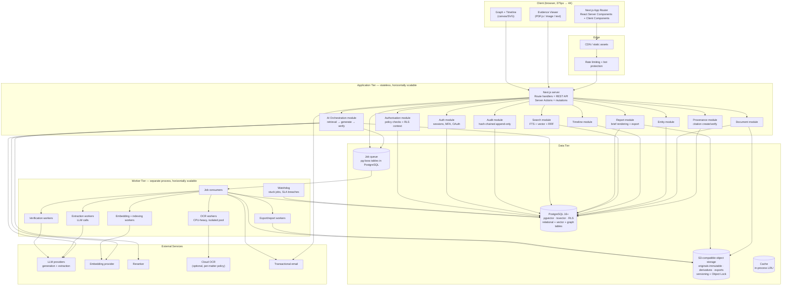

**What to notice.** One database holds relational, full-text, vector, and graph data — that is the
decision that makes the provenance guarantee structural (ADR-004). The worker tier is the only
separate deployable, and it exists because OCR is a genuinely different workload (ADR-001, ADR-014).
The AI orchestration module is the only component that talks to model providers (ADR-005).

---

## D2 — Trust boundaries

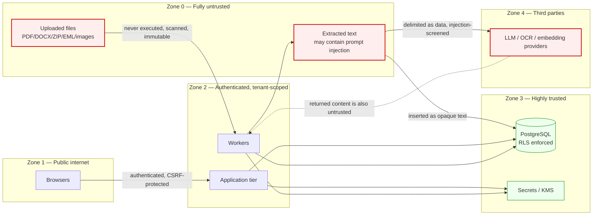

**What to notice.** Extracted text is in Zone 0, not Zone 2. An opposing party's filing is
attacker-controlled input, and the architecture treats it that way at every layer (RT-04). Provider
responses are also untrusted.

---

## D3 — Document processing pipeline

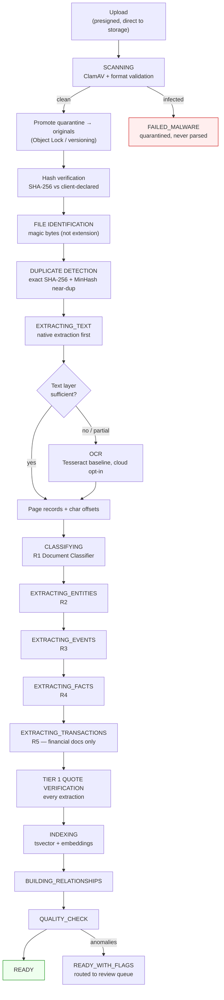

**What to notice.** Nothing is parsed before it is scanned. Born-digital gating before OCR is both a
cost control and a quality control. Every extraction passes Tier 1 verification before indexing.
Exact duplicates are short-circuited rather than reprocessed.

---

## D4 — Document state machine

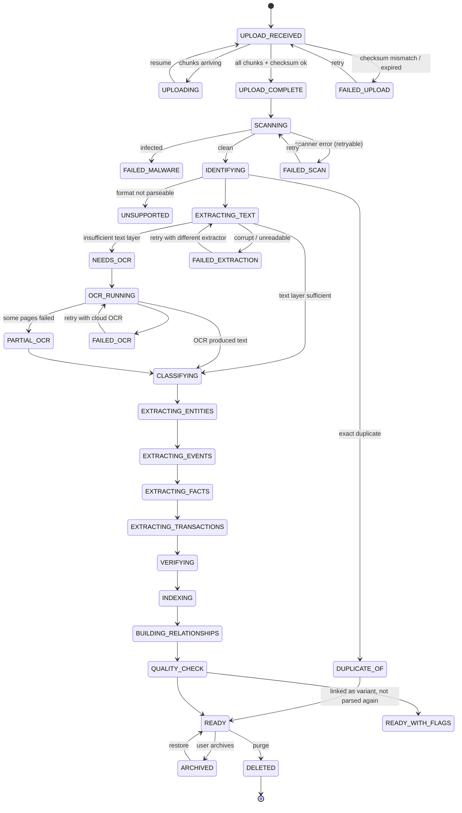

**What to notice.** Every `FAILED_*` state is retryable and retains the original. `UNSUPPORTED` and
`DUPLICATE_OF` are terminal but **not failures** — the file is stored, findable, and downloadable.
No transition destroys a previous successful stage's output.

---

## D5 — AI query, retrieval, and verification pipeline

```mermaid
graph LR
    Q["User question"] --> QP["Query preprocessing<br/>normalise, expand legal abbrevs,<br/>extract entities/dates/amounts"]
    QP --> GUARD{"Legal-advice<br/>or out-of-scope?"}
    GUARD -->|"yes"| REFUSE["Refusal template<br/>declination + redirect"]
    GUARD -->|"no"| A["Arm A: Full-text<br/>websearch_to_tsquery + GIN<br/>legal dictionary, trigram fallback"]
    QP --> B["Arm B: Vector<br/>pgvector HNSW, cosine<br/>top 50"]
    QP --> C["Arm C: Structured<br/>entity/date/amount/type<br/>exact-match lookups"]
    A --> F["Reciprocal Rank Fusion<br/>k = 60"]
    B --> F
    C --> F
    F --> D["Metadata + permission filters<br/>INSIDE the SQL query"]
    D --> E["Reranker (cross-encoder)<br/>top 50 → top 12"]
    E --> S{"Any span above<br/>support threshold?"}
    S -->|"no"| ABS["Abstain<br/>'The uploaded case materials<br/>do not establish this'<br/>+ nearest supported facts"]
    S -->|"yes"| BUN["Numbered evidence bundle<br/>delimited as DATA, injection-screened"]
    BUN --> GEN["Grounded Generator (R7)<br/>output schema requires<br/>citation_indices.min(1)"]
    GEN --> V1["TIER 1 — deterministic quote match<br/>normalise N1-N9, exact then fuzzy"]
    V1 -->|"mismatch"| SUP["SUPPRESS assertion<br/>record, alert Sev-2"]
    V1 -->|"match"| V2["TIER 2 — entailment<br/>DIFFERENT model/provider"]
    V2 -->|"not_supported"| SUP
    V2 -->|"supported"| OK["VerifiedAssertion<br/>ONLY type that can render"]
    OK --> ASM["Answer assembler<br/>structured by intent"]
    ASM --> UIOUT["Structured answer<br/>+ citation chips"]

    style REFUSE fill:#ffd
    style ABS fill:#dff
    style SUP fill:#fee
    style OK fill:#efe
```

**What to notice.** Three things carry the product's guarantee: citations are **indices** into a
system-supplied bundle (so a fabricated citation is unrepresentable), the renderable type is
`VerifiedAssertion` (which only the verification step can construct), and abstention is a first-class
outcome with its own response shape (ADR-019, ADR-021, `07-ai-architecture.md` §6).

---

## D6 — Evidence provenance flow

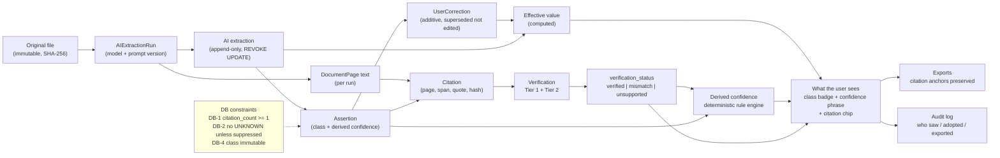

**What to notice.** Every arrow is a real foreign key, and the dashed box is the set of database
constraints that make the promises enforceable rather than conventional. `ai_extractions` is
append-only at the role level, so no code path can overwrite history (ADR-023, DB-5).

---

## D7 — Database entity relationships

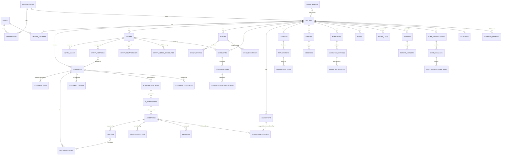

**What to notice.** `ASSERTIONS` is the spine: timeline events, allegations, statements,
contradictions, transactions, narrative sections, chat messages, and summaries all point at it, and
it points at citations. That is why the guarantee is uniform across features rather than
reimplemented per feature.

---

## D8 — User workflow

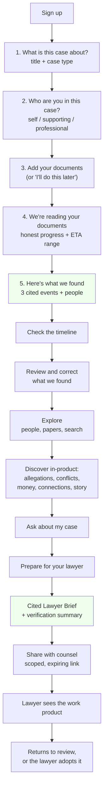

**What to notice.** Five visible onboarding steps, not ten. The first value moment (step 5) is a real
cited timeline, not a feature tour. Later capability is discovered when the case can populate it
(`14-ux-specification.md` §2.3). The brief is a primary destination, not a buried export.

---

## D9 — Case analysis workflow (how knowledge is built)

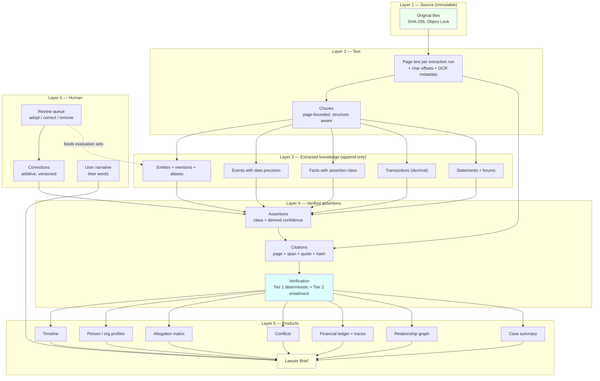

**What to notice.** Knowledge flows upward through six layers, and **verification sits between
extraction and every product surface** — no product surface reads directly from layer 3. Human
correction loops back additively, never destructively. The review queue doubles as the source of
labelled evaluation data.

---

## D10 — Permission architecture

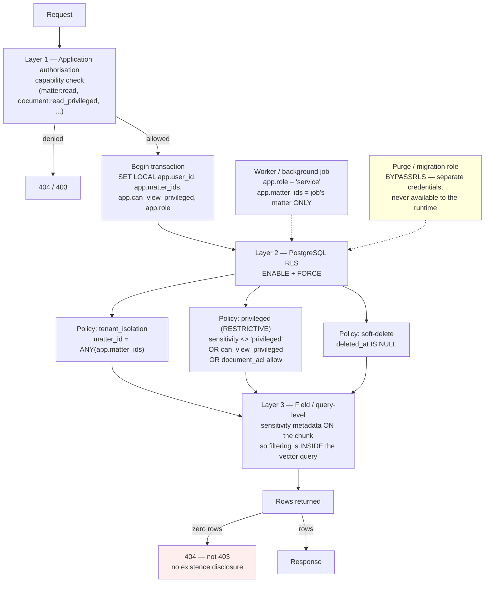

**What to notice.** Three layers, deliberately: an application bug does not become a data breach
because the database still returns zero rows. `FORCE ROW LEVEL SECURITY` matters because without it
the table owner bypasses every policy. `SET LOCAL` (never `SET`) matters because session-level
settings leak across pooled connections — a catastrophic cross-tenant bug (ADR-012).

---

## D11 — Two-tier verification decision flow

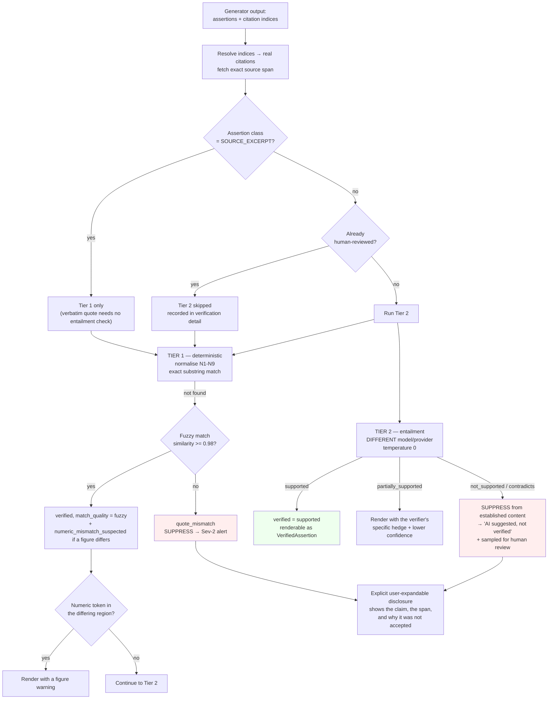

**What to notice.** Tier 2 skipping is bounded to two cases and both are recorded — it is never
extended to inference classes. Suppression is visible rather than silent: the user can see that the
system *chose not to assert something*, which is itself a trust signal.

---

## D12 — Deletion and purge flow

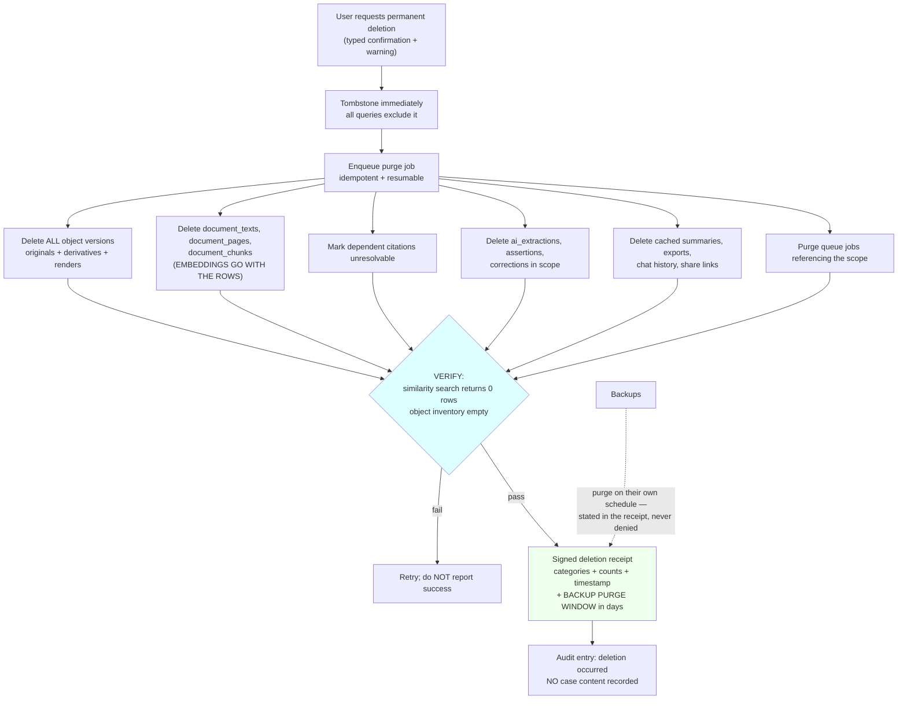

**What to notice.** Embeddings are columns on chunk rows, so deleting the chunk deletes the vector
in the same transaction — this is why the single-database decision pays off (ADR-004, RT-11). The
job does not report success without passing verification. Backup retention is disclosed rather than
denied (ADR-017).

---

## D13 — Deployment topology

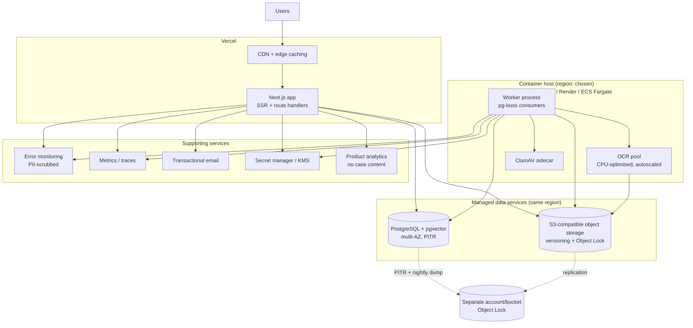

**What to notice.** The app is on Vercel; the workers are **not**, because OCR and long-running
processing do not fit a serverless execution model (ADR-014). Backups live in a separate account so
an attacker with production credentials cannot erase them.

---

## D14 — Feature dependency graph

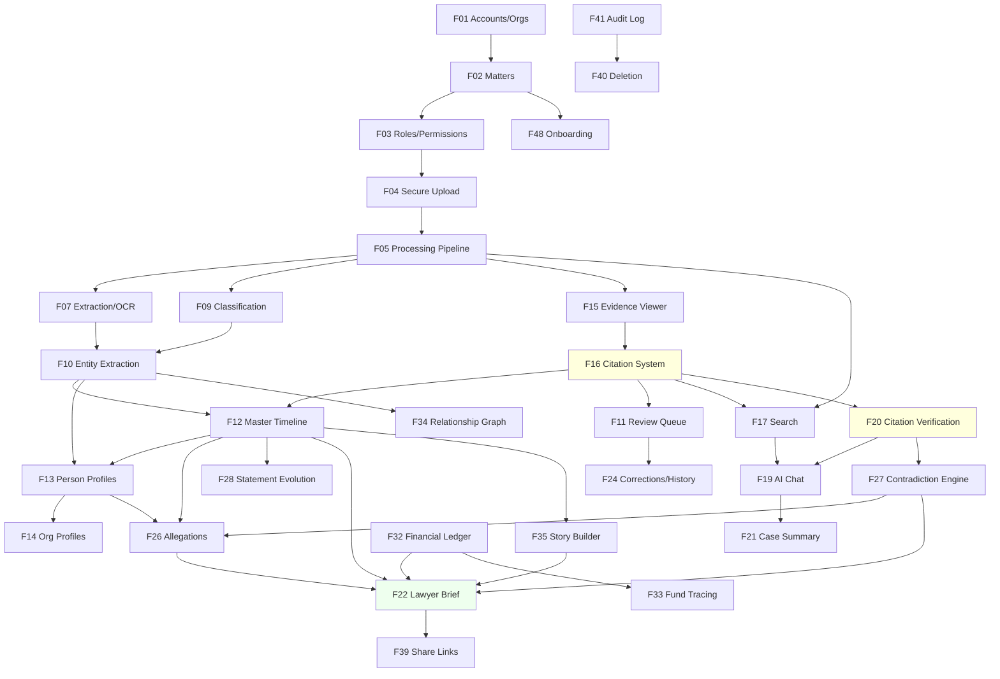

**What to notice.** The two dashed-highlighted nodes are the load-bearing infrastructure: **F16
(citations) is a dependency of the timeline, review, search, and every AI feature**, and **F20
(verification) is a dependency of chat and contradictions**. This is why the build order in
`05-mvp-scope.md` §7 puts the citation substrate before the AI assistant.

---

## D15 — Roadmap phases

```mermaid
graph LR
    P0["Phase 0<br/>Research &<br/>Architecture<br/><i>specs, legal<br/>engagement</i>"] --> P1["Phase 1<br/>Foundation<br/><i>auth, tenancy,<br/>RLS, audit</i>"]
    P1 --> P2["Phase 2<br/>Ingestion<br/><i>upload, extract,<br/>OCR, pipeline</i>"]
    P2 --> P3["Phase 3<br/>Search &<br/>Citations<br/><i>hybrid retrieval,<br/>evidence viewer</i>"]
    P3 --> P4["Phase 4<br/>Timeline &<br/>Entities<br/><i>chronology,<br/>review, corrections</i>"]
    P4 --> P5["Phase 5<br/>AI Assistant<br/><i>grounded chat,<br/>verification</i>"]
    P5 --> P6["Phase 6<br/>Contradictions &<br/>Allegations<br/><i>precision-gated,<br/>Phase 2 feature</i>"]
    P6 --> P7["Phase 7<br/>Story &<br/>Brief<br/><i>the growth loop</i>"]
    P7 --> P8["Phase 8<br/>Security<br/>Hardening<br/><i>pen test, DPIA,<br/>counsel sign-off</i>"]
    P8 --> P9["Phase 9<br/>Beta<br/><i>10 design partners,<br/>real matters</i>"]
    P9 --> P10["Phase 10<br/>Money, Graph,<br/>Teams<br/><i>professional tier</i>"]

    style P3 fill:#ffd
    style P5 fill:#ffd
    style P7 fill:#efe
    style P8 fill:#fee
```

**What to notice.** Phase 3 (citations) precedes Phase 5 (AI), which is the reverse of the instinct
to demo something quickly. Building the citation substrate first makes the no-unsupported-assertion
guarantee structural rather than aspirational. Phase 8 is release-blocking: no public launch before
the penetration test and the legal sign-offs.

---

## Related documents

- `06-system-architecture.md`, `07-ai-architecture.md`, `08-document-ingestion.md`,
  `09-evidence-provenance.md`, `10-database-schema.md`, `12-security-architecture.md`,
  `03-user-journeys.md`, `04-feature-specification.md`, `05-mvp-scope.md`, `19-roadmap.md`
- `wireframes/` — screen-level wireframes
- `24-architecture-decisions.md` — the reasoning behind the shapes shown here
