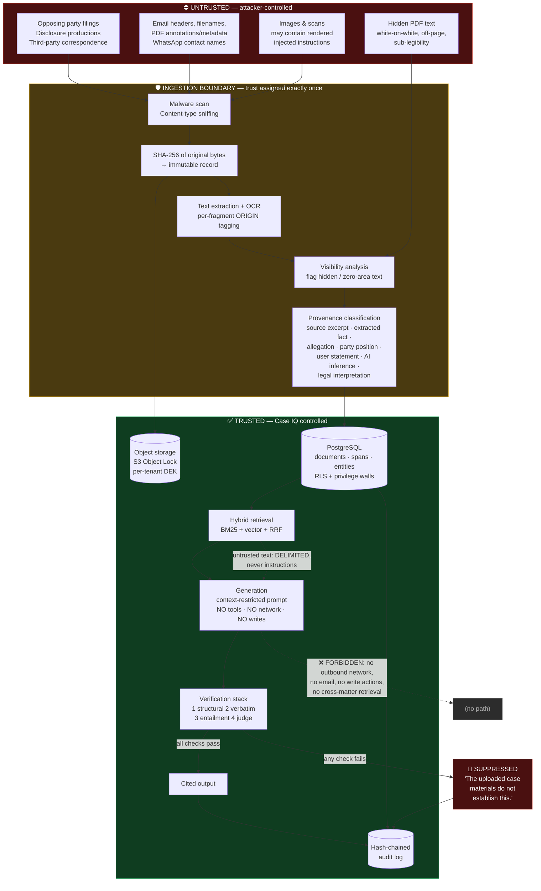
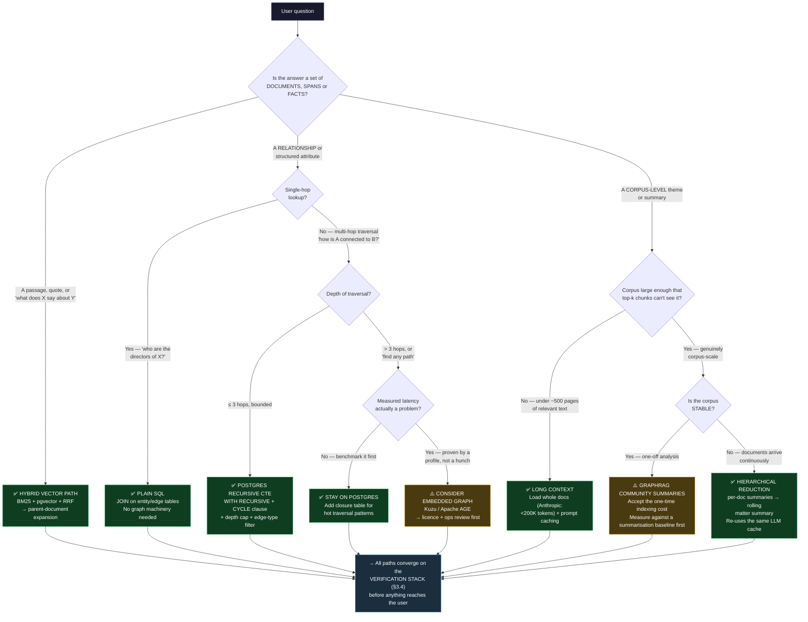

# Case IQ — Technical Best Practices Research

> **Freshness.** Dated **2026-02-14** per spec; all sources accessed **2026-02-14**. Some vendor pages carry later "last updated" stamps; the page's own snapshot date is recorded where that happened. **Do not treat any price here as durable.** Method: official vendor/standards docs → peer-reviewed and arXiv/ACL papers → maintainer engineering blogs → regulator and bar publications. Listicles and AI-generated aggregators were excluded even when search surfaced them. **No benchmark number, price, model name, statutory clause or URL was fabricated**; unverifiable facts are labelled `unverified` or flagged **Evidence gap**.

## 1. Summary — does the default architecture hold?

Default: **TypeScript modular monolith, PostgreSQL + pgvector, S3-compatible storage, Postgres job queue.**

**Verdict: holds, with three amendments and two new first-class subsystems.**

| Assumption | Verdict | Amendment |
|---|---|---|
| Modular monolith, TypeScript | **Holds** | Nothing here justifies microservices for a solo founder |
| PostgreSQL as system of record | **Holds, strongly** | Holds *everything*: documents, entities, edges, permissions, audit chain |
| pgvector | **Holds with caveats** | Fine to low-millions of chunks; weaknesses are *filtered* search and HNSW build cost. Keep an escape hatch behind a retrieval interface |
| S3-compatible storage | **Holds** | Add Object Lock and per-tenant key prefixes |
| Postgres job queue | **Holds, strongly** | pg-boss or Graphile Worker. No Redis |
| *(new)* Training/verification subsystem | **Must be first-class** | Grounding cannot be a prompt instruction — it is an enforced stage with its own persistence, failure mode and UI |
| *(new)* Untrusted-content boundary | **Must be first-class** | Opposing-party filings are attacker-controlled input; needs an architectural boundary, not a security-review line item |

Three findings drive everything:

1. **RAG does not eliminate hallucination.** The first preregistered evaluation of commercial legal AI found LexisNexis (Lexis+ AI) and Thomson Reuters (Westlaw AI-Assisted Research and Ask Practical Law AI) **each hallucinate 17–33% of the time** ([arXiv:2405.20362](https://arxiv.org/abs/2405.20362), *Journal of Empirical Legal Studies*). "Cite or suppress" is therefore the core differentiator, and it must be *verified*, not *instructed*.
2. **Hybrid retrieval is a settled win for legal text**, because legal queries are lexical-heavy (citations, statute numbers, dollar amounts, dates, names). Anthropic measured **49% fewer top-20 retrieval failures** from contextual embeddings + contextual BM25 (5.7%→2.9%) ([source](https://www.anthropic.com/news/contextual-retrieval), 19 Sep 2024).
3. **Long context replaces retrieval only for small corpora.** Anthropic's own guidance: under ~200,000 tokens (~500 pages), put the corpus in the prompt with caching. So the right shape is **retrieval to select documents, long context to read them**.

## 2. A. RAG architectures for large document sets

### 2.1 Chunking

The literature is more equivocal than vendor blogs. MoC reports **semantic chunking boundaries are only marginally superior to fixed-size** ([arXiv:2503.09600](https://ar5iv.labs.arxiv.org/html/2503.09600)); Aalto frames chunking as an accuracy-vs-token-cost tradeoff, not a clean win ([source](https://aaltodoc.aalto.fi/items/ee14d13f-4de4-4609-8f23-9379331797ba/full)).

**What is established is that chunk *context* beats chunk *boundary* cleverness.** Anthropic's win comes from prepending chunk-specific situating context before embedding and BM25 indexing — **$1.02 per million document tokens** under their assumptions, using prompt caching. They report *negative* results for generic document summaries ("very limited gains") and summary-based indexing ("low performance").

| Level | Boundary | Role |
|---|---|---|
| `section` | Native heading / numbered clause / page range | Parent context |
| `paragraph` | Blank line or typographic indent | Retrieval + BM25 unit |
| `sentence` | Sentence segmentation on extracted text | **The only quotable citation unit** |

Store span offsets against the **original file**, not extracted text, so citations verify against raw bytes later (§9).

**Evidence gap.** No reproducible chunking benchmark on Canadian litigation documents (affidavits, examination transcripts, disclosure, police records). Nearest proxies are contract datasets (CUAD, LEDGAR, ContractNLI) and SEC filings — different register and structure. **Build a ~200-question internal gold set; treat chunking parameters as measured, not settled.**

### 2.2 Hybrid retrieval and fusion

**RRF is the correct default** — Cormack, Clarke & Buettcher, SIGIR 2009, DOI [10.1145/1571941.1572114](https://doi.org/10.1145/1571941.1572114). Elastic documents that the paper **"suggests a value of 60 for k and doesn't discuss how many documents N to retrieve"** ([source](https://www.elastic.co/docs/reference/elasticsearch/rest-apis/retrievers/rrf-retriever)). Its advantage is being **unsupervised and requiring no score calibration** — precisely the problem of combining `ts_rank_cd` with cosine distance.

**⚠️ The `k` convention is a trap.** Qdrant's RRF default is **`k=2`, equal weights** (v1.17+); Elasticsearch and the original paper use **`k=60`** ([Qdrant](https://qdrant.tech/articles/when-a-reranker-is-worth-it/)). These are different parameterisations — copying a value between systems silently reweights low-ranked documents. Tune `k` on your own labels and record the convention.

**⚠️ Tie-breaking must be deterministic.** Qdrant's example sorts by *index position*, commenting **"Sort by position so tied scores never compare the points themselves."** RRF produces ties; a tie-break depending on object comparison order is non-deterministic, so the same question retrieves a different document set on two runs — breaking reproducibility and the audit trail. Fix the tie-break (e.g. by document ID) and store the ranking with the citation provenance.

Elastic's own caveat: optimal `k` and `N` are **not established a priori** for modern hybrid retrieval and results are sensitive to both ([source](https://www.elastic.co/search-labs/blog/improving-information-retrieval-elastic-stack-hybrid), 20 Jul 2023).

| Claim | Status |
|---|---|
| Lexical and semantic retrievers are complementary | **Established** |
| Hybrid beats pure dense on general benchmarks | **Established directionally; magnitude contested** |
| Hybrid matters *more* for legal text | **Strongly plausible, weakly quantified — Evidence gap** |
| `k=60` is optimal | **Contested / unverified** |

A query like `"Did payment of $47,500 on 2023-04-12 clear?"` contains three token classes where embeddings are known to blur. **Do not run pure vector in production, even briefly.**

### 2.3 Reranking — weaker evidence than vendors imply

The most important reranking finding is Qdrant's independent (vendor-authored) study: five public datasets (5,183–100,000 docs), four cross-encoders, 200 queries each, with **held-out validation over 200 split-half draws** ([source](https://qdrant.tech/articles/when-a-reranker-is-worth-it/)).

| Dataset | Best model | vs. default RRF | vs. **tuned** fusion | Held-out |
|---|---|---|---|---|
| SciFact | jina-reranker-v2 @ 200 | +0.057 | +0.033 | **no, 37%** |
| ArguAna | jina-reranker-v2 @ 25 | +0.031 | +0.017 | **no, 2.5%** |
| WANDS | MiniLM-L-6 @ 200 | +0.039 | **−0.008** | **no, 0%** |
| CodeSearchNet | jina-reranker-v2 @ 200 | +0.169 | +0.135 | **yes, 100%** |
| DBPedia-entity | jina-reranker-v2 @ 200 | +0.137 | +0.115 | **yes, 100%** |

**(1) Only 2 of 5 wins survived held-out validation. (2) On WANDS, label-tuned fusion beat all four cross-encoders at every candidate count. (3) Every configuration losing at 10 candidates still lost at 200** — a deeper list does not rescue a reranker. Losses were explained by **512-token truncation** (three of four models) and **training-domain mismatch**.

**This contradicts "always rerank", and it contradicts Anthropic's 67% figure unless you notice the baselines differ:** Anthropic's baseline was un-tuned hybrid; Qdrant's decisive baseline was *label-tuned* fusion. **Synthesis: reranking helps when the first stage is un-tuned, and its marginal value shrinks sharply once fusion is tuned.**

**Adopt Qdrant's three-step test before shipping a reranker:** baseline against **tuned** fusion, not default RRF; confirm relevant documents reach the candidate list; rerank 10 candidates with the model you would serve; compare on **held-out** labels. Check each candidate's token window against your 95th-percentile query–document pair length — a model scoring a document it only partly read gives a confident wrong answer. **Evidence gap: no held-out-validated reranker study on legal corpora, and no independent non-vendor latency benchmarks at legal passage lengths.**

### 2.4 Long context vs retrieval

| Provider | Model ID | Context | Max out | In / MTok | Out / MTok |
|---|---|---|---|---|---|
| Anthropic | `claude-fable-5-1` | 1M | 128K | $10 | $50 |
| Anthropic | `claude-opus-5-5` | 1M | 128K | $4 | $20 |
| Anthropic | `claude-sonnet-5` | 1M | 128K | $2 | $10 |
| Anthropic | `claude-haiku-4-5-20251001` | 200K | 64K | $1 | $5 |
| OpenAI | `gpt-6-astra` | 1.05M | 128K | $10 | $50 |
| OpenAI | `gpt-6-sol` | 1.05M | 128K | $2 | $10 |
| OpenAI | `gpt-6-luna` | 1.05M | 128K | $0.10 | $0.50 |
| Google | `gemini-3.8-flash` family | *unverified* | — | *unverified* | *unverified* |

Sources: [platform.claude.com](https://platform.claude.com/docs/en/about-claude/models/overview), [platform.openai.com/docs/models](https://platform.openai.com/docs/models), [ai.google.dev](https://ai.google.dev/gemini-api/docs/models). Anthropic reports prompt caching cutting latency **>2x** and cost **up to 90%**. Combined with `gpt-6-luna` at $0.10/MTok input, **loading whole documents is often cheaper than a multi-hop retrieval loop**:

```
Ingest everything → per-document summaries + retrieval index
Query → narrow candidate documents via hybrid retrieval
Per candidate: fits the budget? load whole : load parent sections
Generate with span citations → verify → suppress unverified
```

**Contested:** whether "lost in the middle" still matters in current generations is **not settled by vendor documentation. Evidence gap.**

### 2.5 Query understanding

| Technique | Evidence | Verdict |
|---|---|---|
| Metadata filtering (self-query) | **Strong** — the difference between a correct answer and a confidently wrong one | **Adopt.** Filters (document, date, party, provenance class) must be first-class in the retrieval API |
| Query decomposition | **Moderate**; legal questions are frequently multi-part | **Adopt selectively** |
| Agentic multi-hop (Self-RAG, CRAG, ReAct) | **Contested.** AgentDojo found SOTA LLMs **fail at many agentic tasks even absent attacks** ([arXiv:2406.13352](https://arxiv.org/abs/2406.13352)) | **Do not adopt at MVP.** Most likely to be adopted prematurely |
| HyDE / summary indexing | Anthropic: "very limited gains" / "low performance" | **Skip** |

Agentic retrieval is where injection risk concentrates — every added tool call is another step an injected instruction can steer.

### 2.6 GraphRAG vs vector RAG

GraphRAG's headline capability (global summarisation) comes from pre-computing community summaries at index time — **an LLM call per community over the whole corpus**, re-run as the corpus changes. For a matter receiving documents continuously, that cost is continuous. **No public GraphRAG indexing-cost measurement was found; the cost was not derived here. Evidence gap.**

Most of what is called "GraphRAG" in an investigation product is **structured extraction plus SQL**, which Postgres does natively and cheaply (§5.4). **Evidence gap: no reproducible GraphRAG-vs-hybrid-RAG evaluation on investigative or litigation corpora — Microsoft's results are on news and podcast corpora. Any claimed win for Case IQ is an unvalidated hypothesis.**

## 3. B. Grounded generation and citation verification — the critical section

### 3.1 The documented baseline

**Magesh, Surani, Dahl, Suzgun, Manning & Ho** (Dahl is third author, not first), arXiv:2405.20362, 30 May 2024, *Journal of Empirical Legal Studies*, DOI [10.1111/jels.12413](https://onlinelibrary.wiley.com/doi/10.1111/jels.12413). Preregistered. **Lexis+ AI and Westlaw AI-Assisted Research / Ask Practical Law AI each hallucinate 17–33% of the time.** Providers' claims that RAG "eliminates", "avoids" or guarantees "hallucination-free" citations are **overstated**. These are well-funded, purpose-built RAG products. **"We use RAG and ground our answers" is not a design.**

### 3.2 Enforcement techniques

**Tier 1 — architectural, load-bearing.** (1) **Quote-extraction-then-claim:** extract verbatim spans first, give them IDs, then write claims referencing those IDs — fabrication becomes structurally harder. (2) **Verbatim match against original file bytes:** deterministic, non-ML, near-zero cost; catches the most damaging failure, *a real-looking quote that isn't in the document*. (3) **NLI entailment** of claim against cited span — note the asymmetry: NLI catches *non-entailment*, not *insufficiency*. (4) **Context-restricted prompting:** only retrieved spans plus the question, no world knowledge, no tools. Works only *with* 1–3, since a restricted model can still paraphrase wrongly or fuse two spans into a false synthesis.

**Tier 2 — with caveats:** structured output schemas (see the incompatibility below); LLM-as-judge (§3.4); self-citation / chain-of-verification (weak alone).

**Tier 3 — do not rely on:** prompt instructions to "cite sources" alone. Anthropic's docs are blunt that the API approach gives **"better citation reliability, because the API parses citations... and extracts `cited_text` directly, citations are guaranteed to contain valid pointers to the provided documents"** ([source](https://docs.anthropic.com/en/docs/build-with-claude/citations)).

### 3.3 The citation API — and the constraint that breaks the obvious design

Verified from Anthropic's Citations docs: granularity is **set by chunking** (content is chunked into sentences; consecutive sentences can be chained); **PDFs return 1-indexed page ranges, plain text 0-indexed character ranges, custom content documents content-block index ranges**; custom content skips further chunking ("if you want Claude to be able to cite specific sentences from your RAG chunks, you should put each RAG chunk into a plain text document"); **`cited_text` counts toward neither input nor output tokens**; the page carries a **"Citations ZDR Eligible — excludes Covered Models"** marker, so **ZDR is scoped per feature and per model, not per vendor**; and **"PDFs that are scans of documents and do not contain extractable text are not citable."**

**⚠️ This invalidates the most natural design.** Verbatim from the docs:

> **"Citations and structured outputs are incompatible.** Citations cannot be used together with structured outputs. If you enable citations on any user-provided document... and also include the `output_config.format` parameter (or the deprecated `output_format` parameter), **the API returns a 400 error**. This is because citations require **interleaving citation blocks with text output**, which is incompatible with the strict JSON schema constraints of structured outputs."

So "strict JSON schema *and* citations on so quotes are guaranteed real" **cannot be built**:

| Option | You get | You give up |
|---|---|---|
| **A. Citations on, free text** | Guaranteed-valid pointers; page ranges; free `cited_text` | **No schema enforcement** — you parse citation blocks yourself |
| **B. Structured outputs, no citations** | Strict schema; verifier gets the exact shape it expects | **No API guarantee the quote exists** — your own verbatim check is the only defence |

**Recommended: Option A plus a deterministic normalisation parser** walking interleaved text/citation blocks into your internal `{claim, citations[]}`. That parser is ordinary testable code, and stage 2's verbatim check becomes redundancy rather than the sole defence. **Scanned exhibits are Option B by necessity** — they are not citable at all, and that is exactly the path where a fabricated figure is most likely, so it needs own-verbatim verification as the primary control plus the OCR quality cap (§4.3).

### 3.4 Verification: failure modes and the gameability warning

**Citation metrics are gameable — ALCE's own authors demonstrated it** (Appendix D, "ALCE Catches Shortcut Cases", ASQA; [ar5iv full text](https://ar5iv.labs.arxiv.org/html/2305.14627)):

| System | Fluency (MAUVE) | Correctness (EM Rec) | Citation Recall | Citation Precision |
|---|---|---|---|---|
| ChatGPT (vanilla, GTR top-5) | 66.6 | 40.4 | 73.6 | 63.0 |
| **"Top-1 passage"** (echo the top passage) | **20.8** | 35.1 | **99.4** | **99.4** |
| "First 2 sentences" of top-1 | 67.2 | 18.9 | 98.7 | 98.7 |

A degenerate extractor **scores 99.4 citation precision and 99.4 recall** while producing incoherent text and worse correctness. **The safest way to satisfy a citation requirement is to say less and quote more.** Case IQ's evaluation must track answer usefulness and correctness alongside citation quality — **never citation precision alone.** A dashboard reading "98% citation precision" over a system that answers nothing is a plausible failure mode for an AI coding agent optimising the wrong metric.

**The NLI verifier is good but not good enough to be the only check.** ALCE reports 120 human-annotated entailment pairs: their NLI model (`google/t5_xxl_true_nli_mixture`) achieved **80.0% accuracy** (Appendix A) — a **1-in-5 error rate on the verification step itself**, on short non-legal claims. So an entailment *pass* is weak evidence and a *fail* should **downgrade rather than always suppress**. This is why the stack maps four stages to different confidence levels rather than to accept/reject.

**ALCE documents a flaw Case IQ will hit:** citation precision "cannot detect a citation that partially supports the statement and hence will falsely penalize it." ALCE notes **"there is no existing model that can judge whether a citation 'partially' supports a claim"**, that **"we also explore prompting ChatGPT to conduct such a task, which yields poor results"**, and defers it to future work. **The authors of the reference citation benchmark tried LLM-as-judge for partial support and reported poor results.** Treat partial support as a **third outcome surfaced to the human**.

| Technique | Cost | Catches | Misses / failure modes |
|---|---|---|---|
| **Exact string match** vs source | ~0 | Fabricated quotes; wrong doc/page | Misquote-paraphrase; correct quote supporting a false synthesis. Whitespace/ligature differences cause **false negatives** — normalise and store the normalisation |
| **Fuzzy match** | Low | OCR char drift in the quote | Fabrication near a real span; no principled threshold; **an attacker controlling a document can craft a near-miss span** |
| **NLI entailment** | Low–med | Unsupported claims | Multi-span claims; partial support; misleading-but-entailed claims. **Measured 80.0% (ALCE)**; legal-domain shift unstudied |
| **LLM-as-judge** | Med–high | Some nuanced failures | Documented **verbosity and self-preference bias**, **position bias** (arXiv:2306.05685; arXiv:2305.17926). **ALCE: partial-support judging "yields poor results"** |
| **Human review** | Highest | Everything eventually | Does not scale — **and does not happen unless the citation is one click away** |

**Recommended stack — all four stages, in order:**

```
Claim + citations
 ├─ 1 STRUCTURAL  ≥1 citation per claim, all fields present
 │     FAIL → suppress → "The uploaded case materials do not establish this."
 ├─ 2 VERBATIM    quoted_text present in ORIGINAL bytes at [start,end]?
 │     FAIL → suppress + HIGH-severity integrity event (the dangerous failure)
 ├─ 3 ENTAILMENT  does the cited span entail the claim? (NLI)
 │     FAIL → downgrade to LOW, mark "citation does not fully support"
 └─ 4 JUDGE       different model than generator; supports in context?
       FAIL → downgrade to LOW, flag for human review
```

### 3.5 Why a 4-level ordinal scale is right

Defend this as a feature. (1) **Verbalised model confidence is not calibrated** — no evidence found that LLM-stated probabilities in legal analysis match observed accuracy (**Evidence gap, suspected negative**). (2) **The stack produces categorical evidence, not probabilistic** — "verbatim and entailed" and "verbatim but not entailed" are different *kinds* of result; collapsing them into 0.83 vs 0.71 invents precision. (3) **Legal audiences read ordinal labels correctly and probabilities incorrectly** — "87% of what?" has no honest answer.

**Make the mapping deterministic, not model-generated:**

| Level | Deterministic trigger |
|---|---|
| **HIGH** | Verbatim passes AND entailment passes AND ≥1 span from a source-class document |
| **MEDIUM** | Both pass, but the claim synthesises ≥2 spans, or rests on a party-position/derived-class document |
| **LOW** | Entailment fails, judge flags, or the claim rests on AI inference not a source excerpt |
| **UNKNOWN** | No citation survived, **or extraction quality is below threshold (§4.3)** |

`UNKNOWN` does real work: it is the honest label for "the OCR of this bank statement was too poor to trust a dollar figure" — a *different* failure from hallucination, and the product should be able to say so.

## 4. C. Document intelligence and ingestion

### 4.1 PDF extraction

| Library | Lang | Licence | Fidelity | Verdict |
|---|---|---|---|---|
| **pdfplumber** | Python | MIT | High — chars/words/lines/rects with coordinates | Best accuracy on hard PDFs |
| **PyMuPDF (fitz)** | Python | **AGPL v3 or commercial** | High, fast | **Do not use the AGPL build in closed-source SaaS without a commercial licence** |
| **pypdf** | Python | BSD-3 | Medium — text only | Fine as a fast first pass |
| **pdfminer.six** | Python | MIT | High (pdfplumber's engine) | Dependency |
| **pdf.js / `pdfjs-dist`** | JS/TS | Apache-2.0 | High — full layout and glyph geometry; **same engine that renders the page** | **The strategic choice** |

**The strongest point:** because the citation UI must highlight a span on the *rendered page*, using **pdf.js for both extraction and rendering eliminates an entire class of bugs** — the coordinate system that produced the span is the one that draws the highlight. Mixing a Python extractor with a JS renderer means maintaining a mapping between two notions of "where on page 4 is this text", and that mapping is where highlights silently drift. The cost is real (Python has the better table ecosystem), so: **pdf.js in the app; a Python sidecar only for the table-heavy financial path, with the second-runtime burden documented.**

**Born-digital vs scanned detection must be per page** — disclosure bundles mix born-digital exhibits with scanned attachments constantly. Signals: characters-per-page, text-covered area ratio, embedded font subsets, image-dominant pages. **Evidence gap: no authoritative published thresholds; calibrate locally.** Store the result as an auditable per-page field, since it later explains why a citation is LOW.

### 4.2 OCR options

| Engine | Licence | Hosted | Strengths |
|---|---|---|---|
| **Tesseract** / `tesseract.js` | Apache-2.0 | Self | Ubiquitous, offline, clean print |
| **PaddleOCR** | Apache-2.0 | Self | Strong CJK |
| **docTR** | Apache-2.0 | Self | Clean API, TF/PyTorch |
| **EasyOCR** | Apache-2.0 | Self | 80+ languages |
| **Surya** | Code Apache-2.0; **weights under a modified AI Pubs Open Rail-M licence — free for research, personal use, startups under $5M funding/revenue** | Self | Layout and reading order |
| **OCRmyPDF** | MPL-2.0 | Self | Adds a text layer; orchestrates Tesseract |
| **AWS Textract** | Proprietary | Yes | Text **and handwriting** in one API; Forms/Tables/Queries/Signatures |
| **Azure Document Intelligence** | Proprietary | Yes | Strong prebuilt models |
| **Google Document AI** | Proprietary | Yes | Processor-based |

**AWS Textract pricing — what is verifiable.** The public page renders unit prices client-side, so the readable table is absent from the HTML. The underlying manifest (`b0.p.awsstatic.com/.../textract/USD/current/textract.json`, manifest date `2026-09-11T12:45:13Z`) shows **US West (Oregon), USD per unit**: `0.0014` (Detect Document Text, over-1M tier); `0.015` (first-tier text / Forms / Signatures); `0.020` (Tables); `0.030` (Queries); `0.040` (Forms+Tables); `0.065` (Tables+Queries). **The manifest's rate codes are hashed; mapping them to feature names is an inference, not a fact read off a page.** Treat the **ratios** as reliable (tables ≈1.3× plain text; tables+queries ≈4.3×) and the **absolute dollars** as needing confirmation against the AWS pricing calculator. Free tier (3 months, new customers): Detect Document Text 1,000 pages/month; Forms/Tables/Layout 100; Analyze ID 100; Analyze Expense 100; Analyze Lending 2,000; **no free tier for Custom Queries**.

Azure and Google Document AI both use per-1,000-page, model- or processor-tiered pricing; specific rates render client-side and were not extracted.

### 4.3 The critical OCR risk: character errors in financial figures

OCR confuses glyphs differing by one stroke — `3`/`8`, `1`/`7`, `5`/`6`, `0`/`O`, `9`/`4`, `.`/`,` — and drops digits in dense tables. In prose that is a spelling error. **In a bank statement it is a different number.** A system reporting `$847,500` when the statement says `$347,500` has asserted a false fact *with an apparently supportive citation* — worse than an uncited hallucination, because it carries unearned credibility.

| Claim | Status |
|---|---|
| OCR produces non-uniform character errors across glyph classes | **Established** |
| Numeral confusion is a material risk in financial processing | **Strongly plausible and widely asserted; no primary benchmark isolating dollar-amount error rates across engines was located. Evidence gap.** |
| Cloud OCR beats Tesseract on scanned financial tables | **Directionally established by vendor tables; no independent reproducible head-to-head found. Treat vendor accuracy claims as marketing until reproduced.** |
| Handwriting accuracy is materially worse than print | **Established in direction**; no per-character handwriting accuracy verified |
| How often a figure error survives an end-to-end RAG pipeline | **Not studied anywhere. The most under-researched area relevant to Case IQ. Evidence gap.** |

**Mitigations (architectural requirements, not nice-to-haves):** (1) **Never let OCR text be the citation of record** — citations point at a page region in the original image; OCR text is a *derived, labelled* representation, and clicking a financial citation shows the scanned region. (2) **Numeric fields are a separate higher-assurance path**: extract dollar amounts, dates and account numbers with a primary engine *and* a second independent method; **agreement → HIGH, disagreement → UNKNOWN surfaced as a flagged field.** Cheap, and it converts the highest-risk field class from "probably right" to "provably consistent or visibly uncertain". (3) **Extraction confidence propagates into the 4-level scale** (§3.5). (4) **Report per-page OCR quality** so a later `UNKNOWN` is explainable.

### 4.4 Table extraction

| Tool | Licence | Approach | Notes |
|---|---|---|---|
| **Camelot** | MIT | `lattice`, `stream`, `network`/`hybrid`, `ml` | **Corrects a widely repeated claim:** "Camelot's default image-conversion backend is pdfium, which ships as a wheel — so a plain install needs no system dependencies. The optional ghostscript and poppler backends require additional dependencies." **Camelot does not force AGPL Ghostscript by default** |
| **pdfplumber tables** | MIT | Position heuristics | Good simple grids, weaker multi-line cells |
| **unstructured.io** | Apache-2.0 core / commercial | Multi-strategy | Heavier footprint |
| **Tabula** | MIT | Whitespace/ruling | Widely described as unmaintained |
| **Azure / AWS table features** | Proprietary | Managed | See §4.2 |
| **Vision-LLM transcription** | Per-token | Prompt for JSON | Flexible, expensive, **non-deterministic — needs verification** |

**Camelot's vendor-stated number:** the `ml` flavor **"on FinTabNet... roughly doubles borderless TEDS vs `network`/`hybrid`"** — a vendor claim on a specific benchmark, recorded as such. **Reliability evidence for financial tables is thin:** built-in parsers need a text-based PDF, and the closest benchmark (FinTabNet: born-digital SEC filings, single-column-dominant) is a *materially different* structure from a two-column bank statement with running balances. **Evidence gap.**

**Design consequence: treat bank-statement extraction as human-supervised** — extract, present parsed rows beside the page image for confirmation, store confirmed rows as derived facts citing the page image. **Implement the running-balance check (`opening + Σcredits − Σdebits = closing`) as an automated test**; it is cheap and catches whole-row and dropped-digit errors.

### 4.5 Email and messaging

| Format | Parsing | Notes |
|---|---|---|
| **MBOX** | Python `mailbox`; Node `mailparser` | Robust |
| **EML** | RFC 5322/2045–2049; `mailparser`, Python `email` | Most tractable |
| **MSG** | Python `extract-msg`; Node `@freiraum/msgreader` | OLE compound file; preserves recipients/timestamps |
| **PST/OST** | Python `libpff`/`pypff`; `libpst`/`readpst` | **Hardest.** Large stores, deleted-item recovery, history of parser fragility. Budget real time |

**Threading:** JWZ threading from `Message-ID`, `In-Reply-To`, `References` (RFC 5322) with subject fallbacks. Real-world complications: truncated `References`, missing/duplicated `Message-ID`, Gmail's non-standard behaviour.

**⚠️ Provenance warning:** the `Date:` header is **attacker-controlled and frequently wrong**, and timezone handling produces off-by-hours errors that matter on a master timeline. **Record both the header date and the mail-store received date as different provenance classes.** Emails are the classic case where "the document says X" and "the metadata says X" diverge — and keeping those distinct *is* the product's value proposition.

**WhatsApp exports.** Variants: Android `12/04/2023, 09:15 - Alice: message`; iOS `[12/04/2023, 09:15:32] Alice: message`; bracketed Android variants; locale-dependent separators. System messages ("Messages and calls are end-to-end encrypted", "Alice added Bob") are interleaved and **not from a named party**. Media appears as `<attached: 00000042-PHOTO-...jpg>` or `<Media omitted>` — **a different thing from a genuinely omitted message**. Multi-line messages have continuation lines lacking the date prefix.

**⚠️ The `DD/MM` vs `MM/DD` ambiguity is a genuine provenance hazard.** `03/04/2023` is either 3 April or 4 March depending on device locale, and the export does not always say. **The timeline must not silently choose.** Detect the convention from disambiguating messages (any value >12 in the first position proves day-first), record the detected convention as metadata, and mark `UNKNOWN`-dated if undeterminable — **the honest answer is worth more than a guess.**

**Forensic soundness: a `.txt` export is a user-mediated, lossy, trivially forgeable artefact — not a forensic extraction.** Ingest it as a *source excerpt* with an explicit "user-supplied export, not forensically validated" note, **never presented as equivalent to a device extraction.**

### 4.6 Deduplication

Exact content hash (SHA-256 of bytes) is the primary key; a **normalised hash** catches re-prints; **MinHash/LSH** (`datasketch`), **SimHash** and **TLSh** handle near-duplicates. **The disclosure-specific problem:** the same document legitimately appears as an exhibit, as an attachment in three threads, as a re-produced copy with different Bates numbering, and in two productions — **same evidence, different files, different provenance.** The model needs a `document` entity (the evidence) and `document_instance` records (each file, with its own hash, source, Bates number, production round). **Collapsing these is an expensive design error**; deduplicating attachments across threads also stops the timeline showing the same email twenty times. **Evidence gap: no published MinHash thresholds with false-positive rates for legal corpora.**

### 4.7 Malware scanning and secure uploads

**ClamAV** (`clamd`, `clamscan`, freshclam) is the standard OSS choice but is **signature-based** — it does not catch novel or targeted malware. It is hygiene, not a security boundary. **AWS GuardDuty Malware Protection for S3** is the managed equivalent (**throughput, supported types and cost unverified**). **⚠️ Do not submit privileged legal documents to VirusTotal** — submissions may be shared with security vendors, which is a **confidentiality problem, not just a security one**.

```
Browser → POST /uploads/initiate   (authz: user may write to matter X)
        ← presigned POST/PUT to a QUARANTINE key prefix
Browser → direct upload to S3 (app never proxies bytes)
        → object-created event → virus scan → type sniff → extract → hash → index
        → promote quarantine → permanent immutable key
```

The app server never handles large uploads (no memory/disk pressure, no timeout fragility), and quarantine→permanent is where "nothing enters the evidence store unhashed and unscanned" is enforced.

### 4.8 PII detection — why blanket redaction destroys this product

Tools: **Microsoft Presidio** (Apache-2.0, the standard OSS choice), AWS Comprehend PII / Macie, Google Cloud DLP, Azure AI Language PII, and NER models (**GLiNER**, **Piiranha**, spaCy/Stanza).

**The tension:** redacting names, addresses, dates and amounts in litigation **destroys the evidence**. The names *are* the parties; the amounts *are* the fraud; the dates *are* the timeline. **Blanket redaction here is data destruction, not a privacy control.**

**What the research supports:** (1) **Don't redact — classify and control.** Tag PII for access control and audit: "this field is sensitive, log every read, enforce the matter's permission model", not "delete it". (2) **Pseudonymise with a reversible, permissioned mapping** — render `[Party A]` in *AI prompts*, keep the mapping behind the permission model, re-hydrate inside the authorised session. **This gets the privacy benefit of redaction without the evidentiary loss**, and reduces the value of a successful injection exfiltration (§7.6). (3) **The detector must be recall-biased here** — a false positive costs a tag, a false negative costs a breach. But high-recall general detectors have **poor precision on legal text**, flagging case citations, statute references and firm names as persons. **Evidence gap: no published Presidio-class precision/recall on Canadian litigation documents.** Expect a legal-entity allowlist (neutral citations, statute forms, court names) as permanent infrastructure.

**Also:** "PII" is not the only sensitive class. **Privileged material, third-party personal information, and material under a sealing order** matter more and **none are regex-detectable** — they are *declared* by the producing party or *inferred* by a lawyer. The permission model must accept **manual classification** as a first-class input.

## 5. D. Entity extraction and knowledge graphs

### 5.1 Structured extraction

**Pattern: schema-constrained generation + validation + bounded retry.** Generate against an explicit JSON Schema; validate with Zod/Pydantic at the boundary; bound retries to 1–2 with the validation error fed back (unbounded retries on a paid API are a cost incident — §6.4). **Known failure modes:** schema drift across model versions; nested/array-of-objects failures materially more common than flat; invented values for absent fields; and — critically — **a syntactically valid extraction with no supporting span**. Validation must include "does every extracted field carry a verifying span?", or structured output becomes a hallucination delivery mechanism. **An extracted `date_of_birth` with no span is not a fact; it is a guess.**

### 5.2 Entity resolution — the highest-consequence correctness risk

**A false merge asserts two people are one: defamation-adjacent, privilege-threatening, case-losing. A false split is an annoyance. The cost function is asymmetric and the architecture must reflect that.**

| Approach | Notes |
|---|---|
| **Blocking / indexing** | Cheap key (surname soundex, first-initial+year) before pairwise comparison. Mandatory at scale |
| **Fellegi–Sunter** | Classical probabilistic record linkage; match weights from m/u-probabilities |
| **Splink** | Open source from the **UK Ministry of Justice Analytical Services**; Spark/DuckDB |
| **`dedupe` / Zingg / Senzing** | OSS active-learning ER / OSS ML ER / commercial purpose-built ER |
| **Embedding-based ER** | Good recall, poor explainability |
| **LLM-based ER** | Expensive; **non-deterministic** — a decision that changes between runs is hard to defend |

**Evaluation — the obvious metric is wrong.** **Pairwise precision/recall/F1 is misleading for clusters**, because one large cluster error creates O(n²) pairwise errors. Use **B-Cubed** (Bagga & Baldwin, 1998) for cluster-level precision/recall and report **both**. **Report merge-error and split-error separately**, and track in production **how many automatic merges a human later reversed** — that is the real quality metric, and the one demanded if a merge is challenged.

**Human-in-the-loop merge review is required.** Auto-merge only on strong HIGH evidence — an exact identifier match (licence, account, email attributed to that person) or exact full name **plus ≥2 independent corroborating attributes**. Everything else goes to a review queue showing both candidates with cited spans. **Every merge is reversible and logged with who approved it and on what evidence, in the tamper-evident log.** **Never auto-merge across matters** — different matters may involve different people with the same name, and it creates a privilege breach (§7.3).

**Domain hazards:** the same person as "J. Smith", "John Smith", "Mr. Smith", "John A. Smith"; corporations sharing a name with individuals; transliterations; nicknames; and **the same name as a witness in one proceeding and an accused in another**. **"John Smith" and "Jon Smith" may or may not be the same person, and no algorithm can tell from the text.** That is why the review queue exists. **Evidence gap: no published false-merge rate for any ER system on Canadian legal documents. Do not promise a number; instrument the queue to discover yours.**

### 5.3 Legal NER

General NER fails systematically: **roles** ("the Respondent", "the Crown") are not names; **neutral citations** (`2023 ONCA 45`) are absent from general training distributions; **statute references** are multi-token and italicised; **defined terms** ("the Purchaser") are entity-and-role simultaneously; **corporate designations** vary by jurisdiction. Benchmarks to know: **LexGLUE, LEDGAR, LEXTREME, LegalNERo, CUAD, ContractNLI, LegalBench, MultiLegalPile**. **Canadian/Ontario-specific legal NER benchmarks were not located. Evidence gap.**

**Do not build citation extraction.** **eyecite** (Free Law Project) is the established OSS US case-citation extractor; **CiteURL** is another. **Canadian neutral-citation coverage in eyecite was not verified — a concrete verification task, not an assumption.**

### 5.4 Graph in PostgreSQL vs a dedicated graph database — recommendation

**MVP: PostgreSQL only. No graph database. At scale: still PostgreSQL, until a measured traversal-latency problem proves otherwise.**

| Option | Licence reality | Verdict |
|---|---|---|
| **PostgreSQL recursive CTEs** | PostgreSQL Licence | **Adopt.** `WITH RECURSIVE` + the `CYCLE` clause (PG 14+) handles cyclic graphs without hand-rolled visited-set logic |
| **Closure table** | — | Materialise transitive closure for hot traversals; write cost, big read win |
| **`ltree`** | — | Excellent for **hierarchies** (document/folder taxonomy); **not** arbitrary relationship graphs |
| **Apache AGE** | Apache-2.0 | openCypher on Postgres. **Not at MVP** — adds an extension dependency and a third query dialect, a real cognitive and agent-compatibility cost |
| **Neo4j** | **Community is GPLv3; Enterprise commercial** | Do not adopt without licence review |
| **Memgraph** | Historically BSL; **current licence not verified — Evidence gap** | — |
| **Kuzu** | **Embedded** graph DB — the only option fitting a monolith rather than adding a service | **Most interesting alternative. Maintenance status and licence not verified — Evidence gap** |
| Neptune / ArangoDB / FalkorDB / TigerGraph | Various | Adds a managed service and a second store to keep consistent with Postgres. Not justified |

**The decisive argument is not performance — it is consistency and operational surface.** In an investigation product the graph, documents, permissions and audit log must be transactionally consistent. *"The edge exists but the permission check says the user can't see the document that created it"* is a cross-wall security bug, and it is exactly what a second store introduces. **One transaction can guarantee an edge, its provenance and its ACL are created together only if they share a database.**

**Benchmark evidence for Postgres vs Neo4j traversals is largely vendor-authored or anecdotal — treat as contested.** At MVP graph sizes (thousands to low tens of thousands of entities per matter) **traversal latency is not the binding constraint; schema and index design are.**

**What the graph must be:** an `entity` table plus an `edge` table with `(source, target, relation_type, valid_from, valid_to, provenance_span_id, confidence)`, queried by recursive CTE with a depth cap. **Temporal edges are essential** — "co-directors from 2019 to 2021" differs from "are co-directors", and a graph without validity intervals produces wrong answers about the relevant period.

### 5.5 Graph visualisation and scaling limits

| Library | Licence | Renderer | Practical scale |
|---|---|---|---|
| **Cytoscape.js** | MIT | Canvas | **Hundreds of nodes for interactive force layout**; thousands non-force |
| **Sigma.js + graphology** | MIT | **WebGL** | **Tens of thousands** |
| **react-force-graph** | MIT | Canvas/WebGL/VR | Thousands |
| **Reagraph** | MIT/Apache | WebGL | Tens of thousands |
| **AntV G6** | MIT | Canvas | Thousands |
| **vis-network** | MIT/Apache | Canvas | Hundreds–thousands |
| **NVL (Neo4j)** | Apache/MIT | WebGL | Large but Neo4j-coupled |
| **Cosmograph** | Commercial | GPU | Vendor claims millions — **not independently verified** |

**The scaling evidence is thin and mostly anecdotal.** The most concrete citable point is the Cytoscape.js maintainers' discussion: a user reports **286 nodes / 288 edges at ~50 ms per render (~20 FPS maximum)** with no styling and no layout applied ([discussion #3088](https://github.com/cytoscape/cytoscape.js/discussions/3088)) — **a user report, not a benchmark.**

**The more important, non-numeric finding:** the graph-visualisation literature describes the **"hairball"** problem — beyond a few hundred nodes a force layout is unreadable *regardless of frame rate*. **The binding constraint is human comprehension, not rendering.** A 60 FPS render of 5,000 nodes is still a useless picture.

**Therefore never "show everything":** focus + context (the selected entity and its N-hop neighbourhood); progressive disclosure (expand on click); filter-first (date, relation type, provenance class, party — applied *before* layout); and **cap the rendered subgraph at a stated maximum, saying it is truncated, with a count. A graph that silently omits edges is a graph that lies.** **Recommendation: Cytoscape.js for MVP** (MIT, mature, huge layout library, well-represented in LLM training data so coding agents are productive); **Sigma.js + graphology if >2,000 nodes must render at once.** Keep graph access behind an API so the renderer can be swapped.

## 6. E. Background processing

### 6.1 Queue comparison

| Option | Type | Licence | Semantics | DLQ | Verdict |
|---|---|---|---|---|---|
| **pg-boss** | Postgres, Node/TS | MIT | README claims **"exactly-once job delivery"** — see caution | **Yes, with redrive** | **Primary recommendation** |
| **Graphile Worker** | Postgres, Node/TS | MIT | At-least-once | Yes | Strong alternative; `job_key` uniqueness is useful |
| **pgmq** | Postgres extension | PostgreSQL | At-least-once | Yes | Needs extension install rights |
| **BullMQ** | Redis | MIT / Redis **AGPLv3 since Redis 8** (Valkey BSD-3) | At-least-once, stalled-job recovery | Yes | Adds a service. Only if Redis is needed anyway |
| **AWS SQS** | Managed | Per-request | **Standard = at-least-once, best-effort ordering**; FIFO ordering + dedup in a 5-min window | Yes + redrive | **Max visibility timeout 12h** (extend via `ChangeMessageVisibility` heartbeat) |
| **Google Cloud Tasks** | Managed | Per-task | At-least-once | Yes | **Documented max dispatch deadline 30 minutes** — poor fit for a 2-hour OCR job |
| **Cloudflare Queues** | Managed | Per-operation | At-least-once | Yes | Poor fit for long work |

**On pg-boss's "exactly-once" claim.** The README says it *"relies on Postgres's SKIP LOCKED... This provides exactly-once delivery and the safety of guaranteed atomic commits."* **Treat carefully.** `SKIP LOCKED` guarantees two workers do not *concurrently* claim the same row. It does **not** guarantee that a job whose worker crashed after a side effect but before acknowledging is not retried. Design to:

> **Deliveries are at-least-once. Effects are made idempotent. "Exactly-once" is a property of the effect, not the queue.**

Not a criticism — pg-boss's feature set is excellent (job dependencies, cron/RRULE, queue storage policies for rate limiting, priority queues, DLQ with redrive, exponential backoff, `LISTEN`/`NOTIFY`, jobs created inside an existing transaction with Drizzle/Knex/Kysely/Prisma adapters). It is a warning against building on a claim no queue can fully honour. **Throughput is not Case IQ's binding constraint** (thousands of documents, not millions of jobs/hour); **job duration and LLM cost are.** A community benchmark comparing PgQue/PgQ/PGMQ/River/Que/pg-boss exists ([work item](https://gitlab.com/postgres-ai/postgresql-consulting/tests-and-benchmarks/-/work_items/77)) but **its methodology and results were not verified. Evidence gap.**

### 6.2 Workflow engines — overkill at MVP

**Temporal** is **overkill at MVP**: real value (deterministic replay, sagas), real operational surface (cluster or Temporal Cloud, worker versioning, determinism constraints, event-history limits) — **the single most likely source of "I can't operate my own system."** Revisit past ~10 stages with human-in-the-loop waits measured in days. **Inngest / Trigger.dev** are **the credible middle path**: managed durability with no cluster to operate, and for a pipeline that is *few jobs, long duration, expensive steps*, per-step pricing can be cheap versus per-step pricing on millions of tiny tasks (verify current pricing). **AWS Step Functions** is **priced per state transition** — a poor fit for many-step pipelines. **Airflow / Dagster / Prefect** are the wrong tool: scheduled batch DAGs, not interactive per-document pipelines. **Restate** is lighter but its maturity and ecosystem are **unverified — Evidence gap**.

**Recommendation: pg-boss with explicit, persisted pipeline state.** Model the pipeline as a **state machine in the database** (`document.state` plus a `pipeline_step` row per stage with inputs, outputs, attempt count, cost, timestamps), and let the queue only deliver work. That gives most of what Temporal gives, in a system you already have, with a state table you can query and debug. **That last point is decisive for a solo founder: a plain SQL table is debuggable by a person and by an AI agent; a Temporal event history is not.**

### 6.3 Long-running jobs

Both Postgres queues and SQS need **heartbeats** for jobs outrunning their visibility/expiry window: the worker extends its lease (SQS `ChangeMessageVisibility`; pg-boss/Graphile job expiry) while making progress, and the queue reassigns only if the heartbeat stops. **Without this, a 40-minute OCR job is delivered to a second worker mid-flight — you pay twice and process the same document twice.** Not optional.

### 6.4 Idempotency and cost control

For a pipeline spending money per LLM call, **retry semantics are a financial control.**

1. **Content-addressed cache key:** `sha256(model_id ‖ model_params ‖ prompt_template_version ‖ serialised_input)` → response, in Postgres. **A retry with identical inputs costs zero**, eliminating duplicate spend from the most common retry causes.
2. **Idempotency key per step** from `(document_id, step_name, input_hash)`; re-running a completed step is a no-op returning the stored result.
3. **Persist the response before acting on it** — write the raw response in the same transaction that marks the step complete, or a crash between call and write means the retry re-spends.
4. **Separate expensive from cheap steps** (extraction/embedding/summarisation are expensive and cacheable; verification/rendering are cheap) so an expensive step is never re-run to recover a cheap step's failure.
5. **Prompt caching is a real discount:** put the long stable context (matter instructions, the document, the extraction schema) in the cached prefix and vary only the small trailing instruction — and check the cache TTL against your job latency, or a cache expiring mid-pipeline is worthless.
6. **Budget guards inside the pipeline, not the dashboard** — a per-document token/cost ceiling enforced *in* the step, failing the step rather than the invoice.

## 7. F. Security and compliance

### 7.1 Encryption — and the field-encryption conflict

Layers: volume/disk → database TDE → object-storage SSE-KMS → TLS everywhere → **envelope encryption** → field-level. **Envelope encryption** (AWS KMS model) wraps a per-tenant **DEK** with a KMS **KEK**, so rotation re-wraps DEKs rather than re-encrypting data. **Per-tenant DEKs are the highest-value cryptographic control for a multi-tenant legal product** — they make cross-tenant exposure require two independent failures.

**⚠️ The conflict, stated honestly: "encrypt document text at field level" directly contradicts "run semantic search over document text."** To embed text you must read it in plaintext and compute over it. **No practical scheme found permits semantic search over encrypted legal text while keeping plaintext inaccessible to the application.** Searchable symmetric encryption leaks access patterns; order-preserving encryption is fundamentally insecure; FHE is infeasible for embedding at this scale. **Evidence gap: no production-viable scheme found.**

**Realistic architecture:** (1) encrypt **at rest** at volume and object level with **per-tenant DEKs under KMS**; (2) **enforce the boundary in the application, not the cipher** — since plaintext exists in memory and Postgres pages, what actually protects it is **RLS, privilege walls, audit logging and prompt pseudonymisation**; (3) **reserve true client-side field encryption for a small enumerated set never searched** (identity document numbers, account numbers, health information); (4) **be honest in the security documentation** that the searchable corpus is not field-encrypted, and say why — **a claim a sophisticated reviewer can falsify is worse than a limitation honestly stated.** **`pgcrypto` is not transparent database encryption**: it provides functions you call explicitly on columns. Right tool for (3), wrong mental model for "encrypt the database".

### 7.2 Row-level security and its pitfalls

From the [official PostgreSQL docs](https://www.postgresql.org/docs/current/ddl-rowsecurity.html): **superusers and `BYPASSRLS` roles always bypass row security, and table owners bypass by default** unless the owner runs `ALTER TABLE ... FORCE ROW LEVEL SECURITY` — **this is the pitfall that bites**, because applications often connect as the table owner, in which case **RLS is silently doing nothing**. Enabling/disabling RLS and adding policies is the **table owner's privilege only**. And **referential-integrity checks (unique/PK constraints, foreign keys) always bypass RLS**, which the docs warn can create covert channels.

**The pooling pitfall, from the authoritative source.** PgBouncer's feature table states that in **transaction pooling mode `SET`/`RESET` is "Never" supported**, along with `LISTEN`, `WITH HOLD CURSOR`, `PREPARE`/`DEALLOCATE`, `LOAD` and **session-level advisory locks** ([pgbouncer.org](https://www.pgbouncer.org/features.html)). Hence:

```
Session A (tenant 1): SET app.tenant_id = '1';   ← session-level SET
                      ... PgBouncer reuses the connection for tenant 2 ...
Session B (tenant 2): query runs with app.tenant_id still '1'  ← CROSS-TENANT LEAK
```

**The fix is `SET LOCAL` inside an explicit transaction** — scoped to the transaction, reset by its boundary. But it requires every query path to open a transaction, and **fails silently if a code path forgets**. **This is the most dangerous RLS failure mode and it is a code-discipline problem, not a configuration problem.**

**Recommended design:** (1) a **dedicated application role that is NOT the table owner** with **no `BYPASSRLS`**; (2) **`FORCE ROW LEVEL SECURITY`** on every tenant-scoped table; (3) **`SET LOCAL app.tenant_id` inside one mandatory `withTenant(tenantId, fn)` helper** that is the *only* way to obtain a connection, enforced by lint rule and review — **never expose a raw pool**; (4) **if using PgBouncer, use session pooling** for RLS-relying roles, or accept transaction-pooling constraints explicitly — do not mix; (5) **background workers need explicit tenant context** — the classic hole is that the API is correctly scoped while the worker connects as a privileged role that bypasses RLS; (6) migrations/DDL run as the owner, **never in a request path**; (7) **test RLS adversarially in CI through the real code path, including the pooled-connection case.**

**Performance:** RLS adds a predicate per row. **No credible public benchmark quantifying RLS cost on tables with vector indexes was found (Evidence gap).** The real risk is a policy expression defeating index usage — keep policies as simple equality/`IN` predicates on indexed columns.

### 7.3 Privilege walls and ethical screens

Screens exist because of **imputed disqualification** — if one lawyer is disqualified, the firm generally is, *unless* an effective screen prevents access or sharing. **ABA Model Rule 1.10** was amended (2009) to permit screening for lateral hires in defined circumstances. **The precise current rule text was not fetched — Evidence gap on the exact clause.**

**The closest real-world software analogue is the Virtual Data Room (VDR)** used in M&A: per-document/user/group permissions, a clean team, watermarking, immutable logs. **A privilege wall is a VDR permission model applied to litigation.**

| Requirement | Why |
|---|---|
| **Matter-level ACLs** as the primary boundary | Conflicts are matter-shaped, not firm-shaped |
| **Per-document overrides** | One document can arrive behind a screen (inadvertent production, sealed exhibit) |
| **Time-bounded access** | Screens lift; grants should expire rather than persist |
| **"Need to know" as default-deny** | Opt-in, not opt-out |
| **Walls that survive admin privileges** | If an admin can read across a wall it is a UI feature, not a control. **Hardest requirement, most often faked** |
| **Immutable access log** | To prove the wall held (§7.4) |
| **No cross-matter entity merging** | §5.2 — merging across matters silently bridges two walls |
| **Wall-aware AI retrieval** | Filters by the *requesting user's* permissions, not the tenant. **The most likely place an AI product leaks privileged material** |

**Also:** privilege can be **inadvertently waived** by disclosure. A system that makes it easy to paste a privileged document into a chat, or that includes it in a shared export, creates waiver risk. **The lawyer-brief export must respect the same walls as the UI and carry a manifest of what was included.**

**Honest statement: most sources on ethical walls concern process and professional responsibility, not software architecture. No published technical standard for implementing a screen was located. Evidence gap.** Case IQ's design must be defensible on first principles and documented — **not claimed to conform to a standard.**

### 7.4 Audit logging and tamper-evident logs

**Design: hash-chained append-only log.** `record_n = {seq, timestamp, actor, action, subject, detail, prev_hash, hash}` where `hash_n = SHA-256(canonical(record_n))`. Each record commits to its predecessor; modifying any record invalidates every subsequent hash; verification is a linear walk. This is the structure behind **Certificate Transparency** (RFC 6962; RFC 9162 for v2), Google's **Trillian**, decades of secure-logging research (**Schneier & Kelsey 1998**), and **AWS CloudTrail log file integrity validation** (digest files).

| Property | Hash chaining | It does NOT give you |
|---|---|---|
| Tamper **detection** | **Yes** — provable alteration | — |
| Tamper **prevention** | Only if the head hash is anchored where the operator cannot rewrite it | **No, by itself** |
| Who did what | Weakly — proves *the system claimed* so | **No** — a compromised app server writes what it wants |
| Non-repudiation | Only with signatures by keys the operator doesn't hold | **No** |

**A hash chain without external anchoring is a speed bump, not a control.** Design decision: **anchor the head hash on a schedule somewhere outside the operator's control** (separate account, customer-held copy, timestamping authority) and **expose anchored values to the tenant so they can verify their own log independently.** Cheap, and genuinely differentiating.

**Evidentiary weight — do not overclaim.** US **FRE 901(a)** governs authentication of electronic records; **FRE 902(13)–(14)** (added 2017) covers records generated by an electronic process or system and data copied from an electronic device. **Canada Evidence Act ss. 31.1–31.8** governs electronic documents, including **s. 31.3** (best-evidence presumption regarding the integrity of an electronic documents system); Ontario's Evidence Act has a parallel provision. **These section numbers were not verified against primary statutory text — Evidence gap.** And: **a hash proves integrity of bytes — that the file you have is the file that was hashed. It does not prove authenticity, truth, lawful collection, or admissibility.** Chain of custody goes to **weight and admissibility**, and many jurisdictions admit evidence with imperfect chains. **Critically: a hash computed by Case IQ proves only that Case IQ's copy is unchanged since Case IQ hashed it** — it says nothing about whether the bytes received are what the producing party sent.

**Product-honesty consequence:** the UI must say *"This hash demonstrates that this file has not changed since it was ingested. It does not establish the authenticity of the original document."* A tool that overclaims here will be embarrassed by the first competent opposing counsel. **Log every read, not just writes** — every document read, permission change, AI query with retrieved doc IDs, export, merge/split decision, login, failed authorization. **Reads are what people forget, and reads are what privilege-wall disputes turn on.**

### 7.5 Signed URLs and secure uploads

From [AWS docs](https://docs.aws.amazon.com/AmazonS3/latest/userguide/using-presigned-url.html): **IAM user credentials → up to 7 days; IAM role credentials → expire with the role session even if a longer expiry is specified; STS temporary credentials → valid only for the credential lifetime.** AWS states that a presigned URL *"expires at either its configured expiration time or when its associated credentials expire, whichever occurs first"*; for ECS tasks **role credentials typically rotate every 1–6 hours**. **Do not set a 7-day expiry on a short-lived-credential URL and assume 7 days.**

| Control | Purpose |
|---|---|
| **`Content-Disposition: attachment`** | Prevents inline rendering of uploaded HTML/SVG. **Without it, an uploaded "PDF" that is actually HTML runs JavaScript on your origin** |
| **`X-Content-Type-Options: nosniff`** | Stops MIME sniffing overriding the declared type |
| **Separate origin/domain for documents** | Same-origin isolation from the app and its session cookies |
| **Strict CSP** (+ `sandbox` on document responses) | Defence in depth |
| **Server-side content-type validation** | Never trust the client's `Content-Type`; sniff the bytes |

**SSRF prevention** ([OWASP cheat sheet](https://cheatsheetseries.owasp.org/cheatsheets/Server_Side_Request_Forgery_Prevention_Cheat_Sheet.html)): allowlist destinations rather than blocklist; resolve DNS and validate the resolved IP against private ranges **including `169.254.169.254`**; block redirects or re-validate after each; **enforce IMDSv2**. **An SSRF in a legal-tech product can read the instance's IAM credentials — the metadata endpoint is not a theoretical target.**

### 7.6 Prompt injection from ingested documents — a first-order threat

**Opposing-party filings, produced documents and third-party correspondence are attacker-controlled input, and Case IQ feeds them to an LLM.** This is the defining security characteristic of the product.

**The canonical attack:** Greshake, Abdelnabi, Mishra, Endres, Holz & Fritz, [arXiv:2302.12173](https://arxiv.org/abs/2302.12173) (Feb 2023). Core insight: **"LLM-Integrated Applications blur the line between data and instructions."** Attack classes include **data theft, worming, information ecosystem contamination**; demonstrated against real systems including Bing Chat; "processing retrieved prompts can act as arbitrary code execution". Conclusion: **"effective mitigations of these emerging threats are currently lacking."**

**The framing that drives architecture.** Simon Willison's **"lethal trifecta"** (16 Jun 2025): an agent is exploitable when it combines **(1) access to private data, (2) exposure to untrusted content, (3) ability to externally communicate** ([source](https://simonwillison.net/2025/Jun/16/the-lethal-trifecta/)). **Case IQ has (1) and (2) by definition — that is the product. Therefore the entire injection strategy is: never acquire (3), and never let (1) meet (2) without a human in the loop.** Concretely: **no outbound network calls from the model's tool surface** (no email, no web fetch, no arbitrary HTTP — the highest-value control at nearly zero cost); **no write actions from the model** (AI reads and proposes, a human commits; extracted facts, entity merges and timeline entries enter a review queue); and **no cross-matter retrieval in a single model context.**

**OWASP's own position:** LLM01 lists prompt injection first and states that **"while techniques like Retrieval Augmented Generation (RAG) and fine-tuning aim to make LLM outputs more relevant and accurate, research shows that they do not fully mitigate prompt injection vulnerabilities."** On mitigation it is candid: *"Given the stochastic influence at the heart of the way models work, it is unclear if there are fool-proof meth[ods]."* ([source](https://genai.owasp.org/llmrisk/llm01-prompt-injection/))

**Benchmark reality:** **AgentDojo** ([arXiv:2406.13352](https://arxiv.org/abs/2406.13352), NeurIPS 2024 D&B) — 97 realistic tasks, 629 security test cases. **"State-of-the-art LLMs fail at many tasks (even in the absence of attacks), and existing prompt injection attacks break some security properties but not all."** **The specific ASR and utility tables were not extracted — Evidence gap; read them directly before quoting a number.**

| Defence | Reported effect | Honest limitation |
|---|---|---|
| **Capability restriction / least privilege** | **Most effective and most underrated.** No exfiltration capability → injection cannot exfiltrate | Requires giving up features. For Case IQ, correct |
| **Human approval gates** | High | Does not stop **misinformation** injection — a document can inject a false "fact" a human approves because it looks cited |
| **Spotlighting / datamarking / delimiting** | Reported ASR reductions; **magnitude not verified — Evidence gap** | Research-stage; bypasses reported as research progresses |
| **Instruction-hierarchy training** ([arXiv:2404.13208](https://arxiv.org/abs/2404.13208)) | Improves robustness | **Model-side, not a guarantee** |
| **Dual-LLM / quarantined-LLM** | Architecturally sound: privileged LLM never sees untrusted content | Adds complexity, loses fidelity; quarantined output is still attacker-influenced |
| **CaMeL** ("Defeating Prompt Injections by Design", [arXiv:2503.18813](https://arxiv.org/abs/2503.18813)) | **Design-level**: control flow from the trusted query, executed with capabilities | Research-stage, not a production drop-in |
| **Injection detection** | Detects some attacks | **Fundamentally incomplete** ([ACL 2025](https://aclanthology.org/2025.acl-long.890/)). Bypass rates unverified |
| **Prompt engineering ("ignore instructions in documents")** | Low | Trivially bypassed. **Theatre — not a control** |

**The threat to take most seriously is not exfiltration — it is misinformation injection.** An adversary does not need to steal anything; they need the tool to assert, with a citation, that a document says something it does not. **They do not even need the model to comply — they need the verifier to be weak.** This is why §3.4's verbatim span check is a *security* control: an injected instruction to produce a plausible fabricated quote fails at stage 2. **The verification stack is Case IQ's actual injection defence, and it happens also to be its grounding mechanism.**

**Case-IQ-specific vectors:** injection in **image files** (text rendered in a scanned exhibit), **email headers and display names**, **PDF annotations, comments and metadata**, **document filenames**, **WhatsApp contact names**, and **spreadsheet cells and formulas**. Every one reaches the model if the pipeline flattens them into text without marking origin. **Therefore tag every text fragment with its structural origin** so the prompt can delimit them and low-trust fragments can be excluded from instruction-bearing positions. **Filename-as-content is the most commonly forgotten vector.**

**Finally, the hidden-text trap.** A PDF can contain white-on-white text, text behind an image, tiny-font text, or text in an off-page crop box. A human reviewer sees nothing; the extracted text contains the instruction. **The pipeline must detect and flag zero-visibility, off-page and sub-legibility text as a distinct provenance class, and the verifier must refuse to cite it** — because "the document says X on page 4" when page 4 visibly does not say X is an integrity failure regardless of what the model did.

### 7.7 Trust boundaries



**The rule this encodes:** trust is assigned exactly once, at the ingestion boundary, and never renegotiated by anything inside the document. No content that entered as untrusted text ever gains the ability to issue instructions — including content that *looks* like a system message, a user turn, or an operator directive.

### 7.8 Standards — the LLM Top 10 mapped to attacker-controlled documents

**OWASP Top 10 for LLM Applications 2025**, official order ([source](https://genai.owasp.org/llm-top-10/)):

| ID | Risk | Meaning for Case IQ |
|---|---|---|
| **LLM01** | **Prompt Injection** | **First-order.** Opposing-party filings are the vector. OWASP: RAG and fine-tuning **do not fully mitigate** |
| **LLM02** | **Sensitive Information Disclosure** | A matter *is* sensitive information. Leakage across a privilege wall, into a log, or into a retry payload breaches the core obligation. Mitigate with prompt pseudonymisation (§4.8), no cross-matter retrieval, log redaction |
| **LLM03** | **Supply Chain** | Model vendor → subprocessors → your app; **and library licences** (PyMuPDF AGPL, Surya weights). **A licence violation is a supply-chain failure with legal consequences** |
| **LLM04** | **Data and Model Poisoning** | Less about training than **corpus poisoning**: a party seeding disclosure designed to skew extraction or entity resolution. Mitigate with provenance labels and per-party filtering |
| **LLM05** | **Improper Output Handling** | **High risk.** Output rendered as HTML/citations/markdown must be escaped; a fabricated citation must not become a `javascript:` URL or SSRF-capable fetch. **Output is untrusted input to your renderer** |
| **LLM06** | **Excessive Agency** | **The most important design constraint.** No writes, no outbound calls, no autonomous file operations. Read-and-propose only |
| **LLM07** | **System Prompt Leakage** | Your system prompt holds case strategy, extraction schema, possibly client names. **Assume extractable**; keep secrets out of it |
| **LLM08** | **Vector and Embedding Weaknesses** | **Under-appreciated and directly relevant.** Multi-tenant vector indexes leak if filtering is post-retrieval; embedding inversion can recover text; poisoned embeddings manipulate retrieval. **Enforce the tenant filter pre-retrieval at the SQL/RLS level** |
| **LLM09** | **Misinformation** | The central risk the citation architecture exists to bound |
| **LLM10** | **Unbounded Consumption** | A 5,000-page scan, a token-maximising document, or an unbounded retry loop is a spend incident. §6.4's budget guards mitigate |

**Other frameworks.** **OWASP ASVS 5.0.0, released May 2025** at Global AppSec EU Barcelona (after 4.0 in 2019 and 4.0.3 in 2021) ([source](https://github.com/OWASP/ASVS)) — **use as the application-security requirement catalogue**: most concrete and testable of these, free, and "targeting ASVS L1/L2" is defensible to a client. **NIST CSF 2.0** is in force and actively maintained ([source](https://www.nist.gov/cyberframework)), organising outcomes as **Govern, Identify, Protect, Detect, Respond, Recover** (Govern added in 2.0); its practical value is the **Govern** function where AI governance and risk tolerance live — a good board and client narrative, **not an engineering checklist**. **SOC 2 Type II** is an AICPA Trust Services Criteria auditor's opinion on **design and operating effectiveness** over a period (typically 3–12 months) against the Security criterion plus scoped others — **it is not a certification, does not test code, and does not measure product quality. Do not pursue at MVP**; no early customer should require it if you offer a security overview, an ASVS-aligned self-assessment and a clear DPA. **The precise current TSC revision and point-of-focus structure were not verified — Evidence gap.** **ISO/IEC 27001:2022 / 27002:2022** are the ISMS standard and control guidance; **ISO/IEC 27701** is the privacy extension but **its current version status was not verified and it matters** (a client asking for "ISO 27701" needs a year) — **Evidence gap**. **OWASP Top 10 (web): current version not verified** (owasp.org returned a permanent redirect) — **Evidence gap; do not cite a year without checking.**

## 8. G. Privacy, AI-provider data handling, and legal/regulatory context

### 8.1 Provider data handling

**⚠️ Provider terms change frequently and several cells are contractual rather than technical. Every `unverified` cell must be confirmed in the provider's current DPA/trust centre before it is relied on in a client contract.**

| Provider | Trains on API data by default? | ZDR? | Default retention | Residency | Verify at |
|---|---|---|---|---|---|
| **OpenAI** | API/business data **not** used for training by default — **verify current wording; the most consequential cell here** | Yes, **enterprise-arranged**; exclusions (e.g. abuse-monitoring logs) must be confirmed | Abuse-monitoring retention applies; **duration unverified** | US, EU, more announced — **verify current list** | [platform.openai.com/docs/guides/your-data](https://platform.openai.com/docs/guides/your-data) |
| **Anthropic** | Commercial terms: no training by default | Yes — **request-based; confirm process and exclusions** | **unverified** | **unverified** | Anthropic Trust Center / commercial terms |
| **Google (Vertex/Gemini)** | **unverified** | **unverified** | **unverified** | Regional endpoints exist — verify | Google Cloud DPA |
| **AWS Bedrock** | **unverified in this pass** (FAQ retrieved, commitment not extracted) | **unverified** | **unverified** | In-region — verify | [aws.amazon.com/bedrock/faqs](https://aws.amazon.com/bedrock/faqs/) |
| **Azure OpenAI / Microsoft Foundry** | Abuse-monitoring opt-out exists; **default and mechanism partially retrieved** | **unverified** | **unverified** | Canada Central / Canada East | [learn.microsoft.com](https://learn.microsoft.com/en-us/azure/ai-foundry/responsible-ai/openai/data-privacy) |

**A concrete verified detail:** Anthropic's Citations docs carry an explicit **"Citations ZDR Eligible — excludes Covered Models"** marker, so **ZDR is scoped per feature and per model, not per vendor.** A vendor's "zero retention" promise is not a promise about *the specific endpoint you call*. **Maintain a table of exactly which model + feature combinations you call on privileged material and confirm ZDR coverage for each.**

**Durable position regardless of the table's gaps:** (a) use providers with a contractual no-training commitment; (b) obtain ZDR in writing for the specific endpoints used on privileged material; (c) disclose US processing in the privacy policy and client DPA; (d) offer self-hosted or regional processing as a premium tier when a client requires it. **Do not claim "your data never leaves Canada" while calling a US API.**

### 8.2 Canadian privacy law

| Instrument | Key obligations | Status |
|---|---|---|
| **PIPEDA** (federal) | **10 fair information principles** (Accountability; Identifying Purposes; Consent; Limiting Collection; Limiting Use, Disclosure and Retention; Accuracy; Safeguards; Openness; Individual Access; Challenging Compliance — **verify current OPC wording**); **mandatory breach reporting** under the Digital Privacy Act with a **"real risk of significant harm"** test, in force since **1 November 2018**; RROSH records must be kept | In force |
| **Bill C-27 / CPPA + AIDA** | Would have replaced PIPEDA with much stronger obligations | **STATUS UNVERIFIED AND CRITICAL.** Confirm from the Parliament of Canada before any compliance plan references it. **Do not assume it passed; do not assume it died** |
| **Ontario PHIPA** | Health information custodians | In force; relevant if a matter includes medical records |
| **Quebec Law 25** | Staged: **22 Sept 2022**, **22 Sept 2023** (privacy officer, breach notification to the CAI, confidentiality-by-default), and a final tranche incl. **portability** and **privacy impact assessments** | In force; **verify the exact final-tranche date and contents with the CAI** |
| **Alberta / BC PIPA** | Provincial private-sector, substantially similar to PIPEDA | In force |

**Design implications:** PIPEDA's **access and correction rights** require producing and correcting all personal information you hold — *across documents, extracted facts, entity profiles, and AI inferences*. **That last category is the one people miss: an entity-profile page with AI-inferred attributes is personal information and is subject to access and correction requests.** Keep the provenance link so you can say which document produced each attribute. **Retention** must be a per-matter, configurable, **enforced** setting, with enforcement being an actual scheduled, audit-logged deletion job — **a retention policy in a document that nothing implements is a compliance finding waiting to happen.**

### 8.3 GDPR

**Lawful basis.** Litigation data is usually sensitive and often special-category under Art. 9, so you need **both** an Art. 6 basis and an Art. 9 condition. The realistic analysis is Art. 6(1)(f) legitimate interests or 6(1)(c) legal obligation, plus **Art. 9(2)(f)** — the establishment, exercise or defence of legal claims. **This is the most favourable Art. 9 condition for litigation software and should be the documented basis.** Confirm with counsel.

**DPIA trigger.** **Art. 35** requires a DPIA where processing is "likely to result in a high risk". **WP248 rev.01** sets out **nine criteria**, with the widely applied rule of thumb that **two or more** indicate a DPIA is needed. Case IQ plausibly engages: evaluation or scoring, systematic monitoring, large-scale processing, sensitive/highly personal data, vulnerable subjects, innovative use of technology, and preventing data subjects exercising a right. **By that analysis, Case IQ requires a DPIA. Plan for it.** **EDPB Opinion 28/2024 on AI models** is relevant to providers and to legitimate-interest characterisation; **specific holdings were not extracted — Evidence gap.**

### 8.4 EU AI Act — the likely classification

**Annex III, point 8, "Administration of justice and democratic processes"** lists as high-risk ([source](https://artificialintelligenceact.eu/annex/3/)), verbatim:

> *"AI systems intended to be used by a judicial authority or on their behalf to assist a judicial authority in researching and interpreting facts and the law and in applying the law to a concrete set of facts, or to be used in a similar way in alternative dispute resolution"*

**A tool used by lawyers to research and interpret facts and law, and apply law to facts, is on its face within this description.** Case IQ's master timeline, allegation matrix, contradiction detection and evidence-cited chat are squarely "researching and interpreting facts and the law".

**The Art. 6(3) escape hatch.** Annex III systems are **not** high-risk if they do **not** pose a significant risk of harm, including **by not materially influencing the outcome of decision making**, and one of four conditions applies ([source](https://artificialintelligenceact.eu/article/6/)): **(a)** intended to perform a **narrow procedural task**; **(b)** intended to **improve the result of a previously completed human activity**; **(c)** detect decision-making patterns or deviations and **not meant to replace or influence the previously completed human assessment, without proper human review**; **(d)** intended to perform a **preparatory task** to an assessment relevant to the Annex III use cases.

Case IQ could plausibly argue **(b) and (d)**. **But note what they require: that the system genuinely does not influence the decision, and that human review is real.** A product producing an "allegation matrix" with confidence levels and "contradiction detection" is producing analysis a human will rely on. **The classification argument is available, but it is an argument, not a safe harbour** — it must be documented, and it is only credible if the Art. 6(3) conditions are true of actual product behaviour, which is another reason to be **read-and-propose, human-commits** (§7.6).

**Timeline.** The implementation timeline page (page's own "last updated: 31 August 2026") records **Chapter III Sections 1–3 for Annex III high-risk systems applying from 2 December 2027** ([source](https://artificialintelligenceact.eu/implementation-timeline/)). Other recorded dates: **1 Aug 2024** entry into force; **2 Feb 2025** prohibitions + AI literacy; **2 Aug 2025** notified bodies, GPAI, governance, confidentiality, penalties; **2 Aug 2026** remainder of the Act; **2 Dec 2026** NCII/CSAM prohibitions and Art. 50(2) compliance for pre-existing generative systems; **2 Aug 2027** GPAI pre-2025 compliance and regulatory sandboxes. **This reflects the Digital Omnibus deferral** — multiple credible secondary sources confirm the **high-risk obligations were postponed to 2 December 2027**, while **2 August 2026 still matters** because most **transparency** obligations were not delayed ([Jones Walker](https://www.joneswalker.com/en/insights/blogs/ai-law-blog/yes-august-2-still-matters-the-eu-approved-a-high-risk-delay-but-most-trans.html), [Gibson Dunn](https://www.gibsondunn.com/eu-ai-act-omnibus-agreement-postponed-high-risk-deadlines-and-other-key-changes/), [Danish DPA](https://www.ds.dk/en/news/2026/digital-omnibus-for-ai-approved)). **These are secondary sources; the primary amending instrument was not retrieved — Evidence gap.**

**GPAI obligations (Art. 53)** fall on **providers of general-purpose AI models**, not downstream application builders. **Case IQ is not a GPAI provider** — it consumes models. But **Art. 25's value-chain provisions** could make Case IQ a downstream provider if it puts its own name on a system or substantially modifies a model; using a hosted API with your own prompt and RAG does not, but **fine-tuning and shipping a model might. Evidence gap on the precise Art. 25 threshold — get legal input before fine-tuning.** The GPAI systemic-risk compute threshold referenced in discussion is expressed as 10^25 FLOP; **not verified against primary text.**

**Practically:** (1) **document the Art. 6(3) reasoning now**, while the product is small and the reasoning is easy to make true; (2) implement the high-risk-ready controls that are cheap and also just good engineering — **human oversight (Art. 14), record-keeping and automatic logging (Arts. 12, 19), accuracy and robustness (Art. 15), technical documentation (Art. 11)** — because they are the same controls §3, §7.4 and §9 require anyway; (3) do not sell into the EU as high-risk until the classification is settled with counsel. **Art. 12 and Art. 19 are close to a description of the hash-chained audit log and the citation provenance store — the AI Act's high-risk requirements and Case IQ's product requirements are unusually convergent.**

### 8.5 Cross-border transfers and residency

**Canada's GDPR adequacy:** the Commission adopted an adequacy decision for Canada in 2001 covering PIPEDA-regulated commercial organisations. **It is subject to periodic review and has attracted criticism, notably a 2023 European Parliament resolution. Verify current status before relying on it. Evidence gap.** Fallback mechanisms: the **2021 Standard Contractual Clauses** (Commission Implementing Decision (EU) 2021/914) with the correct **module** plus a transfer impact assessment; and the **EU–US Data Privacy Framework** for certified US recipients — **certification status of your specific AI provider must be verified individually.** **Canadian cloud regions (verify current names):** AWS `ca-central-1` (Montreal) and `ca-west-1` (Calgary); Azure Canada Central and Canada East; GCP `northamerica-northeast1` (Montreal) and `northeast2` (Toronto).

**The implication the founder must internalise: storage can be entirely Canadian while inference is entirely American**, because a US-hosted model API processes prompt text on US infrastructure. **That is a cross-border transfer of personal information requiring a lawful basis and disclosure, regardless of where the bucket lives.** "Our data is in Canada" is not true if you send it to a US inference endpoint, and a client's privacy reviewer will read the sentence literally. **Mitigation ladder:** store in a Canadian region from day one (migrating regions later is painful) → disclose US inference clearly and specifically → use providers with no-training and, where obtainable, ZDR → offer Canadian-only processing (Bedrock in `ca-central-1`, or a self-hosted open-weight model) at a premium, accepting a quality tradeoff.

### 8.6 Lawyer AI obligations — duty of technological competence

| Jurisdiction | Body | Instrument | Date | Key requirement |
|---|---|---|---|---|
| **US (national)** | ABA | **Formal Opinion 512, "Generative Artificial Intelligence Tools"** | **29 July 2024** | Competence (1.1) and confidentiality (1.6) apply to AI use; understand the technology sufficiently to use it competently; **informed consent** considerations when inputting client information into self-learning tools; **duty to verify** AI output; supervise subordinates' AI use; fee implications |
| **Ontario** | Law Society of Ontario | Practice management guidance on generative AI; Rules of Professional Conduct competence/confidentiality provisions | — | LSO has published licensee guidance on generative AI ([Osler summary](https://www.osler.com/en/insights/updates/law-society-of-ontario-publishes-guidance-for-licensees-with-respect-to-the-use-of-generative-ai/)). **Exact title, date and rule numbers NOT verified — lso.ca returned 403. Evidence gap** |
| **California** | State Bar | **"Practical Guidance for the Use of Generative Artificial Intelligence in the Practice of Law"** | **November 2023** | Competence, confidentiality, supervision, verification; the first state-bar practical guidance of its kind |
| **Florida** | Florida Bar | **Ethics Opinion 24-1** | **January 2024** | Consent and confidentiality duties using AI. **Exact number and date not confirmed from the primary source — Evidence gap** |
| **New York** | NYSBA Task Force on AI | Report and recommendations | **April 2024** | Guidance on AI in practice |
| **DC** | DC Bar | Ethics opinion on generative AI | 2024 | **Existence and number unverified — Evidence gap** |

**Judicial sanctions for AI-hallucinated citations** are now a well-populated category. The canonical case is ***Mata v. Avianca, Inc.***, S.D.N.Y. (Judge P. Kevin Castel): two lawyers sanctioned **$5,000** for a filing containing fabricated case citations generated by ChatGPT. **Further case names and sanction amounts beyond *Mata* were not verified from primary sources — Evidence gap.**

**What this means for product design — and it is an opportunity.** The duty of technological competence and the duty to verify **cannot be discharged at scale without tooling**: a lawyer cannot manually verify 200 AI-generated claims against a 50,000-page disclosure. **Case IQ's citation architecture is not merely a safety feature — it is the mechanism by which the professional obligation becomes dischargeable.** Therefore: (1) **make verification one click and visually obvious** (click a claim, see the highlighted span on the rendered page) — **if verification takes more than one click it will not happen, and the safety claim is hollow**; (2) **produce a verification record** — a log showing the lawyer reviewed each claim, exportable as part of the matter file, **which is the artefact that answers "how did you discharge your 1.1 duty?"** in a disciplinary or negligence inquiry, and doubles as Art. 14 human-oversight evidence; (3) **never give an AI inference the same visual weight as a source excerpt**; (4) **state the "not established" case prominently** — given that commercial legal AI hallucinates 17–33% of the time, a tool that says "the uploaded case materials do not establish this" is *demonstrating* reliability. **Suppression-as-a-feature is both the honest design and the differentiator.**

### 8.7 Unauthorized practice of law (UPL)

**Ontario.** The **Law Society Act** restricts who may practise law or provide legal services, with the core provision being **s. 26.1**, alongside the definitions of "practice of law" and "providing legal services". Licensees hold those rights; unlicensed provision is subject to prosecution and the LSO may seek injunctions. **The exact wording and current numbering of s. 26.1 were not verified against primary statutory text (CanLII/ontario.ca not fetched) — Evidence gap.**

**The operative distinction is legal *information* vs legal *advice*:** neutral explanation of law and process ("in Ontario, a wrongful dismissal claim generally must be commenced within two years") versus application of law to *this person's* facts with a recommendation ("given your facts, you should sue"). **Case IQ crosses the line in specific features: contradiction detection, the allegation matrix, and any consumer-facing chat that applies law to the user's facts.** For a lawyer-facing product this is fine — the lawyer is licensed and the tool is their instrument. **For a consumer-facing configuration it is a live risk.** **Recommended posture:** (1) **ship lawyer-facing first** — the professional-obligation analysis is favourable, the market pays, and the UPL question largely disappears; (2) **if a consumer tier ships, it must be legal *information* and document organisation, not advice** — framing and defaults matter as much as disclaimers; (3) **do not rely on a disclaimer alone**, since it does not cure conduct that is in substance the provision of legal services (**no Canadian enforcement decisions against legal-AI products were located — Evidence gap**; the closest comparative data point is the **US FTC's 2024 action against DoNotPay**, settled with monetary and injunctive terms, **whose specific terms were not verified from the FTC primary source — Evidence gap**); (4) **conflicts and confidentiality at the platform level** — a consumer tool ingesting two opposing parties' documents creates a conflict problem the platform itself must manage, the same machinery as §7.3 applied to itself.

## 9. H. Evidence integrity and e-discovery forensics

### 9.1 Hashing — what it proves and does not

**SHA-256** (FIPS 180-4) is the correct choice and is not contested: collision-resistant by current standards, universally supported.

| Proposition | Does a SHA-256 hash establish it? |
|---|---|
| The file has not changed since it was hashed | **Yes — exactly this** |
| It is the same file someone else hashed | **Yes, if you trust they hashed it and reported honestly** |
| The document is authentic (authored by whom it purports) | **No** |
| The contents are true | **No** |
| It was collected lawfully | **No** |
| It is admissible | **No** — integrity is one input, not admissibility |

**The chain-of-custody limit to internalise:** a hash computed by Case IQ at ingestion proves **Case IQ's copy is unchanged since Case IQ received it**. It says nothing about the bytes received. Where a file arrives from a client or opposing production, **the only meaningful claim is "this is what we received, and here is its hash, recorded at this time."** The UI must say exactly that.

**Practical details.** **S3 `ETag` is not a SHA-256** — for single-part uploads it is the MD5 of the object, and **for multipart uploads it is derived from the part MD5s and part count** and changes if part size changes. **Never use ETag as an integrity check**; use S3 additional checksums or compute and store the hash yourself. **Store the hash at ingestion, before any transformation, and never recompute it over transformed content.** **Verify on download and surface the result** — a "hash verified" badge is cheap, meaningful, and directly responsive to the requirement.

### 9.2 Aligning to e-discovery standards

| Standard | What it is | Worth aligning? |
|---|---|---|
| **EDRM** | The **Electronic Discovery Reference Model**: identification → preservation → collection → processing → review → analysis → production → presentation ([source](https://www.edrm.net/)) | **Yes, as vocabulary and checklist.** Costs nothing to map pipeline stages to EDRM stages, and makes the product legible to an e-discovery professional |
| **LEDES** | **Legal Electronic Data Exchange Standard** — billing formats (1998B, 2000, XML 2.0 and successors), governed by the LEDES Oversight Committee ([source](https://www.ledes.org/)) | **Only if Case IQ produces invoices** |
| **ISO/IEC 27037:2012** | Identification, collection, acquisition, preservation of digital evidence | **Align in spirit; certification is not the point.** **The ISO catalogue page returned 403, so the scope statement was not verified — Evidence gap.** Its practical content (document who/when/how, with what tool and version; hash everything) is the right discipline regardless |
| **ISO/IEC 27041 / 27042 / 27043** | Assurance, analysis, incident investigation | Reference, not certification |
| **ISO/IEC 27050** | Electronic discovery | **Existence and current part structure unverified — Evidence gap** |
| **The Sedona Conference** | Practitioner principles and commentaries on e-discovery, and more recently AI in e-discovery | **Yes, as reading.** **Specific titles and dates not verified — Evidence gap** |

**The honest framing for documentation and marketing:** Case IQ is a **legal-analysis and evidence-organisation tool, not an e-discovery processing platform.** Adopt e-discovery *disciplines* (hashing, provenance, chain of custody, defensible deletion, audit trails) and **do not claim conformance to standards you have not been tested against**. Overclaiming here is a specific, foreseeable reputational risk in a market full of professionals who know the difference. **A concrete, high-value alignment:** adopt EDRM stage names in the ingest pipeline's user-visible status — "Preserved → Processed → Indexed → Ready for Review" is vocabulary a litigation support professional already trusts, and it costs nothing.

### 9.3 Immutability and WORM storage

**S3 Object Lock is the right primitive**, with these verified details ([source](https://docs.aws.amazon.com/AmazonS3/latest/userguide/object-lock.html)): it **requires S3 Versioning** and locks per-object-**version**; a version can have a **retention period**, a **legal hold** (no expiration, remains until explicitly removed, **independent of retention periods**), or both; **default retention** is settable at bucket level and **bucket policies can enforce min/max retention periods** via a condition key — how you prevent a 1-day retention on privileged material; **GOVERNANCE mode** is bypassable with `s3:BypassGovernanceRetention`, while in **COMPLIANCE mode "a protected object version can't be overwritten or deleted by any user, including the root user in your AWS account"**, the retention mode cannot be changed and **the period cannot be shortened**; and **locking is per version — retention periods and legal holds do not prevent new versions being created.**

**Design recommendation:** (1) **ingested originals go into an Object Lock bucket in COMPLIANCE mode with default retention set to the matter's retention period** — "preservation of original bytes" satisfied by infrastructure rather than application code, **the only way it is trustworthy**; (2) **place a legal hold when a matter is under a preservation obligation** — the correct primitive for "must not be deleted while litigation is contemplated", independent of the retention clock; (3) **derived artefacts (extracted text, chunks, embeddings, extractions) are NOT locked** — they are recomputable, will change as models change, and locking them makes the system unmaintainable. **Lock the evidence; version the interpretations** — this distinction belongs explicitly in the data model; (4) **note the honest cost: COMPLIANCE-mode retention means you cannot delete a client's data on request during the retention period**, which may conflict with a PIPEDA access/deletion request or GDPR erasure. **Resolve with legal advice and a documented retention schedule before enabling COMPLIANCE mode by default.** A WORM bucket and a deletion right are in genuine tension; the resolution is setting retention periods to the **lawful** requirement, not arbitrarily long. **Evidence gap: the correct Canadian retention period for litigation evidence is a legal question this research cannot answer.**

**Content-addressed storage** complements this: storing objects at `objects/{sha256}` gives de-duplication and immutability-by-construction (the address *is* the hash). The cost is that a mis-hash becomes a data-integrity incident, so the ingestion path must verify the hash after write.

## 10. Decision tree: vector vs graph retrieval



**The point:** the overwhelmingly common case is the **green** path, and the two **amber** nodes are the ones adopted prematurely. **The graph-database decision is gated on a *measured* latency problem, not on the existence of graph-shaped data** — and graph-shaped data does not imply a graph database.

## 11. Hybrid retrieval + verification pipeline

```mermaid
flowchart TB
    subgraph INGEST["INGESTION (once per document, expensive, cached)"]
        I1["Upload → quarantine"] --> I2["Virus scan + type sniff"]
        I2 --> I3["SHA-256 of ORIGINAL bytes<br/>→ immutable record"]
        I3 --> I4["Born-digital vs scanned<br/>detection (PER PAGE)"]
        I4 --> I5A["pdf.js text + geometry<br/>per-fragment ORIGIN tagging"]
        I4 --> I5B["OCR → numeric fields get<br/>a SECOND independent read"]
        I5A --> I6["Structural chunking<br/>section → paragraph → sentence"]
        I5B --> I6
        I6 --> I7["Contextualise each chunk<br/>(1 LLM call/chunk, prompt-cached)"]
        I7 --> I8["Embed → pgvector<br/>+ BM25 index (tsvector)"]
        I7 --> I9["Structured entity/edge<br/>extraction + span validation"]
    end

    subgraph QUERY["QUERY TIME"]
        Q1["User question"] --> Q2["Query understanding<br/>+ METADATA FILTERS<br/>(tenant · matter · ACL · date · party)"]
        Q2 --> Q3A["BM25 / ts_rank_cd<br/>top-N"]
        Q2 --> Q3B["pgvector cosine top-N<br/>(tenant-filtered IN SQL)"]
        Q3A --> Q4["Reciprocal Rank Fusion<br/>deterministic tie-break"]
        Q3B --> Q4
        Q4 --> Q5["Rerank top-50 → top-8<br/>ONLY after beating<br/>tuned fusion on held-out labels"]
        Q5 --> Q6["Parent-document expansion<br/>+ long-context load<br/>if the doc fits the budget"]
    end

    subgraph GENERATE["GENERATE (restricted)"]
        G1["Context-restricted prompt<br/>ONLY retrieved spans<br/>NO tools · NO network · NO writes"]
        G1 --> G2["Citations enabled (free text)<br/>→ deterministic parser →<br/>{doc, page, span, quoted_text,<br/>provenance_class, confidence}"]
    end

    subgraph VERIFY["VERIFICATION STACK (all four must run)"]
        V1{"1 STRUCTURAL<br/>every claim has<br/>≥1 citation?"}
        V2{"2 VERBATIM<br/>quoted_text present in<br/>ORIGINAL bytes at span?"}
        V3{"3 ENTAILMENT<br/>does cited span<br/>entail the claim?"}
        V4{"4 ADVERSARIAL JUDGE<br/>different model than<br/>generator — in context?"}
        V1 -->|"no"| SUP["🚫 SUPPRESSED<br/>'The uploaded case<br/>materials do not<br/>establish this.'"]
        V1 -->|"yes"| V2
        V2 -->|"NO — fabricated quote<br/>⚠️ INTEGRITY EVENT"| SUP
        V2 -->|"yes"| V3
        V3 -->|"fail"| DGD["⚠️ CONFIDENCE → LOW<br/>'citation does not<br/>fully support'"]
        V3 -->|"pass"| V4
        V4 -->|"fail"| DGD
        V4 -->|"pass"| CONF["Confidence assigned<br/>DETERMINISTICALLY:<br/>HIGH / MEDIUM / LOW<br/>extraction quality caps it<br/>UNKNOWN if no citation survived"]
    end

    subgraph PRESENT["PRESENT"]
        P1["Claim + confidence<br/>+ ONE-CLICK highlight on<br/>the RENDERED page"]
        P2["'I verified this'<br/>→ verification record<br/>(discharges the duty<br/>of technological competence)"]
        P1 --> P2
    end

    subgraph AUDIT["AUDIT (hash-chained, head anchored externally)"]
        A1["Every READ · every AI query<br/>+ retrieved doc IDs · every<br/>merge · every export ·<br/>every suppression"]
    end

    I8 --> Q3A
    I8 --> Q3B
    I9 --> Q3A
    Q6 --> G1
    G2 --> V1
    CONF --> P1
    SUP --> A1
    DGD --> P1
    P1 --> A1

    style INGEST fill:#1a1a2e,stroke:#4a4a8a,color:#fff
    style QUERY fill:#16213e,stroke:#3a7bd5,color:#fff
    style GENERATE fill:#2e1a2e,stroke:#8a4a8a,color:#fff
    style VERIFY fill:#1a2e1a,stroke:#27ae60,color:#fff
    style PRESENT fill:#2e2a1a,stroke:#d4a017,color:#fff
    style AUDIT fill:#2c2c2c,stroke:#666,color:#fff
    style SUP fill:#4a1010,stroke:#c0392b,color:#fff
    style DGD fill:#4a3a10,stroke:#d4a017,color:#fff
```



**Three things this enforces that prose does not:** (1) the verification stack is not optional and not a prompt — stages 1 and 2 are deterministic code, and a claim cannot reach the user without passing both; (2) **stage 2 is a security control**, making injected fabricated-quote attacks fail regardless of how well the model resisted the injection; (3) suppression has a defined, user-visible output rather than being an error state.

## 12. Evidence gaps

Each is a place to **measure rather than assume**.

1. **Legal-domain chunking benchmarks** — nothing on Canadian litigation documents.
2. **OCR digit-error rates on dollar amounts and financial tables** — no primary benchmark; vendor tables unverified. **The highest-consequence unmeasured risk.**
3. **Bank-statement table-extraction reliability** — closest benchmark (FinTabNet) is a different structure.
4. **PII detection precision/recall on Canadian legal text.**
5. **Legal-domain NLI accuracy** — generic NLI measured at 80.0%; legal register unmeasured.
6. **Entity-resolution false-merge rates on legal documents** — must be instrumented.
7. **Reranker effect sizes on legal corpora**, and independent latency numbers.
8. **Parent-document / small-to-big retrieval effect sizes** — **zero published numbers found anywhere**; the case is a product argument, not an evidence claim.
9. **GraphRAG indexing cost** — nobody publishes it; not derived here.
10. **Agentic multi-hop retrieval cost and latency penalties.**
11. **pgvector vs hosted vector DB filtered-search** benchmarks with credible non-vendor methodology; and **queue-throughput benchmark methodology** (not assessed).
12. **Graph-query performance Postgres vs Neo4j** — largely vendor-authored; contested.
13. **Prompt-injection defence effectiveness numbers** — AgentDojo ASR/utility tables and spotlighting ASR reductions not extracted.
14. **Canadian neutral-citation coverage in eyecite.**
15. **Bill C-27 / CPPA status** — confirm from Parliament before any compliance plan cites it.
16. **LSO guidance title/date/rule numbers** (403); **Florida Bar 24-1** exact number/date; **DC Bar opinion** existence.
17. **Canada Evidence Act ss. 31.1–31.8 and Ontario Evidence Act** section numbers.
18. **ISO/IEC 27037 scope; ISO 27701 current version; ISO 27050 existence; OWASP Top 10 (web) current version.**
19. **Six AI-provider data-handling cells** in §8.1 — the most contractually consequential facts here.
20. **EU AI Act Digital Omnibus adopted text** — the deferral rests on secondary sources.
21. **GPAI FLOP threshold and Art. 25 downstream-provider threshold.**
22. **Long-context position-robustness** in current generations.
23. **GraphRAG on litigation corpora** — unmeasured in either direction.
24. **Whether a fabricated claim can pass the verbatim check** — see Appendix item 6.

## 13. Recommendations adopted by Case IQ

1. **Enforce citation grounding in code, not prompts.** Implement the four-stage stack (structural → verbatim → entailment → judge) as a mandatory stage nothing can bypass. *Commercial legal AI hallucinates 17–33% of the time; the model cannot police itself.* **HIGH**
2. **Make "the uploaded case materials do not establish this" a first-class rendered output**, with its own UI treatment, provenance class and audit event. *Suppression-as-a-feature is the honest design, the differentiator, and direct evidence of a lawyer discharging their verification duty.* **HIGH**
3. **Match every quoted span verbatim against the ORIGINAL file bytes**, normalised-but-unmodified, at recorded offsets. *This single deterministic, free control defeats both hallucinated quotes and injected fabricated-quote attacks.* **HIGH**
4. **Run hybrid BM25 + pgvector fused with RRF, and validate fusion on your own labels.** Start at `k=60` (Cormack/Elasticsearch convention) but **record the convention — Qdrant's default is `k=2`.** Never ship pure vector. *Legal queries are dominated by lexical-heavy token classes; Anthropic measured 49% failure reduction from contextual hybrid.* **HIGH on hybrid; MEDIUM on `k` — contested (§2.2).**
5. **Do not ship reranking as load-bearing until it beats *tuned* fusion on held-out legal queries.** Tune fusion first; require the reranker to win across split-half draws; check each candidate's token window against your 95th-percentile pair length; fix the tie-break deterministically. *Qdrant: only 2 of 5 reranker wins survived held-out validation; tuned fusion beat all four cross-encoders on WANDS; three losses were 512-token truncation.* **MEDIUM — CONTESTED; deliberately contradicts "always rerank".** Most likely recommendation to change with local evidence.
6. **Structure-aware chunking; sentences as the only quotable unit; parent-document retrieval; spans against the original file.** *The hard requirement is an exact span plus page — small chunks make spans cheap, parent expansion makes comprehension cheap.* **HIGH on granularity; MEDIUM on boundary rules (contested, §2.1).**
7. **Use pdf.js for extraction AND rendering**; a Python sidecar only for the table-heavy path, with the second-runtime burden documented. *One coordinate system for extraction and highlighting eliminates citation-highlight drift.* **MEDIUM** — sound, but a real operational burden.
8. **Handle the citations-vs-structured-outputs incompatibility deliberately.** Use the citation feature (free text) plus a deterministic normalisation parser; use structured outputs *without* API citations on the scanned path, where citations are unavailable anyway. *Anthropic returns 400 for both together; scanned PDFs are "not citable" — and that is exactly where a fabricated figure is most likely.* **HIGH on the constraint; MEDIUM on the parser design.**
9. **Treat numeric extraction as a separate dual-read path, and let extraction quality cap confidence.** Two independent reads agree → HIGH; disagree → UNKNOWN and flag. Add an automated running-balance check. *OCR digit confusion creates false facts WITH apparent citations — worse than an uncited hallucination.* **HIGH on need; MEDIUM on implementation.**
10. **Store the graph in PostgreSQL: entity + temporal edge tables, recursive CTEs with `CYCLE`. No dedicated graph DB at MVP**, gated on a *measured* latency problem. *The graph must be transactionally consistent with documents, permissions and audit — a second store is the likeliest source of cross-wall leaks. Neo4j Community is GPLv3, disqualifying for closed-source SaaS without licence review.* **HIGH at MVP; MEDIUM at scale — CONTESTED.**
11. **Keep the Postgres queue (pg-boss or Graphile Worker); model the pipeline as an explicit SQL state table, not a workflow engine.** No Temporal at MVP; consider managed Inngest/Trigger.dev if durability needs grow. *A SQL state table is debuggable by a human and an AI agent; a Temporal event history is not.* **HIGH**
12. **Assume at-least-once; make effects idempotent, including LLM spend.** Content-addressed response cache keyed on `sha256(model ‖ params ‖ prompt version ‖ input)`; idempotency keys per step; persist responses before acting; per-document cost ceilings inside the step; heartbeats on long jobs. *Retries with paid side effects are a financial control problem.* **HIGH**
13. **Enforce tenant isolation with RLS + `FORCE ROW LEVEL SECURITY` + a non-owner role with no `BYPASSRLS` + `SET LOCAL` inside one mandatory `withTenant()` wrapper.** No raw pool exposure; per-tenant context in workers; adversarial cross-tenant CI tests through the real code path. *Table owners bypass RLS by default (a silent failure), and PgBouncer transaction pooling does not support session-level `SET`.* **HIGH**
14. **Enforce the tenant and privilege ACL filter IN SQL, before retrieval — never as a post-filter.** *OWASP LLM08: a post-filter has already read the unauthorised rows, and top-k truncation can hide that everything returned was cross-tenant.* **HIGH**
15. **Design for prompt injection: no outbound network, no email, no write actions, no cross-matter retrieval — ever.** Read-and-propose only; humans commit. *Case IQ has two-thirds of the lethal trifecta by definition; the only durable defence is never acquiring the third capability.* **HIGH**
16. **Tag every text fragment with its structural origin (body, header, filename, annotation, metadata, hidden text) and refuse to cite zero-visibility or off-page text.** *Hidden text is an injection vector invisible to the reviewer but fully visible to the pipeline; "page 4 says X" when page 4 visibly does not is an integrity failure.* **HIGH on the control; defence-in-depth sufficiency is CONTESTED — no current mitigation is complete.**
17. **Never mix provenance classes in the data model or the UI.** Source excerpt / extracted fact / allegation / party position / user statement / AI inference / legal interpretation as separate database-level classifications and visually distinct. *Mixing them is the failure mode that makes a legal-analysis tool dangerous.* **HIGH**
18. **Per-tenant DEKs under KMS (envelope encryption), and state plainly that the searchable corpus is not field-encrypted.** Reserve true field encryption for a small enumerated never-searched set. *Semantic search requires plaintext; no viable scheme found for searchable encrypted legal text. A claim a reviewer can falsify is worse than a limitation stated.* **HIGH on approach.**
19. **Hash-chain the audit log and anchor the head hash outside the operator's control on a schedule, exposing anchored values to the tenant.** Log every *read* as well as every write. *Without external anchoring a hash chain detects tampering only if the operator is honest; anchored heads let the tenant verify independently — cheap and differentiating.* **HIGH**
20. **SHA-256 originals at ingestion into an S3 Object Lock COMPLIANCE-mode bucket with per-matter retention and legal holds; never use S3 `ETag` as an integrity check; do NOT lock derived artefacts.** *Lock the evidence, version the interpretations; ETag is MD5 single-part and a composite multipart. Honest tension: COMPLIANCE retention conflicts with erasure — set periods to the lawful requirement with legal input.* **HIGH on mechanics; MEDIUM on retention periods (legal question).**
21. **One-click verification UX, and emit a verification record as a matter artefact.** *The duty to verify is undischargeable at scale without tooling; the record answers "how did you discharge your 1.1 duty?" and doubles as Art. 14 human-oversight evidence.* **HIGH**
22. **Ship lawyer-facing first; keep any consumer tier strictly legal *information* and document organisation, not advice; do not rely on a disclaimer alone. Store in a Canadian region from day one and disclose US inference processing specifically.** *UPL risk largely disappears when the user is a licensee, and "our data is in Canada" is false if inference happens in the US.* **HIGH on storage/disclosure; MEDIUM on UPL scope pending primary-source verification.**
23. **Do not measure citation precision alone.** Track answer usefulness and correctness alongside citation quality. *ALCE's own authors show echoing the top passage scores 99.4 citation precision AND 99.4 recall at MAUVE 20.8 and worse correctness — an agent optimising citation precision alone makes the product useless.* **HIGH**
24. **Do not rely on LLM-as-judge to distinguish "fully supports" from "partially supports"** — surface partial support to the human. *No existing model does this reliably; ALCE tried and reported poor results.* **HIGH**

### Contested items to revisit

| Item | Why contested | Revisit trigger |
|---|---|---|
| **#5 Whether to rerank at all** | Qdrant: 2 of 5 gains survived held-out validation; tuned fusion beat every cross-encoder on WANDS. Anthropic reports a large gain against an *un-tuned* baseline. Directly contradictory | After the three-step test on the internal gold set |
| **#6 Chunking boundary rules** | Semantic chunking only marginally beats fixed-size | After the 200-question gold set exists |
| **#7 Python sidecar for tables** | Real operational burden for a solo founder | If TS table extraction proves adequate, delete it |
| **#8 Citations-vs-schema choice** | Forced by a vendor API decision that may change | Re-check provider docs quarterly |
| **#10 Postgres-only graph at scale** | Graph-DB benchmarks largely vendor-authored | A profile showing >3-hop latency is binding |
| **#16 Injection defence sufficiency** | No current mitigation is complete | Quarterly; on any new reported bypass |
| **#20 Object Lock retention periods** | Legal question, not technical | After legal advice |
| **#22 UPL scope for a consumer tier** | Primary statutory text and LSO guidance unverified | Before shipping any consumer-facing advice-adjacent feature |
| **Verification stages 3–4 accuracy** | NLI measured at 80.0% on short factual claims; ALCE reports LLM partial-support judging "yields poor results". **The verifier is the weakest link in a stack designed to be strong** | Build a legal-domain labelled entailment set and measure it |
| **EU AI Act classification** | The Art. 6(3) argument is available but is an argument, not a safe harbour | Before EU sales; document the reasoning now |

### Do-not-do list

1. **Do not optimise for citation precision alone.**
2. **Do not rely on LLM-as-judge for partial support.**
3. **Do not use model choice as a hedge against building verification.**
4. **Do not adopt agentic multi-hop retrieval at MVP** — SOTA models already fail at agentic tasks absent attacks, and every tool call adds injection surface.
5. **Do not adopt GraphRAG at MVP** — continuous indexing cost on a continuously growing corpus, with no evidence it beats hybrid RAG on litigation corpora.
6. **Do not use PyMuPDF's AGPL build in a closed-source SaaS** without a commercial licence.
7. **Do not submit privileged legal documents to VirusTotal**, or any scanner that may retain or share submissions.
8. **Do not auto-merge entities across matters.**
9. **Do not promise zero retention without confirming ZDR coverage for the specific model + feature combination** you call.
10. **Do not copy an RRF `k` value between systems.**
11. **Do not claim e-discovery conformance you have not been tested against, and do not claim a hash establishes authenticity.**

## Sources

All accessed **2026-02-14**. Blocked pages are recorded with what the blockage cost.

**Grounding, citation and hallucination**

- https://arxiv.org/abs/2405.20362 — Magesh, Surani, Dahl, Suzgun, Manning & Ho, "Hallucination-Free?", 30 May 2024. *Supported:* the 17–33% hallucination rate for Lexis+ AI and Westlaw AI-Assisted Research / Ask Practical Law AI; that "hallucination-free" claims are overstated. Central to §3.1.
- https://onlinelibrary.wiley.com/doi/10.1111/jels.12413 — same paper, *J. Empirical Legal Studies*. *Supported:* venue.
- https://hai.stanford.edu/news/ai-trial-legal-models-hallucinate-1-out-6-or-more-benchmarking-queries — Stanford HAI summary. *Supported:* corroboration.
- https://arxiv.org/abs/2305.14627 — Gao, Yen, Yu & Chen, ALCE, EMNLP 2023. *Supported:* the three-metric structure (fluency, correctness, citation quality); that on ELI5 even the best models lack complete citation support 50% of the time.
- https://ar5iv.labs.arxiv.org/html/2305.14627 — ALCE full text. *Supported three decisive findings:* (1) Table 11 "ASQA cheating cases" — echoing the top-1 passage scores 99.4 citation precision / 99.4 recall at MAUVE 20.8 and EM 35.1 vs ChatGPT 73.6/63.0 at MAUVE 66.6 and EM 40.4 (the gameability result behind Rec. 23); (2) the NLI verifier's measured **80.0%** accuracy against 120 human-annotated entailment pairs (Appendix A); (3) that no existing model can judge *partial* support and that prompting ChatGPT to do so "yields poor results" (Appendix E). Central to §3.4.
- https://aclanthology.org/2023.emnlp-main.398/ — ALCE at EMNLP. *Supported:* venue.
- https://docs.anthropic.com/en/docs/build-with-claude/citations — Anthropic Citations docs. *Supported:* granularity set by chunking; PDF→1-indexed page ranges; plain text→0-indexed char ranges; custom content blocks skip chunking; `cited_text` counts toward neither input nor output tokens; the reliability comparison against prompt-based citation; the "Citations ZDR Eligible — excludes Covered Models" marker; the verbatim statement that "Citations and structured outputs are incompatible... the API returns a 400 error... because citations require interleaving citation blocks with text output, which is incompatible with the strict JSON schema constraints of structured outputs"; and that "PDFs that are scans of documents and do not contain extractable text are not citable". Central to §3.3, Rec. 8, §8.1.
- https://docs.anthropic.com/en/docs/build-with-claude/structured-outputs — structured outputs. *Supported:* the other half of the incompatibility.
- https://qdrant.tech/articles/when-a-reranker-is-worth-it/ — Qdrant, "When Is a Reranker Worth It?". *Supported:* the five-dataset held-out table (only 2 of 5 wins survived — SciFact 37%, ArguAna 2.5%, WANDS 0%, CodeSearchNet 100%, DBPedia-entity 100%); that tuned fusion beat all four cross-encoders on WANDS at every candidate count; the nDCG@10 gap range 0.247–0.487 at depth 200; the 512-token truncation explanation for three losses; Qdrant's RRF default `k=2` equal-weight (v1.17+); the tie-break guidance ("sort by position so tied scores never compare the points themselves"); the three-step test. The source that makes reranking contested — §2.3, Rec. 5.

**Retrieval architecture**

- https://www.anthropic.com/news/contextual-retrieval — "Introducing Contextual Retrieval", 19 Sep 2024. *Supported:* 49% reduction in top-20 retrieval failure (5.7%→2.9%); 67% with reranking; 35% from contextual embeddings alone; the <200k-token "just use the prompt" guidance; prompt caching >2x latency and up to 90% cost reduction; $1.02 per million document tokens for contextualisation; the negative results on generic summaries ("very limited gains") and summary-based indexing ("low performance"). Core to §2.1, §2.3, §2.4, §6.4.
- https://doi.org/10.1145/1571941.1572114 — Cormack, Clarke & Buettcher, RRF, SIGIR 2009. *Supported:* the origin of RRF (DOI verified; ACM full text returned 403).
- https://www.elastic.co/docs/reference/elasticsearch/rest-apis/retrievers/rrf-retriever — Elasticsearch RRF reference. *Supported:* that the original paper "suggests a value of 60 for k and doesn't discuss how many documents N to retrieve".
- https://www.elastic.co/search-labs/blog/improving-information-retrieval-elastic-stack-hybrid — Elastic Search Labs, 20 Jul 2023. *Supported:* lexical and semantic retrievers are complementary; RRF needs no score calibration; optimal k and N are not established a priori and are dataset-sensitive.
- https://ar5iv.labs.arxiv.org/html/2503.09600 — MoC: Mixtures of Text Chunking Learners. *Supported:* semantic chunking boundaries only marginally superior to fixed-size.
- https://aaltodoc.aalto.fi/items/ee14d13f-4de4-4609-8f23-9379331797ba/full — chunking granularity vs token consumption. *Supported:* chunking as a tradeoff, not a clean win.
- https://platform.claude.com/docs/en/about-claude/models/overview — Anthropic models. *Supported:* the Claude table in §2.4 (page snapshot post-dates the document date; recorded as such).
- https://platform.claude.com/docs/en/about-claude/pricing — Anthropic pricing. *Supported:* separate batch and prompt-caching rate structure.
- https://platform.openai.com/docs/models — OpenAI model catalogue. *Supported:* the OpenAI table in §2.4.
- https://ai.google.dev/gemini-api/docs/models — Gemini catalogue. *Supported:* Gemini model IDs. Context windows and prices render client-side and were not extracted — flagged as a gap.
- https://docs.cohere.com/docs/rerank-overview — Cohere Rerank docs. *Supported:* the managed reranking offering.
- https://github.com/FlagOpen/FlagEmbedding — BAAI rerankers. *Supported:* existence of open-weight rerankers.

**Document intelligence**

- https://github.com/jsvine/pdfplumber — pdfplumber. *Supported:* character/word/line/rect extraction with coordinates; table extraction.
- https://github.com/pymupdf/PyMuPDF — PyMuPDF. *Supported:* AGPL v3 open-source licence plus a separate commercial build — the licence trap in §4.1.
- https://github.com/py-pdf/pypdf — pypdf. *Supported:* BSD-3 licence; text-only scope.
- https://github.com/camelot-dev/camelot — Camelot. *Supported:* five parsers; the correction that pdfium is the default backend and Ghostscript is optional, not required; the vendor claim that `ml` roughly doubles borderless TEDS vs network/hybrid on FinTabNet; MIT licence.
- https://github.com/VikParuchuri/surya — Surya. *Supported:* Apache-2.0 code with weights under a modified AI Pubs Open Rail-M licence, free for research/personal use/startups under $5M funding or revenue.
- https://aws.amazon.com/textract/pricing/ — Textract pricing. *Supported:* the feature list; free-tier page counts and the three-month window; that unit prices render client-side.
- https://b0.p.awsstatic.com/pricing/2.0/meteredUnitMaps/textract/USD/current/textract.json — Textract price manifest. *Supported:* USD per-unit rates for US West (Oregon), manifest date 2026-09-11. Feature-name mapping is an inference, labelled as such.
- https://azure.microsoft.com/en-us/pricing/details/ai-document-intelligence/ — Azure DI pricing. *Supported:* per-1,000-page model-tiered structure; rates render client-side.
- https://cloud.google.com/document-ai/pricing — Document AI pricing. *Supported:* processor-based per-1,000-page structure.
- https://learn.microsoft.com/en-us/azure/ai-services/document-intelligence/overview — Azure DI overview. *Supported:* capability framing.
- https://cloud.google.com/document-ai/docs/overview — Document AI overview. *Supported:* capability framing.
- https://github.com/microsoft/presidio — **BLOCKED (404 on the raw README path).** *Cost:* Presidio's supported entity list and licence were cited from general knowledge and need verification.

**Graphs, entities, visualisation**

- https://moj-analytical-services.github.io/splink3_legacy_docs/index.html — Splink (UK MoJ Analytical Services). *Supported:* open-source probabilistic data linkage.
- https://github.com/dedupeio/dedupe — dedupe. *Supported:* open-source active-learning deduplication.
- https://github.com/cytoscape/cytoscape.js/discussions/3088 — Cytoscape.js performance discussion. *Supported:* the user-reported 286 nodes / 288 edges at ~50 ms per render (~20 FPS); the WebGL/sigma.js recommendation. Labelled a user report, not a benchmark.
- https://github.com/cytoscape/cytoscape.js — Cytoscape.js. *Supported:* licence and capability framing.
- https://github.com/jacomyal/sigma.js — Sigma.js. *Supported:* WebGL renderer framing.
- https://github.com/graphology/graphology — graphology. *Supported:* the graph structure paired with Sigma.js.

**Background processing**

- https://github.com/timgit/pg-boss — pg-boss. *Supported:* the "exactly-once job delivery" claim and SKIP LOCKED mechanism; the feature list.
- https://github.com/graphile/worker — Graphile Worker. *Supported:* MIT licence; Postgres queue scope.
- https://gitlab.com/postgres-ai/postgresql-consulting/tests-and-benchmarks/-/work_items/77 — Postgres queue throughput benchmark. *Supported:* existence of the comparison. Methodology not assessed — flagged.
- https://www.pgbouncer.org/features.html — PgBouncer features. *Supported:* the pooling-mode table — SET/RESET, LISTEN, WITH HOLD CURSOR, PREPARE/DEALLOCATE, LOAD and session-level advisory locks are all "Never" supported in transaction pooling. The authoritative basis for §7.2. Page indicates PgBouncer 1.26.0 current.

**Security, standards, injection**

- https://genai.owasp.org/llm-top-10/ — OWASP Top 10 for LLM Applications 2025. *Supported:* the complete official list and order LLM01–LLM10.
- https://genai.owasp.org/llmrisk/llm01-prompt-injection/ — LLM01:2025. *Supported:* the definition; direct vs indirect; that RAG and fine-tuning do not fully mitigate prompt injection; the "unclear if there are fool-proof methods" caveat.
- https://genai.owasp.org/llmrisk/llm052025-improper-output-handling/ — LLM05:2025. *Supported:* improper output handling scope.
- https://genai.owasp.org/llmrisk/llm082025-vector-and-embedding-weaknesses/ — LLM08:2025. *Supported:* vector/embedding weakness scope; basis for the pre-retrieval tenant filter (Rec. 14).
- https://arxiv.org/abs/2302.12173 — Greshake et al., indirect prompt injection, Feb 2023. *Supported:* the attack taxonomy (data theft, worming, information ecosystem contamination); viability against Bing Chat; the "mitigations currently lacking" conclusion.
- https://arxiv.org/abs/2406.13352 — Debenedetti et al., AgentDojo, NeurIPS 2024 D&B. *Supported:* 97 tasks, 629 security test cases; SOTA LLMs fail at many tasks even absent attacks; attacks break some but not all security properties.
- https://simonwillison.net/2025/Jun/16/the-lethal-trifecta/ — Simon Willison, 16 Jun 2025. *Supported:* the private-data + untrusted-content + external-communication framing; that LLMs cannot reliably distinguish instruction importance by provenance.
- https://arxiv.org/abs/2404.13208 — "The Instruction Hierarchy" (OpenAI). *Supported:* instruction-hierarchy training as model-side mitigation, not a guarantee.
- https://arxiv.org/abs/2503.18813 — "Defeating Prompt Injections by Design" (CaMeL, Google DeepMind). *Supported:* design-level injection defence; research-stage status.
- https://aclanthology.org/2025.acl-long.890/ — "Can Indirect Prompt Injection Attacks Be Detected and Removed?" *Supported:* detection-and-removal is not a solved problem.
- https://cheatsheetseries.owasp.org/cheatsheets/Server_Side_Request_Forgery_Prevention_Cheat_Sheet.html — OWASP SSRF cheat sheet. *Supported:* private-range blocking and metadata-endpoint protection.
- https://www.postgresql.org/docs/current/ddl-rowsecurity.html — PostgreSQL row security. *Supported:* BYPASSRLS; owners bypass by default; `FORCE ROW LEVEL SECURITY`; policy management is owner-only; referential-integrity checks bypass RLS.
- https://docs.aws.amazon.com/AmazonS3/latest/userguide/using-presigned-url.html — S3 presigned URLs. *Supported:* IAM-user URLs up to 7 days; role/STS credentials expire with the session; "expires at either its configured expiration time or when its associated credentials expire, whichever occurs first"; ECS role credentials rotating every 1–6 hours.
- https://docs.aws.amazon.com/AmazonS3/latest/userguide/object-lock.html — S3 Object Lock. *Supported:* requires versioning; retention periods vs legal holds; bucket default retention plus policy-enforced min/max; GOVERNANCE bypassable via `s3:BypassGovernanceRetention`; COMPLIANCE cannot be overwritten or deleted by any user including root, and cannot be shortened; locking is per version and does not prevent new versions.
- https://github.com/OWASP/ASVS — OWASP ASVS. *Supported:* ASVS 5.0.0 released May 2025 at Global AppSec EU Barcelona; prior 4.0 (2019) and 4.0.3 (2021).
- https://www.nist.gov/cyberframework — NIST CSF. *Supported:* CSF 2.0 in force and actively maintained.
- https://nvlpubs.nist.gov/nistpubs/CSWP/NIST.CSWP.29.pdf — NIST CSF 2.0 (CSWP 29). *Supported:* the framework document.
- https://learn.microsoft.com/en-us/azure/ai-foundry/responsible-ai/openai/data-privacy — Azure OpenAI data/privacy/security. *Supported:* partial support for the Azure row in §8.1; several cells remain unverified.
- https://owasp.org/www-project-top-ten/ — **BLOCKED (HTTP 308 permanent redirect).** *Cost:* the current OWASP Top 10 (web) version could not be verified.
- https://www.iso.org/standard/44381.html — **BLOCKED (403).** *Cost:* the ISO/IEC 27037 scope statement and revision status could not be verified.
- https://edrm.net/edrm-framework/ — **BLOCKED (connection closed);** https://www.edrm.net/ succeeded. *Supported:* EDRM's existence and current activity.

**Privacy, AI Act, lawyer obligations**

- https://artificialintelligenceact.eu/annex/3/ — EU AI Act Annex III. *Supported:* the high-risk category list and the verbatim point-8 text on "Administration of justice and democratic processes". Basis for §8.4.
- https://artificialintelligenceact.eu/article/6/ — Article 6. *Supported:* Art. 6(2); the Art. 6(3) derogation and its four conditions (a)–(d); the "does not materially influence the outcome of decision making" qualifier; application from 2 Dec 2027 per Art. 113(c)(i).
- https://artificialintelligenceact.eu/article/50/ — Article 50 (transparency). *Supported:* transparency duty scope.
- https://artificialintelligenceact.eu/article/53/ — Article 53 (GPAI obligations). *Supported:* obligations fall on GPAI *providers*, not downstream application builders.
- https://artificialintelligenceact.eu/article/113/ — Article 113 (application dates). *Supported:* the staged schedule.
- https://artificialintelligenceact.eu/implementation-timeline/ — implementation timeline (page's own "last updated: 31 August 2026"). *Supported:* the full date table including **2 Dec 2027** for Annex III high-risk. Central to §8.4.
- https://www.gibsondunn.com/eu-ai-act-omnibus-agreement-postponed-high-risk-deadlines-and-other-key-changes/ — Gibson Dunn. *Supported (secondary):* postponement of high-risk deadlines.
- https://www.joneswalker.com/en/insights/blogs/ai-law-blog/yes-august-2-still-matters-the-eu-approved-a-high-risk-delay-but-most-trans.html — Jones Walker. *Supported (secondary):* the delay did not remove most transparency obligations.
- https://www.ds.dk/en/news/2026/digital-omnibus-for-ai-approved — Danish DPA. *Supported (secondary):* Digital Omnibus adoption.
- https://platform.openai.com/docs/guides/your-data — OpenAI data usage. *Supported:* the OpenAI row in §8.1 at the level of the policy's existence; specific retention durations remain unverified.
- https://aws.amazon.com/bedrock/faqs/ — Bedrock FAQ. *Retrieved,* but the specific no-training commitment was not extracted; the Bedrock row in §8.1 is flagged unverified.
- https://www.americanbar.org/groups/health_law/news/2024/08/aba-ethics-opinion-use-of-ai/ — **BLOCKED (403).** ABA Formal Opinion 512 (29 July 2024) is cited with date and subject matter; *the primary opinion text was not retrieved and should be verified directly.*
- https://www.osler.com/en/insights/updates/law-society-of-ontario-publishes-guidance-for-licensees-with-respect-to-the-use-of-generative-ai/ — Osler summary. *Supported (secondary):* the existence of LSO generative-AI guidance. LSO primary guidance **BLOCKED** (lso.ca 403).

**Evidence integrity**

- https://www.edrm.net/ — EDRM. *Supported:* the framework's existence as the e-discovery process reference.
- https://www.ledes.org/ — LEDES Oversight Committee. *Supported:* the LEDES billing-standard body.
- ISO catalogue pages for ISO/IEC 27037 and related standards — **all BLOCKED (403).** ISO 27037 is cited in §9.2 with an explicit evidence gap on its scope and revision status.

## Appendix: what would change these recommendations

1. **A reproducible chunking and retrieval benchmark on litigation document sets** — would settle Recs. 5 and 6 empirically.
2. **A published OCR digit-error benchmark on bank statements across engines** — would settle Rec. 9 and might permit single-read numeric extraction.
3. **An independent GraphRAG vs hybrid RAG evaluation on investigation corpora** — would test the assumption behind Rec. 10.
4. **A non-vendor benchmark of pgvector filtered search vs a dedicated vector store at 10M+ chunks with realistic tenant filters.**
5. **A published legal-domain NLI entailment accuracy measurement** — would quantify the residual false-suppression rate in verification stages 3–4.
6. **A successful, reproducible prompt-injection attack against a citation-verification stack of the §11 design** — i.e. an attack producing a fabricated claim whose quote passes verbatim matching. **This would be the most important negative result in the field, and Case IQ should be actively trying to produce it internally.**
7. **Confirmation or refutation of the six `unverified` cells in §8.1.**
8. **The adopted Digital Omnibus text**, if it differs from the secondary-source description in §8.4.
